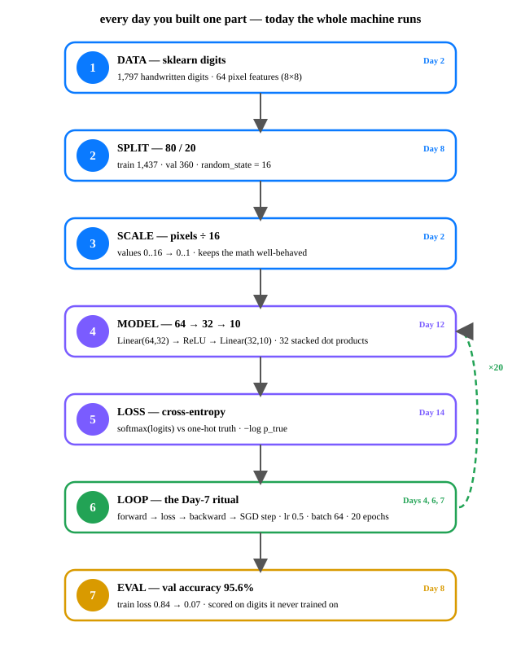

# Day 16 — Tiny Classifier on Real Data

**Tonight you'll be able to:** assemble every piece from Days 2–15 into one working machine — a neural net that reads handwritten digits at 95%+ accuracy.

## The one idea

Fifteen days, fifteen parts. Tonight they stop being parts. The task: read handwritten digits — real data, from sklearn's `digits` dataset: 1,797 grayscale 8×8 images, 64 pixel features each (values 0–16), labeled 0–9. Input: a 64-number pixel vector. Output: which digit.

This is **classification, not regression** — the target is a category, so the model can't emit one number. It emits **10 logits**, one per digit, and Day 14's cross-entropy scores them against the one-hot truth: `−log p_true`. Day 11's punchline returns: minimizing cross-entropy *is* maximum likelihood on the true class.

The model is three lines: `Linear(64, 32) → ReLU → Linear(32, 10)`. The first layer is Day 12 — 32 stacked dot products. The last layer is 10 more. One loan from the future sits between them: **ReLU**, `max(0, x)`. It bends the line so two stacked linear layers can learn curves instead of just planes. The full treatment (activations, why non-linearity matters) lands on Day 22; tonight it's one line, used not taught.

The training loop is Day 7's ritual, but **mini-batch**: instead of one big accurate gradient per step, each step sees 64 shuffled digits and makes ~22 cheap noisy steps per epoch. The noise is a feature — noisy steps converge far faster in wall-clock time and shake the optimizer out of flat spots. Everything else is muscle memory: `zero_grad`, forward, `loss.backward()`, `step()`.

## Analogy

**The integration test.** Days 2–15 were unit tests — each part proven alone. Tonight is the first deploy of the whole request path: data store, split (router), model (service), loss (health check), optimizer (auto-scaler). And like any good integration test, it runs against *real* data and reports a number you can't fake: accuracy on digits the model never trained on.

**The trading version:** this is a backtest harness — data feed, feature pipeline, model, scorer, validator. The val split is your out-of-sample period, and Day 8's rule holds: the model never sees it until scoring. Tonight's P&L: 95.6%.

## See it



Each box names the day that taught it — the dashed loop is one epoch, repeated 20×.

## Code it (~30 min)

On your MacBook (`~/ai-lab`, torch with MPS; `pip install scikit-learn` for the dataset — it's free): load the digits, split, assemble the three-line model, and run Day 7's ritual with mini-batches.

```python
"""Day 16 - Tiny Classifier on Real Data. See code.py for the runnable script."""
import torch
import torch.nn as nn
from sklearn.datasets import load_digits
from sklearn.model_selection import train_test_split

torch.manual_seed(16)
device = torch.device("mps" if torch.backends.mps.is_available() else "cpu")

X, y = load_digits(return_X_y=True)
X = X / 16.0
Xtr, Xva, ytr, yva = train_test_split(X, y, test_size=0.2, random_state=16)
Xtr = torch.tensor(Xtr, dtype=torch.float32).to(device)
Xva = torch.tensor(Xva, dtype=torch.float32).to(device)
ytr = torch.tensor(ytr, dtype=torch.long).to(device)
yva = torch.tensor(yva, dtype=torch.long).to(device)

model = nn.Sequential(
    nn.Linear(64, 32),   # Day 12: 32 stacked dot products
    nn.ReLU(),           # one-line loan from Day 22: bends the line
    nn.Linear(32, 10),   # 10 logits, one per digit
).to(device)
opt = torch.optim.SGD(model.parameters(), lr=0.5)
loss_fn = nn.CrossEntropyLoss()

EPOCHS, B = 20, 64
for epoch in range(1, EPOCHS + 1):
    model.train()
    perm = torch.randperm(len(Xtr), device=device)
    for i in range(0, len(Xtr), B):
        idx = perm[i:i + B]
        opt.zero_grad()
        loss = loss_fn(model(Xtr[idx]), ytr[idx])
        loss.backward()
        opt.step()
    if epoch in (1, 5, 10, 15, 20):
        model.eval()
        with torch.no_grad():
            tr_loss = loss_fn(model(Xtr), ytr).item()
            vacc = (model(Xva).argmax(1) == yva).float().mean().item()
        print(f"epoch {epoch:3d}  train loss {tr_loss:.4f}  val acc {vacc:.4f}")

model.eval()
with torch.no_grad():
    pred = model(Xva).argmax(1)
for i in range(6):
    print(f"  {yva[i].item()} -> {pred[i].item()}")
print(f"WIN: a neural net reading handwriting - val accuracy "
      f"{(pred == yva).float().mean().item():.4f}")
```

**Expected output** (reference numbers — your MacBook may differ in the last digits since its RNG stream differs, but you'll see the same story):

```
device: mps
dataset: 1797 samples, 64 features (8x8 pixels), 10 classes
train: 1437  val: 360
epoch   1  train loss 0.8442  val acc 0.6889
epoch   5  train loss 0.1742  val acc 0.9306
epoch  10  train loss 0.1188  val acc 0.9250
epoch  15  train loss 0.0915  val acc 0.9444
epoch  20  train loss 0.0703  val acc 0.9556

sample predictions (true -> pred):
  6 -> 6
  8 -> 8
  3 -> 3
  1 -> 1
  8 -> 8
  9 -> 9

WIN: a neural net reading handwriting - val accuracy 0.9556
```

## Today's win

Run `code.py` and confirm four things: (1) the dataset line reads `1797 samples, 64 features`; (2) train loss falls from `~0.84` to `~0.07`; (3) val accuracy climbs into the mid-90s on 360 digits the model never trained on; (4) the sample predictions all match.

**Done-state:** point at any line of the script and name the day that taught it — data (Day 2), split (Day 8), Linear (Day 12), cross-entropy (Day 14), the loop (Days 4, 6, 7). That's the whole Phase A machine in your head.

## Short on time? 20-minute version

Read **The one idea**, then set `EPOCHS = 5` and run the script. The non-negotiable moment: the `val acc` line jumping `0.69 → 0.93` in five epochs — five minutes of compute buying 93% accuracy on images it never saw.

## Tomorrow's teaser

Tomorrow: the model learned a little too eagerly — watch what happens when the training loss keeps falling and the validation score stops following.

*Streak: 16 day(s) · Never miss twice.*
