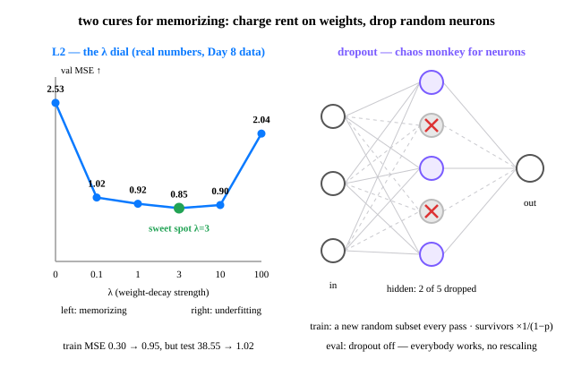

# Day 17 — Regularization: L2 & Dropout

**Tonight you'll be able to:** stop a model from memorizing — charge rent on big weights with L2, break neuron co-dependence with dropout, and watch a test score get rescued from 38.55 to 1.02.

## The one idea

Day 8 gave you the diagnosis: **train loss keeps falling while val loss bottoms out and rises** — the model is memorizing, not learning. Day 16's digits net never showed symptoms: clean data, honest split, 95.6%. But regularization is the brake you install *before* the data turns hostile — mislabeled rows, noisy features, too few samples. Real data is hostile. Market data is hostile squared.

**L2 — charge rent on weights.** Add a second term to the loss: `total loss = data loss + λ·Σw²`. Just-in-time math, one line: the gradient of that term is `2λw`, so every step drags each weight toward zero with a force *proportional to its size*. A weight must keep earning more loss-reduction than its rent, or it decays away. Noise-chasing weights are big and useless — evicted. Real-signal weights pay easily. In PyTorch you rarely write the term yourself: it's the `weight_decay=` argument on the optimizer. Solved exactly for a linear model (Part 1), it's called **ridge regression**. One exemption: the bias pays no rent — it's an offset, not a slope.

**λ is a dial, and val turns it.** Too small and the model still memorizes; too big and it underfits — too scared to learn anything at all. Part 1's sweep is a perfect U: val MSE 2.53 at λ=0, bottoming at **0.85 at λ=3**, back up to 2.04 at λ=100. Watch the weight norm while it happens: **1.89e+06 → 2.36**. The unregularized model's weights weren't large because the signal was large — they were large because nothing charged them rent.

**Dropout — break co-adaptation.** During training, every forward pass independently zeroes each hidden unit with probability `p` — a fresh lottery every pass. Survivors are scaled by `1/(1−p)` (inverted dropout), so the expected signal is unchanged and eval needs no adjustment. Why it works: units can't *collude*. A neuron can't specialize in memorizing one example's noise if its partners keep vanishing — every feature must be carried redundantly, by whichever subset shows up. You're effectively training an ensemble of sub-networks and averaging them at eval time.

**The train/eval switch is load-bearing.** Dropout exists only in train mode — that's why Day 16's `model.eval()` before scoring wasn't ceremony. Forget it, and your val score gets graded by a network with random holes in it. Rules of thumb: `weight_decay` 1e-4–1e-2 as a starting range, dropout `p` 0.1–0.5 on hidden layers (never the output), and the smaller or noisier the data — or the bigger the model — the harder you brake. Always tuned on val, never on test: Day 8's contract still runs the building.

## Analogy

**Chaos engineering for neurons.** Dropout is Netflix's Chaos Monkey pointed at your own network: randomly kill units in training so the system must serve correctly with *any* subset down. No single neuron gets to be load-bearing for a memorized path, because production (eval) is not when you want to discover a single point of failure. Redundancy is designed in, not hoped for.

**L2 is a storage bill.** You know this one from object storage: charge every team rent proportional to what it hoards, and junk gets lifecycle-deleted while data that earns its keep stays. λ·w² is that bill for weights — and it grows quadratically, so the biggest hoarders feel it first.

**The trading version:** position limits. L2 caps how large any single feature's bet can grow; dropout means your P&L can never hinge on one position being open. A strategy that only works when every indicator fires exactly as backtested is a memorized backtest — Day 8's curve-fit, wearing a suit.

## See it



Left: the λ U-curve on Day 8's exact data — val MSE bottoms at λ=3, and the test set (touched once, at the end) is rescued 38.55 → 1.02. Right: one dropout pass — a random 2 of 5 hidden neurons sit out; next pass, a different pair sits out.

## Code it (~30 min)

Three parts, one story. **Part 1** is exact math on Day 8's own data (ridge regression — no training loop, no luck). **Part 2** isolates dropout's mechanics on a vector of ones. **Part 3** returns to Day 16's digits, poisons 25% of the training labels, and races four identical nets that differ only in their brakes. Parts 1–2 run on CPU on purpose (float64 precision; seeded masks); Part 3 is a tiny net — the whole script takes a few minutes.

```python
"""Day 17 - Regularization: L2 & Dropout.

Day 8 showed the disease: a model with too many knobs memorizes noise -
train loss collapses while the honest scores explode. Day 16's digits
were too clean to bleed. Tonight: the two standard brakes, proven three
ways.

  Part 1  L2 (weight decay) rescues Day 8's degree-20 polynomial, with
          exact math. Loss becomes: data loss + lambda * sum(w^2). Every
          weight pays rent proportional to its size; only weights that
          earn their keep survive. lambda is picked on VAL (Day 8's
          contract); the test set is touched exactly once, at the end.
  Part 2  Dropout mechanics: in train mode each unit is zeroed with
          probability p, survivors scaled by 1/(1-p); in eval mode
          dropout is off. model.train() / model.eval() is not ceremony.
  Part 3  Both brakes on Day 16's digits - after poisoning 25% of the
          training labels. The unregularized net memorizes the corrupted
          labels (train acc 0.96 against labels a quarter of which are
          wrong) and pays for it on clean val data (0.84). The
          regularized nets refuse the bad labels - worse train scores,
          ~11 points better where it counts.

Runs on the ~/ai-lab venv: torch (Parts 1-2 on CPU - float64 and a
seeded generator; Part 3 is a tiny net) + scikit-learn for the dataset.
No CUDA, no paid APIs.

Expected output (Part 1 is exact - same numbers everywhere; Parts 2-3
are reference numbers from a numpy twin of the same algorithm - your
MacBook will differ in the last digits, the story will be identical):

  device: mps

  Part 1 - L2 on Day 8's degree-20 polynomial:
    lambda    train      val  ||weights||
       0.0     0.30     2.53     1.89e+06
       0.1     0.79     1.02         3.97
       1.0     0.85     0.92          2.8
       3.0     0.95     0.85         2.36
      10.0     1.28     0.90         1.82
     100.0     3.11     2.04        0.917
  val picks lambda = 3
  test (touched once): lambda=0 -> 38.55   lambda=3 -> 1.02

  Part 2 - dropout mechanics (p = 0.5):
    train pass 1: ~6 of 12 zeroed, survivors = 2.0
    train pass 2: a different ~6 of 12 zeroed, survivors = 2.0
    eval pass: 0 of 12 zeroed, output == input: True

  Part 3 - digits with 25% of training labels flipped:
  run                        train (fed) val (clean) ||weights||
  no regularization               0.9576      0.8389       41.82
  L2 only (wd=0.005)              0.7488      0.9444        9.29
  dropout only (p=0.3)            0.8664      0.8806       37.77
  L2 + dropout                    0.7418      0.9472        9.30
"""
import random

import torch
import torch.nn as nn
from sklearn.datasets import load_digits
from sklearn.model_selection import train_test_split

print("device:", "mps" if torch.backends.mps.is_available() else "cpu")

# ---------- Part 1: L2 rescues Day 8's degree-20 disaster (exact) ----------
# Same world as Day 8 (seed 42, pure-Python data, 40/20/40 split). One quiet
# fix: feature stats now come from TRAIN only - Day 8 used each split's own
# stats, a small leak. float64 on CPU on purpose: degree-20 polynomials are
# ill-conditioned, and MPS has no float64. Precision is the point here.
random.seed(42)
xs = [random.uniform(-2, 2) for _ in range(100)]
ys = [2 * x + 1 + random.gauss(0, 1.0) for x in xs]
idx = list(range(100))
random.shuffle(idx)
X = torch.tensor(xs, dtype=torch.float64)
Y = torch.tensor(ys, dtype=torch.float64)
Xtr, Ytr = X[idx[:40]], Y[idx[:40]]      # TRAIN: study material (Day 8)
Xva, Yva = X[idx[40:60]], Y[idx[40:60]]  # VAL: the judge - lambda is picked here
Xte, Yte = X[idx[60:]], Y[idx[60:]]      # TEST: the verdict - touched once, below


def design(xv, degree, mu=None, sd=None):
    """Polynomial features x..x^degree, standardized with train stats."""
    feats = torch.stack([xv ** p for p in range(1, degree + 1)], dim=1)
    if mu is None:
        mu, sd = feats.mean(0), feats.std(0, unbiased=False)
    z = (feats - mu) / sd
    return torch.cat([torch.ones(len(xv), 1, dtype=torch.float64), z], dim=1), mu, sd


Atr, mu, sd = design(Xtr, 20)
Ava, _, _ = design(Xva, 20, mu, sd)
Ate, _, _ = design(Xte, 20, mu, sd)
mse = lambda a, b: ((a - b) ** 2).mean().item()


def ridge(A, y, lam):
    """Solve min ||A b - y||^2 + lam * sum(b^2) exactly. Bias not penalized."""
    if lam == 0:
        beta, *_ = torch.linalg.lstsq(A, y.unsqueeze(1))
        return beta.squeeze(1)
    P = torch.eye(A.shape[1], dtype=torch.float64)
    P[0, 0] = 0.0  # the bias is an offset, not a slope - it pays no rent
    return torch.linalg.solve(A.T @ A + lam * P, A.T @ y)


print("\nPart 1 - L2 on Day 8's degree-20 polynomial:")
print(f"{'lambda':>8}{'train':>9}{'val':>9}{'||weights||':>13}")
best_lam, best_val, betas = None, float("inf"), {}
for lam in (0.0, 0.1, 1.0, 3.0, 10.0, 100.0):
    b = ridge(Atr, Ytr, lam)
    betas[lam] = b
    tr, va = mse(Atr @ b, Ytr), mse(Ava @ b, Yva)
    print(f"{lam:>8.1f}{tr:>9.2f}{va:>9.2f}{b.norm().item():>13.3g}")
    if va < best_val:
        best_val, best_lam = va, lam
print(f"val picks lambda = {best_lam:g}")
print(f"test (touched once): lambda=0 -> {mse(Ate @ betas[0.0], Yte):.2f}"
      f"   lambda={best_lam:g} -> {mse(Ate @ betas[best_lam], Yte):.2f}")

# ---------- Part 2: dropout mechanics (train mode != eval mode) ----------
# Seeded, on CPU, so the masks below are reproducible. p = 0.5: each unit
# is zeroed with probability 1/2; survivors are scaled by 1/(1-p) = 2, so
# the expected sum is unchanged and eval needs no rescaling (inverted
# dropout - this is what nn.Dropout does).
print("\nPart 2 - dropout mechanics (p = 0.5):")
torch.manual_seed(17)
drop = nn.Dropout(p=0.5)
x = torch.ones(12)
drop.train()
for i in (1, 2):
    out = drop(x)
    print(f"  train pass {i}: {(out == 0).sum().item()} of 12 zeroed,"
          f" survivors = {out[out != 0][0].item():.1f}")
drop.eval()
print(f"  eval pass: {(drop(x) == 0).sum().item()} of 12 zeroed,"
      f" output == input: {torch.equal(drop(x), x)}")

# ---------- Part 3: poisoned digits - both brakes on a real net ----------
# Day 16's digits and split discipline, one twist: 25% of the TRAINING
# labels are randomly flipped. Val labels stay clean - the honest judge.
# Memorizing is now measurable: the only way to score high against the
# fed labels is to learn answers that are wrong a quarter of the time.
Xd, yd = load_digits(return_X_y=True)
Xd = Xd / 16.0
Xtr, Xva, ytr, yva = train_test_split(Xd, yd, test_size=0.2,
                                      random_state=17, stratify=yd)
g = torch.Generator().manual_seed(17)
y_fed = torch.tensor(ytr, dtype=torch.long)
flip_idx = torch.randperm(len(y_fed), generator=g)[:len(y_fed) // 4]
y_fed[flip_idx] = torch.randint(0, 10, (len(flip_idx),), generator=g)
Xtr_t = torch.tensor(Xtr, dtype=torch.float32)
Xva_t = torch.tensor(Xva, dtype=torch.float32)
yva_t = torch.tensor(yva, dtype=torch.long)
print(f"\nPart 3 - digits with 25% of training labels flipped"
      f" ({len(flip_idx)} of {len(y_fed)} labels corrupted):")


def train_digits(wd, p):
    torch.manual_seed(17)  # same init for every run - a fair race
    net = nn.Sequential(
        nn.Linear(64, 256), nn.ReLU(), nn.Dropout(p),  # Day 12 + Part 2
        nn.Linear(256, 10),                            # 10 logits (Day 14)
    )
    opt = torch.optim.SGD(net.parameters(), lr=0.5, weight_decay=wd)
    loss_fn = nn.CrossEntropyLoss()                    # Day 14
    for epoch in range(80):
        perm = torch.randperm(len(Xtr_t))
        for i in range(0, len(Xtr_t), 32):
            j = perm[i:i + 32]
            opt.zero_grad()
            loss = loss_fn(net(Xtr_t[j]), y_fed[j])    # Day 7 ritual
            loss.backward()
            opt.step()
    net.eval()  # dropout OFF for scoring - Part 2's lesson, applied
    with torch.no_grad():
        acc = lambda X_, y_: (net(X_).argmax(1) == y_).float().mean().item()
        wnorm = sum(q.norm().item() ** 2 for name, q in net.named_parameters()
                    if name.endswith("weight")) ** 0.5
    return acc(Xtr_t, y_fed), acc(Xva_t, yva_t), wnorm


print(f"{'run':<26}{'train (fed)':>12}{'val (clean)':>12}{'||weights||':>12}")
for label, wd, p in (("no regularization", 0.0, 0.0),
                     ("L2 only (wd=0.005)", 0.005, 0.0),
                     ("dropout only (p=0.3)", 0.0, 0.3),
                     ("L2 + dropout", 0.005, 0.3)):
    tr, va, wn = train_digits(wd, p)
    print(f"{label:<26}{tr:>12.4f}{va:>12.4f}{wn:>12.2f}")
print("\nthe corrupted labels cap honest train accuracy near 0.75 + slack:")
print("scoring 0.96 against them means the net memorized wrong answers.")
print("WIN: both brakes score WORSE on fed labels and BETTER on clean val.")
```

**Expected output** (Part 1 is exact — same numbers everywhere; Parts 2–3 are reference numbers from a numpy twin of the same algorithm — your MacBook will differ in the last digits, the story will be identical; Part 2's zero-counts hover near 6 of 12 — the exact mask is a fresh lottery each run):

```
device: mps

Part 1 - L2 on Day 8's degree-20 polynomial:
  lambda    train      val  ||weights||
     0.0     0.30     2.53     1.89e+06
     0.1     0.79     1.02         3.97
     1.0     0.85     0.92          2.8
     3.0     0.95     0.85         2.36
    10.0     1.28     0.90         1.82
   100.0     3.11     2.04        0.917
val picks lambda = 3
test (touched once): lambda=0 -> 38.55   lambda=3 -> 1.02

Part 2 - dropout mechanics (p = 0.5):
  train pass 1: 6 of 12 zeroed, survivors = 2.0
  train pass 2: 5 of 12 zeroed, survivors = 2.0
  eval pass: 0 of 12 zeroed, output == input: True

Part 3 - digits with 25% of training labels flipped (359 of 1437 labels corrupted):
run                        train (fed) val (clean) ||weights||
no regularization               0.9576      0.8389       41.82
L2 only (wd=0.005)              0.7488      0.9444        9.29
dropout only (p=0.3)            0.8664      0.8806       37.77
L2 + dropout                    0.7418      0.9472        9.30

the corrupted labels cap honest train accuracy near 0.75 + slack:
scoring 0.96 against them means the net memorized wrong answers.
WIN: both brakes score WORSE on fed labels and BETTER on clean val.
```

## Today's win

Run `code.py` and confirm four receipts: (1) the λ sweep is a U — val falls 2.53 → 0.85 at λ=3, then rises to 2.04 at λ=100, while `||weights||` collapses 1.89e+06 → 2.36; (2) the test line reads `38.55 → 1.02`; (3) dropout train passes zero roughly half of 12 units with survivors exactly `2.0`, and the eval pass returns the input untouched; (4) in Part 3, both-brakes has the *worst* train score (0.7418) and the *best* clean val score (0.9472).

**Done-state:** you can explain, in one breath each, why a big weight must "pay rent", why a dropped neuron can't collude, and why `model.eval()` changes what your network *is* — not just what it reports.

## Short on time? 20-minute version

Run **Part 1 only** (comment out Parts 2–3): five minutes, exact numbers, the whole L2 story — U-curve, weight collapse, test rescued 38.55 → 1.02. Then read the dropout paragraphs of **The one idea**. The non-negotiable moment: the `||weights||` column falling from `1.89e+06` to `2.36` while the honest score *improves*.

## Tomorrow's teaser

Tomorrow: every training loop so far turned one knob — how big a step to take downhill. What changes when the stepper starts remembering where it's been, and adapts its stride per weight?

*Streak: 17 day(s) · Never miss twice.*
