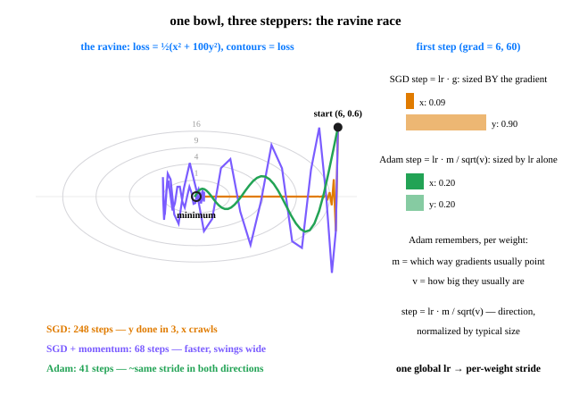

# Day 18 — Optimizers: SGD vs Adam

**Tonight you'll be able to:** explain why one global learning rate breaks when weights live on different scales — and watch Adam finish a race in 41 steps that takes plain SGD 248.

## The one idea

Every `optimizer.step()` you've written so far — Days 7, 16, 17 — was **plain SGD** (stochastic gradient descent): `w ← w − lr · grad`. One global learning rate, and each weight's step is *sized by its own gradient*. That works when every weight lives on roughly the same scale. Real models don't.

**The ravine.** Take `loss = ½(x² + 100y²)` — one direction 100× steeper than the other. The gradient at the start is `(6, 60)`. SGD's lr must stay under ~0.02 or the steep *y* direction explodes — so *y* dies in ~3 steps, then *x* crawls at 1.5% per step for the remaining 245. One lr is serving two geometries, and it can only satisfy the violent one. Tonight's race: **248 steps**.

**Momentum — SGD with a memory.** Keep a rolling velocity: each step adds the new gradient to a decaying average of past steps, then moves along the *velocity*. Gradients that keep pointing the same way build speed; the zigzag across the ravine walls cancels itself out. Same lr, same problem: **68 steps** — faster, but it swings wide on the way in, because a rolling ball doesn't stop on a dime.

**Adam — a learning rate per weight.** Adam keeps *two* rolling averages **per weight**: `m`, the mean gradient (which way, on average — momentum's job), and `v`, the mean *squared* gradient (how big gradients here usually are). The step is `lr · m / √v`: direction, *divided by typical size*. Watch the first step from `(6, 60)`: SGD steps `(0.09, 0.90)` — sized *by* the gradient. Adam steps `(0.20, 0.20)` — sized by `lr` alone, in both directions. That's the whole trick: when a weight's gradients are consistently huge, dividing by their typical size shrinks its stride to ~`lr`; when they're tiny, the same division *lifts* its stride to ~`lr`. The race: **41 steps**.

**What actually changes for you.** (1) Adam's default `lr` is `1e-3`, not SGD's — the number means something different now: it's a per-step stride cap, not a gradient multiplier. (2) Adam is far less sensitive to feature scaling — Part 2 fits a ×100 feature that poisons SGD completely (`MSE 9.44` vs Adam's `0.0111`, at the noise floor). (3) It's not free: Adam stores `m` and `v` for every weight — 2 extra numbers per parameter — and on some problems well-tuned SGD+momentum still reaches a slightly better final minimum. The working rule: **start with Adam, it's the forgiving default; reach for SGD+momentum when you're squeezing the last points and can afford to tune.** One Day-17 callback: in Adam, `weight_decay=` interacts with the normalization — the cleaned-up variant is a separate optimizer called AdamW. Same rent, collected properly.

## Analogy

**Adam is volatility-adjusted position sizing.** You'd never size a trade in raw dollars across names without looking at how much each one *moves*: a $700 stock swinging 3% a day and a $5 stock swinging 0.3% need completely different share counts to carry the same risk. SGD sizes every weight's step in raw gradient units — so the loudest feature silently sets the pace for the whole book. Adam is the vol-targeting version: divide each weight's signal by its own typical move (`√v` is literally a running RMS — a realized-vol estimate), and every weight advances at the same *risk-adjusted* pace.

**Momentum is a trend filter.** A moving average over past gradients: noise whipsaws cancel, a persistent direction compounds — exactly why you trust a 20-day trend over one day's candle. And the systems version: SGD is one global timeout for every downstream service; Adam is a *per-service* adaptive timeout, continuously re-estimated from each service's own observed latency.

## See it



The ravine, loss = ½(x² + 100y²). Orange: SGD kills the steep direction in 3 steps, then crawls 245 more along the shallow one. Purple: momentum builds speed and finishes in 68, swinging wide. Green: Adam strides ~lr in both directions at once &mdash; 41 steps, nearly straight in. Right: why &mdash; SGD's step is sized by the gradient; Adam's is sized by lr alone.

## Code it (~30 min)

Two races, one lesson. **Part 1** runs the ravine from the diagram in the open — three optimizers, same start, count the steps to `loss < 0.01`. **Part 2** is the Day 7 training loop on a regression whose second feature is scaled ×100 (truth: `w = (3, -0.02)`) — the optimizer is the *only* thing that changes between runs. Tiny problems on CPU on purpose: seeded, deterministic, identical numbers everywhere.

```python
"""Day 18 - Optimizers: SGD vs Adam.

Every optimizer.step() so far was plain SGD: w -= lr * grad, one global
learning rate, step size per weight dictated by that weight's gradient.
Fine when all weights live on the same scale - broken when they don't.

  Part 1  The ravine race. loss = 0.5*(x^2 + 100*y^2): the y direction
          is 100x steeper than x. One lr must serve both, so SGD kills
          y in ~3 steps then crawls along x for 248 steps. Momentum
          (a rolling velocity) cuts it to 68, swinging wide on the way.
          Adam keeps two per-weight averages - m (mean gradient) and
          v (mean squared gradient) - and steps lr * m/sqrt(v): each
          weight's stride is normalized by its own typical gradient,
          so both directions advance ~lr per step. 41 steps.
  Part 2  The same race inside the Day 7 training loop, on a regression
          whose second feature is scaled x100 (truth: w = (3, -0.02),
          b = 1, noise floor MSE ~ 0.01). The optimizer is the ONLY
          thing that changes between runs. SGD's lr is capped by the
          huge feature, so w1 barely moves in 300 epochs (MSE 9.44).
          Adam learns both weights at their own pace: MSE 0.0111,
          right at the noise floor.

Runs on the ~/ai-lab venv: torch only, tiny problems on CPU on purpose
(seeded, deterministic, identical numbers everywhere). No CUDA, no
paid APIs.

Expected output:

  Part 1 - the ravine: loss = 0.5*(x^2 + 100*y^2), start (6, 0.6)
  first step from start (gradient = (6, 60)):
    SGD  steps (0.090, 0.900)   <- sized BY the gradient
    Adam steps (0.200, 0.200)   <- sized by lr alone
  optimizer            lr  steps to loss < 0.01
  SGD                0.015                   248
  SGD + momentum     0.015                    68
  Adam               0.200                    41

  Part 2 - regression with a x100 feature (300 full-batch epochs):
  optimizer       loss@1  loss@100     final        w1       w2        b
  SGD             12.9728    9.8222    9.4366    0.0888  -0.01717   0.0289
  SGD + momentum  12.9728    8.3613    5.5815    0.7646  -0.01785   0.2494
  Adam            12.9728    0.0152    0.0111    3.0041  -0.02012   1.0044
  truth: w1 = 3, w2 = -0.02, b = 1, noise floor MSE ~ 0.01
"""
import random

import torch

# ---------- Part 1: the ravine race ----------
# loss = 0.5*(x^2 + 100*y^2). The gradient is (x, 100*y): at the start
# (6, 60). SGD's lr must stay under ~0.02 or the y direction explodes,
# which leaves the x direction crawling at 1.5% per step.
print("Part 1 - the ravine: loss = 0.5*(x^2 + 100*y^2), start (6, 0.6)")


def ravine(opt_name, lr):
    """Race one optimizer downhill; return (first-step, steps to <0.01)."""
    w = torch.tensor([6.0, 0.6], requires_grad=True)
    if opt_name == "sgd":
        opt = torch.optim.SGD([w], lr=lr)
    elif opt_name == "mom":
        opt = torch.optim.SGD([w], lr=lr, momentum=0.9)
    else:
        opt = torch.optim.Adam([w], lr=lr)
    first_step = None
    for step in range(1, 501):
        before = w.detach().clone()
        opt.zero_grad()                                # Day 7 ritual
        loss = 0.5 * (w[0] ** 2 + 100 * w[1] ** 2)
        loss.backward()
        opt.step()
        if first_step is None:
            first_step = (w.detach() - before).abs()
        with torch.no_grad():
            now = 0.5 * (w[0] ** 2 + 100 * w[1] ** 2)
        if now.item() < 0.01:
            return first_step, step
    return first_step, 500


s_sgd, n_sgd = ravine("sgd", 0.015)
s_mom, n_mom = ravine("mom", 0.015)
s_adam, n_adam = ravine("adam", 0.2)
print("first step from start (gradient = (6, 60)):")
print(f"  SGD  steps ({s_sgd[0]:.3f}, {s_sgd[1]:.3f})   <- sized BY the gradient")
print(f"  Adam steps ({s_adam[0]:.3f}, {s_adam[1]:.3f})   <- sized by lr alone")
print(f"{'optimizer':<16}{'lr':>6}{'steps to loss < 0.01':>22}")
print(f"{'SGD':<16}{0.015:>6.3f}{n_sgd:>22}")
print(f"{'SGD + momentum':<16}{0.015:>6.3f}{n_mom:>22}")
print(f"{'Adam':<16}{0.2:>6.3f}{n_adam:>22}")

# ---------- Part 2: badly-scaled features, Day 7 loop, optimizer swapped --
# Data from the pure-Python RNG (seed 18) so the numbers below reproduce
# exactly. Feature 2 is feature-shaped noise scaled x100, so its true
# weight is tiny (-2/100 = -0.02) while w1 = 3. Gradients inherit the
# scale mismatch: grad(w2) runs ~100x grad(w1).
random.seed(18)
n = 200
u1 = [random.gauss(0, 1) for _ in range(n)]
u2 = [random.gauss(0, 1) for _ in range(n)]
noise = [random.gauss(0, 0.1) for _ in range(n)]
X = torch.tensor([[a, 100 * b] for a, b in zip(u1, u2)])
y = torch.tensor([3 * a - 2 * b + 1 + e for a, b, e in zip(u1, u2, noise)])
print("\nPart 2 - regression with a x100 feature (300 full-batch epochs):")


def train(opt_name):
    w = torch.zeros(2, requires_grad=True)
    b = torch.zeros((), requires_grad=True)
    if opt_name == "sgd":
        opt = torch.optim.SGD([w, b], lr=5e-5)
    elif opt_name == "mom":
        opt = torch.optim.SGD([w, b], lr=5e-5, momentum=0.9)
    else:
        opt = torch.optim.Adam([w, b], lr=0.05)
    marks = {}
    for epoch in range(300):
        opt.zero_grad()
        loss = ((X @ w + b - y) ** 2).mean()           # forward + loss
        if epoch in (0, 99):
            marks[epoch] = loss.item()
        loss.backward()                                # backward
        opt.step()                                     # <- the ONLY swap
    with torch.no_grad():
        final = ((X @ w + b - y) ** 2).mean().item()
    return marks[0], marks[99], final, w.detach(), b.item()


print(f"{'optimizer':<16}{'loss@1':>9}{'loss@100':>10}{'final':>10}"
      f"{'w1':>9}{'w2':>10}{'b':>9}")
for name, key in (("SGD", "sgd"), ("SGD + momentum", "mom"), ("Adam", "adam")):
    l1, l100, fin, w, b = train(key)
    print(f"{name:<16}{l1:>9.4f}{l100:>10.4f}{fin:>10.4f}"
          f"{w[0]:>9.4f}{w[1]:>10.5f}{b:>9.4f}")
print("truth: w1 = 3, w2 = -0.02, b = 1, noise floor MSE ~ 0.01")
print("\nWIN: same loop, same data, same epochs - the stepper alone")
print("decides whether the x100 feature poisons the whole fit.")
```

**Expected output:**

```
Part 1 - the ravine: loss = 0.5*(x^2 + 100*y^2), start (6, 0.6)
first step from start (gradient = (6, 60)):
  SGD  steps (0.090, 0.900)   <- sized BY the gradient
  Adam steps (0.200, 0.200)   <- sized by lr alone
optimizer            lr  steps to loss < 0.01
SGD                0.015                   248
SGD + momentum     0.015                    68
Adam               0.200                    41

Part 2 - regression with a x100 feature (300 full-batch epochs):
optimizer       loss@1  loss@100     final        w1       w2        b
SGD             12.9728    9.8222    9.4366    0.0888  -0.01717   0.0289
SGD + momentum  12.9728    8.3613    5.5815    0.7646  -0.01785   0.2494
Adam            12.9728    0.0152    0.0111    3.0041  -0.02012   1.0044
truth: w1 = 3, w2 = -0.02, b = 1, noise floor MSE ~ 0.01
```

## Today's win

Run `code.py` and read the two tables. **Done when:** Part 1 shows **248 / 68 / 41**, and Part 2 shows Adam at **MSE 0.0111** with `w1 = 3.0041` recovered while SGD is still stuck at `9.4366` — then say the mechanism out loud once: *"Adam divides each weight's gradient by its own typical size, so every weight strides ~lr per step, whatever its scale."* You now know what the `step()` you've been calling actually decides — and why swapping one line changes whether a model trains at all.

## Short on time? 20-minute version

Run the script and study **Part 1 only**. Five minutes, three numbers: 248, 68, 41 — and the first-step pair `(0.09, 0.90)` vs `(0.20, 0.20)`, which *is* the entire idea in one line. Then skim the Adam paragraph of **The one idea**. Part 2's poisoned regression will still be there tomorrow.

## Tomorrow's teaser

Tomorrow: your loops have been handed neat little batches as if by magic. We open the pipe between the data on disk and the batch in your loop — and find out the order data arrives in is itself a training decision.

*Streak: 18 day(s) · Never miss twice.*
