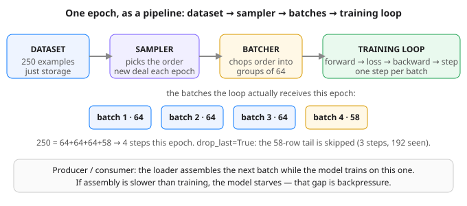

# Day 19 — Data Loaders & Batching

**Tonight you'll be able to:** replace hand-sliced training data with a DataLoader pipeline — and predict, for any dataset, exactly how many batches, steps, and skipped tails an epoch contains.

## The one idea

Every training loop so far sliced its data by hand — Day 16's loop chopped the digits set into mini-batches with index arithmetic you had to get right yourself. Today that plumbing becomes a component. A **Dataset** is just storage with two promises: `len()` says how many examples exist, and `dataset[i]` returns example *i* as an `(x, y)` pair. `TensorDataset` is the built-in one for tensors you already hold in memory. A **DataLoader** wraps a dataset and does the three jobs around it:

- **Sampler — picks the order.** Sequential (0, 1, 2, …) or shuffled. With `shuffle=True` the loader deals a *fresh permutation every epoch*: every example seen exactly once per epoch, in an order that changes. No example is skipped, none repeats — the deck is reshuffled, not redrawn.

- **Batcher — chops the order into groups of `batch_size`** and stacks each group into one tensor. 250 examples at 64 gives batches of 64, 64, 64 — and a short tail of 58. `drop_last=True` discards that tail instead (useful when a ragged batch would break a shape assumption downstream).

- **Feeder — hands the loop one batch at a time.** Your loop body stops being slicing code and becomes the Day 7 ritual, unchanged: `for xb, yb in loader:` forward → loss → backward → step.

Two consequences worth internalizing. **Steps are counted in batches, not epochs:** 256 examples at batch 32 is 8 optimizer steps per epoch — 30 epochs is 240 updates, versus 30 if you'd gone full-batch. Same data, 8× the learning opportunities; that's most of why mini-batch training converges so much faster in wall-clock terms. And **order is a training hyperparameter in disguise:** Part 2 feeds the model a label-sorted dataset without shuffling — batch 1 is 32/32 class 0, batch 5 is 32/32 class 1 — so each half-epoch drags the weights one way, then the other. Sorted inputs (by date, by ticker, by class) are the default state of real data dumps. Shuffling is what makes each batch a fair sample of the whole.

One honest boundary: shuffling assumes examples are *interchangeable*. For time series you'll shuffle the *training* rows only with care, and never shuffle across your train/val/test split — Day 8's chronological-split rule still stands. Tonight's data is i.i.d. (independent draws), so shuffle freely.

## Analogy

**A DataLoader is a batched consumer with backpressure — you've built this a dozen times.** Nobody ships a storage service that reads one object per request when the consumer can chew 64 at a time: per-request overhead dominates, the consumer starves between calls. So you batch — Kafka's `max.poll.records`, a TCP sender coalescing small writes, Conveyor packing objects into larger units before transfer. The loader is the producer side of that pipe: it assembles the next batch *while* the model trains on the current one (with `num_workers>0` it does so in parallel worker processes — on macOS start at 0 and raise carefully). If assembly is slower than training, the GPU idles between batches: that's backpressure made visible, and it shows up as a training loop that's slow for no obvious reason.

The trading version: **a batch is a block trade, an example is a single print.** Acting on one print at a time is noise-chasing — expensive and jittery. Aggregating into blocks gives each decision statistical weight at the cost of freshness. Batch size is that same dial: too small and gradients are noisy prints; too large and each update is stale and lumbering. 32–256 is where most tabular/image work lives.

## See it



The loader as a pipeline: storage (Dataset), ordering (Sampler), grouping (Batcher), consumption (your unchanged training loop). The sampler reshuffles the deck each epoch; the batcher chops whatever order it is handed.

## Code it (~30 min)

Three parts, all tiny and CPU-only so every number reproduces exactly. **Part 1** is anatomy — watch which rows land in which batch (the data *is* its own index). **Part 2** is the sorted-by-label trap and the shuffle fix. **Part 3** is your Day 7 loop with the hand-slicing deleted: the ritual inside is untouched, only the feeder changed. Run it in `~/ai-lab`:

```python
"""Day 19 - Data Loaders & Batching.

Until today every training loop sliced the data by hand. The DataLoader
is the pipeline that replaces the hand-slicing: a Dataset stores the
examples, a Sampler picks the order for this epoch, and the loader
hands the training loop one stacked batch tensor at a time.

  Part 1  Anatomy. 250 examples, batch_size=64: 4 batches, sizes
          [64, 64, 64, 58] - the tail batch is short. drop_last=True
          throws the tail away: 3 batches, 192 seen, 58 skipped.
  Part 2  Order matters. A dataset sorted by label (128 zeros, then
          128 ones) with shuffle=False feeds the model pure single-class
          batches - half the epoch pushes one way, half the other.
          shuffle=True deals a fresh permutation every epoch: same 256
          examples, each exactly once, in an order that changes.
  Part 3  The Day 7 loop, loader-fed. 256 examples, batch 32 -> 8
          steps per epoch, 240 steps over 30 epochs. Loss walks
          3.8638 -> 0.0097 (the noise floor); w, b land on the truth.

Runs on the ~/ai-lab venv: torch only, CPU on purpose (tiny data,
seeded, deterministic). No CUDA, no paid APIs. On your Mac the same
script also works unchanged on MPS - the loader doesn't care which
device the tensors move to afterwards.

Expected output:

  Part 1 - anatomy: 250 examples, batch_size=64
  dataset: 250 examples
  drop_last=False -> 4 batches, sizes [64, 64, 64, 58]
  first batch: X shape (64, 1), rows 0..63
  drop_last=True  -> 3 batches, 192 examples seen, 58 skipped per epoch

  Part 2 - sorted-by-label data, batch_size=32
  shuffle=False: batch 1 classes {0: 32, 1: 0}, batch 5 classes {0: 0, 1: 32}
  shuffle=True : every epoch covers all 256 examples exactly once: True
  shuffle=True : epoch 1 order == epoch 2 order: False (fresh deal each epoch)

  Part 3 - Day 7 loop on loader batches (256 examples, batch 32, SGD lr=0.05)
  steps per epoch: 8, total steps over 30 epochs: 240
    epoch   1  loss 3.8638
    epoch   2  loss 0.7389
    epoch   3  loss 0.1480
    epoch   5  loss 0.0147
    epoch  10  loss 0.0097
    epoch  30  loss 0.0097
  learned w = 2.4890, b = -1.0076  (truth: w = 2.5, b = -1, noise floor MSE ~ 0.01)
"""
import random

import torch
from torch.utils.data import DataLoader, TensorDataset

# ---------- Part 1: anatomy - dataset, batcher, the short tail ----------
# X[i] = i on purpose: you can watch exactly which rows land where.
print("Part 1 - anatomy: 250 examples, batch_size=64")
X = torch.arange(250, dtype=torch.float32).reshape(250, 1)
y = torch.arange(250) % 2
ds = TensorDataset(X, y)
print(f"dataset: {len(ds)} examples")

loader = DataLoader(ds, batch_size=64)                 # drop_last=False
sizes = [xb.shape[0] for xb, _ in loader]
print(f"drop_last=False -> {len(loader)} batches, sizes {sizes}")
xb0, _ = next(iter(loader))
print(f"first batch: X shape {tuple(xb0.shape)}, "
      f"rows {int(xb0[0, 0])}..{int(xb0[-1, 0])}")

loader_dl = DataLoader(ds, batch_size=64, drop_last=True)
seen = sum(xb.shape[0] for xb, _ in loader_dl)
print(f"drop_last=True  -> {len(loader_dl)} batches, {seen} examples seen, "
      f"{250 - seen} skipped per epoch")

# ---------- Part 2: order matters - the sorted-by-label trap ----------
# Labels sorted like a dataset dumped in date order: 128 down-days,
# then 128 up-days. With shuffle=False the batches are pure.
print("\nPart 2 - sorted-by-label data, batch_size=32")
labels = torch.cat([torch.zeros(128), torch.ones(128)]).long()
ds2 = TensorDataset(torch.zeros(256, 1), labels)
plain = DataLoader(ds2, batch_size=32, shuffle=False)
batches = list(plain)
c1 = torch.bincount(batches[0][1], minlength=2)
c5 = torch.bincount(batches[4][1], minlength=2)
print(f"shuffle=False: batch 1 classes {{0: {int(c1[0])}, 1: {int(c1[1])}}}, "
      f"batch 5 classes {{0: {int(c5[0])}, 1: {int(c5[1])}}}")

g = torch.Generator().manual_seed(19)
idx = torch.arange(256).reshape(256, 1).float()
ds_idx = TensorDataset(idx, labels)
shuffled_idx = DataLoader(ds_idx, batch_size=32, shuffle=True, generator=g)
e1 = torch.cat([xb[:, 0] for xb, _ in shuffled_idx]).long()
e2 = torch.cat([xb[:, 0] for xb, _ in shuffled_idx]).long()
print(f"shuffle=True : every epoch covers all 256 examples exactly once: "
      f"{bool((e1.sort().values == torch.arange(256)).all())}")
print(f"shuffle=True : epoch 1 order == epoch 2 order: "
      f"{bool((e1 == e2).all())} (fresh deal each epoch)")

# ---------- Part 3: the Day 7 loop, fed by a loader ----------
# Same ritual as Day 7 - forward, loss, backward, step - but the inner
# loop is now `for xb, yb in loader`. Data from the pure-Python RNG
# (seed 19) so these numbers reproduce exactly.
print("\nPart 3 - Day 7 loop on loader batches (256 examples, batch 32, "
      "SGD lr=0.05)")
random.seed(19)
n = 256
xs = [random.gauss(0, 1) for _ in range(n)]
noise = [random.gauss(0, 0.1) for _ in range(n)]
X3 = torch.tensor(xs, dtype=torch.float32).reshape(n, 1)
y3 = torch.tensor([2.5 * a - 1 + e for a, e in zip(xs, noise)],
                  dtype=torch.float32)
train_loader = DataLoader(TensorDataset(X3, y3), batch_size=32,
                          shuffle=False)
w = torch.zeros((), requires_grad=True)
b = torch.zeros((), requires_grad=True)
opt = torch.optim.SGD([w, b], lr=0.05)
steps = 0
for epoch in range(1, 31):
    epoch_loss = 0.0
    for xb, yb in train_loader:
        opt.zero_grad()                                # Day 7 ritual
        loss = ((xb[:, 0] * w + b - yb) ** 2).mean()   # forward + loss
        loss.backward()                                # backward
        opt.step()                                     # step
        epoch_loss += loss.item() * len(xb)
        steps += 1
    if epoch in (1, 2, 3, 5, 10, 30):
        print(f"  epoch {epoch:>3}  loss {epoch_loss / n:.4f}")
print(f"steps per epoch: {len(train_loader)}, "
      f"total steps over 30 epochs: {steps}")
print(f"learned w = {w.item():.4f}, b = {b.item():.4f}  "
      f"(truth: w = 2.5, b = -1, noise floor MSE ~ 0.01)")
```

**Expected output:**

```
Part 1 - anatomy: 250 examples, batch_size=64
dataset: 250 examples
drop_last=False -> 4 batches, sizes [64, 64, 64, 58]
first batch: X shape (64, 1), rows 0..63
drop_last=True  -> 3 batches, 192 examples seen, 58 skipped per epoch

Part 2 - sorted-by-label data, batch_size=32
shuffle=False: batch 1 classes {0: 32, 1: 0}, batch 5 classes {0: 0, 1: 32}
shuffle=True : every epoch covers all 256 examples exactly once: True
shuffle=True : epoch 1 order == epoch 2 order: False (fresh deal each epoch)

Part 3 - Day 7 loop on loader batches (256 examples, batch 32, SGD lr=0.05)
  epoch   1  loss 3.8638
  epoch   2  loss 0.7389
  epoch   3  loss 0.1480
  epoch   5  loss 0.0147
  epoch  10  loss 0.0097
  epoch  30  loss 0.0097
steps per epoch: 8, total steps over 30 epochs: 240
learned w = 2.4890, b = -1.0076  (truth: w = 2.5, b = -1, noise floor MSE ~ 0.01)
```

## Today's win

Done when: Part 1 prints batch sizes `[64, 64, 64, 58]` and drop_last reports `192 seen, 58 skipped`; Part 2 shows the pure batches (`32/0` then `0/32`) and both shuffle checks print as expected; Part 3 ends at loss `0.0097` with `240` total steps and w ≈ 2.489. You can now say, for any dataset and batch size, exactly how many optimizer steps one epoch contains — and why the loader, not your loop, owns that answer.

## Short on time? 20-minute version

Run Parts 1 and 2 only (~10 min of code), and read Part 3's loop once: notice it's the Day 7 ritual verbatim with `for xb, yb in loader` in place of manual slicing. The anatomy and the sorted-label trap are the durable ideas; the training run will wait for you.

## Tomorrow's teaser

Tomorrow, Day 20 closes Phase A: everything — tensors, autograd, losses, optimizers, regularization, loaders — collapses into one mental model: *learning is differentiable programming*. One page, whole phase, no new machinery.

*Streak: 19 day(s) · Never miss twice.*
