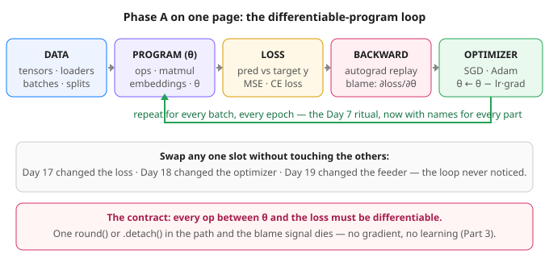

# Day 20 — Phase A Recap: Learning = Differentiable Programming

**Tonight you'll be able to:** look at any model you meet from here on and name its five moving parts — data, program, loss, backward, optimizer — and say why the whole field is just programs that can take criticism, quantitatively.

## The one idea

A normal program takes inputs and produces outputs. A **differentiable program** does one extra thing: every operation inside it also records how much its output would move if an input wiggled a hair. That sensitivity record is the *derivative*; chaining the records end-to-end is the chain rule; autograd (Day 4) is the tape recorder that keeps them. The **gradient** is all of those records collected for the parameters at once — the program's *blame vector*: one signed number per knob, saying "this knob pushed the error up; turn it this way to push it down."

**Learning is what happens when you wrap such a program in four more pieces and loop.** Nothing else has arrived in 20 days — every lesson was one slot of this machine:

- **DATA** — tensors and their shapes (Days 2–3), fed in batches by loaders (Day 19), split honestly into train/val/test (Day 8). Distributions (Day 10) and expectation/variance (Day 11) are the vocabulary this slot speaks.
- **PROGRAM** — a composition of tensor ops: matmul (Day 12), embeddings (Day 15), the little digits classifier (Day 16). Its adjustable knobs are the *parameters*, written θ. Why GPUs exist (Day 13) is why this slot runs fast.
- **LOSS** — one differentiable number scoring wrongness: MSE, cross-entropy (Days 5, 14) — and Day 11's reveal, that minimizing them *is* maximum likelihood in disguise. Day 17's regularization is just an extra term added to this same slot.
- **BACKWARD** — autograd replays the tape and returns ∂loss/∂θ for every knob (Day 4). Part 1 below checks its arithmetic by hand.
- **STEP** — an optimizer moves θ a little against the gradient (Days 6–7 by hand; Day 18, SGD vs Adam), and the loop repeats. Guardrails ride along: Day 8's split discipline and Day 17's penalties keep the loop honest.

Two payoffs. **First, slots swap independently:** you have already done it three times — Day 17 changed the loss, Day 18 changed the optimizer, Day 19 changed the feeder — and the rest of the machine never noticed. **Second, there is exactly one admission requirement:** every op between θ and the loss must be differentiable. Break it — a `round()`, a `.detach()` — and the blame vector comes back all zeros, or never exists at all (Part 3). When a model "isn't learning," this is the first place to look. And Day 9 was this whole machine pointed at real SPY closes: trend, regime change, honest failure and all.

## Analogy

You have run this loop in two other uniforms. In **incident response**, a total — "the service dropped 50K requests" — is useless until attribution says *which stage* dropped them; then you fix that stage and watch the total again. In **trading**, end-of-day P&L is just a number until attribution splits it by position: which name bled, which carried, by how much.

A plain program reports only the total — the loss. **A differentiable program ships the attribution built in:** `backward()` is a postmortem that runs on *every step*, naming each parameter's exact contribution to the error and the direction that would have helped. The optimizer is the on-call engineer who trusts the report and turns exactly those knobs, a little, thousands of times. Gradient descent is incident response with the postmortem automated.

## See it



The whole of Phase A as one loop: data feeds a differentiable program, the loss scores it, backward assigns blame to every parameter, the optimizer turns the knobs. Swap any slot and keep the loop — that has been the last 20 days.

## Code it (~30 min)

Three parts, all CPU and RNG-free so every digit reproduces exactly. **Part 1** dissects one tiny program and checks autograd's blame against the by-hand formula from Day 6. **Part 2** hands one generic `train()` loop two different programs — a line and a curve — to prove the loop never cared which program it was training. **Part 3** breaks the one contract on purpose. Run it in `~/ai-lab`:

```python
"""Day 20 - Phase A Recap: Learning = Differentiable Programming.

Phase A in one sentence: a model is an ordinary program built from
tensor ops; what makes it *learnable* is that every op also records
how its output moves when an input wiggles - its derivative. Chain
those records together and an optimizer can assign blame to every
parameter. That is the whole machine:

    DATA -> PROGRAM(theta) -> LOSS -> BACKWARD -> OPTIMIZER -> repeat

  Part 1  Dissect one program. pred = w*x + b on three points, scored
          by MSE. Autograd's gradients match the by-hand formula
          ("error times input", Day 6) exactly: dw = -18, db = -8.
  Part 2  One generic train() loop, two different programs - a line
          and a quadratic. The loop never inspects the program; swap
          the program and the parameter list and it just works.
  Part 3  Break the contract. Put round() between the parameters and
          the loss and the gradients come back exactly 0; detach()
          the output and the loss has no tape at all. If it is not
          differentiable, it cannot learn - no exceptions.

Runs on the ~/ai-lab venv: torch only, CPU on purpose (tiny data, no
RNG, every number exact). No CUDA, no paid APIs.

Expected output:

  Part 1 - one program, blame checked by hand
    predictions 0.5000, 1.0000, 1.5000, loss 17.5000
    autograd: dw = -18.0000, db = -8.0000
    by hand : dw = -18.0000, db = -8.0000  (match: True)

  Part 2 - same loop, two programs (full-batch SGD)
    program A (line,  lr=0.10, 100 epochs): loss 13.1525 -> 0.009800
      learned w = 2.4700, b = -0.9700  (truth: w = 2.5, b = -1)
    program B (curve, lr=0.05, 300 epochs): loss 15.9167 -> 0.000000
      learned a = 1.0000, b = -2.0000, c = 1.0000  (truth: a = 1, b = -2, c = 1)

  Part 3 - break the contract
    round() in the program: loss 16.6667, grads dw = 0.0000, db = 0.0000
    detached output: loss.requires_grad = False (no tape, nothing to replay)
"""
import torch

# ---------- Part 1: one program, blame checked by hand ----------
# The program: pred = w*x + b. The truth: y = 2x + 1. Start w=0.5, b=0.
print("Part 1 - one program, blame checked by hand")
x = torch.tensor([1.0, 2.0, 3.0])
y = torch.tensor([3.0, 5.0, 7.0])
w = torch.tensor(0.5, requires_grad=True)
b = torch.tensor(0.0, requires_grad=True)
pred = w * x + b                                   # the program runs
loss = ((pred - y) ** 2).mean()                    # one number: how wrong
loss.backward()                                    # blame, per parameter
preds = ", ".join(f"{v:.4f}" for v in pred.tolist())
print(f"  predictions {preds}, loss {loss.item():.4f}")
print(f"  autograd: dw = {w.grad.item():.4f}, db = {b.grad.item():.4f}")
dw_hand = (2 * (pred.detach() - y) * x).mean()     # Day 6: error x input
db_hand = (2 * (pred.detach() - y)).mean()
print(f"  by hand : dw = {dw_hand.item():.4f}, db = {db_hand.item():.4f}"
      f"  (match: {bool(w.grad == dw_hand and b.grad == db_hand)})")

# ---------- Part 2: same loop, two programs ----------
# One generic loop. It knows nothing about lines or curves - hand it a
# differentiable program, its parameters, data, and a loss, and it trains.
print("\nPart 2 - same loop, two programs (full-batch SGD)")


def train(program, params, X, Y, lr, epochs):
    opt = torch.optim.SGD(params, lr=lr)
    first = None
    for _ in range(epochs):
        opt.zero_grad()
        loss = ((program(X, *params) - Y) ** 2).mean()
        if first is None:
            first = loss.item()
        loss.backward()
        opt.step()
    with torch.no_grad():
        final = ((program(X, *params) - Y) ** 2).mean().item()
    return first, final


# Program A: a line, y = 2.5x - 1 plus a fixed wiggle (the "noise").
XA = torch.tensor([-2.0, -1.0, 0.0, 1.0, 2.0])
YA = torch.tensor([-5.8, -3.6, -1.0, 1.6, 3.95])
wA = torch.zeros((), requires_grad=True)
bA = torch.zeros((), requires_grad=True)
first, final = train(lambda X, w, b: w * X + b, [wA, bA], XA, YA,
                     lr=0.10, epochs=100)
print(f"  program A (line,  lr=0.10, 100 epochs): "
      f"loss {first:.4f} -> {final:.6f}")
print(f"    learned w = {wA.item():.4f}, b = {bA.item():.4f}  "
      f"(truth: w = 2.5, b = -1)")

# Program B: a curve, y = (x-1)^2 = x^2 - 2x + 1, no noise at all.
XB = torch.tensor([-2.0, -1.5, -1.0, -0.5, 0.0, 0.5, 1.0, 1.5, 2.0])
YB = (XB - 1) ** 2
aB = torch.zeros((), requires_grad=True)
bB = torch.zeros((), requires_grad=True)
cB = torch.zeros((), requires_grad=True)
first, final = train(lambda X, a, b, c: a * X ** 2 + b * X + c,
                     [aB, bB, cB], XB, YB, lr=0.05, epochs=300)
print(f"  program B (curve, lr=0.05, 300 epochs): "
      f"loss {first:.4f} -> {final:.6f}")
print(f"    learned a = {aB.item():.4f}, b = {bB.item():.4f}, "
      f"c = {cB.item():.4f}  (truth: a = 1, b = -2, c = 1)")

# ---------- Part 3: break the contract ----------
# Same program as Part 1, but round() sits between theta and the loss.
# Rounding is flat almost everywhere, so its derivative is 0 - the
# blame signal arrives as exactly zero and the optimizer has nothing.
print("\nPart 3 - break the contract")
w3 = torch.tensor(0.5, requires_grad=True)
b3 = torch.tensor(0.0, requires_grad=True)
loss3 = ((torch.round(w3 * x + b3) - y) ** 2).mean()
loss3.backward()
print(f"  round() in the program: loss {loss3.item():.4f}, "
      f"grads dw = {w3.grad.item():.4f}, db = {b3.grad.item():.4f}")
w4 = torch.tensor(0.5, requires_grad=True)
b4 = torch.tensor(0.0, requires_grad=True)
loss4 = (((w4 * x + b4).detach() - y) ** 2).mean()
print(f"  detached output: loss.requires_grad = {loss4.requires_grad} "
      f"(no tape, nothing to replay)")
```

**Expected output:**

```
Part 1 - one program, blame checked by hand
  predictions 0.5000, 1.0000, 1.5000, loss 17.5000
  autograd: dw = -18.0000, db = -8.0000
  by hand : dw = -18.0000, db = -8.0000  (match: True)

Part 2 - same loop, two programs (full-batch SGD)
  program A (line,  lr=0.10, 100 epochs): loss 13.1525 -> 0.009800
    learned w = 2.4700, b = -0.9700  (truth: w = 2.5, b = -1)
  program B (curve, lr=0.05, 300 epochs): loss 15.9167 -> 0.000000
    learned a = 1.0000, b = -2.0000, c = 1.0000  (truth: a = 1, b = -2, c = 1)

Part 3 - break the contract
  round() in the program: loss 16.6667, grads dw = 0.0000, db = 0.0000
  detached output: loss.requires_grad = False (no tape, nothing to replay)
```

## Today's win

Done when: Part 1 prints loss `17.5000` with autograd grads `−18.0000 / −8.0000` and `match: True`; Part 2 trains both programs through the *same* `train()` — line to loss `0.009800` (w 2.4700, b −0.9700), curve to `0.000000` (a/b/c = 1.0000 / −2.0000 / 1.0000); Part 3 prints grads of exactly `0.0000` and `requires_grad = False`. The bigger test: close the lesson and name the five slots — data, program, loss, backward, optimizer — and which day each came from. That is Phase A, held in one hand. Phase A: complete. 🎉

## Short on time? 20-minute version

Run Part 1 and Part 3 only (~12 min): the hand-checked gradient *is* the idea, and the zero gradients are its boundary. Skim the slot list in "The one idea." Do run Part 2 once this week, though — watching one loop train a curve it was never written for is the moment the mental model clicks shut.

## Tomorrow's teaser

Tomorrow Phase B begins. The loop you just named does not change at all — the program in the middle starts to grow.

*Streak: 20 day(s) · Never miss twice.*
