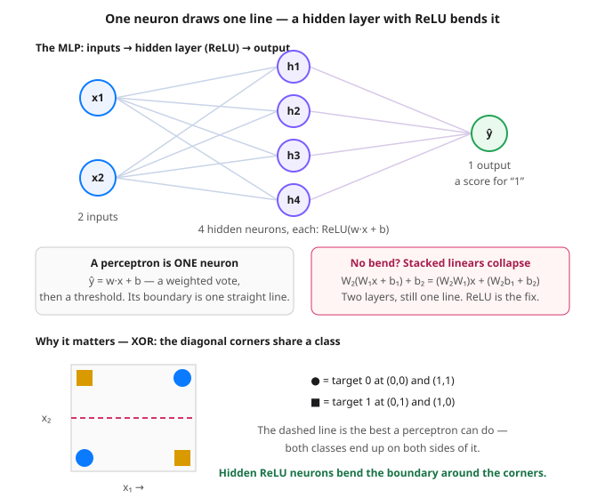

# Day 21 — Perceptron → MLP: Stacking Layers With Non-Linearities

**Tonight you'll be able to:** explain why stacking linear layers alone buys nothing, watch one neuron fail XOR in a very specific way, and train a tiny 2→4→1 MLP that solves it — your first real neural network.

## The one idea

Everything you have trained so far — the Day 6 line, the Day 16 digits classifier's last layer, Day 20's two programs — is built from one unit: the **neuron**, `w·x + b`. Day 12 showed it is just a dot product plus an offset: a weighted vote over the inputs. The original 1950s name for a single neuron with a threshold on its output is a **perceptron**: vote, then call it 1 if the vote clears the bar, else 0.

A perceptron's limit is geometric. The set of inputs where `w·x + b = 0` is a *straight line* (a plane in 3D, a hyperplane beyond that), and the perceptron can only ever split the world with that one line. If the classes are not **linearly separable** — no single line puts all of class 0 on one side and all of class 1 on the other — a perceptron cannot represent the answer, no matter how long it trains. Part 2 makes one try anyway.

The obvious fix is stacking: feed several neurons' outputs into another neuron — a **hidden layer**, so called because you never set its outputs directly; they are internal features the network invents. But stacking alone buys nothing, and Part 1 proves it with arithmetic: `W₂(W₁x + b₁) + b₂ = (W₂W₁)x + (W₂b₁ + b₂)`. Two linear layers in a row are *exactly* one linear layer with multiplied-out weights — still one straight line, just with extra steps and extra parameters saying the same thing.

The ingredient that changes everything is a **non-linearity** between the layers — tonight, **ReLU**: `max(0, z)`, pass positive votes through, floor the rest at zero. Each hidden neuron now computes a *folded* feature: its line still exists, but its output bends flat on one side of it. The output neuron adds up several folded pieces, and a sum of bends is a genuinely bent boundary — piecewise-straight segments that can wrap around corners a single line never could.

That stack — input → one or more hidden layers with non-linearities → output — is a **multi-layer perceptron (MLP)**, and it is the template for almost everything ahead: later architectures mostly change *what the layers compute*, not this stacking idea. The test case is **XOR**: output 1 when exactly one input is on. Its 1-corners sit diagonally opposite each other, so no line separates them (the diagram shows the best attempt) — the textbook example that killed perceptron hype in 1969 and that a two-layer MLP solves in Part 3.

## Analogy

You already own this intuition twice. In **trading**, an EMA of an EMA feels like a new indicator, but both are weighted averages of price — the composition is still just a weighted average of price, one linear filter wearing two coats. No genuinely new behavior appears until a rule has a *kink*: a stop that only fires below a level, a breakout rule that does nothing until price crosses — flat on one side, active on the other. That kink is ReLU's shape exactly.

In **systems**, the same law holds: chain two pipeline stages that only rescale and offset a metric and you have configured one rescale, however many boxes the diagram shows. Insert a circuit breaker — closed below a threshold, open above it — and the composed system can do things neither stage could alone. **Depth without non-linearity is bookkeeping; the kink is where new capability comes from.**

## See it



Top: the MLP — two inputs, a hidden layer of four ReLU neurons, one output. Middle: two linear layers collapse into one; a perceptron is a single neuron whose boundary is one straight line. Bottom: XOR's diagonal classes defeat every straight line — the hidden layer's bends are what get around the corners.

## Code it (~30 min)

Three parts, all CPU and RNG-free — the MLP's starting weights are set by hand (real training would draw them at random; Day 33 covers why the starting values matter), so every digit reproduces exactly. **Part 1** collapses two linear layers into one and checks the outputs match to the last decimal. **Part 2** trains a single neuron on XOR and watches it give up gracefully. **Part 3** adds the hidden ReLU layer and solves it. Run it in `~/ai-lab`:

```python
"""Day 21 - Perceptron to MLP: Stacking Layers With Non-Linearities.

Phase B opens with the smallest neural network there is. A perceptron
is one neuron: pred = w.x + b, a weighted vote whose decision boundary
is a single straight line. Stacking neurons into a hidden layer is
what turns that line into a curve - but ONLY if a non-linearity sits
between the layers.

  Part 1  Stack two linear layers with no bend and they collapse into
          one: W2(W1x + b1) + b2 = (W2W1)x + (W2b1 + b2). The two-layer
          outputs match the single effective layer exactly (diff 0).
  Part 2  One neuron vs XOR, the classic inseparable problem: the
          targets are 1 on the off-diagonal corners, 0 on the diagonal.
          Training converges to predicting 0.5 for everything - the
          loss parks at 0.2500, the honest "I cannot draw this line."
  Part 3  The same data, an MLP (2 -> 4 with ReLU -> 1), weights set
          by hand so every digit reproduces: loss 0.070625 -> 0.000005,
          all four corners called correctly. The hidden layer did not
          add a fancier line; it bent the boundary.

Runs on the ~/ai-lab venv: torch only, CPU on purpose (tiny data, no
RNG, every number exact). No CUDA, no paid APIs.

Expected output:

  Part 1 - two linear layers collapse into one
    effective W = [3.0000, 5.0000], b = 2.5000
    two layers : 5.5000, 7.5000, 10.5000, 3.5000
    one layer  : 5.5000, 7.5000, 10.5000, 3.5000
    max difference: 0.000000

  Part 2 - one neuron vs XOR (SGD, lr=0.5, 300 epochs)
    loss 0.4650 -> 0.2500
    predictions 0.5000, 0.5000, 0.5000, 0.5000  (correct: 2/4)

  Part 3 - MLP with a ReLU hidden layer vs XOR (SGD, lr=0.5, 100 epochs)
    loss 0.070625 -> 0.000005
    predictions 0.0032, 1.0000, 0.9999, -0.0029  (correct: 4/4)
"""
import torch
import torch.nn as nn

# ---------- Part 1: two linear layers collapse into one ----------
# Layer 1 maps 2 -> 3, layer 2 maps 3 -> 1. No non-linearity anywhere.
print("Part 1 - two linear layers collapse into one")
lin1 = nn.Linear(2, 3)
lin2 = nn.Linear(3, 1)
with torch.no_grad():
    lin1.weight.copy_(torch.tensor([[1.0, 2.0], [-1.0, 0.5], [0.0, 3.0]]))
    lin1.bias.copy_(torch.tensor([0.5, -1.0, 2.0]))
    lin2.weight.copy_(torch.tensor([[2.0, -1.0, 0.5]]))
    lin2.bias.copy_(torch.tensor([-0.5]))
X = torch.tensor([[1.0, 0.0], [0.0, 1.0], [1.0, 1.0], [2.0, -1.0]])
with torch.no_grad():
    two = lin2(lin1(X))                                # through both layers
    W_eff = lin2.weight @ lin1.weight                  # the collapse, in math
    b_eff = lin2.weight @ lin1.bias + lin2.bias
    one = X @ W_eff.T + b_eff                          # one single layer
print(f"  effective W = [{W_eff[0, 0]:.4f}, {W_eff[0, 1]:.4f}], "
      f"b = {b_eff.item():.4f}")
fmt = lambda t: ", ".join(f"{v:.4f}" for v in t.flatten().tolist())
print(f"  two layers : {fmt(two)}")
print(f"  one layer  : {fmt(one)}")
print(f"  max difference: {(two - one).abs().max().item():.6f}")

# ---------- Part 2: one neuron vs XOR ----------
# XOR targets: 1 when exactly one input is on. No straight line splits
# the 1-corners from the 0-corners (see the diagram), so the best a
# single neuron can do is shrug: predict 0.5 for every corner.
print("\nPart 2 - one neuron vs XOR (SGD, lr=0.5, 300 epochs)")
Xx = torch.tensor([[0.0, 0.0], [0.0, 1.0], [1.0, 0.0], [1.0, 1.0]])
y = torch.tensor([[0.0], [1.0], [1.0], [0.0]])
neuron = nn.Linear(2, 1)
with torch.no_grad():
    neuron.weight.copy_(torch.tensor([[0.2, -0.1]]))
    neuron.bias.copy_(torch.tensor([0.0]))
opt = torch.optim.SGD(neuron.parameters(), lr=0.5)
first = None
for _ in range(300):
    opt.zero_grad()
    loss = ((neuron(Xx) - y) ** 2).mean()
    if first is None:
        first = loss.item()
    loss.backward()
    opt.step()
with torch.no_grad():
    pred = neuron(Xx)
    final = ((pred - y) ** 2).mean().item()
    correct = int(((pred > 0.5) == (y > 0.5)).sum())
print(f"  loss {first:.4f} -> {final:.4f}")
print(f"  predictions {fmt(pred)}  (correct: {correct}/4)")

# ---------- Part 3: an MLP bends the boundary ----------
# Same XOR data, one new ingredient: a hidden layer of 4 neurons with
# ReLU between the two linear maps. Each hidden neuron still draws
# its own line, but ReLU folds its output at zero, and the output
# neuron adds up folded pieces - a bent, piecewise boundary.
# (Weights are set by hand instead of drawn at random, so the run is
# RNG-free and every digit below reproduces exactly.)
print("\nPart 3 - MLP with a ReLU hidden layer vs XOR (SGD, lr=0.5, 100 epochs)")
mlp = nn.Sequential(nn.Linear(2, 4), nn.ReLU(), nn.Linear(4, 1))
with torch.no_grad():
    mlp[0].weight.copy_(torch.tensor([[1.0, -1.0], [-1.0, 1.0],
                                      [0.5, 0.5], [-0.5, 0.8]]))
    mlp[0].bias.copy_(torch.tensor([0.0, 0.0, -0.5, 0.0]))
    mlp[2].weight.copy_(torch.tensor([[1.0, 1.0, 1.0, -0.5]]))
    mlp[2].bias.copy_(torch.tensor([0.0]))
opt = torch.optim.SGD(mlp.parameters(), lr=0.5)
first = None
for _ in range(100):
    opt.zero_grad()
    loss = ((mlp(Xx) - y) ** 2).mean()
    if first is None:
        first = loss.item()
    loss.backward()
    opt.step()
with torch.no_grad():
    pred = mlp(Xx)
    final = ((pred - y) ** 2).mean().item()
    correct = int(((pred > 0.5) == (y > 0.5)).sum())
print(f"  loss {first:.6f} -> {final:.6f}")
print(f"  predictions {fmt(pred)}  (correct: {correct}/4)")
```

**Expected output:**

```
Part 1 - two linear layers collapse into one
  effective W = [3.0000, 5.0000], b = 2.5000
  two layers : 5.5000, 7.5000, 10.5000, 3.5000
  one layer  : 5.5000, 7.5000, 10.5000, 3.5000
  max difference: 0.000000

Part 2 - one neuron vs XOR (SGD, lr=0.5, 300 epochs)
  loss 0.4650 -> 0.2500
  predictions 0.5000, 0.5000, 0.5000, 0.5000  (correct: 2/4)

Part 3 - MLP with a ReLU hidden layer vs XOR (SGD, lr=0.5, 100 epochs)
  loss 0.070625 -> 0.000005
  predictions 0.0032, 1.0000, 0.9999, -0.0029  (correct: 4/4)
```

## Today's win

Done when: Part 1 prints effective `W = [3.0000, 5.0000]`, `b = 2.5000` and a max difference of `0.000000` — the collapse, proven by your own run; Part 2 ends at loss `0.2500` predicting `0.5000` for all four corners (2/4 — a coin flip, the perceptron's honest surrender); Part 3 drives the loss from `0.070625` to `0.000005` with predictions `0.0032, 1.0000, 0.9999, −0.0029` and `correct: 4/4`. The bigger test: say out loud why the MLP won — not "more layers," but "a non-linearity between the layers, so the boundary could bend." Phase B is open. 🎉

## Short on time? 20-minute version

Run Part 1 and Part 3 only (~15 min): the zero difference *is* the collapse argument, and Part 3 is the payoff. Skim Part 2's output in the expected-output block — but do run it once this week; watching the loss park itself at exactly 0.2500 makes "linearly inseparable" a thing you have seen, not a phrase.

## Tomorrow's teaser

Tomorrow: a closer look at the bend itself — there is more than one way to make one, and which you pick changes how training behaves.

*Streak: 21 day(s) · Never miss twice.*
