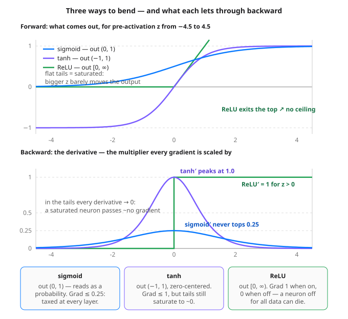

# Day 22 — Activation Functions: ReLU, Sigmoid & Tanh

**Tonight you'll be able to:** read the three classic activation shapes on sight, predict from a derivative alone whether a network will train fast or stall, and prove it by racing the same XOR network three ways.

## The one idea

Yesterday ReLU did its job unnamed in the middle of your first MLP. Today we name the job. An **activation function** is the small elementwise function applied to a neuron's weighted vote — the **pre-activation** `z = w·x + b` — before the value is passed on. Every neuron in every network you'll meet is `activation(w·x + b)`; the only question is which activation. Three classics cover almost everything.

**Sigmoid** — `σ(z) = 1 / (1 + e^−z)` — squashes any vote into (0, 1): big negative → 0, big positive → 1, `σ(0) = 0.5`. That range reads naturally as a probability, which is why sigmoid still owns the final layer of binary classifiers — it's the two-class sibling of Day 14's softmax. **Tanh** is sigmoid's zero-centered cousin — literally `tanh(z) = 2σ(2z) − 1` — squashing into (−1, 1), so its outputs can push the next layer *down* as well as up, and average near zero instead of near 0.5.

**ReLU** — `max(0, z)` — is barely a squash at all: negative votes are floored at 0, positive votes pass through *unchanged*, however large. No exponentials, nothing to compute beyond a comparison. It looks too simple to be the default hidden-layer activation of modern deep learning — until you look at the one property that actually decides training: the **derivative**.

Here's why. Day 4's chain rule says a gradient flowing backward through a neuron gets *multiplied* by that activation's derivative at the neuron's z. So each function's derivative caps how much learning signal survives a layer: **sigmoid′** is `σ(1−σ)`, which peaks at just **0.25** (at z = 0) and falls toward 0 in the tails; **tanh′** is `1 − tanh²`, peaking at **1.0** but with the same collapsing tails; **ReLU′** is a step — exactly **1** whenever z > 0, exactly **0** whenever z < 0. When a neuron's z sits far from 0, sigmoid and tanh are **saturated**: the output has flatlined, the derivative is ~0, and almost no gradient gets through — the neuron has effectively stopped learning. Stack enough taxed or saturated layers and the earliest layers receive a gradient of ~0 — the **vanishing gradient** problem, in one sentence.

ReLU's step has its own failure mode: a neuron whose z is negative for *every* training example outputs 0 and passes gradient 0, so its weights never update — a **dying ReLU**, flatlined for good. It happens in practice (a big learning-rate step can knock a neuron into the dead zone), and the one-line patch is variants that leak a small slope on the negative side; you'll meet the family later. The working rules for now: **hidden layers default to ReLU; the output layer wears the task** — sigmoid for a yes/no probability, softmax (Day 14) for many classes, *no* activation (a raw linear output, like all your regression so far) for predicting a number. Part 3 shows the tax is not theoretical: same network, same start, three activations, three very different finishes.

## Analogy

Think of the backward gradient as a **signal relayed through a chain of services** — your Day 4 request trace, run in reverse. Each hop doesn't just forward the signal; it *scales* it, by its activation's derivative at the value it saw. A chain of ReLU hops forwards at full strength (×1) wherever the neuron fired. A chain of sigmoid hops applies *at best* a ×0.25 haircut per hop: ten healthy hops turn a gradient of 1.0 into 0.0000009 — the early layers aren't slow learners, they're **deaf**; the alert never arrives. A saturated neuron is worse: a hop that returns ~0 no matter what you send it, like a service swallowing webhooks.

Trading version, same math: it's **compounding drag**. A strategy that keeps 25% of its edge per round trip doesn't have a quarter of the edge after ten trades — it has 0.25¹⁰ of it. Multiplicative chains punish any per-step factor below 1, relentlessly. That's the whole reason the *shape of a derivative curve* — a thing that looks like pure math — decides whether a deep network trains at all.

## See it



Top: the three shapes over the same input range — sigmoid and tanh flatten into saturated tails; ReLU keeps climbing. Bottom: their derivatives, the multipliers a backward gradient is scaled by at each neuron. A neuron trains only as fast as its derivative lets the signal through.

## Code it (~30 min)

Three parts, all CPU, all RNG-free — Part 3 reuses Day 21's hand-set starting weights, so its ReLU row must reproduce yesterday's numbers exactly (that's your regression test). **Part 1** prints the three shapes and lets autograd compute their derivatives. **Part 2** applies the chain-rule tax over 1, 5 and 10 hops. **Part 3** races the three activations inside the same XOR network. Run it in `~/ai-lab`:

```python
"""Day 22 - Activation Functions: ReLU, Sigmoid & Tanh.

Day 21 bent the boundary with ReLU and moved on. Today we shop the
bend itself. An activation function is the elementwise function
applied right after z = w.x + b, before the value passes on:

  Part 1  The three classic shapes on the same inputs, with their
          derivatives read off by autograd. Sigmoid squashes to
          (0, 1) and its derivative never tops 0.25. Tanh squashes
          to (-1, 1), zero-centered, derivative up to 1.0. ReLU is
          max(0, z): derivative exactly 1 when on, 0 when off.
  Part 2  The chain-rule tax. A gradient flowing backward is
          MULTIPLIED by the activation's derivative at every neuron
          it passes (Day 4). Through 10 neurons sitting at z = 2:
          sigmoid shrinks it to 1.6279e-10, tanh to 3.0986e-12,
          ReLU passes it through untouched at 1.0. Even at its
          best point (z = 0), sigmoid taxes every hop 4x.
  Part 3  The same XOR network from Day 21 - same hand-set starting
          weights, same optimizer - raced with each activation in
          the hidden layer. All three call the corners 4/4 after
          100 epochs, but the losses tell the real story: ReLU
          0.000005, tanh 0.000020, sigmoid 0.069563. Sigmoid got
          the direction right and the confidence wrong, because
          every gradient it learned from arrived taxed.

Runs on the ~/ai-lab venv: torch only, CPU on purpose (tiny data, no
RNG - starting weights are set by hand, so every digit reproduces
exactly). No CUDA, no paid APIs.

Expected output:

  Part 1 - three shapes on the same inputs, derivatives via autograd
    z       : -4.0000, -2.0000, -1.0000, 0.0000, 1.0000, 2.0000, 4.0000
    sigmoid : 0.0180, 0.1192, 0.2689, 0.5000, 0.7311, 0.8808, 0.9820
    sigmoid': 0.0177, 0.1050, 0.1966, 0.2500, 0.1966, 0.1050, 0.0177
    tanh    : -0.9993, -0.9640, -0.7616, 0.0000, 0.7616, 0.9640, 0.9993
    tanh'   : 0.0013, 0.0707, 0.4200, 1.0000, 0.4200, 0.0707, 0.0013
    relu    : 0.0000, 0.0000, 0.0000, 0.0000, 1.0000, 2.0000, 4.0000
    relu'   : 0.0000, 0.0000, 0.0000, 0.0000, 1.0000, 1.0000, 1.0000

  Part 2 - the chain-rule tax: gradient through neurons at z = 2
    sigmoid  grad 0.1050 -> after 1: 1.0499e-01, after 5: 1.2759e-05, after 10: 1.6279e-10
    tanh     grad 0.0707 -> after 1: 7.0651e-02, after 5: 1.7603e-06, after 10: 3.0986e-12
    relu     grad 1.0000 -> after 1: 1.0000e+00, after 5: 1.0000e+00, after 10: 1.0000e+00
    sigmoid at its best (z = 0, grad 0.2500): after 10: 9.5367e-07

  Part 3 - same XOR network, three activations (SGD, lr=0.5, 100 epochs)
    relu     loss 0.070625 -> 0.000005  predictions 0.0032, 1.0000, 0.9999, -0.0029  (correct: 4/4)
    tanh     loss 0.669811 -> 0.000020  predictions -0.0039, 0.9957, 0.9955, -0.0050  (correct: 4/4)
    sigmoid  loss 0.793775 -> 0.069563  predictions 0.3106, 0.7527, 0.7340, 0.2233  (correct: 4/4)
"""
import torch
import torch.nn as nn

fmt = lambda t: ", ".join(f"{v:.4f}" for v in t.flatten().tolist())

# ---------- Part 1: three shapes, derivatives via autograd ----------
# Same seven inputs through each function. The derivative rows come
# from autograd itself: sum the outputs, call backward(), read z.grad
# - Day 4's tape recorder doing the calculus for us.
print("Part 1 - three shapes on the same inputs, derivatives via autograd")
z = torch.tensor([-4.0, -2.0, -1.0, 0.0, 1.0, 2.0, 4.0],
                 requires_grad=True)
print(f"  {'z':8s}: {fmt(z)}")
for name, fn in [("sigmoid", torch.sigmoid), ("tanh", torch.tanh),
                 ("relu", torch.relu)]:
    if z.grad is not None:
        z.grad = None
    out = fn(z)
    out.sum().backward()
    print(f"  {name:8s}: {fmt(out)}")
    print(f"  {name + chr(39):8s}: {fmt(z.grad)}")

# ---------- Part 2: the chain-rule tax ----------
# Backprop multiplies the incoming gradient by the activation's
# derivative at each neuron (the chain rule from Day 4). If a signal
# passes through N neurons all sitting at the same z, it comes out
# scaled by derivative ** N. Watch what 10 hops do at z = 2.
print("\nPart 2 - the chain-rule tax: gradient through neurons at z = 2")
for name, fn in [("sigmoid", torch.sigmoid), ("tanh", torch.tanh),
                 ("relu", torch.relu)]:
    zz = torch.tensor([2.0], requires_grad=True)
    fn(zz).backward()
    d = zz.grad.item()
    print(f"  {name:8s} grad {d:.4f} -> after 1: {d:.4e}, "
          f"after 5: {d ** 5:.4e}, after 10: {d ** 10:.4e}")
print(f"  sigmoid at its best (z = 0, grad 0.2500): "
      f"after 10: {0.25 ** 10:.4e}")

# ---------- Part 3: same network, three activations ----------
# Day 21's XOR race, rerun as a controlled experiment: identical
# hand-set starting weights, data, optimizer and epoch count - the
# ONLY thing that changes is the hidden layer's activation.
print("\nPart 3 - same XOR network, three activations "
      "(SGD, lr=0.5, 100 epochs)")
Xx = torch.tensor([[0.0, 0.0], [0.0, 1.0], [1.0, 0.0], [1.0, 1.0]])
y = torch.tensor([[0.0], [1.0], [1.0], [0.0]])


def train(act):
    mlp = nn.Sequential(nn.Linear(2, 4), act, nn.Linear(4, 1))
    with torch.no_grad():
        mlp[0].weight.copy_(torch.tensor([[1.0, -1.0], [-1.0, 1.0],
                                          [0.5, 0.5], [-0.5, 0.8]]))
        mlp[0].bias.copy_(torch.tensor([0.0, 0.0, -0.5, 0.0]))
        mlp[2].weight.copy_(torch.tensor([[1.0, 1.0, 1.0, -0.5]]))
        mlp[2].bias.copy_(torch.tensor([0.0]))
    opt = torch.optim.SGD(mlp.parameters(), lr=0.5)
    first = None
    for _ in range(100):
        opt.zero_grad()
        loss = ((mlp(Xx) - y) ** 2).mean()
        if first is None:
            first = loss.item()
        loss.backward()
        opt.step()
    with torch.no_grad():
        pred = mlp(Xx)
        final = ((pred - y) ** 2).mean().item()
        correct = int(((pred > 0.5) == (y > 0.5)).sum())
    return first, final, pred, correct


for name, act in [("relu", nn.ReLU()), ("tanh", nn.Tanh()),
                  ("sigmoid", nn.Sigmoid())]:
    first, final, pred, correct = train(act)
    print(f"  {name:8s} loss {first:.6f} -> {final:.6f}  "
          f"predictions {fmt(pred)}  (correct: {correct}/4)")
```

**Expected output:**

```
Part 1 - three shapes on the same inputs, derivatives via autograd
  z       : -4.0000, -2.0000, -1.0000, 0.0000, 1.0000, 2.0000, 4.0000
  sigmoid : 0.0180, 0.1192, 0.2689, 0.5000, 0.7311, 0.8808, 0.9820
  sigmoid': 0.0177, 0.1050, 0.1966, 0.2500, 0.1966, 0.1050, 0.0177
  tanh    : -0.9993, -0.9640, -0.7616, 0.0000, 0.7616, 0.9640, 0.9993
  tanh'   : 0.0013, 0.0707, 0.4200, 1.0000, 0.4200, 0.0707, 0.0013
  relu    : 0.0000, 0.0000, 0.0000, 0.0000, 1.0000, 2.0000, 4.0000
  relu'   : 0.0000, 0.0000, 0.0000, 0.0000, 1.0000, 1.0000, 1.0000

Part 2 - the chain-rule tax: gradient through neurons at z = 2
  sigmoid  grad 0.1050 -> after 1: 1.0499e-01, after 5: 1.2759e-05, after 10: 1.6279e-10
  tanh     grad 0.0707 -> after 1: 7.0651e-02, after 5: 1.7603e-06, after 10: 3.0986e-12
  relu     grad 1.0000 -> after 1: 1.0000e+00, after 5: 1.0000e+00, after 10: 1.0000e+00
  sigmoid at its best (z = 0, grad 0.2500): after 10: 9.5367e-07

Part 3 - same XOR network, three activations (SGD, lr=0.5, 100 epochs)
  relu     loss 0.070625 -> 0.000005  predictions 0.0032, 1.0000, 0.9999, -0.0029  (correct: 4/4)
  tanh     loss 0.669811 -> 0.000020  predictions -0.0039, 0.9957, 0.9955, -0.0050  (correct: 4/4)
  sigmoid  loss 0.793775 -> 0.069563  predictions 0.3106, 0.7527, 0.7340, 0.2233  (correct: 4/4)
```

## Today's win

Done when: Part 1's derivative rows peak exactly where the diagram says — `sigmoid'` tops out at `0.2500`, `tanh'` at `1.0000`, `relu'` is a clean 0/1 step; Part 2 shows a gradient through 10 neurons at z = 2 shrinking to `1.6279e-10` (sigmoid) and `3.0986e-12` (tanh) while ReLU passes `1.0000e+00` untouched; Part 3 reproduces Day 21's ReLU row (`0.070625 → 0.000005`) and finishes tanh at `0.000020` against sigmoid's `0.069563` — all three 4/4 on corners, wildly different losses. The bigger test: state the picking rule out loud — hidden layers ReLU by default, sigmoid only where a probability comes out, and the derivative tells you the gradient's fate before you train a single step.

## Short on time? 20-minute version

Run Part 1 and Part 3 (~15 min): the derivative table *is* the theory, and the race is the proof. Part 2's arithmetic is worth a slow read later — it's the seed of every "why won't my deep net train?" debugging session you'll ever have.

## Tomorrow's teaser

Tomorrow: follow one gradient on its trip back through the layers, and see how each layer finds out how much of the mistake was its fault.

*Streak: 22 day(s) · Never miss twice.*
