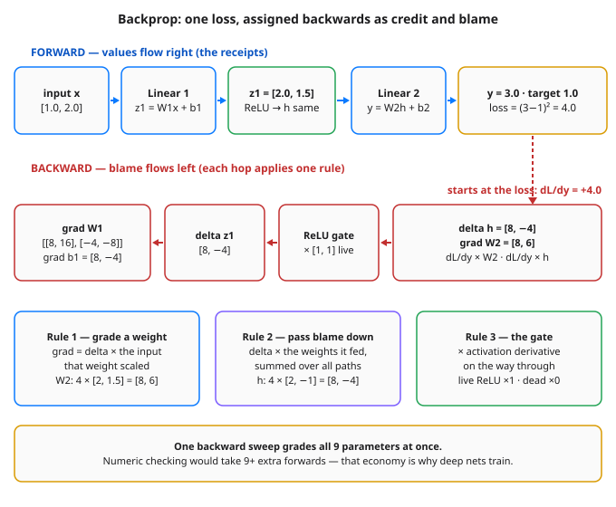

# Day 23 — Backprop Intuition: Credit Assignment Through Layers

**Tonight you'll be able to:** trace one loss backwards through a small network by hand — assigning each layer its share of the blame with three local rules — and watch your hand-computed gradients match autograd on all 9 parameters, exactly.

## The one idea

Every backward pass you've run since Day 4 has been a black box with a button: `loss.backward()`. Today we open the box — not with a derivation, but by following the money. **Backpropagation** is just **credit assignment**: the loss is a single number at the end, and backprop decides, for every weight in the network, *how much of that number was your fault, and in which direction*. It does it with one signal and three local rules.

The signal is **delta** (δ) — the blame arriving at a value: `dL/d(value)`, "if this value had been a little bigger, how much would the loss have changed?" Backprop starts at the output, where delta is easy: for your by-now-familiar `loss = (y − t)²`, `dL/dy = 2(y − t)`. Today's network predicts 3.0 against a target of 1.0, so delta starts at **+4.0** — positive, meaning "y being *smaller* would have helped." Everything upstream is computed from that one number, working backwards, one hop at a time.

**Rule 1 — a weight's gradient is delta times the input that weight scaled.** The output weights multiplied the hidden activations `h = [2.0, 1.5]`, so `grad W2 = 4.0 × [2.0, 1.5] = [8.0, 6.0]` — the weight that amplified the bigger activation gets the bigger grade. You already know this rule: it's Day 6's hand-derived *"error times input,"* and Day 20's blame vector, just seen one layer up. A bias is the same rule with input 1, so its gradient is delta itself. **Rule 2 — blame passed down is delta times the weights.** Hidden neuron 1 fed the output through weight 2.0 and neuron 2 through −1.0, so the blame arriving at `h` is `4.0 × [2.0, −1.0] = [8.0, −4.0]`: neuron 2's blame is *negative* because its weight was — had it fired *more*, the loss would have dropped. When a value feeds several neurons, it collects the sum over all of them — blame adds up across every path it influenced. **Rule 3 — crossing an activation multiplies by its derivative.** That's Day 22's gate, doing its job in situ: both hidden neurons are live ReLUs here, so blame passes ×1 unchanged; Part 2 shows the ×0 case.

Apply the same three rules one more hop and you get `grad W1 = [[8, 16], [−4, −8]]` — delta as a column, input as a row, multiplied out (an *outer product*). And here's the economy that makes deep learning possible: **one forward pass plus one backward sweep grades every parameter in the network** — all 9 here, all billions in a big model, at roughly the cost of the forward pass itself. The naive alternative — nudge each weight, re-run, measure — costs a full forward pass *per weight*. Backprop isn't a nicety; it's the only reason networks with more than a handful of weights can train at all.

## Analogy

Backprop is an **incident postmortem with numbers**. The loss is the outage cost, measured at the edge. The review walks the request trace *backwards* — the same trace Day 4's autograd recorded — and at each service asks: how much of this damage passed through you, and how strongly were you coupled to the failure? A service on the hot path with a big multiplier (a retry storm amplifying a downstream error ×2) gets most of the blame; a service that was **feature-flagged off** for that request gets none — and, just as important, passes none further back, because nothing flowed through it. That's Part 2's dead ReLU, exactly: zero in, zero out, zero blame, in both directions.

Trading version: it's **P&L attribution**. The book lost $4.0 — you don't shrug at the total, you decompose it by position: attribution = price move × exposure. The position held at twice the size takes twice the blame; a hedge with the opposite sign shows up as *negative* blame — it was pulling the right way. A position you didn't hold (exposure 0) gets exactly zero attribution no matter how violently its market moved. Delta × what-it-scaled is how every trading desk already assigns credit; backprop is that habit, mechanized and run backwards through a function.

## See it



Top: the forward pass — every value it computes is a receipt the backward pass will use. Bottom: blame starts at the loss as dL/dy = +4.0 and flows left; each hop either grades the weights it passes (delta × input), routes blame onward (delta × weights), or gates it (× the activation's derivative).

## Code it (~30 min)

Three parts, all CPU, all RNG-free — every weight is set by hand, so every digit reproduces. **Part 1** runs the forward pass, then applies the three rules by hand and checks them against autograd. **Part 2** feeds an input that kills one hidden neuron and watches its credit stop in both directions. **Part 3** takes one real SGD step using only the hand-computed gradients. Run it in `~/ai-lab`:

```python
"""Day 23 - Backprop Intuition: Credit Assignment Through Layers.

Days 4 and 7 let autograd do the backward pass. Today we do ONE
backward pass by hand on a tiny 2 -> 2 (ReLU) -> 1 network and watch
how the loss's blame is assigned, layer by layer. No derivation -
just three local rules, applied in reverse:

  Rule 1  A weight's gradient = the delta arriving at its output
          TIMES the input that weight multiplied.
          (Day 6's "error times input", one layer up.)
  Rule 2  Blame passed down to an input = delta TIMES the weights
          that input fed, summed over every neuron it touched.
  Rule 3  Crossing an activation multiplies by its derivative
          (Day 22): a live ReLU passes blame x1, a dead one x0.

  Part 1  Forward + hand backprop on x = (1, 2): the prediction is
          3.0 against a target of 1.0, loss 4.0. The hand-computed
          gradients match autograd on all 9 parameters exactly.
  Part 2  A second input, x = (2, 0), leaves hidden neuron 2 dead
          (z = -1.5). It gets a double zero: its outgoing weight's
          gradient is 0 because its activation was 0, and its
          incoming weights get 0 because the ReLU gate blocks the
          blame on its way down.
  Part 3  One SGD step (lr = 0.01) using Part 1's hand gradients:
          loss 4.000000 -> 0.285156. Nine parameters graded, one
          backward sweep - that economy is why deep nets can train
          at all.

Runs on the ~/ai-lab venv: torch only, CPU on purpose (tiny data, no
RNG - every weight is set by hand, so every digit reproduces
exactly). No CUDA, no paid APIs.

Expected output:

  Part 1 - forward pass: x = (1.0, 2.0), target 1.0
    z1 (pre-activation): 2.0000, 1.5000
    h  (after ReLU)    : 2.0000, 1.5000
    y = 3.0000   loss = 4.0000   dL/dy = 4.0000

  Part 1 - backward pass, by hand (the three rules)
    grad W2 = delta * h        : 8.0000, 6.0000   grad b2 = 4.0000
    delta_h = delta * W2       : 8.0000, -4.0000
    delta_z1 = delta_h * ReLU' : 8.0000, -4.0000
    grad W1 = delta_z1 x x     : [8.0000, 16.0000], [-4.0000, -8.0000]
    grad b1                    : 8.0000, -4.0000
    grad x  = W1^T x delta_z1  : 12.0000, 0.0000
    autograd max diff vs hand  : 0.000000  (9 parameters, 1 backward sweep)

  Part 2 - the dead neuron gets no credit and passes none
    z1: 2.0000, -1.5000   h: 2.0000, 0.0000   y = 4.5000   loss = 12.2500
    dL/dy = 7.0000
    grad W2: 14.0000, 0.0000  <- dead neuron's activation was 0
    delta_h: 14.0000, -7.0000
    delta_z1 after the ReLU gate: 14.0000, 0.0000  <- gate blocks the rest
    grad W1 row for the dead neuron: 0.0000, 0.0000

  Part 3 - one SGD step on Part 1's hand gradients (lr = 0.01)
    loss 4.000000 -> 0.285156   new y = 1.534000
"""
import torch

fmt = lambda t: ", ".join(f"{v:.4f}" for v in t.flatten().tolist())

# The network, with every weight set by hand (no RNG anywhere):
#   z1 = W1 @ x + b1   (2 hidden pre-activations)
#   h  = relu(z1)
#   y  = W2 @ h + b2   (one number out)
W1 = torch.tensor([[1.0, 0.5], [-1.0, 1.0]])
b1 = torch.tensor([0.0, 0.5])
W2 = torch.tensor([2.0, -1.0])
b2 = torch.tensor(0.5)
TARGET = 1.0


def forward(x):
    z1 = W1 @ x + b1
    h = torch.relu(z1)
    y = W2 @ h + b2
    return z1, h, y


def manual_backward(x, z1, h, y):
    """The three rules, in reverse order. Returns every gradient."""
    dy = 2.0 * (y - TARGET)              # dL/dy for loss = (y - t)^2
    gW2 = dy * h                         # Rule 1: delta x what it scaled
    gb2 = dy                             # bias multiplied "1"
    dh = dy * W2                         # Rule 2: blame down, per neuron
    dz1 = torch.where(z1 > 0, dh, torch.zeros_like(dh))  # Rule 3: gate
    gW1 = torch.outer(dz1, x)            # Rule 1 again, as an outer product
    gb1 = dz1
    gx = W1.T @ dz1                      # Rule 2 again, summed over neurons
    return dy, gW2, gb2, dh, dz1, gW1, gb1, gx


# ---------- Part 1: forward, then backprop by hand ----------
print("Part 1 - forward pass: x = (1.0, 2.0), target 1.0")
x = torch.tensor([1.0, 2.0])
z1, h, y = forward(x)
loss = (y - TARGET) ** 2
print(f"  z1 (pre-activation): {fmt(z1)}")
print(f"  h  (after ReLU)    : {fmt(h)}")
dy, gW2, gb2, dh, dz1, gW1, gb1, gx = manual_backward(x, z1, h, y)
print(f"  y = {y.item():.4f}   loss = {loss.item():.4f}   "
      f"dL/dy = {dy.item():.4f}")

print("\nPart 1 - backward pass, by hand (the three rules)")
print(f"  grad W2 = delta * h        : {fmt(gW2)}   "
      f"grad b2 = {gb2.item():.4f}")
print(f"  delta_h = delta * W2       : {fmt(dh)}")
print(f"  delta_z1 = delta_h * ReLU' : {fmt(dz1)}")
print(f"  grad W1 = delta_z1 x x     : [{fmt(gW1[0])}], [{fmt(gW1[1])}]")
print(f"  grad b1                    : {fmt(gb1)}")
print(f"  grad x  = W1^T x delta_z1  : {fmt(gx)}")

# Check the hand work against autograd (Day 4's tape recorder).
aW1 = W1.clone().requires_grad_(True)
ab1 = b1.clone().requires_grad_(True)
aW2 = W2.clone().requires_grad_(True)
ab2 = b2.clone().requires_grad_(True)
ay = aW2 @ torch.relu(aW1 @ x + ab1) + ab2
((ay - TARGET) ** 2).backward()
diffs = [(aW1.grad - gW1).abs().max(), (ab1.grad - gb1).abs().max(),
         (aW2.grad - gW2).abs().max(), (ab2.grad - gb2).abs().max()]
n_params = W1.numel() + b1.numel() + W2.numel() + b2.numel()
print(f"  autograd max diff vs hand  : "
      f"{max(d.item() for d in diffs):.6f}  "
      f"({n_params} parameters, 1 backward sweep)")

# ---------- Part 2: the dead neuron ----------
# Same weights, new input: hidden neuron 2's pre-activation goes
# negative, so ReLU outputs 0 - and BOTH directions of credit stop.
print("\nPart 2 - the dead neuron gets no credit and passes none")
x2 = torch.tensor([2.0, 0.0])
z1d, hd, yd = forward(x2)
lossd = (yd - TARGET) ** 2
dyd, gW2d, _, dhd, dz1d, gW1d, _, _ = manual_backward(x2, z1d, hd, yd)
print(f"  z1: {fmt(z1d)}   h: {fmt(hd)}   "
      f"y = {yd.item():.4f}   loss = {lossd.item():.4f}")
print(f"  dL/dy = {dyd.item():.4f}")
print(f"  grad W2: {fmt(gW2d)}  <- dead neuron's activation was 0")
print(f"  delta_h: {fmt(dhd)}")
print(f"  delta_z1 after the ReLU gate: {fmt(dz1d)}  "
      f"<- gate blocks the rest")
print(f"  grad W1 row for the dead neuron: {fmt(gW1d[1])}")

# ---------- Part 3: one step on the hand gradients ----------
# Plain SGD, p <- p - lr * grad, using Part 1's gradients - then a
# fresh forward pass to grade the step. This is Day 7's loop with
# the backward pass done by hand instead of by autograd.
print("\nPart 3 - one SGD step on Part 1's hand gradients (lr = 0.01)")
lr = 0.01
W1s = W1 - lr * gW1
b1s = b1 - lr * gb1
W2s = W2 - lr * gW2
b2s = b2 - lr * gb2
y_new = W2s @ torch.relu(W1s @ x + b1s) + b2s
loss_new = (y_new - TARGET) ** 2
print(f"  loss {loss.item():.6f} -> {loss_new.item():.6f}   "
      f"new y = {y_new.item():.6f}")
```

**Expected output:**

```
Part 1 - forward pass: x = (1.0, 2.0), target 1.0
  z1 (pre-activation): 2.0000, 1.5000
  h  (after ReLU)    : 2.0000, 1.5000
  y = 3.0000   loss = 4.0000   dL/dy = 4.0000

Part 1 - backward pass, by hand (the three rules)
  grad W2 = delta * h        : 8.0000, 6.0000   grad b2 = 4.0000
  delta_h = delta * W2       : 8.0000, -4.0000
  delta_z1 = delta_h * ReLU' : 8.0000, -4.0000
  grad W1 = delta_z1 x x     : [8.0000, 16.0000], [-4.0000, -8.0000]
  grad b1                    : 8.0000, -4.0000
  grad x  = W1^T x delta_z1  : 12.0000, 0.0000
  autograd max diff vs hand  : 0.000000  (9 parameters, 1 backward sweep)

Part 2 - the dead neuron gets no credit and passes none
  z1: 2.0000, -1.5000   h: 2.0000, 0.0000   y = 4.5000   loss = 12.2500
  dL/dy = 7.0000
  grad W2: 14.0000, 0.0000  <- dead neuron's activation was 0
  delta_h: 14.0000, -7.0000
  delta_z1 after the ReLU gate: 14.0000, 0.0000  <- gate blocks the rest
  grad W1 row for the dead neuron: 0.0000, 0.0000

Part 3 - one SGD step on Part 1's hand gradients (lr = 0.01)
  loss 4.000000 -> 0.285156   new y = 1.534000
```

## Today's win

Done when: Part 1's hand gradients match autograd with `max diff 0.000000` across all 9 parameters — `grad W2 = [8.0000, 6.0000]`, `grad W1 = [[8.0000, 16.0000], [−4.0000, −8.0000]]`, `grad x = [12.0000, 0.0000]`; Part 2's dead neuron shows the double zero (its outgoing weight's gradient `0.0000` because its activation was 0, its incoming row `0.0000, 0.0000` because the gate blocked the blame); and Part 3's single step on *your* gradients — no autograd anywhere in it — cuts the loss from `4.000000` to `0.285156`. The bigger test: state the three rules out loud — delta × input grades a weight, delta × weights passes blame down, × derivative at every activation gate.

## Short on time? 20-minute version

Run Part 1 only (~15 min) and stare at each line until you can say *which rule* produced it. Parts 2–3 are short and worth the remaining minutes if you have them — the dead-neuron double zero is the single most useful debugging intuition in this phase.

## Tomorrow's teaser

Tomorrow: stop hand-wiring tensors — package this network as a proper reusable model you can instantiate, inspect, and save.

*Streak: 23 day(s) · Never miss twice.*
