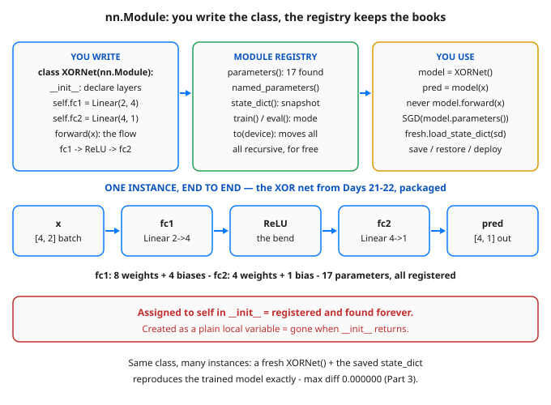

# Day 24 — PyTorch nn.Module: Writing a Clean Model Class

**Tonight you'll be able to:** write any small network as a clean, reusable `nn.Module` class — declare its layers once, let PyTorch find all 17 parameters automatically, train the Days 21–22 XOR net through it, and snapshot + restore its exact state with `state_dict()`.

## The one idea

Until now your networks have been loose tensors wired by hand (Days 21–23) or a straight-line `nn.Sequential` chain (Day 21). That works for a demo and falls apart for anything real: no single place owns the weights, nothing can list them, save them, or move them as one unit. **`nn.Module` is PyTorch's packaging unit** — the base class that *every* layer (`nn.Linear` included) and every real model inherits from. A model class has exactly two jobs.

**`__init__` declares the pieces.** Call `super().__init__()` first — that switches on Module's bookkeeping — then assign each layer to `self`: `self.fc1 = nn.Linear(2, 4)`. The assignment is the whole trick: Module overrides attribute assignment, so anything assigned to `self` is **registered** — tracked, recursively, along with everything inside it. Registration is what makes the free services work: `model.parameters()` walks the registry and hands the optimizer every trainable tensor in *one call* (add a layer later and it is enlisted automatically — no list to update, no weight silently left untrained), `state_dict()` snapshots the whole model as a name → tensor dict you can save and reload into a fresh instance, and `model.to("mps")` or `model.train()` / `model.eval()` apply to the entire tree at once. The failure mode is silent: build a layer into a plain local variable inside `__init__` and it is *never registered* — invisible to the optimizer, missing from the snapshot, gone when `__init__` returns.

**`forward(x)` defines the flow** — how an input moves through the declared pieces, in any shape you like: branches, reuse of one layer twice, a loop. That freedom is exactly what `nn.Sequential` cannot express, and why the class wins the moment a forward pass stops being a straight pipe. One convention is load-bearing in every codebase you will read: you call `model(x)`, *never* `model.forward(x)` — the call routes through Module's machinery (hooks and bookkeeping) on its way into your `forward`. Today's proof that the wrapper changes nothing underneath: the class version of your XOR net, given Day 21's hand-set weights, trains to the byte-identical result — loss `0.070625 → 0.000005`, 4/4 corners.

## Analogy

An `nn.Module` class is a **well-structured service**. `__init__` is its dependency-injection wiring: every dependency you register with the container is discoverable by the framework — health checks, metrics, and config all find it automatically — while a dependency you construct into a local and forget to register is invisible to all of it and dies with the constructor. `forward` is the request handler: pure flow over the wired pieces. And `state_dict()` is the service's **serializable state snapshot** — the etcd snapshot / checkpoint manifest that lets you spin up a fresh replica, hand it the snapshot, and get a byte-identical service back. Part 3 is exactly that restore drill, and it passes with max diff `0.000000`.

Trading version: it's the difference between a strategy as a **class** — parameters declared in one place, state saveable and restorable, new instances spun up for a backtest and a live run — and a strategy as a pile of loose variables in a notebook, where nobody can say what the full position is. Registration is position-keeping for weights.

## See it



Left: the only two methods you write. Middle: the registry services registration buys you — parameter discovery, snapshots, mode and device moves, all recursive. Right: how the instance is actually used. Bottom: the one XORNet, end to end — 17 parameters, every one of them found automatically.

## Code it (~30 min)

Three parts in `~/ai-lab`, all CPU, no RNG in any printed number — the weights are hand-loaded exactly as on Days 21–22. **Part 1** defines `XORNet` and inspects what registration produced. **Part 2** trains XOR through the class, the optimizer fed by a single `model.parameters()` call. **Part 3** snapshots `state_dict()`, restores it into a fresh instance, and flips the train/eval flag.

```python
"""Day 24 - PyTorch nn.Module: Writing a Clean Model Class.

Every model you have built so far was loose tensors or an
nn.Sequential chain (Day 21). Real PyTorch code packages a network
as a subclass of nn.Module - the base class every layer and every
model in PyTorch already is. Two methods do all the work:

  __init__  Declare the pieces. Call super().__init__() FIRST, then
            assign each layer to self (self.fc1 = nn.Linear(...)).
            That assignment REGISTERS the layer: nn.Module tracks
            it, so parameters() and state_dict() find it - and
            everything inside it - automatically, recursively.
            A layer left in a plain local variable is never
            registered, and vanishes when __init__ returns.
  forward   Define the computation: how an input flows through the
            declared pieces. Call the model itself - model(x) -
            never model.forward(x): the call runs PyTorch's hooks
            and bookkeeping around forward for you.

  Part 1  XORNet, a 2 -> 4 (ReLU) -> 1 class. Printing it shows the
          architecture; named_parameters() lists all 4 tensors -
          17 trainable parameters - without you enumerating any.
  Part 2  The Days 21-22 XOR net, hand-loaded weights and all,
          trained through the class. The optimizer takes
          model.parameters() in ONE call, so adding a layer later
          enlists its weights automatically. Same init, same math:
          loss 0.070625 -> 0.000005, 4/4 corners - byte-identical
          to the nn.Sequential version, as it must be.
  Part 3  state_dict(): an ordered name -> tensor snapshot of the
          whole model. Load it into a FRESH instance and its
          predictions match exactly (max diff 0.000000) - that is
          checkpointing and deployment in embryo. Plus the
          train()/eval() mode flag every Module carries.

Runs on the ~/ai-lab venv: torch only, CPU on purpose (tiny data,
hand-set weights - no RNG in any printed number). The MPS device
move you already know (.to("mps")) works on the whole Module at
once; Day 25 puts it to work. No CUDA, no paid APIs.

Expected output:

  Part 1 - one class, and the registry fills itself in
  XORNet(
    (fc1): Linear(in_features=2, out_features=4, bias=True)
    (fc2): Linear(in_features=4, out_features=1, bias=True)
  )
  fc1.weight   shape [4, 2]   8 params
  fc1.bias     shape [4]      4 params
  fc2.weight   shape [1, 4]   4 params
  fc2.bias     shape [1]      1 params
    total trainable parameters: 17

  Part 2 - the Days 21-22 XOR net, trained through the class
    loss 0.070625 -> 0.000005
    predictions 0.0032, 1.0000, 0.9999, -0.0029  (correct: 4/4)
    optimizer received 4 tensors from model.parameters() in one call

  Part 3 - state_dict: snapshot it, load it into a fresh instance
    state_dict keys: fc1.weight, fc1.bias, fc2.weight, fc2.bias
    fresh instance predictions match: max diff 0.000000
    after model.train(): training = True
    after model.eval() : training = False
"""
import torch
import torch.nn as nn


class XORNet(nn.Module):
    """The Days 21-22 XOR MLP, packaged as a reusable class."""

    def __init__(self):
        super().__init__()          # register-tracking starts here
        self.fc1 = nn.Linear(2, 4)  # assigned to self = registered
        self.fc2 = nn.Linear(4, 1)

    def forward(self, x):
        return self.fc2(torch.relu(self.fc1(x)))


# ---------- Part 1: inspection - the registry fills itself in ----------
print("Part 1 - one class, and the registry fills itself in")
model = XORNet()
print(model)
total = 0
for name, p in model.named_parameters():
    total += p.numel()
    print(f"  {name:<12} shape {str(list(p.shape)):<8} {p.numel()} params")
print(f"  total trainable parameters: {total}")

# ---------- Part 2: train the XOR net through the class ----------
# Identical hand-set init to Days 21-22 (no RNG), identical SGD -
# the class wrapper changes the packaging, never the math.
print("\nPart 2 - the Days 21-22 XOR net, trained through the class")
with torch.no_grad():
    model.fc1.weight.copy_(torch.tensor([[1.0, -1.0], [-1.0, 1.0],
                                         [0.5, 0.5], [-0.5, 0.8]]))
    model.fc1.bias.copy_(torch.tensor([0.0, 0.0, -0.5, 0.0]))
    model.fc2.weight.copy_(torch.tensor([[1.0, 1.0, 1.0, -0.5]]))
    model.fc2.bias.copy_(torch.tensor([0.0]))
X = torch.tensor([[0.0, 0.0], [0.0, 1.0], [1.0, 0.0], [1.0, 1.0]])
y = torch.tensor([[0.0], [1.0], [1.0], [0.0]])
opt = torch.optim.SGD(model.parameters(), lr=0.5)  # one call, all 4 tensors
n_tensors = len(list(model.parameters()))
first = None
for _ in range(100):
    opt.zero_grad()
    loss = ((model(X) - y) ** 2).mean()   # model(X), never model.forward(X)
    if first is None:
        first = loss.item()
    loss.backward()
    opt.step()
with torch.no_grad():
    pred = model(X)
    final = ((pred - y) ** 2).mean().item()
    correct = int(((pred > 0.5) == (y > 0.5)).sum())
fmt = lambda t: ", ".join(f"{v:.4f}" for v in t.flatten().tolist())
print(f"  loss {first:.6f} -> {final:.6f}")
print(f"  predictions {fmt(pred)}  (correct: {correct}/4)")
print(f"  optimizer received {n_tensors} tensors "
      f"from model.parameters() in one call")

# ---------- Part 3: state_dict snapshot + the mode flag ----------
# state_dict is the model's entire learned state as name -> tensor.
# Saving it (torch.save) is a checkpoint; loading it into a fresh
# instance of the same class restores the model exactly.
print("\nPart 3 - state_dict: snapshot it, load it into a fresh instance")
sd = model.state_dict()
print(f"  state_dict keys: {', '.join(sd.keys())}")
fresh = XORNet()
fresh.load_state_dict(sd)
with torch.no_grad():
    diff = (fresh(X) - model(X)).abs().max().item()
print(f"  fresh instance predictions match: max diff {diff:.6f}")
model.train()
print(f"  after model.train(): training = {model.training}")
model.eval()
print(f"  after model.eval() : training = {model.training}")
```

**Expected output:**

```
Part 1 - one class, and the registry fills itself in
XORNet(
  (fc1): Linear(in_features=2, out_features=4, bias=True)
  (fc2): Linear(in_features=4, out_features=1, bias=True)
)
  fc1.weight   shape [4, 2]   8 params
  fc1.bias     shape [4]      4 params
  fc2.weight   shape [1, 4]   4 params
  fc2.bias     shape [1]      1 params
  total trainable parameters: 17

Part 2 - the Days 21-22 XOR net, trained through the class
  loss 0.070625 -> 0.000005
  predictions 0.0032, 1.0000, 0.9999, -0.0029  (correct: 4/4)
  optimizer received 4 tensors from model.parameters() in one call

Part 3 - state_dict: snapshot it, load it into a fresh instance
  state_dict keys: fc1.weight, fc1.bias, fc2.weight, fc2.bias
  fresh instance predictions match: max diff 0.000000
  after model.train(): training = True
  after model.eval() : training = False
```

## Today's win

Done when: `print(model)` shows the two-layer architecture; `named_parameters()` lists `fc1.weight [4, 2]`, `fc1.bias [4]`, `fc2.weight [1, 4]`, `fc2.bias [1]` — **17 trainable parameters** you never enumerated by hand; Part 2 trains to loss `0.070625 → 0.000005` with predictions `0.0032, 1.0000, 0.9999, -0.0029` (4/4), byte-identical to Day 21's Sequential version; and Part 3's fresh instance, given only the `state_dict`, reproduces the trained model with **max diff 0.000000**. The bigger test: you can state the two jobs cold — `__init__` declares and registers, `forward` defines the flow — and why you call `model(x)`, never `model.forward(x)`.

## Short on time? 20-minute version

Run Parts 1 and 3 only (~15 min): define the class, list its parameters, snapshot and restore it. That registry round-trip is the concept. Part 2 is a 100-epoch confirmation that the wrapper trains identically — run it if you have the remaining minutes; it takes seconds.

## Tomorrow's teaser

Tomorrow: your clean model meets an equally clean loop — the small disciplines that keep training honest once a model can also be *checked*, not just trained. Same `XORNet`, production habits.

*Streak: 24 day(s) · Never miss twice.*
