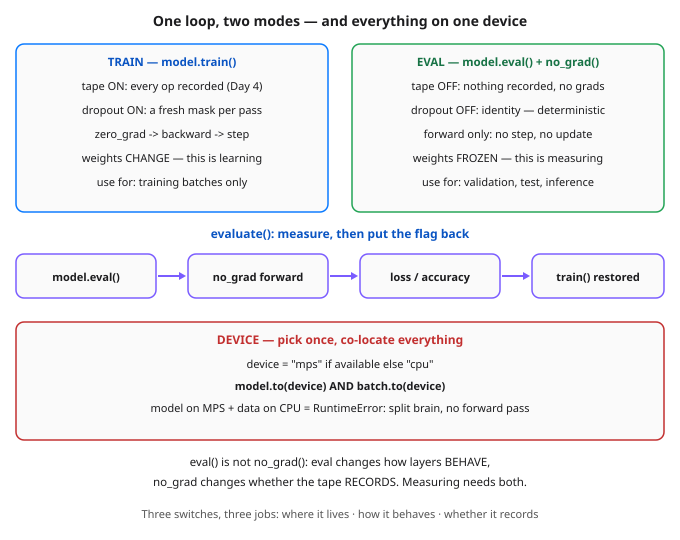

# Day 25 — Training Loop, Done Right: Device, Eval Mode & no_grad

**Tonight you'll be able to:** place Day 24's model on the right device, switch train/eval mode on purpose instead of by accident, and measure it under `no_grad` — so a validation number is honest, deterministic, and costs no gradient memory.

## The one idea

Day 7 gave you the loop's anatomy and Day 24 the clean model class. A production-grade loop has **three independent switches** that beginners merge into one vague idea of "training mode." Separate them and most loop bugs evaporate.

**Switch 1 — device: where everything lives.** Pick it once, at the top: `device = "mps" if torch.backends.mps.is_available() else "cpu"`. Then move the *model* with `model.to(device)` — one call, every registered parameter rides along (Day 24's registry paying rent) — and move *every batch* with `.to(device)` too. Forget the batch and PyTorch stops you cold: "Expected all tensors to be on the same device." Compute and data must co-locate, always.

**Switch 2 — mode: how layers behave.** `model.train()` and `model.eval()` flip a flag carried by every module. Most layers ignore it; dropout (Day 17) obeys it absolutely — drop-and-rescale in train mode, identity in eval mode. Measure a model while it's still in train mode and you've scored a randomly mutilated network: the number changes every pass (Part 1). That isn't a validation score, it's a dice roll.

**Switch 3 — the tape: whether anything records.** Here is the part almost everyone gets wrong: `eval()` does *not* stop autograd. Part 1 proves it — a forward pass in eval mode, with no other protection, still returns `requires_grad: True`. `torch.no_grad()` is the separate switch for the tape (Day 4): inside it, nothing is recorded, no `.grad` is filled, and no activations are saved for a backward that will never come — so measuring is cheaper and *cannot* pollute training. Honest measurement needs both switches: `eval()` for behaviour, `no_grad()` for the tape.

**The pattern that ties it together** is a small helper, `evaluate()`: remember the current flag, switch to eval, run the forward under `no_grad`, then *restore train mode if the model was training*. That last step is the silent killer — forget it and dropout stays off for the rest of training while every log line looks normal. Inside the training loop itself, calling `model.train()` at the top of every epoch is cheap insurance against exactly that. (One sibling to file away: `torch.inference_mode()` is a stronger no-tape mode for pure serving — today, `no_grad` is the tool.)

## Analogy

Think of training as the **write path on a primary**: the write-ahead log (your autograd tape) is on, and every operation mutates state. Evaluating is a **read-only shadow** of that service — and production engineers keep the two toggles separate there too: read-only *behaviour* is one flag, disabling the WAL for a pure read transaction is another. Turning off mutations without turning off logging still pays the logging cost; turning off logging without read-only mode still lets stray writes through. You flip both, deliberately. Device is the oldest lesson in the building: **co-location** — compute in one region and data in another doesn't limp along slowly in PyTorch, it fails fast, which is the kind failure mode.

Trading version: scoring a strategy while dropout is still randomly killing half its signals is marking P&L to a *random* book. `eval()` + `no_grad()` is the clean end-of-day mark: the real position, no orders placed, nothing mutated.

## See it



Two modes, one helper, one placement rule. Top: the same network under train and eval — what changes is behaviour and taping, never the weights' location. Middle: evaluate() restores the flag it borrowed. Bottom: model and data live together, or nothing runs.

## Code it (~30 min)

Three parts in `~/ai-lab`, weights hand-set exactly as on Days 21–24 — no RNG in any printed number except Part 1's train-mode masks, where only the structural claim is printed. **Part 1** isolates the mode flag with a dropout net. **Part 2** builds the reusable `evaluate()` helper and audits its side effects (there are none). **Part 3** runs the full loop on the selected device — on your MacBook that's MPS, so the final loss may differ from the CPU reference below in the last digit; the arc and the 4/4 are the guarantee.

```python
"""Day 25 - Training Loop, Done Right: Device, Eval Mode & no_grad.

Day 24 gave you a clean model class. Real code also needs a clean
LOOP around it, and that loop has three independent switches that
beginners constantly conflate:

  device      WHERE tensors live. Pick it once:
              "mps" if torch.backends.mps.is_available() else
              "cpu" - then move the model AND every batch with
              .to(device). Model on MPS + batch on CPU is the
              classic RuntimeError: compute and data must
              co-locate, always.
  train/eval  HOW layers behave. model.train() / model.eval() flip
              a mode flag: dropout (Day 17) drops units in train
              mode and is the identity in eval mode. But eval()
              does NOT stop gradient recording - Part 1 proves a
              forward pass in eval mode still requires_grad.
  no_grad     WHETHER the autograd tape (Day 4) records at all.
              Under torch.no_grad() nothing is taped: no grads
              are populated, memory stays flat, and a measurement
              pass cannot pollute training. Measuring needs BOTH
              switches: eval() for behaviour, no_grad() for tape.

  Part 1  A DropoutNet (Day 24's XORNet + one nn.Dropout) with
          hand-set weights. In eval mode two passes are identical
          (max diff 0.000000, preds 0.0000/0.6000/1.0000/0.3500);
          in train mode the mask is redrawn and passes vary. And
          eval without no_grad still records the tape.
  Part 2  evaluate(): the reusable measurement helper - eval() +
          no_grad(), then it RESTORES train mode if the model was
          training. On the untrained net it reports the familiar
          Day 21 loss 0.070625 and leaves every .grad at None,
          while one train-mode backward() populates them all.
  Part 3  The full loop, done right, on the selected device:
          co-location check, model.train() every epoch, and
          evaluate() for the honest before/after numbers. Same
          weights and math as Day 24, so the CPU reference result
          is byte-identical: 0.070625 -> 0.000005, 4/4 corners.
          (On MPS the final digits may differ in the last place;
          the arc and the 4/4 are the guarantee.)

Runs on the ~/ai-lab venv: torch only, hand-set weights - no RNG
in any printed number except Part 1's train-mode dropout masks,
where only the structural claim (passes vary) is printed. No CUDA,
no paid APIs.

Expected output:

  Part 1 - train vs eval: dropout is a mode, not a layer you remove
    eval preds: 0.0000, 0.6000, 1.0000, 0.3500
    two eval passes differ by: 0.000000
    eval pass (no no_grad) requires_grad: True
    train-mode passes vary across calls: True

  Part 2 - evaluate(): eval + no_grad, then train mode restored
    evaluate() loss on the untrained net: 0.070625
    prediction under no_grad requires_grad: False
    grads after evaluate(): all None = True
    grads after one train backward(): all populated = True

  Part 3 - the full loop on one device, done right
    device selected: mps
    model and data co-located: True
    initial eval loss: 0.070625
    training flag restored after evaluate(): True
    final eval loss: 0.000005
    predictions 0.0032, 1.0000, 0.9999, -0.0029  (correct: 4/4)
"""
import torch
import torch.nn as nn

# Day 21's hand-set weights, reused for every net below: no RNG in
# any printed number, and every result is comparable across days.
W1 = [[1.0, -1.0], [-1.0, 1.0], [0.5, 0.5], [-0.5, 0.8]]
B1 = [0.0, 0.0, -0.5, 0.0]
W2 = [[1.0, 1.0, 1.0, -0.5]]
B2 = [0.0]
X = torch.tensor([[0.0, 0.0], [0.0, 1.0], [1.0, 0.0], [1.0, 1.0]])
y = torch.tensor([[0.0], [1.0], [1.0], [0.0]])
fmt = lambda t: ", ".join(f"{v:.4f}" for v in t.flatten().tolist())


def load_hand_weights(model):
    with torch.no_grad():
        model.fc1.weight.copy_(torch.tensor(W1))
        model.fc1.bias.copy_(torch.tensor(B1))
        model.fc2.weight.copy_(torch.tensor(W2))
        model.fc2.bias.copy_(torch.tensor(B2))
    return model


class XORNet(nn.Module):
    """Day 24's class, unchanged."""

    def __init__(self):
        super().__init__()
        self.fc1 = nn.Linear(2, 4)
        self.fc2 = nn.Linear(4, 1)

    def forward(self, x):
        return self.fc2(torch.relu(self.fc1(x)))


class DropoutNet(nn.Module):
    """XORNet + one dropout layer, to make the mode flag visible."""

    def __init__(self):
        super().__init__()
        self.fc1 = nn.Linear(2, 4)
        self.drop = nn.Dropout(0.5)
        self.fc2 = nn.Linear(4, 1)

    def forward(self, x):
        return self.fc2(self.drop(torch.relu(self.fc1(x))))


def evaluate(model, Xb, yb):
    """Measure without touching training: eval + no_grad, then
    put the mode flag back exactly where you found it."""
    was_training = model.training
    model.eval()
    with torch.no_grad():
        pred = model(Xb)
        loss = ((pred - yb) ** 2).mean().item()
        correct = int(((pred > 0.5) == (yb > 0.5)).sum())
    if was_training:
        model.train()
    return loss, correct


# ---------- Part 1: train vs eval mode ----------
print("Part 1 - train vs eval: dropout is a mode, not a layer you remove")
dnet = load_hand_weights(DropoutNet())
dnet.eval()                       # dropout becomes the identity
with torch.no_grad():
    p1, p2 = dnet(X), dnet(X)
print(f"  eval preds: {fmt(p1)}")
print(f"  two eval passes differ by: {(p1 - p2).abs().max().item():.6f}")
still_taped = dnet(X)             # eval() alone, no no_grad wrapper
print(f"  eval pass (no no_grad) requires_grad: {still_taped.requires_grad}")
dnet.train()                      # masks are redrawn every pass now
torch.manual_seed(25)
seen = {tuple(dnet(X).flatten().round(decimals=4).tolist())
        for _ in range(16)}
print(f"  train-mode passes vary across calls: {len(seen) > 1}")

# ---------- Part 2: the evaluate() helper ----------
print("\nPart 2 - evaluate(): eval + no_grad, then train mode restored")
dnet.train()                      # pretend we are mid-training
loss0, _ = evaluate(dnet, X, y)
print(f"  evaluate() loss on the untrained net: {loss0:.6f}")
with torch.no_grad():
    png = dnet(X)
print(f"  prediction under no_grad requires_grad: {png.requires_grad}")
print(f"  grads after evaluate(): all None = "
      f"{all(p.grad is None for p in dnet.parameters())}")
loss_t = ((dnet(X) - y) ** 2).mean()   # dnet is back in train mode
loss_t.backward()
print(f"  grads after one train backward(): all populated = "
      f"{all(p.grad is not None for p in dnet.parameters())}")

# ---------- Part 3: the full loop, done right ----------
print("\nPart 3 - the full loop on one device, done right")
device = torch.device("mps" if torch.backends.mps.is_available()
                      else "cpu")
model = load_hand_weights(XORNet()).to(device)   # the whole Module
Xd, yd = X.to(device), y.to(device)              # ... and the data
print(f"  device selected: {device}")
print(f"  model and data co-located: "
      f"{all(p.device == Xd.device for p in model.parameters())}")
opt = torch.optim.SGD(model.parameters(), lr=0.5)
model.train()
init_loss, _ = evaluate(model, Xd, yd)
print(f"  initial eval loss: {init_loss:.6f}")
print(f"  training flag restored after evaluate(): {model.training}")
for _ in range(100):
    model.train()                 # cheap insurance, every epoch
    opt.zero_grad()
    loss = ((model(Xd) - yd) ** 2).mean()
    loss.backward()
    opt.step()
final_loss, correct = evaluate(model, Xd, yd)
with torch.no_grad():
    pred = model(Xd)
print(f"  final eval loss: {final_loss:.6f}")
print(f"  predictions {fmt(pred)}  (correct: {correct}/4)")
```

**Expected output:**

```
Part 1 - train vs eval: dropout is a mode, not a layer you remove
  eval preds: 0.0000, 0.6000, 1.0000, 0.3500
  two eval passes differ by: 0.000000
  eval pass (no no_grad) requires_grad: True
  train-mode passes vary across calls: True

Part 2 - evaluate(): eval + no_grad, then train mode restored
  evaluate() loss on the untrained net: 0.070625
  prediction under no_grad requires_grad: False
  grads after evaluate(): all None = True
  grads after one train backward(): all populated = True

Part 3 - the full loop on one device, done right
  device selected: mps
  model and data co-located: True
  initial eval loss: 0.070625
  training flag restored after evaluate(): True
  final eval loss: 0.000005
  predictions 0.0032, 1.0000, 0.9999, -0.0029  (correct: 4/4)
```

## Today's win

Done when: Part 1 shows eval predictions `0.0000, 0.6000, 1.0000, 0.3500` with two eval passes differing by **0.000000**, train-mode passes varying — and the eval pass *without* `no_grad` still reporting `requires_grad: True`. Part 2's `evaluate()` returns the familiar `0.070625` and leaves every `.grad` at `None`, while one train-mode `backward()` populates them all. Part 3 prints co-located `True`, restores the training flag (`True`), and lands at final eval loss ≈ `0.000005` with **4/4 corners**. The bigger test: you can recite the three switches cold — *device = where it lives, train/eval = how it behaves, no_grad = whether it records* — and why measuring takes the last two together.

## Short on time? 20-minute version

Run Parts 1 and 2 (~15 min): the mode-vs-tape distinction and the `evaluate()` helper are the whole concept. Part 3 is integration — read the loop once, run it if you have the minutes; it takes seconds.

## Tomorrow's teaser

Tomorrow: a new kind of layer, built for data where neighbours matter — same clean loop, brand-new geometry.

*Streak: 25 day(s) · Never miss twice.*
