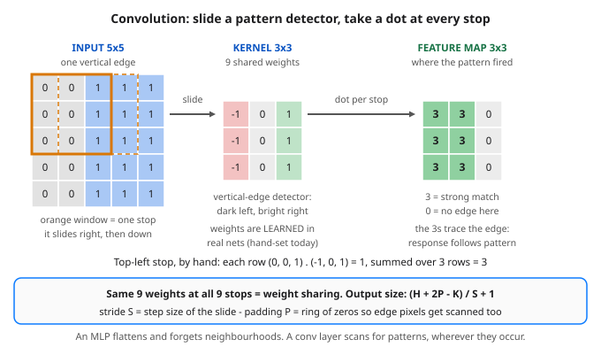

# Day 26 — CNNs 1: Convolution — The Sliding Pattern Scanner

**Tonight you'll be able to:** run a 3×3 kernel across an image by hand and in PyTorch, read the feature map it leaves behind, and explain why sharing 9 weights beats a dense layer’s millions — the layer every image model is built from.

## The one idea

Every layer you have built so far is **dense**: flatten the input into one long vector, and let every neuron look at every value. For the 4-number XOR inputs of Days 21–25 that is fine. For images it throws away the one thing images are made of — **structure**. Flatten a 28×28 digit and position becomes just an index: pixel 1 and pixel 29 (vertical neighbours) look no closer than pixel 1 and pixel 700. Worse, an edge detector learned at the top-left is a completely separate set of weights from one at the bottom-right, so the model must re-learn the same pattern at every location — and pay for it: Part 3 counts **4,245,280** parameters for one dense layer doing a job a conv layer does with **80**.

**Convolution** is the layer built for data where neighbours matter. Instead of one giant weight matrix, it uses a small grid of weights called a **kernel** (or filter) — 3×3, so 9 numbers — which is a tiny pattern template. The kernel **slides** across the image, one step at a time. At each stop it computes a single **dot product** (Day 12's core op: flatten the patch and the kernel, multiply, sum) between the kernel and the patch underneath it, and writes that one number into the output, the **feature map**. A high number means "a pattern shaped like me lives here"; the feature map is literally a map of where the pattern occurs. Each output number sees only its 3×3 patch — that patch is its **receptive field**.

Two consequences do all the work. **Locality:** a value is judged by its neighbourhood, the way a pixel should be. **Weight sharing:** the *same* 9 weights are reused at every stop, so the detector fires wherever the pattern appears (Part 2: move the edge, the response moves with it) and the parameter count stops depending on image size. Those kernel weights are ordinary parameters — in a real network they are *learned* by the same backprop from Days 4 and 23. Today they are hand-set edge detectors so you can watch the mechanics with no training noise. Real layers run many kernels at once, producing a stack of feature maps, one per pattern; and a kernel spans all input channels (1 for grayscale, 3 for colour) as it slides. A ReLU (Day 22) usually follows, clipping negative responses — a pattern seen backwards — to zero (Part 3).

**The two knobs.** **Stride** is the step size of the slide: stride 2 skips every other stop, halving the map — a coarser, cheaper scan. **Padding** adds a ring of zeros around the border so edge pixels get fully scanned and the map can keep the input's size. One just-in-time formula sizes any conv layer: `output = (H + 2P − K) / S + 1` per side, where H is input size, K kernel size, P padding, S stride. Part 3 checks all three cases against PyTorch's actual shapes.

## Analogy

You already run this algorithm — in stream processing. A **sliding window** in Kafka Streams or Flink takes the last N events, computes one aggregate, hops forward by a smaller step, and computes again: one output per window position, the same function at every position. Convolution is that, turned sideways into 2D: the window is a 3×3 patch instead of a time range, the aggregate is a *learned* dot product instead of a sum or average, and the hop is the stride. Same discipline, too: the window function does not care where in the stream it is — that indifference is exactly what makes it scale.

Trading version: scanning a chart for a three-candle pattern with one fixed checklist, applied at every bar. Wherever the pattern prints, it counts — not only at bar 1. A moving average is the 1-D cousin you already know: a sliding window with fixed, equal weights. A conv kernel is a moving average whose weights got to *learn* what shape they are looking for.

## See it



One stop of the scan, frozen. Left: Part 1’s 5×5 image — the solid orange window is the kernel’s first stop, the dashed one its next. Middle: the hand-set vertical-edge kernel. Right: the feature map it writes — the 3s sit exactly on the edge, and the response moves when the edge moves (Part 2).

## Code it (~30 min)

Three parts in `~/ai-lab`, all hand-set and RNG-free — every printed number is exact. **Part 1** writes convolution as nested loops over a 5×5 image with one vertical edge, then checks the loop against `F.conv2d`. **Part 2** moves the edge one column and loads the same kernel into `nn.Conv2d`. **Part 3** turns the stride/padding knobs, runs a reversed edge through ReLU, and counts the parameter dividend on a 28×28 input.

```python
"""Day 26 - CNNs 1: Convolution - The Sliding Pattern Scanner.

Every layer so far (Days 21-25) was dense: flatten the input, and
every neuron looks at every value. Images break that idea. A 28x28
image flattens to 784 numbers where position is just an index, an
edge detector trained at the top-left is a different set of weights
from one at the bottom-right, and the parameter bill explodes.

Convolution is the layer built for data where neighbours matter:

  kernel   A small grid of weights - here 3x3, so 9 numbers - called
           a kernel (or filter). It is a pattern template.
  slide    The kernel visits every patch of the image in turn,
           stepping by the stride (1 unless you say otherwise).
  dot      At each stop it computes ONE dot product (Day 12):
           patch * kernel, summed - plus an optional bias. High
           output means "a pattern like me lives here."
  map      Each stop writes one number to the feature map, so the
           map is a picture of WHERE the pattern occurs.
  sharing  The SAME 9 weights are reused at every position - weight
           sharing. The detector works anywhere, and the parameter
           count stops caring about image size.

In a real network the kernel weights are learned by the same
backprop you met on Days 4 and 23. Today they are hand-set edge
detectors, so the mechanics are visible with zero training.

  Part 1  Convolution by hand: nested loops over a 5x5 image with
          a vertical edge. The vertical kernel fires (map of 3s on
          the edge, 0s past it); the horizontal kernel stays silent
          (all 0s). A hand loop and F.conv2d agree exactly.
  Part 2  Weight sharing: shift the edge one column right and the
          response shifts with it - same 9 weights, no retraining.
          nn.Conv2d loaded with the same kernel reproduces the
          hand map; its weight holds exactly 9 numbers.
  Part 3  The knobs and the dividend. Stride 2 scans coarser
          (output 2x2); padding 1 adds a zero border so the scan
          covers the edges (output 5x5). Output size follows
          (H + 2P - K) / S + 1. A reversed edge scores -3s and
          ReLU (Day 22) clips them to 0: the detector fires one
          way only. And on a 28x28 image, Conv2d(1, 8, 3) makes
          5408 outputs from 80 parameters, where a Linear layer
          making the same outputs needs 4,245,280.

Runs on the ~/ai-lab venv: torch only, hand-set weights, no RNG
anywhere - every printed number is exact. Tiny CPU grids on
purpose: tonight the device is irrelevant, the geometry is the
point. No CUDA, no paid APIs.

Expected output:

  Part 1 - convolution by hand: slide, dot, write one number
    input image (5x5): dark left, bright right
      0  0  1  1  1
      0  0  1  1  1
      0  0  1  1  1
      0  0  1  1  1
      0  0  1  1  1
    vertical-edge kernel (3x3):
      -1  0  1
      -1  0  1
      -1  0  1
    feature map, vertical kernel (3x3):
      3  3  0
      3  3  0
      3  3  0
    feature map, horizontal kernel (3x3):
      0  0  0
      0  0  0
      0  0  0
    hand loop vs F.conv2d max diff: 0.000000

  Part 2 - weight sharing: same 9 weights, every position
    edge shifted one column right, vertical kernel:
      0  3  3
      0  3  3
      0  3  3
    nn.Conv2d weight shape: (1, 1, 3, 3)
    parameters in that kernel: 9
    nn.Conv2d output matches hand map: True

  Part 3 - stride, padding, and the sharing dividend
    stride 1, pad 0: (5 + 0 - 3)/1 + 1 = 3 -> output (1, 1, 3, 3)
    stride 2, pad 0: (5 + 0 - 3)/2 + 1 = 2 -> output (1, 1, 2, 2)
    stride 1, pad 1: (5 + 2 - 3)/1 + 1 = 5 -> output (1, 1, 5, 5)
    reversed edge, raw map row 0: 0  -3  -3 -> after ReLU: 0  0  0
    Conv2d(1, 8, 3) on 28x28: 80 params for 5408 outputs
    Linear(784, 5408), same outputs: 4245280 params
"""
import torch
import torch.nn as nn
import torch.nn.functional as F

# A 5x5 "image": dark (0) on the left, bright (1) on the right -
# one vertical edge. Every row is identical, on purpose.
img = torch.tensor([[0.0, 0.0, 1.0, 1.0, 1.0]] * 5)
img_shifted = torch.tensor([[0.0, 0.0, 0.0, 1.0, 1.0]] * 5)
img_reversed = torch.tensor([[1.0, 1.0, 1.0, 0.0, 0.0]] * 5)

# Hand-set kernels. Vertical-edge detector: -1s where the pattern
# should be dark, +1s where it should be bright.
k_vert = torch.tensor([[-1.0, 0.0, 1.0]] * 3)
k_horiz = torch.tensor([[-1.0, -1.0, -1.0],
                        [0.0, 0.0, 0.0],
                        [1.0, 1.0, 1.0]])


def grid(t, indent="    "):
    """Print a 2D tensor as aligned rows of whole numbers."""
    return "\n".join(
        indent + "  ".join(f"{v:.0f}" for v in row)
        for row in t.tolist())


def conv_by_hand(image, kernel):
    """Convolution with the machinery showing: slide the kernel,
    take one dot product (Day 12) per stop, write one number."""
    H, W = image.shape
    KH, KW = kernel.shape
    out = torch.zeros(H - KH + 1, W - KW + 1)
    for i in range(out.shape[0]):
        for j in range(out.shape[1]):
            patch = image[i:i + KH, j:j + KW]
            out[i, j] = (patch * kernel).sum()
    return out


# ---------- Part 1: convolution by hand ----------
print("Part 1 - convolution by hand: slide, dot, write one number")
print("  input image (5x5): dark left, bright right")
print(grid(img))
print("  vertical-edge kernel (3x3):")
print(grid(k_vert))
map_v = conv_by_hand(img, k_vert)
map_h = conv_by_hand(img, k_horiz)
print("  feature map, vertical kernel (3x3):")
print(grid(map_v))
print("  feature map, horizontal kernel (3x3):")
print(grid(map_h))
fast = F.conv2d(img.view(1, 1, 5, 5),
                k_vert.view(1, 1, 3, 3)).view(3, 3)
print(f"  hand loop vs F.conv2d max diff: "
      f"{(fast - map_v).abs().max().item():.6f}")

# ---------- Part 2: weight sharing ----------
print("\nPart 2 - weight sharing: same 9 weights, every position")
map_s = conv_by_hand(img_shifted, k_vert)
print("  edge shifted one column right, vertical kernel:")
print(grid(map_s))
conv = nn.Conv2d(1, 1, kernel_size=3, bias=False)
with torch.no_grad():
    conv.weight.copy_(k_vert.view(1, 1, 3, 3))
out_s = conv(img_shifted.view(1, 1, 5, 5)).view(3, 3)
print(f"  nn.Conv2d weight shape: {tuple(conv.weight.shape)}")
print(f"  parameters in that kernel: "
      f"{sum(p.numel() for p in conv.parameters())}")
print(f"  nn.Conv2d output matches hand map: "
      f"{bool((out_s == map_s).all())}")

# ---------- Part 3: stride, padding, the dividend ----------
print("\nPart 3 - stride, padding, and the sharing dividend")
x = img.view(1, 1, 5, 5)
w = k_vert.view(1, 1, 3, 3)
s1 = F.conv2d(x, w)
s2 = F.conv2d(x, w, stride=2)
p1 = F.conv2d(x, w, padding=1)
print(f"  stride 1, pad 0: (5 + 0 - 3)/1 + 1 = 3 "
      f"-> output {tuple(s1.shape)}")
print(f"  stride 2, pad 0: (5 + 0 - 3)/2 + 1 = 2 "
      f"-> output {tuple(s2.shape)}")
print(f"  stride 1, pad 1: (5 + 2 - 3)/1 + 1 = 5 "
      f"-> output {tuple(p1.shape)}")
raw_row = conv_by_hand(img_reversed, k_vert)[0]
relu_row = torch.relu(raw_row)
row = lambda t: "  ".join(f"{v:.0f}" for v in t.tolist())
print(f"  reversed edge, raw map row 0: {row(raw_row)} "
      f"-> after ReLU: {row(relu_row)}")
conv28 = nn.Conv2d(1, 8, kernel_size=3)
n_conv = sum(p.numel() for p in conv28.parameters())
n_out = 8 * 26 * 26          # 8 maps, each (28 - 3)/1 + 1 = 26 wide
dense = nn.Linear(28 * 28, n_out)
n_dense = sum(p.numel() for p in dense.parameters())
print(f"  Conv2d(1, 8, 3) on 28x28: {n_conv} params "
      f"for {n_out} outputs")
print(f"  Linear(784, 5408), same outputs: {n_dense} params")
```

**Expected output:**

```
Part 1 - convolution by hand: slide, dot, write one number
  input image (5x5): dark left, bright right
    0  0  1  1  1
    0  0  1  1  1
    0  0  1  1  1
    0  0  1  1  1
    0  0  1  1  1
  vertical-edge kernel (3x3):
    -1  0  1
    -1  0  1
    -1  0  1
  feature map, vertical kernel (3x3):
    3  3  0
    3  3  0
    3  3  0
  feature map, horizontal kernel (3x3):
    0  0  0
    0  0  0
    0  0  0
  hand loop vs F.conv2d max diff: 0.000000

Part 2 - weight sharing: same 9 weights, every position
  edge shifted one column right, vertical kernel:
    0  3  3
    0  3  3
    0  3  3
  nn.Conv2d weight shape: (1, 1, 3, 3)
  parameters in that kernel: 9
  nn.Conv2d output matches hand map: True

Part 3 - stride, padding, and the sharing dividend
  stride 1, pad 0: (5 + 0 - 3)/1 + 1 = 3 -> output (1, 1, 3, 3)
  stride 2, pad 0: (5 + 0 - 3)/2 + 1 = 2 -> output (1, 1, 2, 2)
  stride 1, pad 1: (5 + 2 - 3)/1 + 1 = 5 -> output (1, 1, 5, 5)
  reversed edge, raw map row 0: 0  -3  -3 -> after ReLU: 0  0  0
  Conv2d(1, 8, 3) on 28x28: 80 params for 5408 outputs
  Linear(784, 5408), same outputs: 4245280 params
```

## Today's win

Done when: Part 1's vertical-kernel map reads `3 3 0` on every row, the horizontal kernel's map is all zeros, and hand loop vs `F.conv2d` differ by **0.000000**. Part 2's shifted-edge map reads `0 3 3` per row, `nn.Conv2d` reports exactly **9 parameters** and matches the hand map (`True`). Part 3 prints shapes `(1, 1, 3, 3)` / `(1, 1, 2, 2)` / `(1, 1, 5, 5)`, the reversed edge clips to all zeros under ReLU, and the count lands at **80 vs 4,245,280**. The bigger test: you can say it cold — *slide, dot, write one number; same weights everywhere* — and size any conv layer with `(H + 2P − K) / S + 1`.

## Short on time? 20-minute version

Run Part 1 only (~15 min) and read Part 3's last two lines. The hand loop *is* the concept; Parts 2–3 are the payoff and take two minutes to skim.

## Tomorrow's teaser

Tomorrow: the hand-set weights go away — this same slide, with kernels the model learns itself, reads real handwritten digits.

*Streak: 26 day(s) · Never miss twice.*
