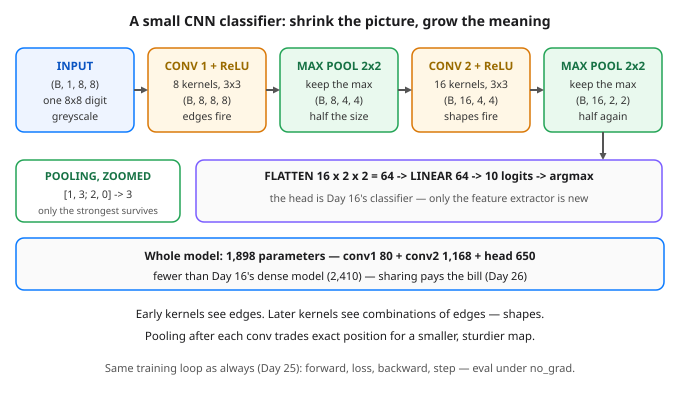

# Day 27 — CNNs 2: Build a Small Image Classifier

**Tonight you'll be able to:** assemble a conv → ReLU → pool stack into a working image classifier, calculate every shape and parameter count before you run it, and train it on real handwritten digits to about 98% held-out accuracy — beating your Day 16 dense model with fewer parameters.

## The one idea

Yesterday you slid *one* hand-set kernel over a toy grid and watched a feature map light up on an edge. A real CNN classifier is that same slide, industrialised: **many kernels, learned by backprop** instead of hand-set, **stacked in blocks**, and finished with a plain classifier head. The model tonight has two halves, and keeping them separate in your head is the whole lesson. The **feature extractor** learns *what to look at* in the image. The **head** decides *what the answer is* from what the extractor found. You already own the head — it is Day 16’s flatten → Linear → 10 logits, unchanged. Everything new lives in the extractor.

An extractor block is three layers. **Conv** (Day 26): a stack of kernels slides at once — 8 kernels in block 1 — producing 8 feature maps, called **channels**: 8 different “where does *my* pattern occur” maps of the same image. **ReLU** (Day 22) keeps positive responses and zeroes the rest. Then the one genuinely new layer: **max pooling**. `MaxPool2d(2)` cuts the map into 2×2 patches and keeps only the *maximum* in each, discarding the other three numbers. The map halves on each side — 8×8 becomes 4×4 — and what survives is the strongest pattern response in each neighbourhood. Exact position within the patch is traded away; in exchange the next layer gets a smaller, sturdier map, and a pattern shifted by a pixel often produces the same pooled output.

Stack a second block and something qualitative changes. Block 2’s kernels do not look at pixels — each of its 16 kernels spans *all 8* of block 1’s maps (8×9 weights + bias = 73 parameters per kernel), so it detects *combinations* of edges: corners, curves, loops. Nobody programs “find a loop”; the hierarchy — edges, then shapes built from edges — is what gradient descent finds, because shapes are what separate a 6 from an 8. After block 2 pools again, the image has been distilled to 16 maps of 2×2: 64 numbers that say which shapes fired where, roughly. Flatten those, and the head takes it from there.

**Shape is the contract.** With padding 1, a 3×3 conv preserves size (Day 26’s formula: (8 + 2 − 3)/1 + 1 = 8), so pooling is the *only* shrinker — one thing to reason about. That makes the flatten size pure arithmetic: 16 channels × 2 × 2 = **64**, which must match the head’s `in_features` exactly. A mismatch there is the #1 beginner CNN bug, and PyTorch reports it as a shape error at the head, far from its cause. Part 1 walks a dummy batch through every joint and prints each shape *before* any training, so the contract is checked the way you’d check an API schema before deploying against it. The parameter bill is the Day 26 dividend, cashed: **1,898 total** — fewer than Day 16’s dense model (2,410) — because shared kernels do the looking and the head only ever sees 64 distilled numbers, not 64 raw pixels pretending position doesn’t matter.

## Analogy

Think of your metrics pipeline. Raw samples pour in per host; a first rollup keeps the **max** per minute — not the average, because the spike is the signal and averaging would bury it; a second rollup aggregates across hosts. Each level carries fewer numbers and more meaning, and nobody downstream wants the raw firehose. Max pooling is the max-rollup: the strongest response in each neighbourhood is the spike worth keeping, and the coarser map is what the next level can actually reason over. The head is just the alert rule reading the final rollup.

Trading version: multi-timeframe analysis. You don’t read a day of 1-minute candles bar by bar to judge the daily trend — you let each timeframe compress the one below it, keeping the extremes (session highs and lows, the maxes) and discarding the jitter. Edges on the small timeframe, structure on the large one. A CNN does the same compression — except every timeframe’s “what counts as structure” is learned from data instead of fixed by convention.

## See it



The whole classifier on one line. Two conv blocks (orange) learn what to look at; pooling (green) halves the map after each, keeping only the strongest response per 2&times;2 patch; the purple head &mdash; flatten, linear, argmax &mdash; is Day 16&rsquo;s classifier reading 64 distilled numbers instead of raw pixels.

## Code it (~30 min)

One file in `~/ai-lab`, three parts. **Part 1** is the architecture on paper: a dummy batch walks the joints and prints every shape, plus the per-layer parameter count — check 64 and 1,898 by hand before scrolling on. **Part 2** trains for 15 epochs on the Day 16 digits split (same `random_state=16`, so the comparison is honest), images kept as `(N, 1, 8, 8)`, fed by a `DataLoader` (Day 19), optimised by Adam (Day 18), evaluated with Day 25’s `eval()` + `no_grad` helper. **Part 3** prints the receipts next to Day 16’s 0.9556. Reference numbers below: your MacBook’s RNG stream differs, so last digits will vary — the arc and the win are the same.

```python
"""Day 27 - CNNs 2: Build a Small Image Classifier.

Day 26 slid ONE hand-set kernel over a toy grid. Tonight the kernels
are learned, there are stacks of them, and the stack reads real
handwriting: the same sklearn digits from Day 16 (1,797 images) --
but this time kept AS images, (N, 1, 8, 8), never flattened first.

The recipe is two halves:

  feature extractor  Learns WHAT to look at. Conv block 1: eight
      3x3 kernels (Day 26) + ReLU (Day 22), then max pooling --
      keep only the strongest response in each 2x2 patch, halving
      the map. Conv block 2: sixteen kernels over those 8 maps,
      ReLU, pool again. Early kernels learn edges; later kernels
      learn combinations of edges -- shapes. Each pool trades
      exact position for a smaller, sturdier map.
  head  Decides the answer. Flatten (16, 2, 2) to 64 numbers and
      one Linear layer to 10 logits -- Day 16's classifier,
      unchanged. Only the extractor is new.

Shape is the contract at every joint, and Part 1 prints it:
  (B,1,8,8) -> conv1 (B,8,8,8) -> pool (B,8,4,4)
            -> conv2 (B,16,4,4) -> pool (B,16,2,2)
            -> flatten 64 -> linear (B,10)
Padding 1 keeps a 3x3 conv's output the same size as its input
(Day 26 formula: (8 + 2 - 3)/1 + 1 = 8), so only pooling shrinks
the map -- one shrinker to reason about, not two.

The training is Day 25's loop done right -- model on the device,
batches moved to it, eval under eval() + no_grad -- fed by Day 19's
DataLoader. The optimizer is Adam (Day 18) at lr 0.01: conv nets
have features at very different scales, Adam's home turf.

Parameter bill: conv1 80 + conv2 1,168 + head 650 = 1,898 total,
FEWER than Day 16's dense model (2,410) -- weight sharing (Day 26)
pays again. Watch whether fewer params + image structure also
beats Day 16's val accuracy of 0.9556.

  Part 1  The architecture on paper: stage-by-stage shapes from a
          dummy batch, and the per-layer parameter count.
  Part 2  Train 15 epochs, batch 64, Adam. Print the loss/acc arc
          at epochs 1, 5, 10, 15.
  Part 3  Receipts: sample predictions on held-out digits and the
          final val accuracy, next to Day 16's number.

Runs on the ~/ai-lab venv: torch + scikit-learn (free), CPU or MPS,
no CUDA, no paid APIs, no downloads -- digits ships with sklearn.

Expected output (reference numbers -- your MacBook's RNG stream
differs from the reference run, so last digits will vary; the arc
and the win are the same):

  device: mps
  Part 1 - the architecture: shapes are the contract
    input            (2, 1, 8, 8)
    after conv1+ReLU (2, 8, 8, 8)
    after pool1      (2, 8, 4, 4)
    after conv2+ReLU (2, 16, 4, 4)
    after pool2      (2, 16, 2, 2)
    after flatten    (2, 64)
    logits           (2, 10)
    params: conv1 80  conv2 1168  head 650  total 1898
    Day 16 dense model params: 2410
  Part 2 - train: Day 25's loop, Day 19's loader, Adam
    dataset: 1797 samples, images (1, 8, 8), 10 classes
    train: 1437  val: 360
    epoch   1  train loss 0.8715  val acc 0.7722
    epoch   5  train loss 0.1058  val acc 0.9417
    epoch  10  train loss 0.0468  val acc 0.9722
    epoch  15  train loss 0.0150  val acc 0.9833
  Part 3 - receipts
    sample predictions (true -> pred):
      6 -> 6
      8 -> 8
      3 -> 3
      1 -> 1
      8 -> 8
      9 -> 9
    WIN: CNN val accuracy 0.9833 vs Day 16 MLP 0.9556
"""
import torch
import torch.nn as nn
from sklearn.datasets import load_digits
from sklearn.model_selection import train_test_split
from torch.utils.data import DataLoader, TensorDataset

torch.manual_seed(27)
device = torch.device("mps" if torch.backends.mps.is_available() else "cpu")
print("device:", device)


class SmallCNN(nn.Module):
    """Day 24's class discipline, Day 26's layers.

    Extractor: conv -> ReLU -> pool, twice. Head: flatten -> linear.
    """

    def __init__(self):
        super().__init__()
        self.conv1 = nn.Conv2d(1, 8, kernel_size=3, padding=1)
        self.conv2 = nn.Conv2d(8, 16, kernel_size=3, padding=1)
        self.pool = nn.MaxPool2d(2)
        self.head = nn.Linear(16 * 2 * 2, 10)

    def forward(self, x):
        x = self.pool(torch.relu(self.conv1(x)))   # (B, 8, 4, 4)
        x = self.pool(torch.relu(self.conv2(x)))   # (B, 16, 2, 2)
        x = torch.flatten(x, 1)                    # (B, 64)
        return self.head(x)                        # (B, 10) logits


model = SmallCNN().to(device)

# ---------- Part 1: the architecture, shapes are the contract ----------
print("Part 1 - the architecture: shapes are the contract")
dummy = torch.zeros(2, 1, 8, 8, device=device)
with torch.no_grad():
    a = torch.relu(model.conv1(dummy))
    b = model.pool(a)
    c = torch.relu(model.conv2(b))
    d = model.pool(c)
    flat = torch.flatten(d, 1)
    logits = model.head(flat)
print(f"  input            {tuple(dummy.shape)}")
print(f"  after conv1+ReLU {tuple(a.shape)}")
print(f"  after pool1      {tuple(b.shape)}")
print(f"  after conv2+ReLU {tuple(c.shape)}")
print(f"  after pool2      {tuple(d.shape)}")
print(f"  after flatten    {tuple(flat.shape)}")
print(f"  logits           {tuple(logits.shape)}")
n1 = sum(p.numel() for p in model.conv1.parameters())
n2 = sum(p.numel() for p in model.conv2.parameters())
n3 = sum(p.numel() for p in model.head.parameters())
print(f"  params: conv1 {n1}  conv2 {n2}  head {n3}  total {n1 + n2 + n3}")
print("  Day 16 dense model params: 2410")

# ---------- Part 2: train ----------
print("Part 2 - train: Day 25's loop, Day 19's loader, Adam")
X, y = load_digits(return_X_y=True)
X = (X / 16.0).astype("float32").reshape(-1, 1, 8, 8)  # keep the image!
print(f"  dataset: {X.shape[0]} samples, images (1, 8, 8), 10 classes")
Xtr, Xva, ytr, yva = train_test_split(X, y, test_size=0.2, random_state=16)
print(f"  train: {len(Xtr)}  val: {len(Xva)}")
Xtr = torch.tensor(Xtr).to(device)
Xva = torch.tensor(Xva).to(device)
ytr = torch.tensor(ytr, dtype=torch.long).to(device)
yva = torch.tensor(yva, dtype=torch.long).to(device)
loader = DataLoader(TensorDataset(Xtr, ytr), batch_size=64, shuffle=True)
opt = torch.optim.Adam(model.parameters(), lr=0.01)   # Day 18
loss_fn = nn.CrossEntropyLoss()                       # Day 14


def evaluate():
    """Day 25's helper: eval mode + no_grad, restore training after."""
    was_training = model.training
    model.eval()
    with torch.no_grad():
        acc = (model(Xva).argmax(1) == yva).float().mean().item()
        tr_loss = loss_fn(model(Xtr), ytr).item()
    if was_training:
        model.train()
    return tr_loss, acc


for epoch in range(1, 16):
    model.train()
    for xb, yb in loader:
        opt.zero_grad()
        loss = loss_fn(model(xb), yb)   # forward -> loss
        loss.backward()                 # backward (Day 4)
        opt.step()                      # step (Day 6)
    if epoch in (1, 5, 10, 15):
        tr_loss, vacc = evaluate()
        print(f"  epoch {epoch:3d}  train loss {tr_loss:.4f}  val acc {vacc:.4f}")

# ---------- Part 3: receipts ----------
print("Part 3 - receipts")
model.eval()
with torch.no_grad():
    pred = model(Xva).argmax(1)
print("  sample predictions (true -> pred):")
for i in range(6):
    print(f"    {yva[i].item()} -> {pred[i].item()}")
acc = (pred == yva).float().mean().item()
print(f"  WIN: CNN val accuracy {acc:.4f} vs Day 16 MLP 0.9556")
```

**Expected output:**

```
device: mps
Part 1 - the architecture: shapes are the contract
  input            (2, 1, 8, 8)
  after conv1+ReLU (2, 8, 8, 8)
  after pool1      (2, 8, 4, 4)
  after conv2+ReLU (2, 16, 4, 4)
  after pool2      (2, 16, 2, 2)
  after flatten    (2, 64)
  logits           (2, 10)
  params: conv1 80  conv2 1168  head 650  total 1898
  Day 16 dense model params: 2410
Part 2 - train: Day 25's loop, Day 19's loader, Adam
  dataset: 1797 samples, images (1, 8, 8), 10 classes
  train: 1437  val: 360
  epoch   1  train loss 0.8715  val acc 0.7722
  epoch   5  train loss 0.1058  val acc 0.9417
  epoch  10  train loss 0.0468  val acc 0.9722
  epoch  15  train loss 0.0150  val acc 0.9833
Part 3 - receipts
  sample predictions (true -> pred):
    6 -> 6
    8 -> 8
    3 -> 3
    1 -> 1
    8 -> 8
    9 -> 9
  WIN: CNN val accuracy 0.9833 vs Day 16 MLP 0.9556
```

## Today's win

Done when: Part 1 prints the shape walk ending `(2, 16, 2, 2)` → `(2, 64)` → `(2, 10)` and the count **conv1 80, conv2 1168, head 650, total 1898**. Part 2’s arc falls from train loss ~0.87 to ~0.02 with val accuracy climbing past **0.97** by epoch 15, and Part 3’s WIN line beats Day 16’s **0.9556** (reference: **0.9833**) with all six sample digits read correctly. The bigger test: you can say it cold — *the extractor learns what to look at, pooling keeps the strongest and halves the map, the head decides* — and size any flatten layer as channels × height × width without guessing.

## Short on time? 20-minute version

Run the whole file once (it trains in well under a minute on these 8×8 images), but spend your attention on Part 1’s shape walk and Part 3’s WIN line. If you can predict each shape before it prints, you have the lesson; the training arc is Day 25’s loop doing familiar work.

## Tomorrow's teaser

Tomorrow: data that arrives one step at a time — and a model that has to remember what it saw earlier in the sequence.

*Streak: 27 day(s) · Never miss twice.*
