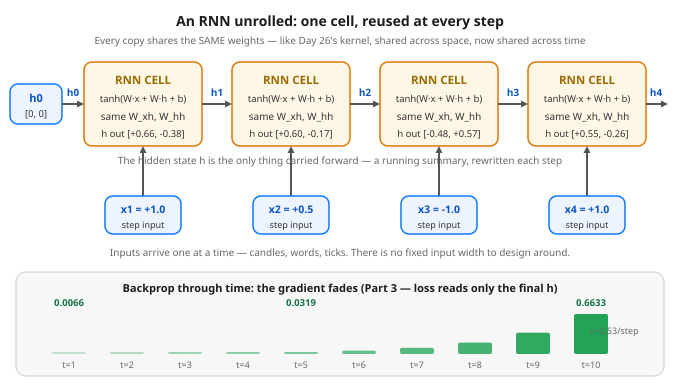

# Day 28 — RNNs & Sequences: Recurrence and the Fading Memory

**Tonight you'll be able to:** run one recurrent cell by hand across a sequence, match it exactly with `nn.RNN`, and measure with autograd why the first step of a long sequence barely learns — its gradient arrives about 100× smaller than the last step's.

## The one idea

Everything you have built so far takes a **fixed-size** input and has **no memory**. An MLP sees all its inputs at once; shuffle them and it cannot even tell (Day 19's loader shuffles on purpose). A CNN slides over a grid that is simply *there*. But a huge class of data is a **sequence**: words in a sentence, candles in a session, ticks in a stream. Two things break. The length **varies** — there is no fixed input width to design a layer around. And the **order is the information**: step *t* only makes sense given what came before it.

The recurrent neural network (RNN) answers with a single **cell**, reused at every step. The cell carries a vector called the **hidden state**, `h` — a running summary of everything seen so far. At each step it rewrites that summary from two ingredients, the new input `x_t` and its own previous value `h_{t-1}`:

`h_t = tanh(W_xh · x_t + W_hh · h_{t-1} + b)`, starting from `h_0 = 0`

Read the two weight matrices as two jobs. `W_xh` decides what the *new input* contributes; `W_hh` decides what of the *old summary* survives and how it mixes. `tanh` (Day 22) squashes the result back into (−1, 1), so the summary cannot blow up no matter how long the sequence runs. The same `W_xh` and `W_hh` are used at *every* step — **weight sharing over time**, exactly the trick Day 26's kernel used over space. That is why the parameter count ignores sequence length, and why any length works: Part 2 runs the same 10-parameter cell at T=4 and T=12.

Draw the loop stretched out in time (**unrolling**) and an RNN is a very deep network — one layer per step, all sharing weights. The final summary `h_T` (or the summary at every step) then feeds an ordinary head, like Day 24's `Linear` layer: sequence in, fixed-size summary out, decision on top. Keep one honest caveat in view: a fixed-size vector is a *lossy* summary. Everything the model will ever know about step 1 must survive being rewritten at every later step.

**Why they fade — in one paragraph.** Training sends the gradient from the final loss back through every step — **backprop through time**, Day 23's blame chain stretched over steps instead of layers. Each hop backwards multiplies the blame by `W_hh` and by `tanh'`, which is at most 1 (Day 22). Tonight that per-hop factor is about 0.53, and products of numbers below 1 shrink *exponentially*: 0.53^9 ≈ 1/100 over the 9 hops of Part 3, and effectively zero over 50 steps. So a plain RNN's early steps receive almost no gradient and barely learn — it masters short-range patterns and goes deaf to distant ones. (Push the factor above 1 and the same product explodes instead; the field's fix is gated cells that protect the gradient's path — a later day's story. Tonight you just measure the fade.)

## Analogy

Think **stateful stream processing** — your world. A Kafka Streams aggregation or a Raft log applier does not re-read the whole log for every new event; it carries a compact **state** and folds each event in: `state_t = f(state_{t-1}, event_t)`. The hidden state is exactly that state, and the cell is the fold function — except the fold here is *learned* instead of hand-written. Same operational shape, same failure mode: if your state summary drops something, no later event can bring it back.

Trading version: an **EMA is a scalar RNN with frozen weights** — `EMA_t = α·price_t + (1−α)·EMA_{t-1}`. One number of state, updated by the same rule at every candle, old information decaying by a fixed factor per step. You have watched that decay your whole trading life; tonight the decay factor is learned, the state is a vector — and in Part 3 you will watch the *gradient* decay by the same compounding logic.

## See it



One cell, copied across time: each copy reads one input and the previous hidden state, and writes the next hidden state — the same weights everywhere. Below, Part 3's measured gradient per step: blame for the final loss arrives at t=10 at full strength and at t=1 about 100× weaker.

## Code it (~30 min)

One file in `~/ai-lab`, three parts, and — rare treat — **no randomness anywhere**: every weight is hand-set, so your output should match the expected output digit for digit on CPU or MPS. **Part 1** runs the cell by hand over four toy candle moves (+1.0, +0.5, −1.0, +1.0) and prints the summary after each step — watch step 3's −1.0 flip the first component of `h` negative: the summary is being *rewritten*, not appended to. **Part 2** copies those exact weights into `nn.RNN` (note PyTorch's two biases: the cell's bias goes in `bias_ih_l0`, and `bias_hh_l0` is zeroed so nothing is double-counted) and checks the packaged version against your hand loop, then stretches the same cell from T=4 to T=12. **Part 3** is the fade, measured: a scalar cell (`w_hh`=0.8) reads ten identical inputs, the loss is just the final `h`, and autograd reports each step's gradient.

```python
"""Day 28 - RNNs & Sequences: Recurrence and the Fading Memory.

Every model so far took a fixed-size input and had no memory:
shuffle the rows (Day 19) and an MLP cannot even tell. Sequences
-- words in a sentence, candles in a session, ticks in a stream --
break both assumptions. The length varies, and the ORDER is the
information: step t only makes sense given what came before it.

A recurrent neural network (RNN) answers with one cell, reused:

  h_t = tanh(W_xh @ x_t + W_hh @ h_prev + b),   h_0 = 0

h is the hidden state -- a fixed-size running summary, rewritten
at every step from the new input and its own previous value. The
SAME W_xh and W_hh are used at every step: weight sharing over
time, exactly as Day 26's kernel shared weights over space. So
the parameter count ignores the sequence length, and any length
works. Unroll the loop in time and the RNN is a very deep
network -- one layer per step, all sharing weights -- whose
final hidden state (or the state at every step) feeds an
ordinary head, e.g. Day 24's Linear layer.

  Part 1  The cell by hand: fixed weights, a 4-step sequence of
          toy candle moves (+1.0, +0.5, -1.0, +1.0), print h
          after every step and watch step 3's -1.0 rewrite the
          summary the first two steps built.
  Part 2  nn.RNN is the same cell, packaged: copy the Part 1
          weights in, check the outputs match to 0.000000, and
          show the parameter count (10) does not change when the
          sequence grows from T=4 to T=12.
  Part 3  Why they fade: a scalar gradient probe (w_hh = 0.8,
          ten identical inputs of 0.2). The loss reads only the
          FINAL hidden state; autograd reports how much each
          step's input could have changed it. The first step's
          gradient arrives about 100x smaller than the last
          step's -- backprop through time multiplies by a factor
          below 1 at every hop (about 0.53 here), and products
          of numbers below 1 vanish exponentially. That is why
          plain RNNs learn short-range patterns and go deaf to
          distant ones.

Runs on the ~/ai-lab venv: torch only (free), CPU or MPS, no
CUDA, no paid APIs, no downloads. No randomness anywhere in
this file -- every weight is hand-set, so your output should
match the expected output below digit for digit.

Expected output:

  device: mps
  Part 1 - one cell, unrolled by hand
    h0 = [+0.0000, +0.0000]
    t=1  x=+1.0  h=[+0.6640, -0.3799]
    t=2  x=+0.5  h=[+0.6006, -0.1676]
    t=3  x=-1.0  h=[-0.4750, +0.5737]
    t=4  x=+1.0  h=[+0.5510, -0.2594]
  Part 2 - nn.RNN: the same cell, packaged
    input shape (1, 4, 1)  (batch, time, features)
    output shape (1, 4, 2)  (hidden state at every step)
    h_n shape (1, 1, 2)  (the final hidden state)
    hand loop vs nn.RNN max diff: 0.000000
    params: 10  (T=4)
    T=12 output shape (1, 12, 2)  params still 10
  Part 3 - why they fade: the gradient through time
    final h after 10 steps: 0.5803
    grad wrt x_t, t=1..10: 0.0066, 0.0086, 0.0123, 0.0190, 0.0319, 0.0561, 0.1020, 0.1888, 0.3529, 0.6633
    last step grad 0.6633 vs first step grad 0.0066 -- ratio 99.7x
"""
import torch
import torch.nn as nn

device = torch.device("mps" if torch.backends.mps.is_available() else "cpu")
print("device:", device)

# ---------- Part 1: one cell, unrolled by hand ----------
print("Part 1 - one cell, unrolled by hand")
W_xh = torch.tensor([[0.8], [-0.5]], device=device)          # (2, 1)
W_hh = torch.tensor([[0.5, 0.1], [0.2, 0.4]], device=device)  # (2, 2)
b_h = torch.tensor([0.0, 0.1], device=device)
xs = [1.0, 0.5, -1.0, 1.0]  # toy candle moves
h = torch.zeros(2, device=device)                             # h_0 = 0
print(f"  h0 = [{h[0]:+.4f}, {h[1]:+.4f}]")
hand_hs = []
for t, xv in enumerate(xs, 1):
    x_t = torch.tensor([xv], device=device)
    h = torch.tanh(W_xh @ x_t + W_hh @ h + b_h)               # the cell
    hand_hs.append(h.clone())
    print(f"  t={t}  x={xv:+.1f}  h=[{h[0]:+.4f}, {h[1]:+.4f}]")

# ---------- Part 2: nn.RNN -- the same cell, packaged ----------
print("Part 2 - nn.RNN: the same cell, packaged")
rnn = nn.RNN(input_size=1, hidden_size=2, batch_first=True).to(device)
with torch.no_grad():
    rnn.weight_ih_l0.copy_(W_xh)   # PyTorch's name for W_xh
    rnn.weight_hh_l0.copy_(W_hh)   # PyTorch's name for W_hh
    rnn.bias_ih_l0.copy_(b_h)      # the cell's bias lives here...
    rnn.bias_hh_l0.zero_()         # ...so the second bias stays 0
x_seq = torch.tensor(xs, device=device).reshape(1, 4, 1)  # (B, T, F)
with torch.no_grad():
    out, h_n = rnn(x_seq)
print(f"  input shape {tuple(x_seq.shape)}  (batch, time, features)")
print(f"  output shape {tuple(out.shape)}  (hidden state at every step)")
print(f"  h_n shape {tuple(h_n.shape)}  (the final hidden state)")
hand = torch.stack(hand_hs)                                   # (4, 2)
diff = (hand - out[0]).abs().max().item()
print(f"  hand loop vs nn.RNN max diff: {diff:.6f}")
n_params = sum(p.numel() for p in rnn.parameters())
print(f"  params: {n_params}  (T=4)")
x_long = torch.zeros(1, 12, 1, device=device)
with torch.no_grad():
    out12, _ = rnn(x_long)
print(f"  T=12 output shape {tuple(out12.shape)}  params still {n_params}")

# ---------- Part 3: why they fade -- the gradient through time ----------
print("Part 3 - why they fade: the gradient through time")
x = torch.full((10,), 0.2, requires_grad=True, device=device)
h = torch.zeros((), device=device)
for t in range(10):
    h = torch.tanh(0.8 * h + 1.0 * x[t])   # scalar cell: w_hh=0.8, w_xh=1.0
print(f"  final h after 10 steps: {h.item():.4f}")
h.backward()                               # blame flows back through time
g = x.grad
print("  grad wrt x_t, t=1..10: " + ", ".join(f"{v:.4f}" for v in g.tolist()))
print(f"  last step grad {g[-1]:.4f} vs first step grad {g[0]:.4f}"
      f" -- ratio {(g[-1] / g[0]).item():.1f}x")
```

**Expected output:**

```
device: mps
Part 1 - one cell, unrolled by hand
  h0 = [+0.0000, +0.0000]
  t=1  x=+1.0  h=[+0.6640, -0.3799]
  t=2  x=+0.5  h=[+0.6006, -0.1676]
  t=3  x=-1.0  h=[-0.4750, +0.5737]
  t=4  x=+1.0  h=[+0.5510, -0.2594]
Part 2 - nn.RNN: the same cell, packaged
  input shape (1, 4, 1)  (batch, time, features)
  output shape (1, 4, 2)  (hidden state at every step)
  h_n shape (1, 1, 2)  (the final hidden state)
  hand loop vs nn.RNN max diff: 0.000000
  params: 10  (T=4)
  T=12 output shape (1, 12, 2)  params still 10
Part 3 - why they fade: the gradient through time
  final h after 10 steps: 0.5803
  grad wrt x_t, t=1..10: 0.0066, 0.0086, 0.0123, 0.0190, 0.0319, 0.0561, 0.1020, 0.1888, 0.3529, 0.6633
  last step grad 0.6633 vs first step grad 0.0066 -- ratio 99.7x
```

## Today's win

Done when: Part 1 prints the trace `h` = [+0.6640, −0.3799] → [+0.6006, −0.1676] → [−0.4750, +0.5737] → [+0.5510, −0.2594]; Part 2 reports **max diff 0.000000**, **params: 10** at both T=4 and T=12; and Part 3 prints the gradient list ending **0.6633** at t=10 against **0.0066** at t=1 — **ratio 99.7×**. The bigger test: you can say it cold — *`h_t = tanh(W_xh·x_t + W_hh·h_{t-1} + b)`, same weights every step; the gradient is multiplied by a below-1 factor at every hop back through time, so distant steps barely learn.*

## Short on time? 20-minute version

Run the whole file once (seconds), but spend your attention on Part 1's trace and Part 3's gradient list. Check the fade yourself on your phone calculator: 0.53^9 ≈ 0.01. If you can explain *why* the t=1 gradient had to land near 0.0066 before you run it, you have the lesson.

## Tomorrow's teaser

Tomorrow: as stacks get deeper, the numbers flowing through them drift while training runs — and a small in-layer fix keeps them tame.

*Streak: 28 day(s) · Never miss twice.*
