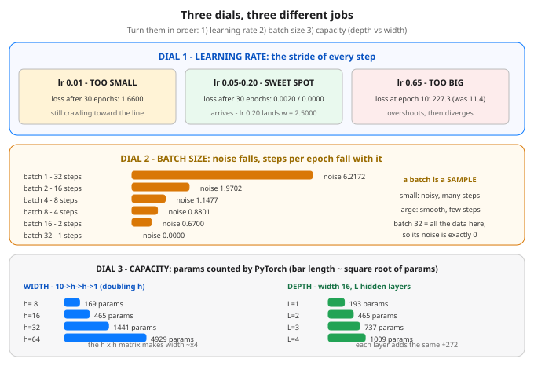

# Day 30 — Hyperparameters That Actually Matter: LR, Batch Size, Depth vs Width

**Tonight you'll be able to:** look at any training run and know which dial to turn — set a learning rate that actually trains, pick a batch size by its noise-versus-steps tradeoff, and size a model by depth versus width — in that order, and only after diagnosing whether the problem is underfitting or overfitting.

## The one idea

Everything inside the model — every weight, every bias — is a **parameter**: training learns it. The settings you choose *before* training starts, which no optimizer ever touches, are **hyperparameters**: they set the conditions the learning happens under. There are dozens, but three dominate almost every real outcome, and each is a different *kind* of choice. Tonight all three get measured on machinery you already own.

**Dial 1 — learning rate (lr): the stride of every step.** Gradient descent moves `−lr × gradient` (Day 6, raced again on Day 18's ravine). Part 1 reruns Day 7's line (truth w = 2.5, b = −1) at four strides. Too small (0.01) and 30 epochs still leave you at loss **1.6600**, w = 1.5958 — walking the right way, arriving never. The sweet spot (0.05–0.20) lands at **0.0020 / 0.0000**, exactly on the truth. Too big (0.65) does not wobble — it **diverges**: 11.4 → 48.7 → 227.3 in ten epochs. Why no universal good value? The largest stable stride is set by the loss surface's *curvature*, which changes with the model, the data and the optimizer (Day 18: Adam's lr behaves like a stride cap, not a multiplier). So the working skill is not memorizing 0.001 — it is running a **sweep**: try strides spaced by powers of ten (0.001, 0.01, 0.1, …), keep the biggest one that trains smoothly, refine around it.

**Dial 2 — batch size: the sample behind every gradient.** Day 19 built the machinery; today is what it *means*. The gradient your optimizer follows is computed from one batch, so it is an *estimate* of the full-data gradient — and estimates have noise. Part 2 measures it at w = b = 0 on 32 points: the true gradient is −6.7579, and the chunk gradients of one shuffled epoch deviate from it with RMS **6.2172** at batch 1, falling through 1.1477 at batch 4 to exactly **0.0000** at batch 32 — batch 32 *is* the full data, so the estimate is the truth. The other side of the trade: steps per epoch fall 32 → 1 over the same sweep. Small batch = many noisy updates (the noise is not pure villain — it bounces the optimizer out of shallow dips); large batch = few smooth updates, each expensive, but perfectly parallel on the GPU (Day 13). The dials also couple: a bigger batch gives a smoother gradient, which usually tolerates a bigger stride — when you scale one, expect to re-check the other.

**Dial 3 — depth vs width: the shape of capacity.** Both make the model bigger; they bill you differently. Widening a hidden layer grows the matrix *between* hidden layers as h × h, so Part 3's counts go 169 → 465 → 1441 → **4929** as h doubles 8 → 64 — approaching ×4 per doubling. Adding a layer at fixed width 16 adds the *same* 272 parameters each time (193 → 465 → 737 → 1009): linear. What the money buys differs too: width is more pattern-detectors working the same level in parallel; depth is *composition* — features of features — which is why depth, not width, cracked XOR on Day 21. Depth's price is not parameters, it is trainability: longer credit-assignment chains fade (Days 22/28), which is exactly what Day 29's norms exist to protect.

**Diagnose before you dial.** Read two numbers first — train loss and validation loss (Day 8). Train high *and* val high: the model cannot even fit what it has seen — **underfitting** — and only now is capacity the right dial (or more epochs / a bigger stride). Train low, val high: **overfitting** — more capacity is precisely the wrong medicine; that is regularization, data, or a smaller model (Day 17). Most wasted tuning hours are dial 3 turned on a dial-1 problem, or capacity added to an overfit model. Order of operations, every time: *stride until it trains, batch for your hardware, capacity only when the train loss itself is the complaint.*

## Analogy

These are the three knobs on a **control loop**, and you have tuned this loop before — it is TCP congestion control wearing a different hat. Learning rate is the controller's **gain**: too timid and the window crawls toward the fair rate and never gets there; too aggressive and it oscillates, overshoots, and blows the queue — Part 1's divergence is a control loop going unstable, not a statistics surprise. Batch size is the **sample window** behind each control decision: react to every single ACK and you chase noise; wait for a big window and your estimate is solid but your decisions are rare and stale. Depth vs width is your oldest systems tradeoff: **scale a node up versus add hops to the chain** — a bigger node costs quadratically in the cross-connect, while each added hop is a flat fee that compounds latency and failure modes instead.

Trading version: you already refuse to judge an edge from **one trade** — that print is batch size 1, noise RMS 6.2172, mostly luck. Thirty-two trades in, the estimate tightens toward the strategy's true expectancy. And your stride is your **position-step size**: creep in 1% at a time and the move is over before you are sized; leap and one adverse print owns you. Same dials, same discipline: sample enough to see, step as big as stability allows.

## See it



The three dials with the lesson's real numbers. Learning rate: 0.01 still crawling at loss 1.6600 after 30 epochs, 0.05–0.20 landing at 0.0020/0.0000, 0.65 diverging to 227.3. Batch size: gradient-noise RMS falls 6.2172 to 0.0000 as steps per epoch fall 32 to 1. Capacity: widening h 8 to 64 costs 169 to 4,929 parameters (~×4 per doubling, from the h × h matrix); deepening at width 16 adds a flat 272 per layer.

## Code it (~30 min)

One file in `~/ai-lab`, three parts, **no randomness** — every run starts from the same hand-set init (w = b = 0), so your numbers should match the expected output (the diverging lr 0.65 losses are printed to 1 decimal on purpose — a diverging run amplifies last-bit float differences, so its trailing digits are not stable; its first digits very much are). **Part 1** sweeps the stride on Day 7's line, full batch, 30 epochs. **Part 2** takes one shuffled epoch of 32 points, computes each chunk's gradient at w = b = 0 by autograd, and reports the RMS deviation from the true full-data gradient next to the steps-per-epoch count. **Part 3** lets PyTorch count parameters itself for the width and depth sweeps.

```python
"""Day 30 - Hyperparameters That Actually Matter: LR, Batch Size,
Depth vs Width.

Parameters are learned by training: every weight and bias in
the model. Hyperparameters are chosen by YOU, before training
starts, and never touched by the optimizer: they set the
conditions the learning happens under. Dozens exist, but three
dominate almost every outcome -- and tonight each one gets
measured, not asserted.

  Learning rate (the stride): gradient descent moves
    -lr * gradient every step (Days 6/18). Too small and the
    epochs run out before you arrive; too big and each step
    overshoots -- past a threshold the loss does not wobble,
    it explodes. There is no universal good value: the loss
    surface's curvature sets the scale (Day 18's ravine), which
    is why the practical skill is a sweep over powers of ten,
    not memorizing a number.
  Batch size (the sample): the gradient is computed from the
    batch, so it is an ESTIMATE of the full-data gradient
    (Day 19). Small batches take many noisy steps per epoch;
    large batches take few smooth ones. At batch = dataset
    size the estimate is exact and the noise is zero.
  Depth vs width (the shape of capacity): widening a hidden
    layer grows its hidden-to-hidden matrix as h x h, so
    doubling width roughly QUADRUPLES that layer's parameters.
    Deepening at fixed width adds one same-size layer at a
    time -- parameters grow LINEARLY -- and buys composition
    (Day 21: depth, not width, is what cracked XOR), at the
    price of harder optimization (Days 22/28/29).

The order matters as much as the dials: (1) find a learning
rate that trains at all, (2) set batch size for your hardware
and the noise you can tolerate, (3) touch capacity LAST, and
only when the TRAIN loss is the problem. Train loss low but
validation loss high is overfitting (Day 8) -- more capacity
is exactly the wrong medicine there; that is Day 17's dial.

  Part 1  LR sweep on the Day 7 line (truth w=2.5, b=-1),
          full batch, 30 epochs, fixed init w=b=0: lr 0.01 is
          still crawling at loss 1.6600, lr 0.05 lands at
          0.0020, lr 0.20 is exact -- and lr 0.65 diverges,
          11.4 -> 227.3 in 10 epochs.
  Part 2  Gradient noise on 32 points at w=b=0: one epoch in
          a fixed shuffled order, chunked at batch sizes
          1/2/4/8/16/32. RMS deviation of the chunk gradients
          from the true full gradient falls 6.2172 -> 0.0000
          while steps per epoch fall 32 -> 1.
  Part 3  Parameter counts, counted by PyTorch itself: width
          8/16/32/64 on a 10->h->h->1 MLP gives
          169/465/1441/4929; depth 1/2/3/4 at width 16 gives
          193/465/737/1009 -- a flat +272 per extra layer.

Runs on the ~/ai-lab venv: torch only (free), CPU or MPS, no
CUDA, no paid APIs, no downloads. No randomness -- every run
starts from the same hand-set init, so your numbers should
match the expected output. (The diverging lr 0.65 losses are
printed to 1 decimal: a diverging run amplifies last-bit
float differences, so its trailing digits are not stable --
its first digits very much are.)

Expected output:

  device: mps
  Part 1 - learning rate: same line, same init, 30 full-batch epochs
    lr 0.01: loss 11.4167 -> 5.9553 (ep 10) -> 1.6600 (ep 30)   w 1.5958  b -0.4545
    lr 0.05: loss 11.4167 -> 0.3933 (ep 10) -> 0.0020 (ep 30)   w 2.4895  b -0.9576
    lr 0.20: loss 11.4167 -> 0.0000 (ep 10) -> 0.0000 (ep 30)   w 2.5000  b -1.0000
    lr 0.65: loss 11.4 -> 48.7 (ep 5) -> 227.3 (ep 10)  DIVERGING - stride too big
  Part 2 - batch size: gradient noise vs steps per epoch (32 points)
    full-data gradient (the truth every batch estimates): dw = -6.7579
    batch  1: 32 steps/epoch, gradient noise RMS 6.2172
    batch  2: 16 steps/epoch, gradient noise RMS 1.9702
    batch  4:  8 steps/epoch, gradient noise RMS 1.1477
    batch  8:  4 steps/epoch, gradient noise RMS 0.8801
    batch 16:  2 steps/epoch, gradient noise RMS 0.6700
    batch 32:  1 steps/epoch, gradient noise RMS 0.0000
  Part 3 - depth vs width: parameter counts (PyTorch-counted)
    width sweep 10->h->h->1:  h=8: 169   h=16: 465   h=32: 1441   h=64: 4929
    depth sweep width 16:     L=1: 193   L=2: 465   L=3: 737   L=4: 1009  (+272 per layer)
"""
import torch
import torch.nn as nn

device = torch.device("mps" if torch.backends.mps.is_available() else "cpu")
print("device:", device)

# ---------- Part 1: the learning-rate sweep ----------
print("Part 1 - learning rate: same line, same init, 30 full-batch epochs")
X = torch.tensor([-2.0, -1.5, -1.0, -0.5, 0.0, 0.5, 1.0, 1.5, 2.0],
                 device=device)
Y = 2.5 * X - 1.0                                 # truth: w = 2.5, b = -1

def train_line(lr, epochs):
    w = torch.tensor(0.0, device=device, requires_grad=True)
    b = torch.tensor(0.0, device=device, requires_grad=True)
    opt = torch.optim.SGD([w, b], lr=lr)
    losses = []
    for epoch in range(epochs + 1):
        loss = ((w * X + b - Y) ** 2).mean()      # Day 7's loop, full batch
        losses.append(loss.item())
        if epoch == epochs:
            break
        opt.zero_grad()
        loss.backward()                           # step = -lr * gradient
        opt.step()
    return losses, w.item(), b.item()

for lr in (0.01, 0.05, 0.20):
    losses, w, b = train_line(lr, 30)
    print(f"  lr {lr:.2f}: loss {losses[0]:.4f} -> {losses[10]:.4f} (ep 10)"
          f" -> {losses[30]:.4f} (ep 30)   w {w:.4f}  b {b:.4f}")
losses, _, _ = train_line(0.65, 10)               # past the cliff
print(f"  lr 0.65: loss {losses[0]:.1f} -> {losses[5]:.1f} (ep 5)"
      f" -> {losses[10]:.1f} (ep 10)  DIVERGING - stride too big")

# ---------- Part 2: batch size = gradient noise vs steps ----------
print("Part 2 - batch size: gradient noise vs steps per epoch (32 points)")
X2 = torch.linspace(-2.0, 2.0, 32, device=device)
Y2 = 2.5 * X2 - 1.0 + 0.5 * torch.sin(3.0 * X2)   # same line + a wiggle
PERM = [0, 17, 5, 22, 11, 28, 3, 19, 8, 25, 14, 30, 1, 16, 7, 23,
        12, 27, 2, 20, 9, 26, 15, 31, 4, 18, 10, 24, 13, 29, 6, 21]

def grad_w(xs, ys):
    w = torch.tensor(0.0, device=device, requires_grad=True)
    b = torch.tensor(0.0, device=device, requires_grad=True)
    loss = ((w * xs + b - ys) ** 2).mean()
    loss.backward()
    return w.grad.item()                          # dLoss/dw at w = b = 0

full = grad_w(X2, Y2)
print(f"  full-data gradient (the truth every batch estimates): dw = {full:.4f}")
order = torch.tensor(PERM, device=device)         # one shuffled epoch (Day 19)
for bs in (1, 2, 4, 8, 16, 32):
    chunks = [order[i:i + bs] for i in range(0, 32, bs)]
    grads = torch.tensor([grad_w(X2[c], Y2[c]) for c in chunks])
    rms = ((grads - full) ** 2).mean().sqrt().item()
    print(f"  batch {bs:2d}: {len(chunks):2d} steps/epoch, "
          f"gradient noise RMS {rms:.4f}")

# ---------- Part 3: depth vs width, counted in parameters ----------
print("Part 3 - depth vs width: parameter counts (PyTorch-counted)")

def count_params(hidden, in_features=10):
    layers, prev = [], in_features
    for h in hidden:
        layers += [nn.Linear(prev, h), nn.ReLU()]
        prev = h
    layers += [nn.Linear(prev, 1)]
    model = nn.Sequential(*layers)
    return sum(p.numel() for p in model.parameters())

widths = {h: count_params([h, h]) for h in (8, 16, 32, 64)}
print("  width sweep 10->h->h->1:  " +
      "   ".join(f"h={h}: {n}" for h, n in widths.items()))
depths = {L: count_params([16] * L) for L in (1, 2, 3, 4)}
print("  depth sweep width 16:     " +
      "   ".join(f"L={L}: {n}" for L, n in depths.items()) +
      "  (+272 per layer)")
```

**Expected output:**

```
device: mps
Part 1 - learning rate: same line, same init, 30 full-batch epochs
  lr 0.01: loss 11.4167 -> 5.9553 (ep 10) -> 1.6600 (ep 30)   w 1.5958  b -0.4545
  lr 0.05: loss 11.4167 -> 0.3933 (ep 10) -> 0.0020 (ep 30)   w 2.4895  b -0.9576
  lr 0.20: loss 11.4167 -> 0.0000 (ep 10) -> 0.0000 (ep 30)   w 2.5000  b -1.0000
  lr 0.65: loss 11.4 -> 48.7 (ep 5) -> 227.3 (ep 10)  DIVERGING - stride too big
Part 2 - batch size: gradient noise vs steps per epoch (32 points)
  full-data gradient (the truth every batch estimates): dw = -6.7579
  batch  1: 32 steps/epoch, gradient noise RMS 6.2172
  batch  2: 16 steps/epoch, gradient noise RMS 1.9702
  batch  4:  8 steps/epoch, gradient noise RMS 1.1477
  batch  8:  4 steps/epoch, gradient noise RMS 0.8801
  batch 16:  2 steps/epoch, gradient noise RMS 0.6700
  batch 32:  1 steps/epoch, gradient noise RMS 0.0000
Part 3 - depth vs width: parameter counts (PyTorch-counted)
  width sweep 10->h->h->1:  h=8: 169   h=16: 465   h=32: 1441   h=64: 4929
  depth sweep width 16:     L=1: 193   L=2: 465   L=3: 737   L=4: 1009  (+272 per layer)
```

## Today's win

Done when: Part 1 shows lr 0.01 stuck at loss **1.6600** (w 1.5958), lr 0.05 at **0.0020**, lr 0.20 landing exactly on **w 2.5000, b −1.0000**, and lr 0.65 **diverging to 227.3** by epoch 10; Part 2's noise falls **6.2172 → 0.0000** while steps per epoch fall **32 → 1**; Part 3 counts width h=64 at **4,929** params against depth L=4 at **1,009**. The bigger test: you can say the order cold — *diagnose first (train loss vs val loss), then stride, then batch, then capacity — and capacity only when the train loss is the problem.*

## Short on time? 20-minute version

Run the whole file once (seconds), and spend your attention on Part 1's four lines — crawl, arrive, arrive, explode — plus Part 2's two falling columns. If, before running it, you can predict *which* of the four learning rates diverges and *why* batch 32's noise must be exactly zero, you have the lesson.

## Tomorrow's teaser

Tomorrow: the run went sideways anyway — how to read what it is telling you before you touch a single dial.

Streak: 30 day(s) · Never miss twice.
