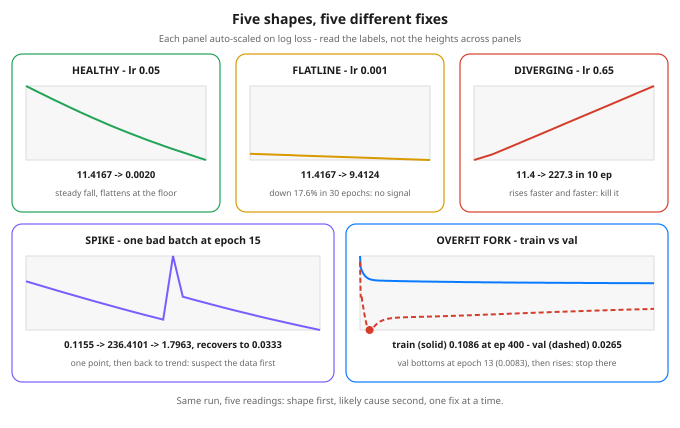

# Day 31 — Debugging Training: Loss Curves as Observability

**Tonight you'll be able to:** read any training run’s loss curve like a dashboard — tell a healthy descent from a flatline, a divergence, a one-batch spike and an overfit fork, name the likely cause of each, and know the first fix to try (and when to just kill the run).

## The one idea

Every run you have trained so far ended with you reading one number: the final loss. That number is nearly useless on its own. The loss curve — loss plotted against epoch — is the real telemetry, and its shape is the signal. Read it the way you read a service dashboard: trend over a window, train and validation side by side (Day 8), never one point in isolation. Five shapes cover almost everything you will ever debug:
1. Healthy. A steady fall that flattens as it approaches a floor — the noise floor of the problem (Days 7/19). Part 1’s lr 0.05 run: 11.4167 → 0.3933 by epoch 10 → 0.0020 at epoch 30, train and val together. Jagged is fine: a small batch makes the curve noisy even when the trend is sound (Day 30’s gradient noise). First move: none. Let it run.
2. Flatline. The loss barely moves — Part 1’s lr 0.001 run falls only 17.6% in 30 epochs, to 9.4124. Almost no signal is reaching the weights. Causes, in check order: stride far too small; gradients vanishing through saturated or dead units (Days 22/28); or the loss not connected to the weights at all — Day 20’s round() / detach() experiment produced gradients of exactly zero, and a zero gradient trains nothing, forever. First move: print a gradient. Non-zero and finite? Raise the stride. Zero? The graph is broken, not the dial.
3. Diverging. The loss rises, and rises faster: 11.4 → 48.7 → 227.3 in ten epochs at lr 0.65, on its way to NaN. Causes: stride past the stability edge (Day 30), exploding gradients, wildly unscaled inputs. First move: kill the run. Divergence never heals; every extra epoch is wasted compute. Then cut the stride by 10× and rerun short.
4. Spike. One epoch jumps, then the curve returns to trend. Part 2 feeds the healthy run a single corrupted target (50.0 — a bad print) at epoch 15 only: 0.1155 → 236.4101 → 1.7963, recovering to 0.0333 by epoch 30. A spike is a data story first — one bad batch, one corrupt example — not a model story. Note the honest cost: the bad step still moved the weights, so the healed run ends at 0.0333, not the healthy 0.0020. First move: don’t kill it. Inspect the batch at the spike.
5. Overfit fork. Train loss keeps falling while val loss bottoms and rises — invisible if you only watch train. Part 3’s degree-9 polynomial on 10 noisy points: train improves all 400 epochs to 0.1086, but val bottoms at epoch 13 (0.0083) and ends at 0.0265 — 3.2× worse. The model stopped learning the line and started memorizing the noise (Days 8/17). First move: stop at the val minimum — early stopping — then reach for Day 17’s tools, not more epochs.
The triage discipline. Shape → hypothesis → one intervention → the shortest run that can confirm it. Before touching any Day-30 dial, run the sanity checks: gradients present and finite, one batch of data and labels eyeballed, and the smoke test — can this model overfit ten examples? If it can’t even memorize a handful of points, the bug is in the code or the graph, not the hyperparameters. Tonight’s code ends with a tiny diagnose() that turns a loss history into a verdict with crude thresholds — real debugging is exactly that, with your judgment supplying the thresholds.

## Analogy

A loss curve is a training run’s Prometheus dashboard, and each shape has an incident-room twin you already know. Flatline is the frozen graph: the process is “up,” the metric hasn’t moved in an hour, and nothing is actually flowing — you check whether the pipeline is connected before you tune it. Divergence is a retry storm: errors compounding on themselves, and the correct response is the same — shed load / kill it now, diagnose after. A spike is the single bad deploy or the one poisoned request: terrifying on the graph, gone a minute later, and paging the whole team over it would have been the actual mistake.
Trading version, and it’s the fork: train loss is your backtest, val loss is your forward test. A curve-fit strategy’s backtest P&L improves with every extra parameter you tune (train falling) while live trading quietly deteriorates (val rising) — Day 9’s SPY line did exactly this across a regime change. You already refuse to trust a backtest that has no forward test beside it. Read training curves with the same suspicion: two lines, or you’re only seeing the flattering half.

## See it



Five shapes from tonight&rsquo;s real runs, each panel auto-scaled on log loss. Healthy lr 0.05: 11.4167 to 0.0020. Flatline lr 0.001: 11.4167 to 9.4124 (down 17.6%). Diverging lr 0.65: 11.4 to 227.3 in 10 epochs. Spike: one corrupted target at epoch 15 sends 0.1155 to 236.4101, then the run recovers to 0.0333. Overfit fork: train (solid) reaches 0.1086 at epoch 400 while val (dashed) bottoms at epoch 13 (0.0083) and rises to 0.0265.

## Code it (~30 min)

One file in ~/ai-lab, three parts, no randomness — every run starts from a hand-set init, so your numbers should match the expected output (the diverging run’s losses print to 1 decimal on purpose — divergence amplifies last-bit float differences). Part 1 trains Day 7’s line three ways and lets diagnose() — a small rule function defined at the top of the file — read each curve’s shape. Part 2 reruns the healthy training with one corrupted target at epoch 15 and watches the spike heal. Part 3 tracks train and val loss for a degree-9 polynomial over 400 epochs and reports the epoch early stopping would have chosen.

```python
"""Day 31 - Debugging Training: Loss Curves as Observability.

A single loss value tells you almost nothing. The SHAPE of the
loss over time is the signal -- the loss curve is the primary
dashboard of a training run, the way latency and error-rate
graphs are the dashboard of a service. Tonight five shapes,
each with a different likely cause and a different first fix:

  HEALTHY    steady fall, flattening near a floor. Train and
             val fall together. Leave it alone.
  FLATLINE   barely moves (Part 1: down 17.6% in 30 epochs).
             Almost no signal is reaching the weights: stride
             far too small, gradients vanishing (Days 22/28),
             dead units, or a loss that is not connected to
             the weights at all (Day 20: round()/detach()
             gave gradients of exactly zero).
  DIVERGING  rises, faster and faster, on its way to NaN.
             Stride too big (Day 30), exploding gradients, or
             unscaled data. Kill the run -- waiting never
             fixes a divergence.
  SPIKE      one-step jump, then a return to trend (Part 2:
             0.1155 -> 236.4101 -> 1.7963). Suspect ONE bad
             batch -- a corrupt example or a data glitch --
             before you suspect the model. Recovery is real
             but not free: the bad step still moved the
             weights, and the healed run ends worse.
  OVERFIT    train keeps falling while val bottoms and rises
  FORK       (Part 3). The model has started memorizing
             (Days 8/17). The cure is stopping at the val
             minimum -- early stopping -- not more epochs.

Two reading habits matter as much as the shapes. Judge the
TREND over a window, never one point to the next: a small
batch makes the curve jagged even when it is healthy
(Day 30's gradient noise). And always read train and val
together -- the fork is invisible in the train curve alone.

The diagnose() function below is the lesson in code: crude
threshold rules that turn a loss history into a verdict.
Real debugging is the same shape -- hypothesis from the
curve, ONE intervention, shortest run that can confirm it.

  Part 1  Three runs on Day 7's line (truth w=2.5, b=-1),
          same init w=b=0: lr 0.05 healthy, lr 0.001 flat,
          lr 0.65 diverging to 227.3 inside 10 epochs.
  Part 2  The healthy run with one corrupted target
          (50.0, a bad print) fed at epoch 15 only: loss
          spikes 2046x for one epoch, then recovers to
          0.0333 by epoch 30 vs the healthy 0.0020.
  Part 3  A degree-9 polynomial (features x..x^9) on 10
          noisy points of the true line y=x, validated on
          41 clean points: train falls the whole 400
          epochs, val bottoms at epoch 13 (0.0083) and
          ends at 0.0265 -- 3.2x worse.

Runs on the ~/ai-lab venv: torch only (free), CPU or MPS, no
CUDA, no paid APIs, no downloads. No randomness -- every run
starts from a hand-set init, so your numbers should match
the expected output. (The diverging losses are printed to
1 decimal: a diverging run amplifies last-bit float
differences, so its trailing digits are not stable.)

Expected output:

  device: mps
  Part 1 - three runs, same line, same init: read the shape
    healthy   lr 0.050: loss 11.4167 -> 2.0310 (ep 5) -> 0.3933 (ep 10) -> 0.0020 (ep 30)  w 2.4895  b -0.9576  -> HEALTHY
    flatline  lr 0.001: loss 11.4167 -> 11.0548 (ep 5) -> 10.7045 (ep 10) -> 9.4124 (ep 30)  w 0.2383  b -0.0583  -> FLATLINE
    diverging lr 0.650: loss 11.4 -> 48.7 (ep 5) -> 227.3 (ep 10)  -> DIVERGING
  Part 2 - one bad batch: a single corrupted target at epoch 15
    ep 14 loss 0.1155   ep 15 loss 236.4101   ep 16 loss 1.7963   ep 20 loss 0.5137   ep 30 loss 0.0333  -> SPIKE (recovered)
    spike size: 2046x the epoch-14 loss; final w 2.5691  b -0.8407 (healthy run: w 2.4895  b -0.9576)
  Part 3 - the overfit fork: train falls, val bottoms, then rises
    ep   0: train 0.4824  val 0.3500
    ep  10: train 0.1448  val 0.0099
    ep  50: train 0.1222  val 0.0164
    ep 200: train 0.1128  val 0.0202
    ep 400: train 0.1086  val 0.0265  -> OVERFIT FORK
    best val 0.0083 at epoch 13 - stopping there beats epoch 400 by 3.2x on val
"""
import math

import torch
import torch.nn as nn

device = torch.device("mps" if torch.backends.mps.is_available() else "cpu")
print("device:", device)


def diagnose(train_losses, val_losses=None):
    """Crude shape rules: a loss history in, a verdict out."""
    first, last = train_losses[0], train_losses[-1]
    if not all(math.isfinite(v) for v in train_losses) or last > first:
        return "DIVERGING"
    jumps = [train_losses[i] / max(train_losses[i - 1], 1e-12)
             for i in range(1, len(train_losses))]
    if max(jumps) > 20 and last < 0.01 * max(train_losses):
        return "SPIKE (recovered)"
    if (val_losses is not None and last < first
            and val_losses[-1] > 1.5 * min(val_losses)):
        return "OVERFIT FORK"
    if last > 0.75 * first:
        return "FLATLINE"
    return "HEALTHY"


# ---------- Part 1: three runs, three shapes ----------
print("Part 1 - three runs, same line, same init: read the shape")
X = torch.tensor([-2.0, -1.5, -1.0, -0.5, 0.0, 0.5, 1.0, 1.5, 2.0],
                 device=device)
Y = 2.5 * X - 1.0                                 # truth: w = 2.5, b = -1


def train_line(lr, epochs, spike_epoch=None):
    w = torch.tensor(0.0, device=device, requires_grad=True)
    b = torch.tensor(0.0, device=device, requires_grad=True)
    opt = torch.optim.SGD([w, b], lr=lr)
    losses = []
    for epoch in range(epochs + 1):
        targets = Y
        if epoch == spike_epoch:                  # one bad print, once
            targets = Y.clone()
            targets[8] = 50.0
        loss = ((w * X + b - targets) ** 2).mean()
        losses.append(loss.item())
        if epoch == epochs:
            break
        opt.zero_grad()
        loss.backward()
        opt.step()
    return losses, w.item(), b.item()


healthy, hw, hb = train_line(0.05, 30)
print(f"  healthy   lr 0.050: loss {healthy[0]:.4f} -> {healthy[5]:.4f} (ep 5)"
      f" -> {healthy[10]:.4f} (ep 10) -> {healthy[30]:.4f} (ep 30)"
      f"  w {hw:.4f}  b {hb:.4f}  -> {diagnose(healthy)}")
flat, fw, fb = train_line(0.001, 30)
print(f"  flatline  lr 0.001: loss {flat[0]:.4f} -> {flat[5]:.4f} (ep 5)"
      f" -> {flat[10]:.4f} (ep 10) -> {flat[30]:.4f} (ep 30)"
      f"  w {fw:.4f}  b {fb:.4f}  -> {diagnose(flat)}")
div, _, _ = train_line(0.65, 10)
print(f"  diverging lr 0.650: loss {div[0]:.1f} -> {div[5]:.1f} (ep 5)"
      f" -> {div[10]:.1f} (ep 10)  -> {diagnose(div)}")

# ---------- Part 2: a spike is a data story first ----------
print("Part 2 - one bad batch: a single corrupted target at epoch 15")
spiked, sw, sb = train_line(0.05, 30, spike_epoch=15)
print(f"  ep 14 loss {spiked[14]:.4f}   ep 15 loss {spiked[15]:.4f}"
      f"   ep 16 loss {spiked[16]:.4f}   ep 20 loss {spiked[20]:.4f}"
      f"   ep 30 loss {spiked[30]:.4f}  -> {diagnose(spiked)}")
print(f"  spike size: {spiked[15] / spiked[14]:.0f}x the epoch-14 loss;"
      f" final w {sw:.4f}  b {sb:.4f} (healthy run: w {hw:.4f}  b {hb:.4f})")

# ---------- Part 3: the overfit fork, train vs val ----------
print("Part 3 - the overfit fork: train falls, val bottoms, then rises")
tx = torch.linspace(-1.0, 1.0, 10, device=device)
noise = torch.tensor([0.50, -0.40, 0.45, -0.35, 0.30,
                      -0.50, 0.40, -0.30, 0.48, -0.42], device=device)
ty = tx + noise                                   # true line y = x, noised
vx = torch.linspace(-1.0, 1.0, 41, device=device)
vy = vx.clone()                                   # clean validation line


def poly_features(x):
    return torch.stack([x ** k for k in range(1, 10)], dim=1)  # x .. x^9


model = nn.Linear(9, 1, bias=False).to(device)
with torch.no_grad():
    model.weight.zero_()                          # hand-set init, as always
opt = torch.optim.SGD(model.parameters(), lr=0.5)
train_hist, val_hist, rows = [], [], []
for epoch in range(401):
    train_loss = ((model(poly_features(tx)).squeeze(1) - ty) ** 2).mean()
    with torch.no_grad():                         # Day 25: eval discipline
        val_loss = ((model(poly_features(vx)).squeeze(1) - vy) ** 2).mean()
    train_hist.append(train_loss.item())
    val_hist.append(val_loss.item())
    if epoch in (0, 10, 50, 200, 400):
        rows.append((epoch, train_loss.item(), val_loss.item()))
    if epoch == 400:
        break
    opt.zero_grad()
    train_loss.backward()
    opt.step()
for epoch, tl, vl in rows:
    suffix = f"  -> {diagnose(train_hist, val_hist)}" if epoch == 400 else ""
    print(f"  ep {epoch:3d}: train {tl:.4f}  val {vl:.4f}{suffix}")
best_epoch = min(range(len(val_hist)), key=lambda i: val_hist[i])
print(f"  best val {val_hist[best_epoch]:.4f} at epoch {best_epoch}"
      f" - stopping there beats epoch 400 by"
      f" {val_hist[-1] / val_hist[best_epoch]:.1f}x on val")
```

**Expected output:**

```
device: mps
Part 1 - three runs, same line, same init: read the shape
  healthy   lr 0.050: loss 11.4167 -> 2.0310 (ep 5) -> 0.3933 (ep 10) -> 0.0020 (ep 30)  w 2.4895  b -0.9576  -> HEALTHY
  flatline  lr 0.001: loss 11.4167 -> 11.0548 (ep 5) -> 10.7045 (ep 10) -> 9.4124 (ep 30)  w 0.2383  b -0.0583  -> FLATLINE
  diverging lr 0.650: loss 11.4 -> 48.7 (ep 5) -> 227.3 (ep 10)  -> DIVERGING
Part 2 - one bad batch: a single corrupted target at epoch 15
  ep 14 loss 0.1155   ep 15 loss 236.4101   ep 16 loss 1.7963   ep 20 loss 0.5137   ep 30 loss 0.0333  -> SPIKE (recovered)
  spike size: 2046x the epoch-14 loss; final w 2.5691  b -0.8407 (healthy run: w 2.4895  b -0.9576)
Part 3 - the overfit fork: train falls, val bottoms, then rises
  ep   0: train 0.4824  val 0.3500
  ep  10: train 0.1448  val 0.0099
  ep  50: train 0.1222  val 0.0164
  ep 200: train 0.1128  val 0.0202
  ep 400: train 0.1086  val 0.0265  -> OVERFIT FORK
  best val 0.0083 at epoch 13 - stopping there beats epoch 400 by 3.2x on val
```

## Today's win

Done when: Part 1 prints all three verdicts — lr 0.05 HEALTHY at loss 0.0020, lr 0.001 FLATLINE at 9.4124, lr 0.65 DIVERGING at 227.3; Part 2 shows the spike to 236.4101 at epoch 15, recovery to 0.0333, and the verdict SPIKE (recovered); Part 3 prints the fork (train 0.1086 vs val 0.0265 at epoch 400) with best val 0.0083 at epoch 13. The bigger test: hand you any loss curve and you can say shape → likely cause → first fix, in that order, before touching a single dial.

## Short on time? 20-minute version

Run the whole file once (seconds), then study Part 1’s three verdict lines and Part 3’s five train/val rows. If you can predict diagnose()’s verdict for each run before it prints — including why the spike is not a divergence and why the fork needs both curves to be seen at all — you have the lesson.

## Tomorrow's teaser

Tomorrow: a real tabular dataset and a full MLP build — and for the first time, you’ll know how to read the run while it’s training.

Streak: 31 day(s) · Never miss twice.
