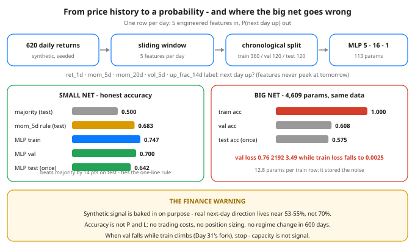

# Day 32 — Build: MLP on Tabular Data — Predict Next-Day Direction

**Tonight you'll be able to:** engineer 5 features from raw price history, train an MLP to predict tomorrow's direction, judge it against two baselines it has to beat — and watch a much bigger net memorize the same data and do worse.

## The one idea

Every dataset so far arrived pre-shaped: digits as 64 pixel numbers (Days 16/27), XOR as coordinates. **Tabular data** — rows of numbers in columns, the shape of almost all business and market data — arrives as *history*, and the model never sees the history. It sees **features**: numbers you engineer from the history. That translation, **feature engineering**, is most of tonight's job — the MLP at the end is deliberately small.

**The five features** (one row per day, all computed from returns up to and including today): `ret_1d` — yesterday's return; `mom_5d` / `mom_20d` — mean return over 5 / 20 days (momentum and trend); `vol_5d` — the 5-day standard deviation (volatility); `up_frac_14d` — the fraction of up days in 14 (breadth). The **label** is tomorrow's sign: 1 if the next return is positive, else 0 — a binary classification (Days 14/16), scored with `BCEWithLogitsLoss`. The iron rule: **features may never peek at tomorrow.** One leaked future value is look-ahead bias (Day 9), and every accuracy after it is a lie.

**Split and scale, the Day 8/9 way.** The 600 samples split *chronologically* — train 360, val 120, test 120, test touched once per model at the very end. Shuffling time would let the model train on the future and "predict" the past. Then **z-score normalization** with *train* statistics only: the raw scales are wildly different (`vol_5d` averages 0.00461, `up_frac_14d` 0.53353), and unscaled inputs are exactly Day 30's ravine — one feature's gradient drowns the rest.

**Baselines before models. Always.** Two numbers any model must beat: the **majority baseline** (always predict the commoner sign: 0.5222 / 0.5167 / 0.5000 across the splits) and a **one-line rule** — predict tomorrow's sign from `mom_5d` alone (0.6972 / 0.6417 / 0.6833). A neural net that cannot beat a coin-weighted guess *and* a one-line rule has learned nothing, whatever its training loss says.

**The overfitting warning — tonight's real lesson.** Finance has the lowest signal-to-noise ratio in machine learning, so capacity discipline is the whole game. Count **parameters per training sample**: the small net carries 113 params for 360 rows (0.3 per row) and generalizes — val accuracy 0.7000, test 0.6417, comfortably past majority and roughly *tied* with the one-line rule (in low-signal domains, that tie is the honest norm). The big net carries 4,609 params — **12.8 per row** — and memorizes: train accuracy 1.0000, train loss 0.0025, while val loss *climbs* 0.7614 → 3.4858 (Day 31's fork, in loss) and test *falls* to 0.5750. Two honesty notes: tonight's signal is baked into synthetic data on purpose — real next-day direction lives near 53–55%, not 70% — and accuracy is not P&L: no trading costs, sizing, or regime change are modeled here. Phase G does this for real.

## Analogy

Feature engineering is a **materialized view**. You would never alert on raw log lines; you pre-aggregate them into metrics — error rate per service, p99 per endpoint — and alert on *those*. Features are the same move: raw returns are the log lines, `mom_20d` and `vol_5d` are the rollups, and the MLP is just the alert rule that learned its own thresholds. Garbage rollup, garbage alert — the model downstream cannot recover information your features threw away, or un-leak a future value they smuggled in.

Trading version: **indicators are hand-engineered features.** RSI, moving averages, realized vol — you have read them for years. An MLP on five indicators is a *learnable combiner* of indicators, nothing more mystical. And parameters-per-sample is a rule you already trade by: a strategy with 40 tuned knobs fit to 30 historical trades is curve-fit (Day 8) no matter how beautiful the backtest equity curve looks. 4,609 knobs on 360 rows is that strategy, wearing a neural net.

## See it



The pipeline: 620 synthetic daily returns → a sliding window of 5 features per day → a chronological 360/120/120 split → a 113-param MLP. Left: the small net's honest scores — test 0.642 beats the majority baseline (0.500) and roughly ties the one-line mom_5d rule (0.683). Right: the 4,609-param net on the same data — train accuracy 1.000 while val loss climbs 0.76 → 3.49 and test drops to 0.575. Memorization, measured.

## Code it (~30 min)

One file, three parts. Part 1 builds the returns from fixed formulas (no randomness — its output is **exact**), engineers the 5 features with a sliding window, splits chronologically, prints both baselines, and normalizes with train stats only. Part 2 trains the small MLP (Adam, `DataLoader` batch 32, the Day 25 `evaluate()` discipline) and touches test *once*. Part 3 trains the big net on the same rows and watches it memorize. Parts 2–3 set `torch.manual_seed(42)`, but init and shuffle streams differ across devices and torch versions, so their numbers below are **reference numbers from a verified run** — your last digits may differ; the pattern (small generalizes, big memorizes) is guaranteed.

```python
"""Day 32 - Build: MLP on Tabular Data - Predict Next-Day Direction.

Every model so far ate data that was already shaped for it:
digits arrived as 64 pixel numbers (Days 16/27), XOR arrived
as coordinates. Real tabular data arrives as HISTORY, and
the model never sees the history - it sees FEATURES, numbers
you engineer from the history. Feature engineering is that
translation step, and tonight it is most of the job.

  The dataset (Part 1). 620 synthetic daily returns, built
  from a smooth momentum wave plus seeded hash noise - a
  real signal baked in ON PURPOSE, so there is something
  to learn. A sliding window turns each day into 5 features
  a trader already computes by hand:

    ret_1d       yesterday's return
    mom_5d       mean return, last 5 days   (momentum)
    mom_20d      mean return, last 20 days  (trend)
    vol_5d       std of returns, last 5 days (volatility)
    up_frac_14d  fraction of up days, last 14 (breadth)

  The label is tomorrow's sign: 1 if the next return is
  > 0, else 0. Features use only data up to today - one
  peek at tomorrow is look-ahead bias (Day 9) and makes
  every number that follows a lie. The split is
  chronological, never shuffled (Days 8/19): train 360,
  val 120, test 120, test touched once per model at the
  very end. Features are z-scored with TRAIN stats only
  (Day 9's rule): the raw scales are wildly different
  (vol_5d ~ 0.0046, up_frac_14d ~ 0.53), and unscaled
  inputs are Day 30's ravine all over again.

  Baselines before models. Always. The majority class
  (always predict the commoner sign) scores 0.5222 /
  0.5167 / 0.5000 on train/val/test, and a one-line rule -
  predict tomorrow = sign of mom_5d - scores 0.6972 /
  0.6417 / 0.6833. A model that cannot beat BOTH numbers
  has learned nothing, however good its loss looks.

  Part 2 trains a small MLP (5 -> 16 -> 1, 113 params,
  BCEWithLogits - Days 14/16, Adam - Day 18, DataLoader -
  Day 19, evaluate() discipline - Day 25). It generalizes:
  train acc 0.7472, val 0.7000, test 0.6417 - comfortably
  past the majority baseline, roughly TIED with the
  one-line rule. In low-signal finance that tie is the
  honest norm, not a failure.

  Part 3 is the overfitting warning, measured. Same data,
  a bigger MLP (5 -> 64 -> 64 -> 1): 4,609 params for 360
  train rows - 12.8 params per sample. It memorizes:
  train loss 0.0025, train acc 1.0000, while val loss
  CLIMBS 0.7614 -> 3.4858 (Day 31's fork, in loss) and
  test falls to 0.5750, below the small net. Capacity is
  not signal. When parameters outnumber the patterns,
  the net stores the noise - and finance is mostly noise:
  tonight's signal was baked in and still caps near 0.70;
  real next-day direction lives near 0.53-0.55, and even
  a true accuracy edge is not P&L (no costs, sizing or
  regime change modeled here). Phase G does this for real.

Runs on the ~/ai-lab venv: torch only (free), CPU or MPS,
no CUDA, no paid APIs, no downloads. Part 1 is exact -
the data is built from fixed formulas, no randomness.
Parts 2-3 set torch.manual_seed(42) before each model,
but init and shuffle streams differ across devices and
torch versions, so those numbers are REFERENCE numbers
from a verified run: your digits may differ in the last
places, the pattern is guaranteed - small net val ~0.70
and test beating majority; big net train -> 1.0000 with
val loss climbing and test below the small net's.

Expected output:

  device: mps
  Part 1 - features from price history: one row per day
    returns: 620 days -> 600 samples, X shape (600, 5), y shape (600,)
    features: ret_1d mom_5d mom_20d vol_5d up_frac_14d
    first row: [0.00356, 0.00410, 0.00535, 0.00174, 0.92857]  label 1 (up)
    splits (chronological, no shuffle): train 360  val 120  test 120
    train: up 0.5222  majority baseline 0.5222  mom_5d rule 0.6972
    val:   up 0.5167  majority baseline 0.5167  mom_5d rule 0.6417
    test:  up 0.5000  majority baseline 0.5000  mom_5d rule 0.6833
    normalize with train stats only: mean [0.00014, 0.00016, 0.00038, 0.00461, 0.53353]
                                     std  [0.00631, 0.00461, 0.00340, 0.00141, 0.26490]
    first row normalized: [0.542, 0.856, 1.460, -2.034, 1.491]
  Part 2 - small MLP 5 -> 16 -> 1: 113 params for 360 train rows
    ep   0: train loss 0.7014  train acc 0.5611  val loss 0.7127  val acc 0.5917
    ep  15: train loss 0.5320  train acc 0.7250  val loss 0.5821  val acc 0.7167
    ep  30: train loss 0.5240  train acc 0.7278  val loss 0.5922  val acc 0.7000
    ep  60: train loss 0.5132  train acc 0.7472  val loss 0.5911  val acc 0.7000
    test (touched once): acc 0.6417  (majority 0.5000, mom_5d rule 0.6833)
  Part 3 - big MLP 5 -> 64 -> 64 -> 1: 4609 params for the same 360 rows
    ep   0: train loss 0.8364  train acc 0.4389  val loss 0.7614  val acc 0.5167
    ep  75: train loss 0.1941  train acc 0.9139  val loss 1.7103  val acc 0.5667
    ep 150: train loss 0.1222  train acc 0.9444  val loss 2.6606  val acc 0.6250
    ep 300: train loss 0.0025  train acc 1.0000  val loss 3.4858  val acc 0.6083
    test (touched once): acc 0.5750  (small MLP: 0.6417)
    verdict: 4609 params = 12.8 per train row - the big net memorized; the small net generalized
"""
import math

import torch
import torch.nn as nn
from torch.utils.data import DataLoader, TensorDataset

device = torch.device("mps" if torch.backends.mps.is_available() else "cpu")
print("device:", device)

# ---------- Part 1: features from price history ----------
print("Part 1 - features from price history: one row per day")
ret_list = []
for i in range(620):
    n1 = math.sin(i * 12.9898) * 43758.5453
    n1 = n1 - math.floor(n1) - 0.5               # seeded hash noise
    n2 = math.sin(i * 78.233 + 5.0) * 12543.123
    n2 = n2 - math.floor(n2) - 0.5
    wave = 0.005 * math.sin(i / 6.0) + 0.003 * math.sin(i / 17.0 + 1.3)
    ret_list.append(wave + (n1 + n2) * 0.012)    # momentum wave + noise
rets = torch.tensor(ret_list, dtype=torch.float32)

rows, labels = [], []
for t in range(19, 619):                         # 600 labeled days
    w5, w20, w14 = rets[t - 4:t + 1], rets[t - 19:t + 1], rets[t - 13:t + 1]
    rows.append(torch.stack([
        rets[t],                                 # ret_1d
        w5.mean(),                               # mom_5d
        w20.mean(),                              # mom_20d
        w5.std(),                                # vol_5d
        (w14 > 0).float().mean(),                # up_frac_14d
    ]))
    labels.append(1.0 if rets[t + 1] > 0 else 0.0)   # tomorrow's sign
X = torch.stack(rows)
y = torch.tensor(labels)
print(f"  returns: 620 days -> 600 samples, X shape {tuple(X.shape)},"
      f" y shape {tuple(y.shape)}")
print("  features: ret_1d mom_5d mom_20d vol_5d up_frac_14d")
first = ", ".join(f"{v:.5f}" for v in X[0].tolist())
print(f"  first row: [{first}]  label {int(y[0])} (up)")

Xtr, ytr = X[:360], y[:360]                      # chronological split:
Xva, yva = X[360:480], y[360:480]                # no shuffling time
Xte, yte = X[480:], y[480:]
print("  splits (chronological, no shuffle): train 360  val 120  test 120")
mom_pred = (X[:, 1] > 0).float()                 # one-line rule: mom_5d sign
base = {}
for name, Xs, ys in (("train", Xtr, ytr), ("val", Xva, yva),
                     ("test", Xte, yte)):
    up = ys.mean().item()
    maj = max(up, 1.0 - up)
    sl = {"train": slice(0, 360), "val": slice(360, 480),
          "test": slice(480, 600)}[name]
    rule = (mom_pred[sl] == ys).float().mean().item()
    base[name] = (maj, rule)
    print(f"  {name + ':':<7}up {up:.4f}  majority baseline {maj:.4f}"
          f"  mom_5d rule {rule:.4f}")

mu, sd = Xtr.mean(dim=0), Xtr.std(dim=0)         # train stats ONLY
print("  normalize with train stats only: mean ["
      + ", ".join(f"{v:.5f}" for v in mu.tolist()) + "]")
print("                                   std  ["
      + ", ".join(f"{v:.5f}" for v in sd.tolist()) + "]")
Xtr_n, Xva_n, Xte_n = (Xtr - mu) / sd, (Xva - mu) / sd, (Xte - mu) / sd
print("  first row normalized: ["
      + ", ".join(f"{v:.3f}" for v in Xtr_n[0].tolist()) + "]")
Xtr_n, Xva_n, Xte_n = Xtr_n.to(device), Xva_n.to(device), Xte_n.to(device)
ytr_d, yva_d, yte_d = ytr.to(device), yva.to(device), yte.to(device)

# ---------- the model + the Day 25 evaluation discipline ----------
crit = nn.BCEWithLogitsLoss()


class TabMLP(nn.Module):
    """Rows in, one logit out: P(up) = sigmoid(logit)."""

    def __init__(self, hidden):
        super().__init__()
        layers, d = [], 5
        for h in hidden:
            layers += [nn.Linear(d, h), nn.ReLU()]
            d = h
        layers += [nn.Linear(d, 1)]
        self.net = nn.Sequential(*layers)

    def forward(self, x):
        return self.net(x).squeeze(1)


def evaluate(model, Xs, ys):
    model.eval()                                 # Day 25: eval + no_grad
    with torch.no_grad():
        logits = model(Xs)
        acc = ((logits > 0).float() == ys).float().mean()
        return crit(logits, ys).item(), acc.item()


def train_model(hidden, epochs, checks):
    torch.manual_seed(42)
    model = TabMLP(hidden).to(device)
    opt = torch.optim.Adam(model.parameters(), lr=0.01)
    loader = DataLoader(TensorDataset(Xtr_n, ytr_d), batch_size=32,
                        shuffle=True)
    for epoch in range(epochs + 1):
        if epoch in checks:
            tl, ta = evaluate(model, Xtr_n, ytr_d)
            vl, va = evaluate(model, Xva_n, yva_d)
            print(f"  ep {epoch:3d}: train loss {tl:.4f}  train acc {ta:.4f}"
                  f"  val loss {vl:.4f}  val acc {va:.4f}")
        if epoch == epochs:
            break
        model.train()
        for xb, yb in loader:
            opt.zero_grad()
            crit(model(xb), yb).backward()
            opt.step()
    return model, sum(p.numel() for p in model.parameters())


def count_params(hidden):
    dims = [5] + hidden + [1]
    return sum((a + 1) * b for a, b in zip(dims[:-1], dims[1:]))


# ---------- Part 2: the small net generalizes ----------
print(f"Part 2 - small MLP 5 -> 16 -> 1: {count_params([16])} params"
      " for 360 train rows")
small, _ = train_model([16], 60, (0, 15, 30, 60))
_, small_test = evaluate(small, Xte_n, yte_d)
print(f"  test (touched once): acc {small_test:.4f}"
      f"  (majority {base['test'][0]:.4f}, mom_5d rule {base['test'][1]:.4f})")

# ---------- Part 3: the big net memorizes ----------
print(f"Part 3 - big MLP 5 -> 64 -> 64 -> 1: {count_params([64, 64])} params"
      " for the same 360 rows")
big, _ = train_model([64, 64], 300, (0, 75, 150, 300))
_, big_test = evaluate(big, Xte_n, yte_d)
print(f"  test (touched once): acc {big_test:.4f}"
      f"  (small MLP: {small_test:.4f})")
print(f"  verdict: {count_params([64, 64])} params ="
      f" {count_params([64, 64]) / 360:.1f} per train row - the big net"
      " memorized; the small net generalized")
```

**Expected output:**

```
device: mps
Part 1 - features from price history: one row per day
  returns: 620 days -> 600 samples, X shape (600, 5), y shape (600,)
  features: ret_1d mom_5d mom_20d vol_5d up_frac_14d
  first row: [0.00356, 0.00410, 0.00535, 0.00174, 0.92857]  label 1 (up)
  splits (chronological, no shuffle): train 360  val 120  test 120
  train: up 0.5222  majority baseline 0.5222  mom_5d rule 0.6972
  val:   up 0.5167  majority baseline 0.5167  mom_5d rule 0.6417
  test:  up 0.5000  majority baseline 0.5000  mom_5d rule 0.6833
  normalize with train stats only: mean [0.00014, 0.00016, 0.00038, 0.00461, 0.53353]
                                   std  [0.00631, 0.00461, 0.00340, 0.00141, 0.26490]
  first row normalized: [0.542, 0.856, 1.460, -2.034, 1.491]
Part 2 - small MLP 5 -> 16 -> 1: 113 params for 360 train rows
  ep   0: train loss 0.7014  train acc 0.5611  val loss 0.7127  val acc 0.5917
  ep  15: train loss 0.5320  train acc 0.7250  val loss 0.5821  val acc 0.7167
  ep  30: train loss 0.5240  train acc 0.7278  val loss 0.5922  val acc 0.7000
  ep  60: train loss 0.5132  train acc 0.7472  val loss 0.5911  val acc 0.7000
  test (touched once): acc 0.6417  (majority 0.5000, mom_5d rule 0.6833)
Part 3 - big MLP 5 -> 64 -> 64 -> 1: 4609 params for the same 360 rows
  ep   0: train loss 0.8364  train acc 0.4389  val loss 0.7614  val acc 0.5167
  ep  75: train loss 0.1941  train acc 0.9139  val loss 1.7103  val acc 0.5667
  ep 150: train loss 0.1222  train acc 0.9444  val loss 2.6606  val acc 0.6250
  ep 300: train loss 0.0025  train acc 1.0000  val loss 3.4858  val acc 0.6083
  test (touched once): acc 0.5750  (small MLP: 0.6417)
  verdict: 4609 params = 12.8 per train row - the big net memorized; the small net generalized
```

## Today's win

Done when: Part 1 prints 600 samples with the baselines (majority 0.5222 / 0.5167 / 0.5000, mom_5d rule 0.6972 / 0.6417 / 0.6833); Part 2's small net lands val accuracy near 0.70 with test (touched once) near 0.64, past the majority baseline; Part 3's big net drives train accuracy to ~1.0000 while its val loss climbs past 3 and its test accuracy lands *below* the small net's. The bigger test: you can finish this sentence without notes — "the big net lost because it had ___ parameters per training row, so it stored ___ instead of learning ___."

## Short on time? 20-minute version

Run the file once (the big net takes a minute or two), then study just two things: Part 1's baseline table and Part 3's four checkpoint rows. If you can explain why the split must be chronological, why test is touched once, and why a *rising* val loss matters even when val accuracy wobbles sideways, you have the lesson.

## Tomorrow's teaser

Tomorrow: two identical nets on the same data — one trains, one never moves at all. The difference is decided before the first epoch begins.

Streak: 32 day(s) · Never miss twice.
