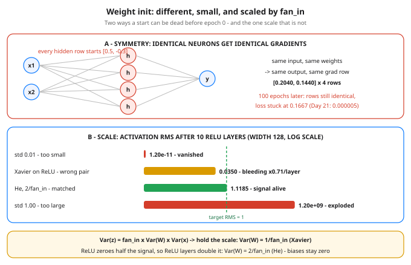

# Day 33 — Weight Init & Why It Matters

**Tonight you'll be able to:** spot the two ways a network can be dead before epoch 0 — identical neurons that can never specialize, and a signal that vanishes or explodes layer by layer — and initialize weights the way PyTorch's own recipes do: random, scaled by fan-in, and matched to the activation.

## The one idea

Every weight you have ever trained started as a number somebody chose *before* epoch 0 — you set some by hand (Days 21–24), PyTorch picked the rest behind your back. That choice is **weight initialization**, and it has exactly two jobs: make the neurons **different** from each other, and keep the **signal the same size** as it crosses each layer. Fail either job and the net is dead before training starts — no optimizer (Day 18) and no learning rate (Day 30) can save it.

**Job 1 — break symmetry.** Day 23's rules say a weight's gradient is the blame signal times the input it scaled. Give two hidden neurons identical weights and they compute identical outputs, receive identical blame, and take identical steps — forever. A 4-neuron layer with one copied row is really a 1-neuron layer with extra arithmetic. All-**zero** init is the extreme case: with ReLU, hidden activations are 0, first-layer gradients are exactly 0, and only the output bias can move at all (Part 1 measures both). Random weights are not superstition — the randomness *is* the specialization mechanism.

**Job 2 — hold the scale.** A pre-activation is a sum of `fan_in` products, `z = w1·x1 + … + wn·xn`, and the variances of independent terms *add*: `Var(z) = fan_in × Var(W) × Var(x)`. That one line is tonight's whole math budget, and it bites fast: at fan-in 128, weights with std 1.0 give each layer's signal a std of about √128 ≈ 11.3; std 0.01 shrinks it to 0.11 — per layer, compounding (Days 22/28 showed what repeated shrinking does to gradients, which travel backward through the same weights).

**The two named recipes.** Set `Var(W) = 1/fan_in` and the scale holds: that is **Xavier (Glorot) init**, std `√(1/fan_in)`, the right pair for tanh/sigmoid, whose alive zone sits around zero (Day 22). ReLU zeroes about half its inputs, halving the signal's power, so ReLU layers need double: `Var(W) = 2/fan_in`, std `√(2/fan_in)` — **He (Kaiming) init**. Too-large weights kill tanh the other way: they don't explode, they *saturate* it (Part 2: 85.96% of pre-activations past |z| = 2, gradient factor 0.0697).

**In practice:** biases start at zero — the asymmetry lives in the weights. PyTorch's `nn.Linear` default is already a fan-in-scaled init, which is why your earlier nets trained without ever asking this question; you reach for explicit init when you write custom layers, stack many layers, or override a default. And the start is *checkable* (Day 31's instinct): print each layer's weight std against its target, and probe one batch's activation size layer by layer, before you train.

## Analogy

Booting replicas with an **identical random seed**. Every replica then makes the same "random" choices — same jitter, same retry times, same shard picks — and a fleet that was supposed to spread load moves as one synchronized herd. Real fleets seed per replica precisely so identical code produces *different* behavior. Identical neurons are replicas with the same seed: same input, same decision, same update, forever — capacity on paper, one worker in fact.

Trading version, and it is exact: **init is position sizing.** Put 128 names in a book, each sized as if it were your only trade, and the portfolio's variance is the *sum* of 128 variances — total risk ≈ √128 ≈ 11.3× a single name. To hold portfolio risk constant, per-name size shrinks like `1/√(book size)`. A neuron summing 128 inputs obeys the same arithmetic: per-weight std shrinks like `1/√(fan_in)`. He's extra √2 is just sizing up because half the book (the ReLU-zeroed half) is flat at any moment.

## See it



Top: four hidden neurons sharing one weight row get one shared gradient row ([0.2040, 0.1440] × 4) — after 100 epochs the rows are still identical and XOR loss is stuck at 0.1667, vs Day 21's 0.000005 with different init. Bottom: activation RMS after 10 ReLU layers (width 128, log scale) — std 0.01 vanishes to 1.20e-11, Xavier-on-ReLU bleeds to 0.0350, std 1.00 explodes to 1.20e+09, and He (2/fan_in) lands at 1.1185, next to the target line.

## Code it (~30 min)

One file, three parts. Part 1 is **exact** — every weight set by hand: a zero-init net's first backward pass, then Day 21's XOR recipe (SGD lr=0.5, 100 epochs) run on a net whose hidden rows all start identical. Part 2 pushes one seeded signal through 10 ReLU layers of width 128 under four inits and prints the signal's **RMS** (root mean square — its typical size) at layers 1, 5 and 10, plus the tanh saturation detour. Part 3 is the recipe you will actually reuse: `kaiming_normal_` on ReLU layers, `xavier_normal_` on the output, biases zeroed, each layer's actual std checked against target. Parts 2–3 set `torch.manual_seed`, but randn streams differ across devices and torch versions, so their numbers below are **reference numbers from a verified run** — your last digits may differ; the pattern (tiny vanishes, large explodes, He holds ~1, actual stds land near target) is guaranteed.

```python
"""Day 33 - Weight Init & Why It Matters.

Every net you have trained started from weights somebody
picked before epoch 0 - Days 21-32 you either set them by
hand or let PyTorch pick. Tonight is what that choice does,
in three measured failures and one recipe.

  Part 1 - symmetry. If two hidden neurons start with the
  SAME weights, they see the same input, produce the same
  output, and - by Day 23's rules - receive the same
  gradient, forever. They can never split up the work:
  the layer is one neuron wearing copies. All-zero is
  worse with ReLU: hidden activations are 0 and the first
  weight gradient is delta x input = 0 x 0, so W1 and W2
  get grad 0.0000 and only the output bias can move (it
  can learn the mean of y, nothing else). The all-same
  XOR net (every hidden row [0.5, -0.3], every output
  weight 0.6) trains 100 epochs and its hidden rows are
  STILL identical to the last digit: loss stalls at
  0.1667, 3/4 corners. Day 21's different-by-hand init
  on the same data reached 0.000005 and 4/4.

  Part 2 - scale. A neuron's pre-activation is a sum of
  fan_in products, and variances of independent terms
  ADD: Var(z) = fan_in x Var(W) x Var(x). Hold Var(z) at
  Var(x) and you get Var(W) = 1/fan_in - the Xavier
  scale. ReLU then zeroes about half its inputs, halving
  the signal's second moment, so ReLU layers need double:
  Var(W) = 2/fan_in - the He scale. Measured through 10
  ReLU layers of width 128: std 0.01 shrinks the signal
  x0.08 per layer (1.20e-11 by layer 10), std 1.00 grows
  it x8 per layer (1.20e+09), Xavier-for-ReLU still
  bleeds x0.71 per layer (0.0350), He holds ~1. The same
  oversizing kills tanh differently: at std 1.00, 85.96%
  of layer-1 pre-activations sit past |z| = 2, saturated,
  with mean gradient factor 0.0697 vs Xavier's 0.6067
  (Day 22's saturation tax, collected at layer 1).

  Part 3 - the recipe, in code: random (breaks symmetry),
  scaled by fan_in (holds the scale), matched to the
  activation (He for ReLU layers, Xavier for the tanh /
  linear-style output), biases at zero - the asymmetry
  lives in the weights. PyTorch's nn.Linear default is
  already a scaled init, which is why your earlier nets
  trained without you ever asking; you reach for explicit
  init when you build custom layers, go deep, or override.

Runs on the ~/ai-lab venv: torch only (free), CPU on
purpose (tiny data), no CUDA, no paid APIs, no downloads.
Part 1 is exact - every weight is set by hand. Parts 2-3
set torch.manual_seed, but randn streams differ across
devices and torch versions, so their numbers are
REFERENCE numbers from a verified run: your digits may
differ in the last places, the pattern is guaranteed -
tiny vanishes, large explodes, He holds ~1, and every
actual std lands within a few % of its target.

Expected output:

  Part 1 - symmetry: identical neurons can never split up the work
    all-zero init: loss 0.5000  grad W1 max 0.0000  grad W2 max 0.0000  grad b2 -1.0000
      only the output bias can move - it can learn the mean of y, nothing else
    all-same init, step 0: grad W1 row = [0.2040, 0.1440], repeated for all 4 rows
    all-same init, 100 epochs: loss 0.3176 -> 0.1667
      preds 0.3333, 0.3333, 1.0000, 0.3333  (correct: 3/4)
      hidden row 0 after training: [0.4016, -0.3720]  max diff between rows 0.000000
      contrast Day 21 (different init, same data): loss 0.000005, correct 4/4
  Part 2 - signal size through 10 ReLU layers, width 128 (activation RMS)
    std 0.01 (too small):     in 1.0028  layer 1 0.0798  layer 5 3.29e-06  layer 10 1.20e-11
    std 1.00 (too large):     in 1.0028  layer 1 7.9769  layer 5 3.29e+04  layer 10 1.20e+09
    Xavier std 0.0884 (1/128): in 1.0028  layer 1 0.7051  layer 5 0.1773  layer 10 0.0350
    He std 0.1250 (2/128):    in 1.0028  layer 1 0.9971  layer 5 1.0027  layer 10 1.1185
    tanh detour, layer 1: std 1.00 -> 85.96% saturated (|z| > 2), mean grad factor 0.0697
                          Xavier   -> 4.54% saturated (|z| > 2), mean grad factor 0.6067
    verdict: only the fan_in-scaled init matched to the activation holds the signal near 1
  Part 3 - the recipe: random, fan_in-scaled, matched to the activation
    hidden 1 (fan_in 128): He normal     target std 0.1250  actual std 0.1254
    hidden 2 (fan_in 128): He normal     target std 0.1250  actual std 0.1257
    output   (fan_in 128): Xavier normal target std 0.1204  actual std 0.1181
    biases: all zero - the asymmetry lives in the weights, not the biases
    check: every actual std within a few % of target - that is a healthy start
"""
import math

import torch
import torch.nn as nn

# ---------- Part 1: symmetry - identical neurons, identical fate ----------
print("Part 1 - symmetry: identical neurons can never split up the work")
X = torch.tensor([[0.0, 0.0], [0.0, 1.0], [1.0, 0.0], [1.0, 1.0]])
y = torch.tensor([[0.0], [1.0], [1.0], [0.0]])          # XOR (Day 21)


def build(w1, b1, w2, b2):
    fc1, fc2 = nn.Linear(2, 4), nn.Linear(4, 1)
    with torch.no_grad():
        fc1.weight.copy_(w1)
        fc1.bias.copy_(b1)
        fc2.weight.copy_(w2)
        fc2.bias.copy_(b2)
    return fc1, fc2


def forward(fc1, fc2, x):
    return fc2(torch.relu(fc1(x)))


# all-zero: with ReLU nothing upstream of the output bias can ever move
fc1, fc2 = build(torch.zeros(4, 2), torch.zeros(4),
                 torch.zeros(1, 4), torch.zeros(1))
loss = ((forward(fc1, fc2, X) - y) ** 2).mean()
loss.backward()
print(f"  all-zero init: loss {loss.item():.4f}"
      f"  grad W1 max {fc1.weight.grad.abs().max().item():.4f}"
      f"  grad W2 max {fc2.weight.grad.abs().max().item():.4f}"
      f"  grad b2 {fc2.bias.grad.item():.4f}")
print("    only the output bias can move - it can learn the mean of"
      " y, nothing else")

# all-same: every hidden row identical -> every gradient row identical
same_w1 = torch.tensor([[0.5, -0.3]] * 4)
same_w2 = torch.tensor([[0.6, 0.6, 0.6, 0.6]])
fc1, fc2 = build(same_w1, torch.zeros(4), same_w2, torch.zeros(1))
loss0 = ((forward(fc1, fc2, X) - y) ** 2).mean()
loss0.backward()
g = fc1.weight.grad[0]
print(f"  all-same init, step 0: grad W1 row = [{g[0]:.4f}, {g[1]:.4f}],"
      " repeated for all 4 rows")

fc1, fc2 = build(same_w1, torch.zeros(4), same_w2, torch.zeros(1))
opt = torch.optim.SGD(list(fc1.parameters()) + list(fc2.parameters()),
                      lr=0.5)
for _ in range(100):                                     # Day 21's recipe
    opt.zero_grad()
    loss = ((forward(fc1, fc2, X) - y) ** 2).mean()
    loss.backward()
    opt.step()
with torch.no_grad():
    preds = forward(fc1, fc2, X)
    final = ((preds - y) ** 2).mean().item()
    correct = int(((preds > 0.5) == (y > 0.5)).sum().item())
    row_diff = (fc1.weight - fc1.weight[0]).abs().max().item()
    row0 = fc1.weight[0]
fmt = ", ".join(f"{v:.4f}" for v in preds.flatten().tolist())
print(f"  all-same init, 100 epochs: loss {loss0.item():.4f} -> {final:.4f}")
print(f"    preds {fmt}  (correct: {correct}/4)")
print(f"    hidden row 0 after training: [{row0[0]:.4f}, {row0[1]:.4f}]"
      f"  max diff between rows {row_diff:.6f}")
print("    contrast Day 21 (different init, same data): loss 0.000005,"
      " correct 4/4")

# ---------- Part 2: scale - the signal after 10 layers ----------
print("Part 2 - signal size through 10 ReLU layers, width 128"
      " (activation RMS)")
torch.manual_seed(42)
X0 = torch.randn(512, 128)                               # signal in, RMS ~1


def rms(a):
    return a.pow(2).mean().sqrt().item()


def fmt_rms(v):
    return f"{v:.4f}" if 0.01 <= v <= 100 else f"{v:.2e}"


def propagate(std):
    torch.manual_seed(7)                # same matrices, rescaled per run
    a, sizes = X0, [rms(X0)]
    for _ in range(10):
        a = torch.relu(a @ (torch.randn(128, 128) * std))
        sizes.append(rms(a))
    return sizes


for name, std in (("std 0.01 (too small)", 0.01),
                  ("std 1.00 (too large)", 1.00),
                  ("Xavier std 0.0884 (1/128)", math.sqrt(1 / 128)),
                  ("He std 0.1250 (2/128)", math.sqrt(2 / 128))):
    s = propagate(std)
    print(f"  {name + ':':<27} in {fmt_rms(s[0])}  layer 1 {fmt_rms(s[1])}"
          f"  layer 5 {fmt_rms(s[5])}  layer 10 {fmt_rms(s[10])}")

for name, std in (("std 1.00", 1.00), ("Xavier  ", math.sqrt(1 / 128))):
    torch.manual_seed(7)
    z = X0 @ (torch.randn(128, 128) * std)               # tanh pre-acts
    sat = (z.abs() > 2).float().mean().item() * 100
    grad_factor = (1 - torch.tanh(z) ** 2).mean().item()
    print(f"  tanh detour, layer 1: {name} -> {sat:.2f}% saturated"
          f" (|z| > 2), mean grad factor {grad_factor:.4f}")
print("  verdict: only the fan_in-scaled init matched to the activation"
      " holds the signal near 1")

# ---------- Part 3: the recipe, in PyTorch ----------
print("Part 3 - the recipe: random, fan_in-scaled, matched to the"
      " activation")
torch.manual_seed(42)
net = nn.Sequential(nn.Linear(128, 128), nn.ReLU(),
                    nn.Linear(128, 128), nn.ReLU(),
                    nn.Linear(128, 10))
linears = [m for m in net if isinstance(m, nn.Linear)]


def init_weights(module):
    if isinstance(module, nn.Linear):
        if module is linears[-1]:        # output: no ReLU after it
            nn.init.xavier_normal_(module.weight)
        else:                            # hidden: ReLU follows
            nn.init.kaiming_normal_(module.weight, nonlinearity="relu")
        nn.init.zeros_(module.bias)


net.apply(init_weights)
targets = (math.sqrt(2 / 128), math.sqrt(2 / 128), math.sqrt(2 / (128 + 10)))
for name, layer, target in zip(("hidden 1", "hidden 2", "output"),
                               linears, targets):
    scheme = "Xavier normal" if name == "output" else "He normal"
    print(f"  {name:<8} (fan_in {layer.in_features}): {scheme:<13}"
          f" target std {target:.4f}  actual std"
          f" {layer.weight.std().item():.4f}")
print("  biases: all zero - the asymmetry lives in the weights, not"
      " the biases")
print("  check: every actual std within a few % of target - that is a"
      " healthy start")
```

**Expected output:**

```
  Part 1 - symmetry: identical neurons can never split up the work
    all-zero init: loss 0.5000  grad W1 max 0.0000  grad W2 max 0.0000  grad b2 -1.0000
      only the output bias can move - it can learn the mean of y, nothing else
    all-same init, step 0: grad W1 row = [0.2040, 0.1440], repeated for all 4 rows
    all-same init, 100 epochs: loss 0.3176 -> 0.1667
      preds 0.3333, 0.3333, 1.0000, 0.3333  (correct: 3/4)
      hidden row 0 after training: [0.4016, -0.3720]  max diff between rows 0.000000
      contrast Day 21 (different init, same data): loss 0.000005, correct 4/4
  Part 2 - signal size through 10 ReLU layers, width 128 (activation RMS)
    std 0.01 (too small):     in 1.0028  layer 1 0.0798  layer 5 3.29e-06  layer 10 1.20e-11
    std 1.00 (too large):     in 1.0028  layer 1 7.9769  layer 5 3.29e+04  layer 10 1.20e+09
    Xavier std 0.0884 (1/128): in 1.0028  layer 1 0.7051  layer 5 0.1773  layer 10 0.0350
    He std 0.1250 (2/128):    in 1.0028  layer 1 0.9971  layer 5 1.0027  layer 10 1.1185
    tanh detour, layer 1: std 1.00 -> 85.96% saturated (|z| > 2), mean grad factor 0.0697
                          Xavier   -> 4.54% saturated (|z| > 2), mean grad factor 0.6067
    verdict: only the fan_in-scaled init matched to the activation holds the signal near 1
  Part 3 - the recipe: random, fan_in-scaled, matched to the activation
    hidden 1 (fan_in 128): He normal     target std 0.1250  actual std 0.1254
    hidden 2 (fan_in 128): He normal     target std 0.1250  actual std 0.1257
    output   (fan_in 128): Xavier normal target std 0.1204  actual std 0.1181
    biases: all zero - the asymmetry lives in the weights, not the biases
    check: every actual std within a few % of target - that is a healthy start
```

## Today's win

Done when your run shows: Part 1's zero init with grad W1/W2 max exactly 0.0000 (only grad b2 = −1.0000); the all-same net stuck at loss 0.1667 with hidden-row max diff 0.000000 after 100 epochs; Part 2's He row still near RMS 1 at layer 10 while std 0.01 is at ~1e-11 and std 1.00 at ~1e+09; and Part 3's three actual stds each within a few % of target. The keeper skill: given any fresh layer you can now say, without notes, which init it wants — "ReLU follows, fan-in is 128, so He: std √(2/128) = 0.125, biases zero."

## Short on time? 20-minute version

Read "The one idea", study the diagram, then run only Part 1 and the He row of Part 2. If you can explain why identical neurons can never specialize, and why per-weight std must shrink like 1/√(fan_in), you have the lesson — Part 3 is a recipe card to copy when you need it.

## Tomorrow's teaser

Tomorrow: Phase B closes with a one-page recap — Days 21–33 compressed into a single mental model of what a neural net is. No new machinery; the whole machine, on one page.

Streak: 33 day(s) · Never miss twice.
