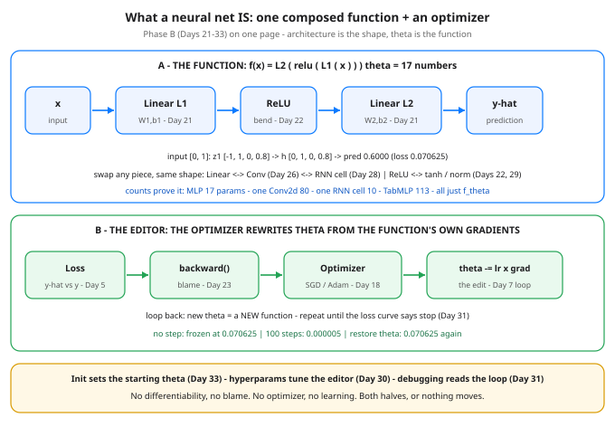

# Day 34 — What a Neural Net Is: A Composed Function + an Optimizer

**Tonight you'll be able to:** compress all of Phase B (Days 21–33) into one reusable sentence — a neural net is one composed differentiable function `f_theta(x)` plus an optimizer that edits theta — and prove each half by taking the other half away.

## The one idea

Phase A ended with a sentence: learning = differentiable programming (Day 20). Phase B spent fourteen days building one object large enough to deserve its own version of that sentence:

**A neural net is ONE composed differentiable function, `f_theta(x)`, plus an optimizer that rewrites theta from the function's own gradients.**

**Composed** means nested, nothing more exotic: the output layer eats the hidden layer's output, which ate the input — `f(x) = L2(relu(L1(x)))` for Day 21's XOR net. Stacking only worked because a non-linearity bends between the linears (Day 21's collapse proof, Day 22's bends). Swap the pieces and the shape of the composition changes — a convolution slides one kernel everywhere (Day 26), a recurrent cell feeds its own output back in over time (Day 28), pooling and norms reshape or re-scale mid-chain (Days 27, 29) — but it is still one function, input in, prediction out. In code that function is one `nn.Module` with one `forward()` (Day 24), run in train or eval mode, on one device, under the Day 25 switches.

**Theta IS the function.** The architecture is only the *shape* of the composition — which pieces, in which order, with which widths. The actual function you have is the numbers: Day 21's net is exactly 17 numbers (W1 8 + b1 4 + W2 4 + b2 1). Change a number, change the function. Save the numbers (`state_dict`, Day 24) and you have saved the function itself. That is why Day 33's init matters so much: init is choosing the *starting function* before the editor ever runs.

**Differentiable** is the contract from Day 20, now at network scale: every piece in the chain has a derivative, so one scalar loss can send blame backward through every layer to every number in theta (Day 23's three local rules, run by `backward()`). Break the chain — a dead ReLU column, a saturated tanh, a signal that vanished at init — and the blame arrives as zero for everything upstream, however good the architecture looks on paper.

**Plus an optimizer** — and the plus is load-bearing. The function alone is frozen: it maps inputs to predictions and never improves (Part 3 runs it 100 times and the loss does not move). The optimizer is a separate editor that knows nothing about your architecture: it receives theta and gradients, and applies one update rule (plain SGD, momentum, Adam — Day 18; stride and batch size are its dials, Day 30). Everything else in Phase B is support for these two halves: loaders feed the loop (Day 19, reused all phase), regularization edits the loss the editor answers to (Day 17), loss curves are the loop's telemetry (Day 31), and Day 32's tabular build was the two halves running untouched on a new dataset. Two halves, each useless alone, sufficient together — that is the whole Phase B mental model.

## Analogy

A deployed service you already run in your head: **binary + config + reconcile loop.** The binary is the composition — functions calling functions in a fixed shape. Theta is its config: the same binary with different config values *behaves as a different system*, and snapshotting the config snapshots the behavior. The optimizer is the reconcile loop (Day 7's analogy, now at full size): it reads desired state (the labels) vs actual state (the predictions), computes the diff (the loss), assigns blame per field (gradients), and nudges the config one safe step. Nobody confuses the binary with the loop — keep the same separation here and every framework API sorts itself: `forward()` is binary, `state_dict()` is config, `step()` is reconcile.

Trading version, one line: the architecture is your strategy's *form* (say, mean-reversion on a lookback), theta is the fitted lookback and thresholds, and the optimizer is the fitting process — a form with no fitted parameters is a blog post, and fitted parameters with no form are just numbers.

## See it



Top: the function — pieces composed in a chain, theta = 17 numbers, with the swap rule that turns an MLP into a CNN or an RNN without changing what kind of object it is. Bottom: the editor — loss, blame, and one update rule, looping back into a new theta (a new function) each step. The footer names the supporting cast: init, hyperparams, and debugging all serve one of the two halves.

## Code it (~30 min)

One file, three proofs, every weight hand-set from Day 21 — no RNG, every digit exact. **Part 1** unrolls the composition by hand: for input `[0, 1]` you print each intermediate, then check the by-hand formula against the `nn.Module` on all four corners. **Part 2** defines one generic `train()` loop and runs it on two different functions — Day 22's ReLU vs tanh race — without changing a line of the loop. **Part 3** separates the halves: 100 forwards with no step (frozen), 100 steps (learned), then the saved theta snapshot restored (the original function, back exactly) — plus the parameter-count inventory across Phase B's architectures.

```python
"""Day 34 - What a Neural Net Is: A Composed Function + an Optimizer.

Phase B recap. Fourteen days of new machinery - perceptrons,
activations, backprop, Modules, CNNs, RNNs, norms, init - and
tonight it all compresses into one sentence:

    A neural net is ONE composed differentiable function
    f_theta(x), plus an optimizer that rewrites theta from
    the function's own gradients.

Composed: the output layer eats the hidden layer's output,
which ate the input - f(x) = L2(relu(L1(x))). Differentiable:
every piece in the chain has a derivative, so Day 23's blame
signal can flow from the loss back to every number in theta.
Theta IS the function: the architecture is the shape of the
composition, the 17 numbers in theta are the function itself.

  Part 1  Unroll the composition by hand on Day 21's XOR net.
          For input [0, 1]: z1, the ReLU gate, and the final
          sum, digit by digit - then the same formula on all
          four corners matches the nn.Module exactly. Theta
          is 8 + 4 + 4 + 1 = 17 numbers, nothing else.
  Part 2  One generic train() loop, two different functions.
          Swap only the hidden activation - ReLU vs tanh,
          Day 22's race - and the loop does not change by one
          character: it only ever calls model(X), reads a
          scalar loss, calls backward(), and steps. The
          optimizer serves the composition, any composition.
  Part 3  The two halves, separated. Run the function 100
          times with NO optimizer step and the loss is frozen
          at 0.070625 - a function alone never learns. Train
          it, then restore the saved theta snapshot and the
          loss returns to exactly 0.070625: change theta,
          change the function; restore theta, restore it.
          The inventory underneath shows every Phase B
          architecture - MLP, CNN, RNN, tabular MLP - is
          the same object: an nn.Module with a theta you
          can count.

Runs on the ~/ai-lab venv: torch only (free), CPU on
purpose (tiny data), no CUDA, no paid APIs, no downloads.
Every weight is set by hand, so every number is exact -
no RNG anywhere in this lesson.

Expected output:

  Part 1 - unroll f_theta: L2(relu(L1(x))), by hand
    input [0.0, 1.0]: z1 = -1.0000, 1.0000, 0.0000, 0.8000
      after ReLU: h = 0.0000, 1.0000, 0.0000, 0.8000  -> pred 0.6000 (target 1)
    all four preds, by hand: 0.0000, 0.6000, 1.0000, 0.3500  loss 0.070625
    nn.Module vs by-hand formula: max diff 0.000000
    theta = W1 8 + b1 4 + W2 4 + b2 1 = 17 numbers - they ARE the function
  Part 2 - one generic loop, two different functions (SGD, lr=0.5, 100 epochs)
    relu  loss 0.070625 -> 0.000005  predictions 0.0032, 1.0000, 0.9999, -0.0029  (correct: 4/4)
    tanh  loss 0.669811 -> 0.000020  predictions -0.0039, 0.9957, 0.9955, -0.0050  (correct: 4/4)
    the loop changed by zero lines - only the piece inside f changed
  Part 3 - no optimizer, no learning; theta restored, function restored
    100 forwards, no step: loss 0.070625 -> 0.070625  (changed: False)
    after 100 optimizer steps: loss 0.000005
    snapshot restored: loss 0.070625  preds vs original max diff 0.000000
    every Phase B architecture is the same object - f_theta with a countable theta:
      MLP 2->4->1 (Days 21-25):        17 params
      Conv2d 1->8, k=3 (Days 26-27):   80 params
      RNN cell 1->2 (Day 28):          10 params
      TabMLP 5->16->1 (Day 32):        113 params
    verdict: architecture = shape of the composition, theta = the function, optimizer = the editor
"""
import torch
import torch.nn as nn

# Day 21's hand-set init - the same starting function all Phase B.
W1_INIT = torch.tensor([[1.0, -1.0], [-1.0, 1.0],
                        [0.5, 0.5], [-0.5, 0.8]])
B1_INIT = torch.tensor([0.0, 0.0, -0.5, 0.0])
W2_INIT = torch.tensor([[1.0, 1.0, 1.0, -0.5]])
B2_INIT = torch.tensor([0.0])
X = torch.tensor([[0.0, 0.0], [0.0, 1.0], [1.0, 0.0], [1.0, 1.0]])
y = torch.tensor([[0.0], [1.0], [1.0], [0.0]])          # XOR (Day 21)

fmt = lambda t: ", ".join(f"{v:.4f}" for v in t.flatten().tolist())


def build(act):
    net = nn.Sequential(nn.Linear(2, 4), act, nn.Linear(4, 1))
    with torch.no_grad():
        net[0].weight.copy_(W1_INIT)
        net[0].bias.copy_(B1_INIT)
        net[2].weight.copy_(W2_INIT)
        net[2].bias.copy_(B2_INIT)
    return net


# ---------- Part 1: unroll the composition by hand ----------
print("Part 1 - unroll f_theta: L2(relu(L1(x))), by hand")
x_one = torch.tensor([0.0, 1.0])
with torch.no_grad():
    z1 = x_one @ W1_INIT.T + B1_INIT                   # L1: linear piece
    h = torch.relu(z1)                                 # the bend (Day 22)
    pred_one = (h @ W2_INIT.T + B2_INIT).item()        # L2: linear piece
print(f"  input [0.0, 1.0]: z1 = {fmt(z1)}")
print(f"    after ReLU: h = {fmt(h)}  -> pred {pred_one:.4f} (target 1)")
with torch.no_grad():
    manual = torch.relu(X @ W1_INIT.T + B1_INIT) @ W2_INIT.T + B2_INIT
    loss0 = ((manual - y) ** 2).mean().item()
    module_pred = build(nn.ReLU())(X)
    diff = (manual - module_pred).abs().max().item()
print(f"  all four preds, by hand: {fmt(manual)}  loss {loss0:.6f}")
print(f"  nn.Module vs by-hand formula: max diff {diff:.6f}")
n_theta = W1_INIT.numel() + B1_INIT.numel() + W2_INIT.numel() \
    + B2_INIT.numel()
print(f"  theta = W1 {W1_INIT.numel()} + b1 {B1_INIT.numel()} + "
      f"W2 {W2_INIT.numel()} + b2 {B2_INIT.numel()} = {n_theta} numbers"
      " - they ARE the function")

# ---------- Part 2: one generic loop, two different functions ----------
print("Part 2 - one generic loop, two different functions "
      "(SGD, lr=0.5, 100 epochs)")


def train(model):
    """The Phase B loop (Days 7/25). It knows nothing about the
    model except: model(X) is differentiable, loss is a scalar."""
    opt = torch.optim.SGD(model.parameters(), lr=0.5)
    first = None
    for _ in range(100):
        opt.zero_grad()
        loss = ((model(X) - y) ** 2).mean()
        if first is None:
            first = loss.item()
        loss.backward()
        opt.step()
    with torch.no_grad():
        pred = model(X)
        final = ((pred - y) ** 2).mean().item()
        correct = int(((pred > 0.5) == (y > 0.5)).sum().item())
    return first, final, pred, correct


for name, act in (("relu", nn.ReLU()), ("tanh", nn.Tanh())):
    first, final, pred, correct = train(build(act))
    print(f"  {name:<5} loss {first:.6f} -> {final:.6f}  "
          f"predictions {fmt(pred)}  (correct: {correct}/4)")
print("  the loop changed by zero lines - only the piece inside f changed")

# ---------- Part 3: separate the two halves ----------
print("Part 3 - no optimizer, no learning; theta restored, "
      "function restored")
net = build(nn.ReLU())
snapshot = {k: v.clone() for k, v in net.state_dict().items()}
with torch.no_grad():
    before = ((net(X) - y) ** 2).mean().item()
    for _ in range(100):                               # forwards only
        _ = net(X)
    frozen = ((net(X) - y) ** 2).mean().item()
print(f"  100 forwards, no step: loss {before:.6f} -> {frozen:.6f}"
      f"  (changed: {bool(before != frozen)})")
_, trained_final, _, _ = train(net)
print(f"  after 100 optimizer steps: loss {trained_final:.6f}")
net.load_state_dict(snapshot)
with torch.no_grad():
    restored = ((net(X) - y) ** 2).mean().item()
    orig = torch.relu(X @ W1_INIT.T + B1_INIT) @ W2_INIT.T + B2_INIT
    rdiff = (net(X) - orig).abs().max().item()
print(f"  snapshot restored: loss {restored:.6f}  "
      f"preds vs original max diff {rdiff:.6f}")
print("  every Phase B architecture is the same object - "
      "f_theta with a countable theta:")
inventory = (
    ("MLP 2->4->1 (Days 21-25):", build(nn.ReLU())),
    ("Conv2d 1->8, k=3 (Days 26-27):", nn.Conv2d(1, 8, 3, padding=1)),
    ("RNN cell 1->2 (Day 28):", nn.RNN(1, 2, batch_first=True)),
    ("TabMLP 5->16->1 (Day 32):",
     nn.Sequential(nn.Linear(5, 16), nn.ReLU(), nn.Linear(16, 1))),
)
for label, module in inventory:
    count = sum(p.numel() for p in module.parameters())
    print(f"    {label:<32} {count} params")
print("  verdict: architecture = shape of the composition, "
      "theta = the function, optimizer = the editor")
```

**Expected output:**

```
Part 1 - unroll f_theta: L2(relu(L1(x))), by hand
  input [0.0, 1.0]: z1 = -1.0000, 1.0000, 0.0000, 0.8000
    after ReLU: h = 0.0000, 1.0000, 0.0000, 0.8000  -> pred 0.6000 (target 1)
  all four preds, by hand: 0.0000, 0.6000, 1.0000, 0.3500  loss 0.070625
  nn.Module vs by-hand formula: max diff 0.000000
  theta = W1 8 + b1 4 + W2 4 + b2 1 = 17 numbers - they ARE the function
Part 2 - one generic loop, two different functions (SGD, lr=0.5, 100 epochs)
  relu  loss 0.070625 -> 0.000005  predictions 0.0032, 1.0000, 0.9999, -0.0029  (correct: 4/4)
  tanh  loss 0.669811 -> 0.000020  predictions -0.0039, 0.9957, 0.9955, -0.0050  (correct: 4/4)
  the loop changed by zero lines - only the piece inside f changed
Part 3 - no optimizer, no learning; theta restored, function restored
  100 forwards, no step: loss 0.070625 -> 0.070625  (changed: False)
  after 100 optimizer steps: loss 0.000005
  snapshot restored: loss 0.070625  preds vs original max diff 0.000000
  every Phase B architecture is the same object - f_theta with a countable theta:
    MLP 2->4->1 (Days 21-25):        17 params
    Conv2d 1->8, k=3 (Days 26-27):   80 params
    RNN cell 1->2 (Day 28):          10 params
    TabMLP 5->16->1 (Day 32):        113 params
  verdict: architecture = shape of the composition, theta = the function, optimizer = the editor
```

## Today's win

Done when your run shows all three proofs: Part 1's by-hand preds `0.0000, 0.6000, 1.0000, 0.3500` matching the Module with max diff `0.000000`; Part 2's two losses (`0.000005` ReLU, `0.000020` tanh) from one unchanged loop; and Part 3's frozen loss (`0.070625 -> 0.070625` with no step) returning to exactly `0.070625` after the snapshot restore. The keeper test, no notes allowed: given any Phase B model — CNN, RNN, tabular MLP — you can point and say which part is the composed function, where its theta lives, what counts it, and which separate object edits it.

## Short on time? 20-minute version

Read "The one idea", study the diagram until you can redraw its two panels from memory, then run only Part 1 and the frozen half of Part 3. If you can say out loud why a function alone never learns and why restoring theta restores the function, you have the recap — Part 2 is the victory lap.

## Tomorrow's teaser

Tomorrow: Phase B closes for real — one end-to-end mini-project on a dataset you pick, running the whole machine start to finish with no new pieces.

Streak: 34 day(s) · Never miss twice.
