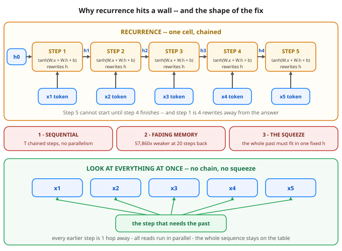

# Day 36 — Sequence Modeling Recap: Why Attention Replaced Recurrence

**Tonight you'll be able to:** name the three structural problems that capped the RNN — the chain, the fade, and the squeeze — measure two of them yourself, and state exactly what shape of mechanism a fix has to have.

## The one idea

Phase C opens with an audit, not a new model. Day 28 gave you the best sequence machine of the pre-2017 world: one recurrent cell whose hidden state `h` is rewritten at every step, the same weights everywhere. It handled any length and it learned short patterns well. Today we ask the question the field asked in 2017: why did that design hit a wall — not a "needs more tuning" wall, a **structural** one? Three reasons, and you will measure two of them yourself.

**Problem 1 — the chain (sequential).** `h_t` is built from `h_{t-1}`, so step *t* cannot start until step *t−1* has finished. It is a linked list, not an array. Remember Day 13: GPUs win when thousands of *independent* operations run side by side. A chain offers exactly one operation at a time, so most of the machine idles — and the wait grows linearly with the sequence. For language, where T runs to thousands, the chain *is* the job.

**Problem 2 — the fade (distance).** Day 28 measured the *gradient* arriving about 100× weaker after 10 hops back. The forward direction is worse: the summary itself is rewritten at every step, so distant information is not merely hard to learn from — it is physically overwritten. Part 2 makes it visceral: change *only* the first token, +1 vs −1, keep everything after it identical, and 19 steps later the final state cannot tell the two pasts apart. Gated cells (LSTM/GRU) were the field's patch — they protect a memory lane and genuinely help — but they keep the chain and the squeeze, and the fade still wins at long range.

**Problem 3 — the squeeze (fixed-size state).** `h` has a fixed size: 4 numbers in today's toy, maybe 1,024 in a serious RNN — fixed, while T is not. Everything the model will ever know about a 10,000-token document must be compressed into that one vector, and the compression is lossy in exactly the wrong place: the oldest content has survived the most rewrites. Problem 2 feeds problem 3. It is a fixed-size context header trying to carry an unbounded conversation.

**The fix, specified before it is built.** Write the requirements the way you would spec a system: (1) positions computable **in parallel** — no chain; (2) any position reachable from any other in **one hop** — no compounding fade; (3) **no fixed-size summary** — the whole sequence stays available, and each step looks at the parts it needs. A mechanism with exactly that shape exists, and its name is **attention**. The 2017 paper that swapped recurrence for it is titled, bluntly, *Attention Is All You Need*. How a step decides what to look at is tomorrow's lesson. One honest note: looking at everything is not free — a later day prices it. Nothing is free; the question is always what you pay for what you get.

## Analogy

Think of recurrence as a request chained through T services: each hop hands the next a **fixed-size context header**, every hop can drop fields, and the last service can only know what survived the header. Latency is the sum of all hops, and hop 1 is reachable only through hops 2…T. The alternative shape is a shared store: every step writes its record where it stays, and the step that needs the past reads the exact records it wants — directly, in parallel, nothing dropped in transit.

Trading version: an **EMA line vs the full tape**. Recurrence reads the market through one rolling summary that each candle rewrites. Attention keeps the whole tape on screen and lets the current candle reach back to the exact earlier candle that matters.

## See it



Top: the recurrent chain — inputs enter one at a time, the summary h is rewritten at every step, and step 1 sits 4 hops from the answer. Middle: the three structural bills. Bottom: the fix's shape — every earlier step one direct hop away, read in parallel, nothing squeezed into a summary.

## Code it (~30 min)

One file in `~/ai-lab`, the same hand-set scalar cell as Day 28 (`w_hh`=0.8, `w_xh`=1.0), and **no randomness** — your numbers should match the expected output digit for digit on CPU or MPS. **Part 1** stretches Day 28's gradient probe from T=10 to T=20. **Part 2** is the new instrument: a forward-pass distance test — two sequences that differ only at step 1, and a ruler (the gap between their final states) for how much of step 1 survives. **Part 3** counts instead of timing: chain length, hops, and memory at T=4/20/100, RNN vs the look-at-everything shape.

```python
"""Day 36 - Sequence Modeling Recap: Why Attention Replaced Recurrence.

Phase B ended with Day 28's recurrent cell as our best sequence
model:

  h_t = tanh(W_xh @ x_t + W_hh @ h_prev + b),   h_0 = 0

One cell, reused at every step, carrying a fixed-size hidden
state h -- a lossy running summary of everything seen so far.
Today we stop adding machinery and instead audit that design,
the way you would audit a system you inherited. It has three
structural problems, and none of them is a tuning problem:

  1. SEQUENTIAL. Step t cannot start until step t-1 has
     finished: the computation is a chain of T dependent steps.
     Day 13's GPUs win by doing many independent things at
     once; a chain keeps one lane busy and T-1 lanes idle.
  2. FADING MEMORY. Day 28 measured the gradient arriving at
     step 1 about 100x weaker than at step 10. Extend the
     sequence and the fade compounds -- and it is not only the
     gradient. The information itself is rewritten away.
  3. THE SQUEEZE. Everything the model will ever know about
     the past must fit inside h, whose size is fixed while the
     sequence is not. A 10,000-step past, compressed into the
     same fixed number of floats as a 10-step past.

  Part 1  Day 28's gradient probe, stretched from T=10 to
          T=20: the first step's gradient is now tens of
          thousands of times weaker than the last step's.
  Part 2  The distance test, on the forward pass this time.
          Two sequences that differ ONLY in a marker at step 1
          (+1.0 vs -1.0), then identical filler. Read the final
          state: if the marker was 1 hop back, the states are
          far apart; 19 hops back, they are indistinguishable.
          Memory does not fade in storage -- it is overwritten.
  Part 3  The three problems, counted. For T = 4, 20, 100:
          chained steps, hops from step 1 to the output, and
          how much the past gets to occupy -- against a design
          that keeps every step and lets the reader look at
          all of them at once: 1 parallel step, 1 hop, no
          squeeze. That design has a name -- attention -- and
          tomorrow we open the box.

Runs on the ~/ai-lab venv: torch only (free), CPU or MPS, no
CUDA, no paid APIs, no downloads. No randomness anywhere --
the same hand-set scalar cell as Day 28 (w_hh = 0.8,
w_xh = 1.0), so your output should match the expected output
below digit for digit.

Expected output:

  device: mps
  Part 1 - the gradient fade, stretched to T=20
    final h after 20 steps: 0.5822
    grad wrt x_1: 1.1426e-05
    grad wrt x_5: 5.4759e-05
    grad wrt x_10: 1.1396e-03
    grad wrt x_15: 2.7360e-02
    grad wrt x_20: 6.6109e-01
    last step 0.6611 vs first step 1.1426e-05 -- ratio 57,860x
  Part 2 - the distance test: can the final state still see step 1?
    marker 1 hop back:   h = +0.6692 (marker +1) vs -0.3879 (marker -1), gap 1.0570
    marker 9 hops back:  h = +0.5827 (marker +1) vs +0.5654 (marker -1), gap 0.0172
    marker 19 hops back: h = +0.5822 (marker +1) vs +0.5821 (marker -1), gap 0.000030
    the marker's fingerprint is 35.3 thousand x weaker at 19 hops than at 1 hop
  Part 3 - the three problems, counted (hidden size fixed at 4)
    T=4    RNN:   4 chained steps,  3 hops, state = 4 numbers   all-at-once: 1 step, 1 hop, keeps 16 numbers
    T=20   RNN:  20 chained steps, 19 hops, state = 4 numbers   all-at-once: 1 step, 1 hop, keeps 80 numbers
    T=100  RNN: 100 chained steps, 99 hops, state = 4 numbers   all-at-once: 1 step, 1 hop, keeps 400 numbers
    the chain and the hops grow with T; the state never does
"""
import torch

device = torch.device("mps" if torch.backends.mps.is_available() else "cpu")
print("device:", device)

# The Day 28 scalar cell, reused all day: h = tanh(0.8 * h + 1.0 * x)

# ---------- Part 1: the gradient fade, stretched to T=20 ----------
print("Part 1 - the gradient fade, stretched to T=20")
x = torch.full((20,), 0.2, requires_grad=True, device=device)
h = torch.zeros((), device=device)
for t in range(20):
    h = torch.tanh(0.8 * h + 1.0 * x[t])   # one chained step; t+1 waits for t
print(f"  final h after 20 steps: {h.item():.4f}")
h.backward()                               # blame flows back through all 20 hops
g = x.grad.tolist()
for t in (0, 4, 9, 14, 19):
    print(f"  grad wrt x_{t + 1}: {g[t]:.4e}")
print(f"  last step {g[-1]:.4f} vs first step {g[0]:.4e}"
      f" -- ratio {g[-1] / g[0]:,.0f}x")

# ---------- Part 2: the distance test ----------
print("Part 2 - the distance test: can the final state still see step 1?")

def final_state(marker, fillers):
    """Run the cell on [marker] + fillers of 0.2; return the final h."""
    h = torch.zeros((), device=device)
    with torch.no_grad():
        for xv in [marker] + [0.2] * fillers:
            h = torch.tanh(0.8 * h + xv)
    return h.item()

gaps = {}
for hops in (1, 9, 19):
    hp = final_state(1.0, hops)    # step 1 was +1.0, then `hops` filler steps
    hm = final_state(-1.0, hops)   # step 1 was -1.0, same filler after it
    gap = abs(hp - hm)
    gaps[hops] = gap
    gap_s = f"{gap:.6f}" if hops == 19 else f"{gap:.4f}"
    label = f"marker {hops} hop{'s' if hops != 1 else ''} back:"
    print(f"  {label.ljust(21)}h = {hp:+.4f} (marker +1)"
          f" vs {hm:+.4f} (marker -1), gap {gap_s}")
print(f"  the marker's fingerprint is {gaps[1] / gaps[19] / 1000:.1f} thousand x"
      " weaker at 19 hops than at 1 hop")

# ---------- Part 3: the three problems, counted ----------
print("Part 3 - the three problems, counted (hidden size fixed at 4)")
H = 4  # the hidden state is 4 numbers, whatever T does
for T in (4, 20, 100):
    print("  T=%-4d RNN: %3d chained steps, %2d hops, state = %d numbers"
          "   all-at-once: 1 step, 1 hop, keeps %d numbers"
          % (T, T, T - 1, H, T * H))
print("  the chain and the hops grow with T; the state never does")
```

**Expected output:**

```
device: mps
Part 1 - the gradient fade, stretched to T=20
  final h after 20 steps: 0.5822
  grad wrt x_1: 1.1426e-05
  grad wrt x_5: 5.4759e-05
  grad wrt x_10: 1.1396e-03
  grad wrt x_15: 2.7360e-02
  grad wrt x_20: 6.6109e-01
  last step 0.6611 vs first step 1.1426e-05 -- ratio 57,860x
Part 2 - the distance test: can the final state still see step 1?
  marker 1 hop back:   h = +0.6692 (marker +1) vs -0.3879 (marker -1), gap 1.0570
  marker 9 hops back:  h = +0.5827 (marker +1) vs +0.5654 (marker -1), gap 0.0172
  marker 19 hops back: h = +0.5822 (marker +1) vs +0.5821 (marker -1), gap 0.000030
  the marker's fingerprint is 35.3 thousand x weaker at 19 hops than at 1 hop
Part 3 - the three problems, counted (hidden size fixed at 4)
  T=4    RNN:   4 chained steps,  3 hops, state = 4 numbers   all-at-once: 1 step, 1 hop, keeps 16 numbers
  T=20   RNN:  20 chained steps, 19 hops, state = 4 numbers   all-at-once: 1 step, 1 hop, keeps 80 numbers
  T=100  RNN: 100 chained steps, 99 hops, state = 4 numbers   all-at-once: 1 step, 1 hop, keeps 400 numbers
  the chain and the hops grow with T; the state never does
```

## Today's win

Done when: Part 1 prints **ratio 57,860x** (last step 0.6611 vs first step 1.1426e-05); Part 2 prints gaps **1.0570 / 0.0172 / 0.000030** for the marker 1 / 9 / 19 hops back; Part 3 shows T=100 at 100 chained steps and 99 hops while the state stays stuck at 4 numbers. The bigger test: you can say it cold — *recurrence is sequential, fading, and squeezed; the fix must be parallel, one-hop, and keep the whole sequence on the table.* That spec is attention's job description.

## Short on time? 20-minute version

Run the file once and study Part 2's three lines: the same marker at three distances, fingerprints 1.0570 → 0.0172 → 0.000030. If you can explain *why* the 19-hop gap had to land near zero before you ran it — every filler step rewrites the summary — you have the lesson. Then skim Part 3's table for the squeeze.

## Tomorrow's teaser

Tomorrow we open the box named attention: how one step of a sequence can look back at every earlier step at once — and decide, on its own, which ones deserve its attention.

*Day 36 of 100 · Self-paced — do it when you can. Never miss twice.*
