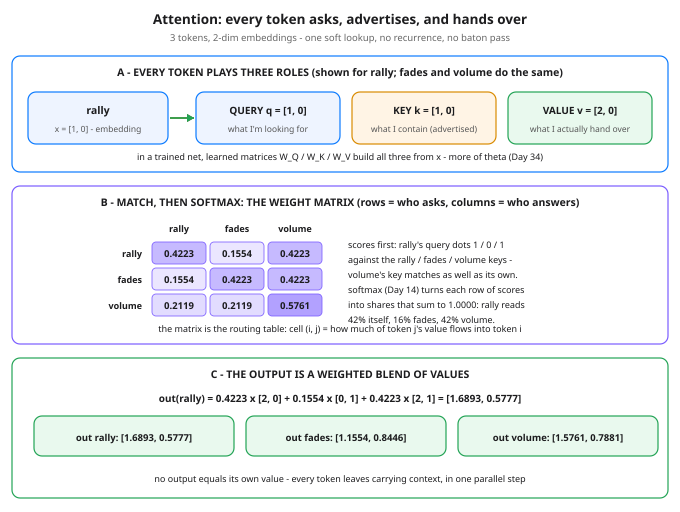

# Day 37 — Attention Intuition: Queries, Keys, Values

**Tonight you'll be able to:** explain attention as a soft lookup — each token's query asks, every key advertises, and softmax turns the matches into weights that blend the values — and read a 3x3 weight matrix to say exactly who attends to whom, and by how much.

## The one idea

Day 36's problem, in one line: an RNN forces everything a sequence knows through one hidden state, passed hand to hand until the early steps fade. Attention deletes the baton pass. **Every token reads every other token directly, in parallel, and mixes what it finds into its own vector.** That mixing — who reads whom, and how much — is tonight's whole concept.

To read, each token plays three roles at once. From its embedding `x` (Day 15) it builds three vectors through three separate linear projections (Day 24): a **query** `q = x·W_Q` — "what I'm looking for"; a **key** `k = x·W_K` — "what I contain," the advertisement other tokens match against; and a **value** `v = x·W_V` — "what I actually hand over" if someone reads me. Three roles, three different vectors from the same token — and the split between key and value is the subtle part: what makes a token *findable* is not what it *delivers*, so training gets to tune the two separately.

The read itself is two moves you already own. **Match:** dot each query with every key (Day 12 — a dot product is a similarity score) to get one row of scores per token. **Weigh:** run softmax over that row (Day 14) and the scores become *attention weights* — shares that sum to exactly 1. Then the token's new vector is the weighted blend of everyone's values: `out = Σ w_j · v_j`. Nothing here is a hard pick: every token contributes to every other token in proportion to the match. That softness is not a compromise — it is what keeps the whole lookup differentiable (Day 20's contract), so the projections can be *learned* instead of hand-designed.

Read tonight's example before you run it: `rally` has embedding [1, 0], `fades` [0, 1], `volume` [1, 1]. Rally's query dots 1 against its own key, 0 against fades', 1 against volume's — so after softmax rally spends its read 42% on itself, 16% on fades, 42% on volume. Note *why*: volume gets read because of what it *contains* (it carries rally's dim), not because of where it sits. Attention routes by content, not by position in line. Its output, [1.6893, 0.5777], is no longer "rally" — it is rally *informed by* the sentence around it. That is the entire trick, and it is enough to rebuild sequence modeling on.

## Analogy

Think **quorum read with read-repair**, the DynamoDB/Cassandra pattern you know cold: a coordinator doesn't trust one replica — it fans the read out, compares what comes back, and merges. Attention is that pattern made differentiable. The querying token is the coordinator. Every token is a replica holding a piece of the sequence's state: its **key** is the metadata it advertises (think version/timestamp tags on a read response), its **value** is the actual payload. The coordinator scores each replica's advertisement against what it needs — and then, instead of read-repair's hard rule "newest wins," it takes a **weighted merge of all the payloads**, weighted by match. A hard winner-take-all merge would be an ordinary database lookup: correct, but with no gradient — nothing upstream could learn from it. The soft merge is the whole invention: proportional contributions are arithmetic, arithmetic is differentiable, so the advertisements themselves (the projections) get trained.

Trading version, one line: scores are your signals, softmax is the position sizer that turns signals into weights summing to 100%, and values are what each position actually delivers.

## See it



Left to right, one lookup: rally's embedding spawns its three roles (query in blue, key in amber, value in green — fades and volume do the same). Panel B is the heart: scores from query·key, softmaxed into the weight matrix — the routing table of the sequence, cell (i, j) = how much of token j's value flows into token i. Panel C collects the payload: rally's output is its row of the matrix applied to the three values, worked in full.

## Code it (~30 min)

One file, one lookup, every number pencil-checkable. **Part 1** builds the three roles: `W_Q` and `W_K` are identity and `W_V` stretches dim 0 by 2, so you can *see* the value differ from the key (in a trained net all three are learned — tonight they are fixed so the arithmetic stays honest). **Part 2** computes scores and the weight matrix, with softmax written by hand (Day 14, max-subtraction included) and cross-checked against `torch.softmax`. **Part 3** blends the values and works rally's output by hand in the printout. Runs in `~/ai-lab` on MPS if available, else CPU; no downloads, no RNG.

```python
"""Day 37 - Attention Intuition: Queries, Keys, Values.

Day 36 left the problem: an RNN squeezes a whole sequence
into one fading hidden state, passed hand to hand. Tonight
is the fix's core idea - attention as a SOFT LOOKUP. No
token waits for a summary. Every token looks at every other
token directly and builds its own context blend:

  query - "what I'm looking for"    (one per token)
  key   - "what I contain"          (one per token, advertised)
  value - "what I actually hand over" (one per token)

A query is dotted with every key (Day 12) to get match
scores; softmax (Day 14) turns one query's scores into
weights that sum to 1; the token's new vector is the
weighted blend of everyone's values. Match and delivery
are separate on purpose: the key is the advertisement,
the value is the payload.

Three hand-set tokens from a trading sentence - rally,
fades, volume - with 2-dim embeddings you can follow with
a pencil:

  Part 1  The three roles. Q and K are the embeddings
          themselves today (identity projections); V is
          the embedding stretched by W_V, so you can SEE
          that the value is not the key. In a trained net,
          W_Q / W_K / W_V are learned matrices (Day 34:
          just more of theta) - fixed by hand tonight so
          every digit is checkable.
  Part 2  Scores = Q @ K.T, weights = softmax over each
          row. The weight matrix IS the lesson: read a row
          and you see who attends to whom. rally splits
          its read 42/16/42 because volume's key matches
          rally's query as strongly as rally's own key.
  Part 3  Outputs = weights @ V. rally's output is its
          blend worked by hand in the printout - and no
          output equals its own value: every token leaves
          carrying context, gathered in one parallel step.

Deliberately NOT here: the score-scaling knob and the
full by-hand derivation (tomorrow, Day 38), and splitting
this into multiple heads (Day 39). One lookup, done slowly.

Runs on the ~/ai-lab venv: torch only (free), MPS if
available else CPU (tiny tensors), no CUDA, no paid APIs,
no downloads. Every weight is set by hand - no RNG, so
every printed number is exact (reference output below is
CPU; MPS agrees to printed precision on these values).

Expected output:

  Part 1 - three tokens, three roles each
    embeddings X - what each token starts with (Day 15):
      rally   [1.0000, 0.0000]
      fades   [0.0000, 1.0000]
      volume  [1.0000, 1.0000]
    projections today: W_Q = W_K = identity, W_V stretches dim 0 by 2
    values V = X @ W_V - what each token actually hands over:
      rally   [2.0000, 0.0000]
      fades   [0.0000, 1.0000]
      volume  [2.0000, 1.0000]
    rally's three vectors: q [1.0000, 0.0000]  k [1.0000, 0.0000]  v [2.0000, 0.0000]
      the key advertises the plain embedding; the value delivers it stretched
  Part 2 - match scores -> weights: who attends to whom
    scores = Q @ K.T (Day 12 dot products, one per query-key pair):
                rally   fades  volume
      rally    1.0000  0.0000  1.0000
      fades    0.0000  1.0000  1.0000
      volume   1.0000  1.0000  2.0000
    weights = softmax(scores, dim=-1) (Day 14):
                rally   fades  volume
      rally    0.4223  0.1554  0.4223
      fades    0.1554  0.4223  0.4223
      volume   0.2119  0.2119  0.5761
    row sums: 1.0000, 1.0000, 1.0000 - every query gets a full 100% to spend
    manual softmax vs torch.softmax: max diff 0.000000
    read rally's row: 42% itself, 16% fades, 42% volume - volume's key
      matches rally's query as strongly as rally's own key does
  Part 3 - outputs: weighted blends of values
    out = weights @ V:
      rally   [1.6893, 0.5777]
      fades   [1.1554, 0.8446]
      volume  [1.5761, 0.7881]
    rally by hand: 0.4223*[2, 0] + 0.1554*[0, 1] + 0.4223*[2, 1] = [1.6893, 0.5777]
    verdict: no output equals its own value - every token leaves
      carrying context, gathered in one parallel step
"""
import torch

device = torch.device("mps" if torch.backends.mps.is_available() else "cpu")

TOKENS = ["rally", "fades", "volume"]
# Hand-set 2-dim embeddings (Day 15). rally carries dim 0,
# fades carries dim 1, volume carries both.
X = torch.tensor([[1.0, 0.0],
                  [0.0, 1.0],
                  [1.0, 1.0]], device=device)
# Projections: learned matrices in a real net (more of theta,
# Day 34). Hand-set tonight: identity for Q and K, and a
# stretch for V so the value visibly differs from the key.
W_Q = torch.eye(2, device=device)
W_K = torch.eye(2, device=device)
W_V = torch.tensor([[2.0, 0.0],
                    [0.0, 1.0]], device=device)

Q = X @ W_Q                                    # what I'm looking for
K = X @ W_K                                    # what I contain
V = X @ W_V                                    # what I hand over

fmt = lambda t: ", ".join(f"{v:.4f}" for v in t.flatten().tolist())


def table(M):
    print("    " + " " * 7 + "".join(f"{t:>8}" for t in TOKENS))
    for name, row in zip(TOKENS, M.tolist()):
        print(f"    {name:<7}" + "".join(f"{v:8.4f}" for v in row))


# ---------- Part 1: three tokens, three roles each ----------
print("Part 1 - three tokens, three roles each")
print("  embeddings X - what each token starts with (Day 15):")
for name, row in zip(TOKENS, X.tolist()):
    print(f"    {name:<7} [{fmt(torch.tensor(row))}]")
print("  projections today: W_Q = W_K = identity, "
      "W_V stretches dim 0 by 2")
print("  values V = X @ W_V - what each token actually hands over:")
for name, row in zip(TOKENS, V.tolist()):
    print(f"    {name:<7} [{fmt(torch.tensor(row))}]")
print(f"  rally's three vectors: q [{fmt(Q[0])}]  "
      f"k [{fmt(K[0])}]  v [{fmt(V[0])}]")
print("    the key advertises the plain embedding; "
      "the value delivers it stretched")

# ---------- Part 2: scores -> weights ----------
print("Part 2 - match scores -> weights: who attends to whom")
scores = Q @ K.T                               # Day 12: dot products
print("  scores = Q @ K.T (Day 12 dot products, "
      "one per query-key pair):")
table(scores)
# Softmax by hand (Day 14, with its max-subtraction fix),
# cross-checked against torch's built-in.
e = torch.exp(scores - scores.max(dim=-1, keepdim=True).values)
weights = e / e.sum(dim=-1, keepdim=True)
diff = (weights - torch.softmax(scores, dim=-1)).abs().max().item()
print("  weights = softmax(scores, dim=-1) (Day 14):")
table(weights)
print(f"  row sums: {fmt(weights.sum(dim=-1))} - every query "
      "gets a full 100% to spend")
print(f"  manual softmax vs torch.softmax: max diff {diff:.6f}")
print("  read rally's row: 42% itself, 16% fades, 42% volume "
      "- volume's key")
print("    matches rally's query as strongly as rally's own key does")

# ---------- Part 3: outputs are blends of values ----------
print("Part 3 - outputs: weighted blends of values")
out = weights @ V
print("  out = weights @ V:")
for name, row in zip(TOKENS, out.tolist()):
    print(f"    {name:<7} [{fmt(torch.tensor(row))}]")
hand = weights[0, 0] * V[0] + weights[0, 1] * V[1] \
    + weights[0, 2] * V[2]
print("  rally by hand: 0.4223*[2, 0] + 0.1554*[0, 1] "
      f"+ 0.4223*[2, 1] = [{fmt(hand)}]")
print("  verdict: no output equals its own value - every token leaves")
print("    carrying context, gathered in one parallel step")
```

**Expected output:**

```
Part 1 - three tokens, three roles each
  embeddings X - what each token starts with (Day 15):
    rally   [1.0000, 0.0000]
    fades   [0.0000, 1.0000]
    volume  [1.0000, 1.0000]
  projections today: W_Q = W_K = identity, W_V stretches dim 0 by 2
  values V = X @ W_V - what each token actually hands over:
    rally   [2.0000, 0.0000]
    fades   [0.0000, 1.0000]
    volume  [2.0000, 1.0000]
  rally's three vectors: q [1.0000, 0.0000]  k [1.0000, 0.0000]  v [2.0000, 0.0000]
    the key advertises the plain embedding; the value delivers it stretched
Part 2 - match scores -> weights: who attends to whom
  scores = Q @ K.T (Day 12 dot products, one per query-key pair):
              rally   fades  volume
    rally    1.0000  0.0000  1.0000
    fades    0.0000  1.0000  1.0000
    volume   1.0000  1.0000  2.0000
  weights = softmax(scores, dim=-1) (Day 14):
              rally   fades  volume
    rally    0.4223  0.1554  0.4223
    fades    0.1554  0.4223  0.4223
    volume   0.2119  0.2119  0.5761
  row sums: 1.0000, 1.0000, 1.0000 - every query gets a full 100% to spend
  manual softmax vs torch.softmax: max diff 0.000000
  read rally's row: 42% itself, 16% fades, 42% volume - volume's key
    matches rally's query as strongly as rally's own key does
Part 3 - outputs: weighted blends of values
  out = weights @ V:
    rally   [1.6893, 0.5777]
    fades   [1.1554, 0.8446]
    volume  [1.5761, 0.7881]
  rally by hand: 0.4223*[2, 0] + 0.1554*[0, 1] + 0.4223*[2, 1] = [1.6893, 0.5777]
  verdict: no output equals its own value - every token leaves
    carrying context, gathered in one parallel step
```

## Today's win

Done when your run matches on all four checks: the weight matrix rows `0.4223 / 0.1554 / 0.4223`, `0.1554 / 0.4223 / 0.4223`, `0.2119 / 0.2119 / 0.5761`; row sums exactly `1.0000, 1.0000, 1.0000`; manual-vs-built-in softmax max diff `0.000000`; and rally's hand blend landing on `[1.6893, 0.5777]`. The keeper test, no notes: point at any row of the matrix and say, in plain words, who that token read, by how much, and why the match came out that way — then say what the key/value split buys. If you can, you own the core idea of the transformer; everything after tonight is machinery around this lookup.

## Short on time? 20-minute version

Read "The one idea", study Panel B of the diagram until you can predict rally's row before looking, then run the code and check only two numbers by hand: rally's weights (softmax of 1, 0, 1) and its output blend. If both match, you have the concept — Parts 1 and 3 are the victory lap.

## Tomorrow's teaser

Tomorrow: the same lookup with the training wheels off — you compute it end to end by hand in torch, meet the one knob tonight deliberately left out, and find out why it has to be there.
