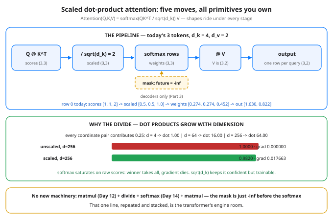

# Day 38 — Scaled Dot-Product Attention, By Hand in Torch

**Tonight you'll be able to:** run the most reused formula in modern AI — Attention(Q,K,V) = softmax(QK^T/sqrt(d_k))V — step by step with your own hands, match PyTorch's fused op exactly, and prove why the sqrt(d_k) divide is load-bearing.

## The one idea

Day 37 gave every token three roles: a **query** (what am I looking for), a **key** (what do I advertise), a **value** (what do I hand over if picked). Today the roles become one formula. Stack the tokens' vectors into matrices: `Q` and `K` are (T, d_k) — one row per token, d_k = the key width (4 today; 64–128 per head in real models) — and `V` is (T, d_v). Then:

**Attention(Q, K, V) = softmax(QK^T / sqrt(d_k)) · V**

**The five moves.** (1) **Score:** `S = QK^T`, shape (T, T) — S[i][j] is query i dotted with key j: every pair, one matmul (Day 12). (2) **Scale:** divide every score by sqrt(d_k) — the reason gets its own paragraph below. (3) **Mask** (optional, decoders only): block the future before it can be picked — also below. (4) **Softmax each row:** row i becomes a set of weights summing to 1 — a budget over tokens (Day 14). (5) **Blend:** `out = weights · V` — output row i is the weighted average of the value rows, using row i's budget. That is the entire mechanism; everything else in a transformer is scaffolding around this line.

**Read one row end to end.** In today's run, query 2 scores [1, 1, 1] — it matches every key equally — so its weights are [1/3, 1/3, 1/3] and its output is the plain average of all three value rows, [1.3333, 1.0000]. Attention with no preference *is* averaging. The sharp, selective rows (query 0 putting 0.4519 on token 2) are what training will eventually produce; the formula is just the blending machine.

**The one math bite: why sqrt(d_k).** A dot product is a *sum* of d_k coordinate products, and sums grow. If the coordinates are unit-sized and random-signed, the sum wanders like a random walk — typical size sqrt(d_k) (Day 10's distributions). If they align, it grows like d_k itself. Part 2 shows the aligned case with every coordinate pair contributing 0.25: the raw dot is 1.00 at d = 4 but 64.00 at d = 256. Feed softmax a score gap of 64 and the winner takes 1.0000, the runner-up gets ~10^-28, and the gradient factor p(1-p) is 0.000000 — a saturated softmax passes no blame backward (Day 22's saturation, in softmax form), so nothing upstream can learn. Divide by sqrt(d_k) and the same gap becomes 4.00: winner 0.9820, gradient 0.017663 — confident, but alive. The divide exists to keep scores in softmax's working range as the dimension grows. Nothing deeper is hiding in it.

**The mask beat.** A decoder generates text one token at a time, left to right, so when it is being trained, position i must not read positions after i — that is look-ahead bias, the exact sin from Days 9 and 32: peeking at the future invalidates the test. The fix is mechanical: before the softmax, set every score with j > i to -inf. Then exp(-inf) = 0, the future weights come out exactly 0, and each row still sums to 1. Position 0 can only read itself, so its output is exactly its own value row — Part 3 proves it. Models that read a whole input at once (encoders) skip the mask; the formula is otherwise identical.

## Analogy

Day 37 called attention a quorum read over memory; the formula is that read written as a protocol. **`QK^T` is the fan-out:** your read (one query) is scored against every replica's advertised index (the keys) in parallel — it is one matmul *because* it is one broadcast. **Softmax is the vote-weighting rule:** weights are normalized to sum to 1, bigger match = bigger say — a weighted quorum, not a majority vote. **`@ V` is the merge:** you don't take one replica's payload, you blend all payloads by vote weight. And **the causal mask is Lamport's happens-before, enforced as arithmetic:** an event may only be influenced by events that happened before it; anything later isn't slow or stale, it's causally inadmissible, so its weight is exactly zero, not approximately.

Trading version, one line: the mask is your no-look-ahead rule from backtesting (Days 9, 32), enforced by the math instead of by discipline.

## See it



Top: the pipeline with shapes — every query scores every key in one matmul, the scores are scaled, decoders mask the future, softmax turns each row into a budget, and the budgets blend the value rows. Bottom: why the divide exists — raw dot products grow with dimension until softmax saturates and the gradient dies; dividing by sqrt(d_k) keeps the winner confident and the gradient alive.

## Code it (~30 min)

One file, three parts, every tensor hand-set — no RNG, every digit checkable against the diagram. **Part 1** runs the formula in five explicit steps and diffs the result against `F.scaled_dot_product_attention` (the `[None]` just adds the batch slot that API expects). **Part 2** is the scaling experiment from "The one idea". **Part 3** adds the causal mask by hand, then lets PyTorch apply the same mask with `is_causal=True`.

```python
"""Day 38 - Scaled Dot-Product Attention, By Hand in Torch.

Day 37 gave every token three roles: a query (what am I
looking for), a key (what do I advertise), and a value (what
do I hand over if picked). Tonight those roles become one
formula - the single most reused line in modern AI:

    Attention(Q, K, V) = softmax(QK^T / sqrt(d_k)) V

Five moves, every one a primitive you already own: a matmul
(Day 12), a divide, a row-wise softmax (Day 14), another
matmul. Nothing else. If you can run this by hand, you can
read any transformer diagram ever drawn.

  Part 1  The formula by hand on 3 tokens, d_k = 4. Print
          every intermediate: scores QK^T (3, 3), the scaled
          scores, the softmax weights (each row a budget
          summing to 1), and the output (3, 2) - then check
          the whole chain against PyTorch's fused
          F.scaled_dot_product_attention.
  Part 2  Why the / sqrt(d_k) is there. A dot product is a
          sum of d_k coordinate products, so it grows with
          dimension: with every coordinate pair contributing
          0.25, the raw dot is 1.00 at d = 4 but 64.00 at
          d = 256. Feed scores like that to softmax and the
          winner takes literally everything - top weight
          1.0000, gradient factor p(1-p) = 0.000000, nothing
          can learn. Dividing by sqrt(d_k) keeps the winner
          confident (0.9820) and the gradient alive.
  Part 3  The causal mask. A decoder generating token i may
          not read tokens after i - that would be peeking at
          the answer. Set the future scores (j > i) to -inf
          BEFORE the softmax and exp(-inf) = 0 does the rest:
          position 0's weights become [1, 0, 0] and its output
          is exactly its own value row. Same mask PyTorch
          applies with is_causal=True.

Runs on the ~/ai-lab venv: torch only (free), CPU on
purpose (tiny hand-set tensors, exact digits - the same
ops run unchanged on MPS), no CUDA, no paid APIs, no
downloads. No RNG anywhere: every tensor is set by hand.

Expected output:

  Part 1 - attention by hand: softmax(QK^T / sqrt(d_k)) V
    Q (3, 4), K (3, 4), V (3, 2) - d_k = 4, sqrt(d_k) = 2
    scores = Q @ K^T (3, 3):
      [1.0000, 1.0000, 2.0000]
      [1.0000, 1.0000, 0.0000]
      [1.0000, 1.0000, 1.0000]
    scaled = scores / 2 (3, 3):
      [0.5000, 0.5000, 1.0000]
      [0.5000, 0.5000, 0.0000]
      [0.5000, 0.5000, 0.5000]
    weights = softmax row by row (3, 3):
      [0.2741, 0.2741, 0.4519]
      [0.3837, 0.3837, 0.2327]
      [0.3333, 0.3333, 0.3333]
    every weight row sums to 1.0000, 1.0000, 1.0000 - a budget (Day 14)
    out = weights @ V (3, 2):
      [1.6297, 0.8222]
      [1.0817, 1.1510]
      [1.3333, 1.0000]
    F.scaled_dot_product_attention vs by-hand: max diff 0.000000
  Part 2 - why divide by sqrt(d_k): dot products grow with d
    q . k where every coordinate pair contributes 0.25:
      d =   4: raw dot 1.00 -> scaled 0.50 | top weight raw 0.7311 vs scaled 0.6225 | grad p(1-p) raw 0.196612 vs scaled 0.235004
      d =  64: raw dot 16.00 -> scaled 2.00 | top weight raw 1.0000 vs scaled 0.8808 | grad p(1-p) raw 0.000000 vs scaled 0.104994
      d = 256: raw dot 64.00 -> scaled 4.00 | top weight raw 1.0000 vs scaled 0.9820 | grad p(1-p) raw 0.000000 vs scaled 0.017663
    unscaled: winner takes all and the gradient is ~0 - nothing learns
    scaled: still confident, gradient alive - that is the whole trick
  Part 3 - causal mask: a decoder may not see the future
    future scores (j > i) set to -inf before the softmax
    causal weights (3, 3):
      [1.0000, 0.0000, 0.0000]
      [0.5000, 0.5000, 0.0000]
      [0.3333, 0.3333, 0.3333]
    causal out (3, 2):
      [1.0000, 2.0000]
      [0.5000, 1.5000]
      [1.3333, 1.0000]
    position 0 out == V row 0 exactly: True (it may only read itself)
    F.scaled_dot_product_attention(is_causal=True) vs by-hand: max diff 0.000000
"""
import math

import torch
import torch.nn.functional as F

# Three tokens, hand-set. d_k = 4 (Q/K width), d_v = 2 (V width).
Q = torch.tensor([[1.0, 0.0, 1.0, 0.0],
                  [0.0, 1.0, 0.0, 1.0],
                  [1.0, 1.0, 0.0, 0.0]])
K = torch.tensor([[1.0, 0.0, 0.0, 1.0],
                  [0.0, 1.0, 1.0, 0.0],
                  [1.0, 0.0, 1.0, 0.0]])
V = torch.tensor([[1.0, 2.0],
                  [0.0, 1.0],
                  [3.0, 0.0]])


def show(label, t):
    print(f"  {label}")
    for r in t.tolist():
        print("    [" + ", ".join(f"{v:.4f}" for v in r) + "]")


# ---------- Part 1: the formula, step by step ----------
print("Part 1 - attention by hand: softmax(QK^T / sqrt(d_k)) V")
d_k = Q.shape[-1]
print(f"  Q {tuple(Q.shape)}, K {tuple(K.shape)}, V {tuple(V.shape)}"
      f" - d_k = {d_k}, sqrt(d_k) = {math.sqrt(d_k):.0f}")
scores = Q @ K.T                       # every query vs every key
show("scores = Q @ K^T (3, 3):", scores)
scaled = scores / math.sqrt(d_k)       # the scaling - Part 2 justifies it
show("scaled = scores / 2 (3, 3):", scaled)
weights = torch.softmax(scaled, dim=-1)          # Day 14, row by row
show("weights = softmax row by row (3, 3):", weights)
sums = ", ".join(f"{v:.4f}" for v in weights.sum(dim=-1).tolist())
print(f"  every weight row sums to {sums} - a budget (Day 14)")
out = weights @ V                      # blend the values by the weights
show("out = weights @ V (3, 2):", out)
# PyTorch's fused op. [None] adds the batch slot the API expects.
ref = F.scaled_dot_product_attention(Q[None], K[None], V[None])[0]
diff = (out - ref).abs().max().item()
print(f"  F.scaled_dot_product_attention vs by-hand: max diff {diff:.6f}")

# ---------- Part 2: why divide by sqrt(d_k) ----------
print("Part 2 - why divide by sqrt(d_k): dot products grow with d")
print("  q . k where every coordinate pair contributes 0.25:")
for d in (4, 64, 256):
    q = torch.full((d,), 0.5)
    k = torch.full((d,), 0.5)
    raw = (q * k).sum().item()                   # sum of d terms of 0.25
    sc = raw / math.sqrt(d)
    top_raw = torch.softmax(torch.tensor([raw, 0.0]), dim=0)[0].item()
    top_sc = torch.softmax(torch.tensor([sc, 0.0]), dim=0)[0].item()
    print(f"    d = {d:>3}: raw dot {raw:.2f} -> scaled {sc:.2f} | "
          f"top weight raw {top_raw:.4f} vs scaled {top_sc:.4f} | "
          f"grad p(1-p) raw {top_raw * (1 - top_raw):.6f} vs "
          f"scaled {top_sc * (1 - top_sc):.6f}")
print("  unscaled: winner takes all and the gradient is ~0 - "
      "nothing learns")
print("  scaled: still confident, gradient alive - that is the "
      "whole trick")

# ---------- Part 3: the causal mask ----------
print("Part 3 - causal mask: a decoder may not see the future")
print("  future scores (j > i) set to -inf before the softmax")
T = Q.shape[0]
future = torch.triu(torch.ones(T, T, dtype=torch.bool), diagonal=1)
masked = scaled.masked_fill(future, float("-inf"))
weights_c = torch.softmax(masked, dim=-1)        # exp(-inf) = 0
show("causal weights (3, 3):", weights_c)
out_c = weights_c @ V
show("causal out (3, 2):", out_c)
print(f"  position 0 out == V row 0 exactly: "
      f"{bool(torch.equal(out_c[0], V[0]))} (it may only read itself)")
ref_c = F.scaled_dot_product_attention(Q[None], K[None], V[None],
                                       is_causal=True)[0]
diff_c = (out_c - ref_c).abs().max().item()
print(f"  F.scaled_dot_product_attention(is_causal=True) vs "
      f"by-hand: max diff {diff_c:.6f}")
```

**Expected output:**

```
Part 1 - attention by hand: softmax(QK^T / sqrt(d_k)) V
  Q (3, 4), K (3, 4), V (3, 2) - d_k = 4, sqrt(d_k) = 2
  scores = Q @ K^T (3, 3):
    [1.0000, 1.0000, 2.0000]
    [1.0000, 1.0000, 0.0000]
    [1.0000, 1.0000, 1.0000]
  scaled = scores / 2 (3, 3):
    [0.5000, 0.5000, 1.0000]
    [0.5000, 0.5000, 0.0000]
    [0.5000, 0.5000, 0.5000]
  weights = softmax row by row (3, 3):
    [0.2741, 0.2741, 0.4519]
    [0.3837, 0.3837, 0.2327]
    [0.3333, 0.3333, 0.3333]
  every weight row sums to 1.0000, 1.0000, 1.0000 - a budget (Day 14)
  out = weights @ V (3, 2):
    [1.6297, 0.8222]
    [1.0817, 1.1510]
    [1.3333, 1.0000]
  F.scaled_dot_product_attention vs by-hand: max diff 0.000000
Part 2 - why divide by sqrt(d_k): dot products grow with d
  q . k where every coordinate pair contributes 0.25:
    d =   4: raw dot 1.00 -> scaled 0.50 | top weight raw 0.7311 vs scaled 0.6225 | grad p(1-p) raw 0.196612 vs scaled 0.235004
    d =  64: raw dot 16.00 -> scaled 2.00 | top weight raw 1.0000 vs scaled 0.8808 | grad p(1-p) raw 0.000000 vs scaled 0.104994
    d = 256: raw dot 64.00 -> scaled 4.00 | top weight raw 1.0000 vs scaled 0.9820 | grad p(1-p) raw 0.000000 vs scaled 0.017663
  unscaled: winner takes all and the gradient is ~0 - nothing learns
  scaled: still confident, gradient alive - that is the whole trick
Part 3 - causal mask: a decoder may not see the future
  future scores (j > i) set to -inf before the softmax
  causal weights (3, 3):
    [1.0000, 0.0000, 0.0000]
    [0.5000, 0.5000, 0.0000]
    [0.3333, 0.3333, 0.3333]
  causal out (3, 2):
    [1.0000, 2.0000]
    [0.5000, 1.5000]
    [1.3333, 1.0000]
  position 0 out == V row 0 exactly: True (it may only read itself)
  F.scaled_dot_product_attention(is_causal=True) vs by-hand: max diff 0.000000
```

## Today's win

Done when your run shows all three proofs: Part 1's fused-op check at max diff `0.000000`, with every weight row summing to `1.0000`, and you can trace row 0 through all five stages on the diagram without looking at the code; Part 2's d = 256 line showing grad p(1-p) raw `0.000000` vs scaled `0.017663`, with the one-sentence reason on demand; and Part 3's causal weights with an exactly-zero upper triangle and position 0's output equal to V's first row, `[1.0000, 2.0000]`.

## Short on time? 20-minute version

Read "The one idea", study the diagram's top panel, then run Part 1 only and narrate each printed matrix as it goes past — scores, scaled, weights, out. If you can explain why row 2's output is the average of V, you own the formula; Parts 2–3 are the victory laps.

## Tomorrow's teaser

Tomorrow: one attention pass blends values with ONE set of weights per token — but a token sometimes needs to track its immediate neighbors *and* the sentence's subject at the same time. What if it could run several blends in parallel and combine them?

Day 38 of 100 · Streak: 38 day(s) · Never miss twice.
