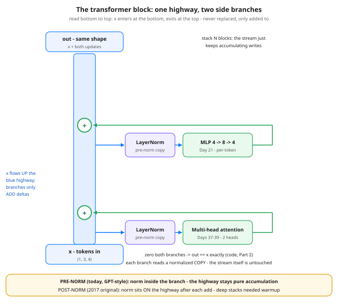

# The Transformer Block: Attention + MLP + Residuals + Norms

**Day 40 of 100** · Phase C — Attention & transformers

Tonight you'll be able to: assemble the whole transformer block — attention, MLP, residuals, norms — from the parts you already own, and prove with one zeroed-out block why the residual stream is what makes deep stacks trainable at all.

## The one idea

Four days of parts, one day of assembly. You have attention (Days 37-38), several heads of it in parallel (Day 39), the MLP (Day 21), and LayerNorm (Day 29). The **transformer block** is those parts wired in one fixed pattern — two sublayers, two norms, two adds:

```
h   = x + Attention(LayerNorm(x))
out = h + MLP(LayerNorm(h))
```

**The adds are the design.** Read the equations literally: x is never *replaced* by a sublayer's output, it is only *added to*. Each sublayer reads a normalized copy of the current stream, does its computation off to the side, and writes back a **delta** — an update, not a new value. The thing flowing vertically through the stack has a name: the **residual stream**. After block 1 it holds `x + Δ_attn + Δ_mlp`; after 12 or 96 blocks it holds the input plus every block's writes, accumulated. Nothing is ever overwritten.

**That is what makes depth possible** — in both directions. Forward: the original signal is additively present at the top of the stack, not squeezed through 96 successive transformations. Backward: differentiation of `x + branch(x)` hands the gradient a pure identity lane — a path where the Day 23 blame signal is multiplied by exactly 1, however the branches behave. Contrast Day 28: the RNN's gradient paid a ~0.53× tax at every hop because every hop was a multiplication. Here a block *can* garble its delta, but it cannot tax the through-lane. In the code you will zero both sublayers and watch the gradient arrive at a dead block at full strength: 1.0000, everywhere.

**Pre-norm vs post-norm, honestly.** The 2017 original was *post-norm*: LayerNorm sat on the stream itself, after each add, re-scaling the accumulated signal at every block — and deep stacks needed careful learning-rate warmup to survive it. Modern blocks (GPT-2 onward, and today's code) are *pre-norm*: the norm moves inside the branch, the stream is never normalized, it just accumulates. Pre-norm stacks train deeper with far less fuss. The price is real: an unnormalized stream grows with depth, and the bill is paid by one final LayerNorm just before the output head — which arrives with the full model build, two days from now.

Last, the contract that makes it all composable: **a block preserves shape** — `(batch, tokens, d_model)` in, the identical shape out. That is why "how many layers" is a free dial (Day 30's depth knob): you stack the same block N times and the plumbing never changes. Today's block takes token positions as given — the sequence goes in as a set of vectors, and attention alone cannot tell token 1 from token 3. Hold that thought until tomorrow.

> **Analogy.** You already run this architecture: **an append-only event log with side processors.** The residual stream is the log — the single source of truth flowing through the system. Each sublayer is a consumer that reads the log through a canonicalizing adapter (the pre-norm: every consumer sees the same normalized view, Day 29), computes, and *appends a delta event*. Nobody edits history in place; nobody downstream has to re-read a mutated record. A consumer that crashes — or outputs zeros — degrades the stream by exactly nothing: the log still carries every earlier event. That is Part 2 of the code, in systems language.
>
> Trading version, one line: the stream is your position, sublayers are trades — each one adjusts the book by a delta, and no trade ever restates the whole position from scratch.

## See it



*Bottom to top: x enters the residual stream and flows up the blue highway. Twice, a branch taps the stream, normalizes a copy (pre-norm), computes — attention, then MLP — and adds its delta back at the + node. The stream itself is never normalized, never multiplied, never replaced: that is why a signal — and a gradient — can cross 12 or 96 of these blocks.*

## Code it (~30 min)

One file, three parts, every weight hand-set — no RNG, every digit exact. **Part 1** builds `TransformerBlock` (hand-rolled 2-head attention from Day 39, pre-norm wiring, a 4→8→4 ReLU MLP — production MLPs widen 4× and use GELU; 2× and ReLU keep today's arithmetic checkable), runs a 3-token sequence through, and counts θ: 156 numbers. **Part 2** is the highway proof: zero every sublayer weight and the block returns its input *exactly*, gradient included. **Part 3** restores the weights and measures the writes — each update against the size of the stream it lands in. No causal mask: the block is the reusable chassis; masking belongs to the full-model build.

```python
"""Day 40 - The Transformer Block: Attention + MLP + Residuals + Norms.

Phase C has spent four days forging parts: attention as a
weighted read over memory (Days 37-38), several heads in
parallel (Day 39), and LayerNorm from Day 29. Today the parts
become the machine. One transformer block is:

    h   = x + Attention(LayerNorm(x))
    out = h + MLP(LayerNorm(h))

Two sublayers, two norms, two adds - and the adds are the
design. x is never replaced, only added to. Each sublayer
reads a normalized copy of the stream and writes back a
DELTA, an update. Stack N blocks and the stream is the
input plus every block's writes, accumulated - the
residual stream, an always-open highway that carries the
signal (and, backward, the gradient) through untouched
lanes. That is what makes depth possible: Day 28's RNN
faded at ~0.53 of gradient per hop because every hop was a
multiplication; here every block also offers an identity
lane, a pure +x path where nothing is multiplied at all.

Pre-norm vs post-norm, one honest paragraph: the 2017
original put the LayerNorm ON the stream, after each add
(post-norm), so the stream itself was re-scaled at every
block and deep stacks needed careful learning-rate warmup.
Modern blocks (GPT-2 onward, and this lesson) use pre-norm:
the norm lives inside the branch, the stream is never
normalized, it just accumulates. Pre-norm stacks train
deeper with less fuss; the price is a stream whose size
grows with depth, paid by one final LayerNorm before the
output head (that arrives with the Day 42 build).

  Part 1  Build the block: hand-rolled 2-head attention
          (Day 39) + LayerNorms (Day 29) + a 4 -> 8 -> 4
          ReLU MLP (Day 21 - production MLPs widen 4x and
          use GELU; 2x and ReLU keep today's arithmetic
          small enough to check). Shape in == shape out:
          (1, 3, 4) -> (1, 3, 4), two blocks stack into
          the same shape, and theta is countable: 156.
  Part 2  The highway proof. Zero every weight in both
          sublayers and the block returns its input
          EXACTLY - the branches write nothing, the stream
          carries x through untouched. Then the backward
          version: with loss = out.sum(), d loss/d input
          is exactly 1.0000 everywhere. The branches are
          dead and the gradient still arrives at full
          strength, because differentiation of (x + 0)
          is identity - the lane backprop rides.
  Part 3  The stream at work, real weights restored.
          Recompose the block by hand from its submodules
          (matches block(x) to 0.000000), then measure the
          writes: the attention update and the MLP update
          are each smaller than the stream they write
          into, and cos(out, x) = 0.8338 - after a full
          block, the original signal is still the bulk of
          what is flowing.

No causal mask today: the block is the reusable chassis
for both encoder and decoder stacks; masking is a detail
of the Day 42 build, not of the block itself. Positions
are taken as given - order-sense is tomorrow's lesson.

Runs on the ~/ai-lab venv: torch only (free), CPU on
purpose (tiny tensors; four-digit numbers stay exact),
no CUDA, no paid APIs, no downloads. Every weight is
hand-set below, so there is no RNG anywhere in this
lesson and every printed number is exact.

Expected output:

  Part 1 - one block: shape in == shape out, theta counted
    input shape (1, 3, 4) -> output shape (1, 3, 4)  (shape-preserving - that is why blocks stack)
    two blocks stacked: (1, 3, 4) - still the same shape
    token 0 out: 1.6055, 0.3608, 0.2908, -0.1129
    token 1 out: 0.5623, 1.3342, -0.5888, 0.2007
    token 2 out: 1.1301, 0.8896, 0.3603, 0.4565
    params: attention 64 + mlp 76 + norms 16 = 156
  Part 2 - kill the branches: the highway carries x untouched
    zeroed sublayers: output == input exactly: True  max diff 0.000000
    loss = out.sum(): d loss / d input min 1.0000 max 1.0000 - gradient rides the highway untouched too
  Part 3 - the stream at work: sublayers write updates, x rides through
    manual recomposition vs block(x): max diff 0.000000
    token 0 in : 1.0000, 0.0000, 0.5000, -0.5000
    token 0 out: 1.6055, 0.3608, 0.2908, -0.1129
    ||x|| 2.1213  ||attn update|| 1.1925  ||mlp update|| 0.9825
    combined update ||out - x|| 1.5434 = 72.8% of ||x||;  cos(out, x) 0.8338
    verdict: sublayers only ever ADD to the stream - depth works because x itself is never multiplied away
"""
import math

import torch
import torch.nn as nn

D_MODEL, NUM_HEADS, T = 4, 2, 3

# Hand-set weights - the same starting function every run.
W_Q = torch.tensor([[1.0, 0.0, 0.0, 0.0],
                    [0.0, 1.0, 0.0, 0.0],
                    [0.0, 0.0, 0.5, 0.0],
                    [0.0, 0.0, 0.0, 0.5]])
W_K = torch.tensor([[0.5, 0.0, 0.0, 0.0],
                    [0.0, 0.5, 0.0, 0.0],
                    [0.0, 0.0, 1.0, 0.0],
                    [0.0, 0.0, 0.0, 1.0]])
W_V = torch.tensor([[0.0, 1.0, 0.0, 0.0],
                    [1.0, 0.0, 0.0, 0.0],
                    [0.0, 0.0, 1.0, 0.0],
                    [0.0, 0.0, 0.0, 1.0]])
W_O = torch.tensor([[0.5, 0.0, 0.0, 0.0],
                    [0.0, 0.5, 0.0, 0.0],
                    [0.0, 0.0, 0.0, 0.5],
                    [0.0, 0.0, 0.5, 0.0]])
FC1 = torch.tensor([[1.0, 0.0, 0.0, 0.0],
                    [0.0, 1.0, 0.0, 0.0],
                    [0.0, 0.0, 1.0, 0.0],
                    [0.0, 0.0, 0.0, 1.0],
                    [0.5, 0.5, 0.0, 0.0],
                    [0.0, 0.0, 0.5, 0.5],
                    [1.0, -1.0, 0.0, 0.0],
                    [0.0, 0.0, 1.0, -1.0]])
FC2 = torch.tensor([[0.25, 0.0, 0.0, 0.0, 0.25, 0.0, 0.0, 0.0],
                    [0.0, 0.25, 0.0, 0.0, 0.0, 0.25, 0.0, 0.0],
                    [0.0, 0.0, 0.25, 0.0, 0.0, 0.0, 0.25, 0.0],
                    [0.0, 0.0, 0.0, 0.25, 0.0, 0.0, 0.0, 0.25]])
X = torch.tensor([[[1.0, 0.0, 0.5, -0.5],
                   [0.0, 1.0, -0.5, 0.5],
                   [0.5, 0.5, 1.0, 0.0]]])          # (1, T=3, D=4)

fmt = lambda t: ", ".join(f"{v:.4f}" for v in t.flatten().tolist())


class MultiHeadSelfAttention(nn.Module):
    """Day 39's module, hand-rolled: project Q/K/V, split into
    heads, scaled dot-product attention per head, concat, mix."""

    def __init__(self, d_model=D_MODEL, num_heads=NUM_HEADS):
        super().__init__()
        self.num_heads = num_heads
        self.head_dim = d_model // num_heads
        self.q = nn.Linear(d_model, d_model, bias=False)
        self.k = nn.Linear(d_model, d_model, bias=False)
        self.v = nn.Linear(d_model, d_model, bias=False)
        self.o = nn.Linear(d_model, d_model, bias=False)

    def forward(self, x):
        B, T, D = x.shape

        def split(t):
            return t.view(B, T, self.num_heads,
                          self.head_dim).transpose(1, 2)

        q, k, v = split(self.q(x)), split(self.k(x)), split(self.v(x))
        scores = q @ k.transpose(-2, -1) / math.sqrt(self.head_dim)
        heads = torch.softmax(scores, dim=-1) @ v     # (B, H, T, hd)
        concat = heads.transpose(1, 2).reshape(B, T, D)
        return self.o(concat)


class TransformerBlock(nn.Module):
    """Pre-norm block: the norm lives inside each branch, so the
    residual stream itself is never touched except by adds."""

    def __init__(self, d_model=D_MODEL):
        super().__init__()
        self.ln1 = nn.LayerNorm(d_model)
        self.attn = MultiHeadSelfAttention(d_model)
        self.ln2 = nn.LayerNorm(d_model)
        self.mlp = nn.Sequential(nn.Linear(d_model, 2 * d_model),
                                 nn.ReLU(),
                                 nn.Linear(2 * d_model, d_model))

    def forward(self, x):
        h = x + self.attn(self.ln1(x))                # read, write delta
        return h + self.mlp(self.ln2(h))              # read, write delta


def build_block():
    blk = TransformerBlock()
    with torch.no_grad():
        blk.attn.q.weight.copy_(W_Q)
        blk.attn.k.weight.copy_(W_K)
        blk.attn.v.weight.copy_(W_V)
        blk.attn.o.weight.copy_(W_O)
        blk.mlp[0].weight.copy_(FC1)
        blk.mlp[0].bias.zero_()
        blk.mlp[2].weight.copy_(FC2)
        blk.mlp[2].bias.zero_()
    return blk


# ---------- Part 1: build it, run it, count it ----------
print("Part 1 - one block: shape in == shape out, theta counted")
block = build_block()
with torch.no_grad():
    out = block(X)
    stacked = nn.Sequential(build_block(), build_block())(X)
print(f"  input shape {tuple(X.shape)} -> output shape {tuple(out.shape)}"
      "  (shape-preserving - that is why blocks stack)")
print(f"  two blocks stacked: {tuple(stacked.shape)}"
      " - still the same shape")
for t in range(T):
    print(f"  token {t} out: {fmt(out[0, t])}")
count = lambda m: sum(p.numel() for p in m.parameters())
n_attn = count(block.attn)
n_mlp = count(block.mlp)
n_norm = count(block.ln1) + count(block.ln2)
print(f"  params: attention {n_attn} + mlp {n_mlp} + norms {n_norm}"
      f" = {n_attn + n_mlp + n_norm}")

# ---------- Part 2: kill the branches, watch the highway ----------
print("Part 2 - kill the branches: the highway carries x untouched")
dead = build_block()
with torch.no_grad():
    for module in (dead.attn, dead.mlp):
        for p in module.parameters():
            p.zero_()                                 # norms untouched
Xg = X.clone().requires_grad_(True)
out_z = dead(Xg)
with torch.no_grad():
    max_diff = (out_z - X).abs().max().item()
print(f"  zeroed sublayers: output == input exactly:"
      f" {bool(torch.equal(out_z, X))}  max diff {max_diff:.6f}")
out_z.sum().backward()                                # loss = out.sum()
print(f"  loss = out.sum(): d loss / d input min"
      f" {Xg.grad.min().item():.4f} max {Xg.grad.max().item():.4f}"
      " - gradient rides the highway untouched too")

# ---------- Part 3: the stream at work ----------
print("Part 3 - the stream at work: sublayers write updates,"
      " x rides through")
with torch.no_grad():
    a = block.attn(block.ln1(X))                      # attention's write
    h = X + a
    b = block.mlp(block.ln2(h))                       # the MLP's write
    manual = h + b
    rdiff = (manual - block(X)).abs().max().item()
    nx = X.norm().item()
    nu = (manual - X).norm().item()
    cos = torch.dot(manual.flatten(), X.flatten()).item() \
        / (manual.norm().item() * nx)
print(f"  manual recomposition vs block(x): max diff {rdiff:.6f}")
print(f"  token 0 in : {fmt(X[0, 0])}")
print(f"  token 0 out: {fmt(manual[0, 0])}")
print(f"  ||x|| {nx:.4f}  ||attn update|| {a.norm().item():.4f}"
      f"  ||mlp update|| {b.norm().item():.4f}")
print(f"  combined update ||out - x|| {nu:.4f} = {100 * nu / nx:.1f}%"
      f" of ||x||;  cos(out, x) {cos:.4f}")
print("  verdict: sublayers only ever ADD to the stream - depth works"
      " because x itself is never multiplied away")
```

**Expected output:**

```
Part 1 - one block: shape in == shape out, theta counted
  input shape (1, 3, 4) -> output shape (1, 3, 4)  (shape-preserving - that is why blocks stack)
  two blocks stacked: (1, 3, 4) - still the same shape
  token 0 out: 1.6055, 0.3608, 0.2908, -0.1129
  token 1 out: 0.5623, 1.3342, -0.5888, 0.2007
  token 2 out: 1.1301, 0.8896, 0.3603, 0.4565
  params: attention 64 + mlp 76 + norms 16 = 156
Part 2 - kill the branches: the highway carries x untouched
  zeroed sublayers: output == input exactly: True  max diff 0.000000
  loss = out.sum(): d loss / d input min 1.0000 max 1.0000 - gradient rides the highway untouched too
Part 3 - the stream at work: sublayers write updates, x rides through
  manual recomposition vs block(x): max diff 0.000000
  token 0 in : 1.0000, 0.0000, 0.5000, -0.5000
  token 0 out: 1.6055, 0.3608, 0.2908, -0.1129
  ||x|| 2.1213  ||attn update|| 1.1925  ||mlp update|| 0.9825
  combined update ||out - x|| 1.5434 = 72.8% of ||x||;  cos(out, x) 0.8338
  verdict: sublayers only ever ADD to the stream - depth works because x itself is never multiplied away
```

> **Today's win.** Done when your run shows: shape `(1, 3, 4) → (1, 3, 4)` with `156` params in Part 1; Part 2's `output == input exactly: True` with the input gradient at min/max `1.0000` on a block whose branches are dead; and Part 3's `cos(out, x) 0.8338`. The keeper test, no notes: point at the diagram and narrate one token's full trip — up the highway, tapped twice, two deltas added — and say in one sentence why a 96-block stack can still learn.

> **Short on time? 20-minute version.** Read "The one idea", trace the diagram bottom to top once with your finger, then run only Part 2. If you can explain why a block with both sublayers zeroed still passes x — and its gradient — through perfectly, you own the idea; Parts 1 and 3 are the receipts.

> **Tomorrow's teaser.** Tomorrow: your block has a blind spot — shuffle the three tokens and nothing in today's math changes, because nothing in it knows the order. Tomorrow the model gets a sense of sequence.

Streak: 40 day(s) · Never miss twice.
