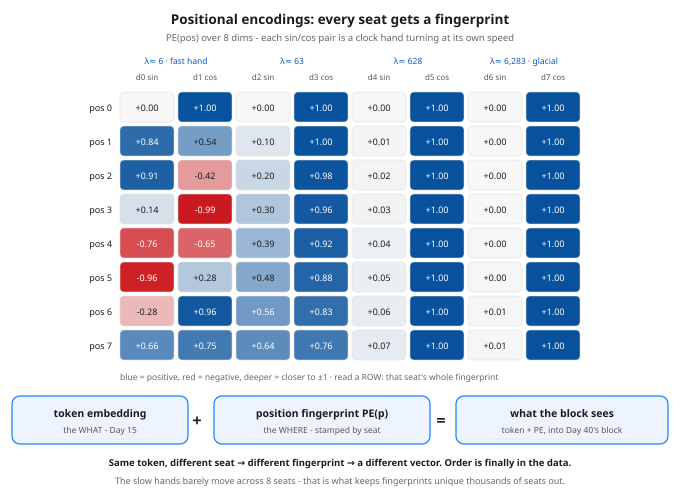

# Day 41 — Positional Encodings: Giving the Model a Sense of Order

**Tonight you'll be able to:** prove attention on its own is order-blind — shuffle the tokens and the outputs just shuffle with them — then fix it by stamping every seat with a sinusoidal fingerprint, and read that fingerprint table as a row of clock hands turning at different speeds.

## The one idea

**The flaw first.** Look back at Day 38's recipe: a token's output is a *weighted sum over all the tokens*, weights from dot products. A sum has no order — reorder the terms and the total is identical, term for term. Position is never a variable anywhere in the formula, so Day 40's block inherits the blindness: shuffle the input tokens and every output follows its token, unchanged (you will measure this in Part 1: max diff `0.000000`). To a bare transformer, *"dog bites man"* and *"man bites dog"* are literally the same input. The RNN of Day 28 got order for free — it *consumes* tokens one at a time. Attention traded that recurrence away for parallelism (Day 36), so order has to be bought back, explicitly, and injected into the only thing the block ever sees: the vectors.

**The fix is one addition.** Before the first block, each token vector gets its seat's fingerprint added to it: `input = token embedding + PE(pos)`. Added, not glued on — same dimension, so the token now carries *what it is* and *where it sits* in a single vector, and every downstream dot product mixes content with position. One detail matters enormously, and Part 2 is built around it: the fingerprint belongs to the **seat**, not the token. Token A moved to seat 1 gets seat 1's fingerprint — so after a reorder it is a genuinely different input, and its output moves (tonight: by `0.2751`).

**How to build the fingerprint — option 1: learned.** Keep a table, one trainable row per seat (`nn.Embedding(max_len, d)` — Day 15's lookup, but indexed by position instead of by token). GPT-style models do this: simple, and the model learns whatever position code it likes. The costs: parameters (Part 3 prices a toy table at 4,096; real ones are far bigger) and a hard ceiling — seat 10,000 has no row if you only trained 1,024.

**Option 2: sinusoidal — tonight's build.** No table, no parameters: a formula. Pair up the dimensions; each pair is **one clock hand**, and seat `p` reads that hand's angle as `(sin, cos)`: `PE(p, 2i) = sin(p / 10000^(2i/d))`, `PE(p, 2i+1) = cos(p / 10000^(2i/d))`. In tonight's `d = 8` toy the four hands complete a full turn every ~6, ~63, ~628 and ~6,283 seats (a real `d = 512` model has 256 hands, the slowest needing tens of thousands of seats per turn). Three properties fall out, all measured in Part 3: every seat's combined reading is **unique** (the slow hands disambiguate what the fast hand repeats); **nearby seats overlap heavily** — cosine similarity from seat 0 falls 0.8838 → 0.6409 → 0.4912 across seats 1, 2, 3 — so "close together" is a smooth, learnable signal rather than a cliff; and because each hand advances by a **fixed angle per seat**, seat `p + k`'s fingerprint is seat `p`'s with every hand turned by the same extra amount — a fixed offset looks the same wherever it occurs, which is exactly the relative-position signal attention needs. And since it is a formula, it prices any seat, trained-for or not.

**One honest paragraph on the modern variant: RoPE.** Most current open models (the Llama family and descendants) do not add a fingerprint to the embeddings at all. Instead, *rotary positional embeddings* rotate each query/key pair (Day 37) by an angle proportional to its seat, inside attention itself — the same clock hands, applied to Q and K rather than to the input, so scores end up depending on *relative* distance directly. Tonight you are not learning RoPE's mechanics; just file the name: if an interviewer says "rotary embeddings," it is this lesson's clock, moved one layer deeper.

Two practical notes before the code. The fingerprint is added **once**, at the input — not re-stamped at every block. And tonight it runs at full strength (every fingerprint row has norm 2.0000, against the toy tokens' ~1.4) so the effect is impossible to miss; a trained model learns input/output scales that balance the two signals. The mechanism is the lesson, not the ratio.

## Analogy

You already refuse to build systems this way. Hand a consumer the same set of Kafka records *as an unordered bag* and it cannot reconstruct what happened — that is why every record carries an **offset stamped by its position in the log**, not by anything in its payload. TCP does the same with sequence numbers: the bytes are the content, the sequence number is the seat. Attention without positional encodings is a consumer reading payloads with the offsets stripped; `PE(pos)` is you stamping the offset back on, in a format (a vector) the model can compute with.

Trading version, one line: the same five candles, shuffled, are a different market — a hammer candle *after* a flush means something its twin *before* the flush does not, because the exchange stamps every candle with its time. Order is data. Tonight you give the model its timestamps.

## See it



The sinusoidal fingerprint table for seats 0–7 at `d = 8`. Read across a row: that seat's full fingerprint. Read down a pair of columns: one clock hand — the fast hand (dims 0–1, wavelength ≈ 6 seats) has already swung through most of a turn, the ≈ 63 and ≈ 628 hands have visibly crept, and the glacial hand (dims 6–7, ≈ 6,283) still reads ≈ 0 / +1.00: it exists for seats in the thousands, where the fast hands have repeated themselves thousands of times and only the slow hands can tell two far-apart seats apart. Bottom: the one addition that fixes Day 40's block — token (the what) + fingerprint (the where) = the vector the block actually sees.

## Code it (~30 min)

One file, three measurements, every vector hand-set or formula-built — no RNG, every digit exact. **Part 1** runs Day 38's attention with the Q/K/V projections stripped to identity (isolating the pure set-average) on four toy tokens, then permutes the input to `[C, A, D, B]` and compares outputs row-by-row: the flaw, as a number. **Part 2** stamps the sinusoidal fingerprint on each seat *after* permuting — the pipeline a real model runs — and re-measures: the same comparison, plus a minimal A↔B swap that moves token A's own output. **Part 3** prints the fingerprint table itself: rows 0–3, every row's norm, cosine similarity vs distance, and the learned table's price tag for comparison.

```python
"""Day 41 - Positional Encodings: Giving the Model a Sense of Order.

Day 38's attention has a quiet flaw, and Day 40's block
inherited it: attention is a weighted average over a SET.
Every output is a sum over token pairs, and a sum does not
care about the order of its terms - so shuffle the input
and each output simply follows its token, unchanged.
'dog bites man' and 'man bites dog' are the same bag of
words. The block cannot see order until order is put INTO
the vectors themselves.

The fix is one addition, before the block:

    input at seat p  =  token embedding  +  PE(p)

Two ways to build PE(p), the position fingerprint:

  Learned - an nn.Embedding table, one trainable row per
  seat (what GPT-style models use). Flexible, but the
  table only has as many rows as you trained for.

  Sinusoidal - tonight's build. A formula, zero params.
  Each dimension pair is one clock hand and seat p reads
  the hand's angle as (sin, cos):

      PE(p, 2i)   = sin(p / 10000^(2i/d))
      PE(p, 2i+1) = cos(p / 10000^(2i/d))

  With d = 8 the four hands complete a turn every ~6,
  ~63, ~628 and ~6,283 seats. Every seat's 8-number
  fingerprint is unique, nearby seats' fingerprints
  overlap heavily, and each hand advances by a fixed
  angle per seat - so a fixed OFFSET between two seats
  always looks the same to the model, wherever it sits.

  Part 1  The flaw, measured. Day 38 attention with the
          Q/K/V projections stripped to identity, on four
          hand-set tokens; then permute the input to
          [C, A, D, B] and re-run: the outputs are the
          same rows, shuffled - max diff 0.000000.
  Part 2  The fix, measured. Stamp PE on each SEAT after
          permuting, and the same permutation no longer
          commutes: max diff 0.5367. Even a two-token
          swap moves token A's own output by 0.2751 -
          the same token, a different seat, a different
          input vector.
  Part 3  The fingerprint table itself. Rows 0-3 printed:
          the fast hand spins, the slow hands barely
          crawl. Every row's norm is 2.0000, cosine
          similarity from seat 0 falls with distance
          (0.8838, 0.6409, 0.4912), and the learned
          alternative costs 4,096 params for 512 seats
          where the formula costs 0.

Runs on the ~/ai-lab venv: torch only (free), CPU on
purpose (tiny data, exact digits), no CUDA, no paid
APIs, no downloads. Every vector is hand-set or built
by the formula - no RNG anywhere in this lesson.

Expected output:

  Part 1 - attention alone (identity Q/K/V): a weighted average over a set
    A: 0.3451, 0.2423, 0.2423, 0.1702, 0.8298, 0.0000, 0.0000, 0.0000
    B: 0.2423, 0.3451, 0.2423, 0.1702, 0.8298, 0.0000, 0.0000, 0.0000
    C: 0.2423, 0.2423, 0.3451, 0.1702, 0.8298, 0.0000, 0.0000, 0.0000
    D: 0.2260, 0.2260, 0.2260, 0.3219, 0.6781, 0.0000, 0.0000, 0.0000
    permuted input [C, A, D, B]: max diff vs the same rows re-shuffled: 0.000000
    verdict: no position anywhere in the math - attention sees a set, not a sequence
  Part 2 - add PE(p) to each seat BEFORE attention
    same permutation [C, A, D, B], PE stamped by seat after permuting:
    max diff vs the same rows re-shuffled: 0.5367
    token A in seat 0: 0.8234, 0.6982, 0.2988, 1.1064, 0.8937, 0.9999, 0.0011, 1.0000
    token A in seat 1 (A<->B swap - same set of tokens): 1.0907, 0.4231, 0.3489, 1.1042, 0.8965, 0.9999, 0.0013, 1.0000
    A's own output moved by: max diff 0.2751
    verdict: PE is stamped on the SEAT, not the token - reorder, and every output changes
  Part 3 - the sinusoidal fingerprint table (d = 8, base 10000)
    pos 0: 0.0000, 1.0000, 0.0000, 1.0000, 0.0000, 1.0000, 0.0000, 1.0000
    pos 1: 0.8415, 0.5403, 0.0998, 0.9950, 0.0100, 0.9999, 0.0010, 1.0000
    pos 2: 0.9093, -0.4161, 0.1987, 0.9801, 0.0200, 0.9998, 0.0020, 1.0000
    pos 3: 0.1411, -0.9900, 0.2955, 0.9553, 0.0300, 0.9996, 0.0030, 1.0000
    every row's norm: 2.0000, 2.0000, 2.0000, 2.0000, 2.0000, 2.0000, 2.0000, 2.0000
    cos(pos 0, pos 1) = 0.8838   cos(pos 0, pos 2) = 0.6409   cos(pos 0, pos 3) = 0.4912
    nearby seats look alike, distant seats don't - order is now IN the vectors
    learned table for 512 seats x 8 dims: 4096 trainable params - sinusoidal: 0 (a formula)
"""
import math

import torch

D = 8
# Four hand-set token embeddings (labels A-D). Each owns one
# dimension and shares dimension 4, so attention has something
# to mix - but nothing anywhere encodes WHO CAME FIRST.
X = torch.tensor([[1.0, 0.0, 0.0, 0.0, 1.0, 0.0, 0.0, 0.0],   # A
                  [0.0, 1.0, 0.0, 0.0, 1.0, 0.0, 0.0, 0.0],   # B
                  [0.0, 0.0, 1.0, 0.0, 1.0, 0.0, 0.0, 0.0],   # C
                  [0.0, 0.0, 0.0, 1.0, 0.0, 0.0, 0.0, 0.0]])  # D
LABELS = ("A", "B", "C", "D")
PERM = torch.tensor([2, 0, 3, 1])          # seat order becomes C, A, D, B

fmt = lambda t: ", ".join(f"{v:.4f}" for v in t.flatten().tolist())


def attention(x):
    """Day 38's scaled dot-product attention, Q/K/V projections
    set to identity on purpose: the pure set-average, isolated."""
    scores = x @ x.T / math.sqrt(x.size(-1))
    return torch.softmax(scores, dim=-1) @ x


def sinusoidal(n_pos, d_model):
    """PE(p, 2i) = sin(p / 10000^(2i/d)), PE(p, 2i+1) = cos(...).
    Row p is seat p's fingerprint; each column pair is one clock
    hand, and hand i turns 10000^(2i/d) times slower than hand 0."""
    pos = torch.arange(n_pos, dtype=torch.float32).unsqueeze(1)
    div = 10000.0 ** (torch.arange(0, d_model, 2).float() / d_model)
    ang = pos / div                                    # (n_pos, d/2)
    pe = torch.zeros(n_pos, d_model)
    pe[:, 0::2] = torch.sin(ang)
    pe[:, 1::2] = torch.cos(ang)
    return pe


PE = sinusoidal(8, D)                      # seats 0..7, built once

# ---------- Part 1: attention alone is order-blind ----------
print("Part 1 - attention alone (identity Q/K/V): "
      "a weighted average over a set")
out = attention(X)
for lab, row in zip(LABELS, out):
    print(f"  {lab}: {fmt(row)}")
out_perm = attention(X[PERM])
diff = (out_perm - out[PERM]).abs().max().item()
print(f"  permuted input [C, A, D, B]: max diff vs the same rows "
      f"re-shuffled: {diff:.6f}")
print("  verdict: no position anywhere in the math - "
      "attention sees a set, not a sequence")

# ---------- Part 2: stamp the seat, break the symmetry ----------
print("Part 2 - add PE(p) to each seat BEFORE attention")
out_pe = attention(X + PE[:4])
out_perm_pe = attention(X[PERM] + PE[:4])  # PE stamped AFTER permuting:
diff2 = (out_perm_pe - out_pe[PERM]).abs().max().item()   # by seat, always
print("  same permutation [C, A, D, B], PE stamped by seat "
      "after permuting:")
print(f"  max diff vs the same rows re-shuffled: {diff2:.4f}")
swap = torch.tensor([1, 0, 2, 3])          # A<->B, same set of tokens
out_swap = attention(X[swap] + PE[:4])
a_moved = (out_pe[0] - out_swap[1]).abs().max().item()
print(f"  token A in seat 0: {fmt(out_pe[0])}")
print("  token A in seat 1 (A<->B swap - same set of tokens): "
      f"{fmt(out_swap[1])}")
print(f"  A's own output moved by: max diff {a_moved:.4f}")
print("  verdict: PE is stamped on the SEAT, not the token - "
      "reorder, and every output changes")

# ---------- Part 3: read the fingerprint table ----------
print("Part 3 - the sinusoidal fingerprint table (d = 8, base 10000)")
for p in range(4):
    print(f"  pos {p}: {fmt(PE[p])}")
print(f"  every row's norm: {fmt(PE.norm(dim=-1))}")


def cos(a, b):
    return (a @ b / (a.norm() * b.norm())).item()


print(f"  cos(pos 0, pos 1) = {cos(PE[0], PE[1]):.4f}   "
      f"cos(pos 0, pos 2) = {cos(PE[0], PE[2]):.4f}   "
      f"cos(pos 0, pos 3) = {cos(PE[0], PE[3]):.4f}")
print("  nearby seats look alike, distant seats don't - "
      "order is now IN the vectors")
print(f"  learned table for 512 seats x {D} dims: {512 * D} "
      "trainable params - sinusoidal: 0 (a formula)")
```

**Expected output:**

```
Part 1 - attention alone (identity Q/K/V): a weighted average over a set
  A: 0.3451, 0.2423, 0.2423, 0.1702, 0.8298, 0.0000, 0.0000, 0.0000
  B: 0.2423, 0.3451, 0.2423, 0.1702, 0.8298, 0.0000, 0.0000, 0.0000
  C: 0.2423, 0.2423, 0.3451, 0.1702, 0.8298, 0.0000, 0.0000, 0.0000
  D: 0.2260, 0.2260, 0.2260, 0.3219, 0.6781, 0.0000, 0.0000, 0.0000
  permuted input [C, A, D, B]: max diff vs the same rows re-shuffled: 0.000000
  verdict: no position anywhere in the math - attention sees a set, not a sequence
Part 2 - add PE(p) to each seat BEFORE attention
  same permutation [C, A, D, B], PE stamped by seat after permuting:
  max diff vs the same rows re-shuffled: 0.5367
  token A in seat 0: 0.8234, 0.6982, 0.2988, 1.1064, 0.8937, 0.9999, 0.0011, 1.0000
  token A in seat 1 (A<->B swap - same set of tokens): 1.0907, 0.4231, 0.3489, 1.1042, 0.8965, 0.9999, 0.0013, 1.0000
  A's own output moved by: max diff 0.2751
  verdict: PE is stamped on the SEAT, not the token - reorder, and every output changes
Part 3 - the sinusoidal fingerprint table (d = 8, base 10000)
  pos 0: 0.0000, 1.0000, 0.0000, 1.0000, 0.0000, 1.0000, 0.0000, 1.0000
  pos 1: 0.8415, 0.5403, 0.0998, 0.9950, 0.0100, 0.9999, 0.0010, 1.0000
  pos 2: 0.9093, -0.4161, 0.1987, 0.9801, 0.0200, 0.9998, 0.0020, 1.0000
  pos 3: 0.1411, -0.9900, 0.2955, 0.9553, 0.0300, 0.9996, 0.0030, 1.0000
  every row's norm: 2.0000, 2.0000, 2.0000, 2.0000, 2.0000, 2.0000, 2.0000, 2.0000
  cos(pos 0, pos 1) = 0.8838   cos(pos 0, pos 2) = 0.6409   cos(pos 0, pos 3) = 0.4912
  nearby seats look alike, distant seats don't - order is now IN the vectors
  learned table for 512 seats x 8 dims: 4096 trainable params - sinusoidal: 0 (a formula)
```

## Today's win

Done when your run shows all three numbers: Part 1's permutation diff of exactly `0.000000` (attention alone provably cannot see order), Part 2's `0.5367` for the same permutation once fingerprints are stamped by seat — and token A's own output moving `0.2751` under a mere A↔B swap — and Part 3's cosine ladder `0.8838 → 0.6409 → 0.4912` (nearby seats alike, distant seats not). The keeper test, no notes allowed: explain why the fingerprint must belong to the seat and not the token, state the learned-vs-sinusoidal trade (parameters + a length ceiling vs a formula that prices any seat), and say in one sentence what RoPE changes.

## Short on time? 20-minute version

Read "The one idea", study the diagram row by row until you can see the four clock hands' speeds, then run only Part 1 and Part 3. If you can say out loud why a shuffled input fools bare attention and why seat 3's fingerprint sits between seat 0's and seat 7's, you have the concept — Part 2 is the confirmation lap.

## Tomorrow's teaser

Tomorrow: the assembly you have been building toward since Day 36 — Day 40's block, today's fingerprints, and a pile of plain text go in one end, and a tiny transformer starts predicting what comes next.
