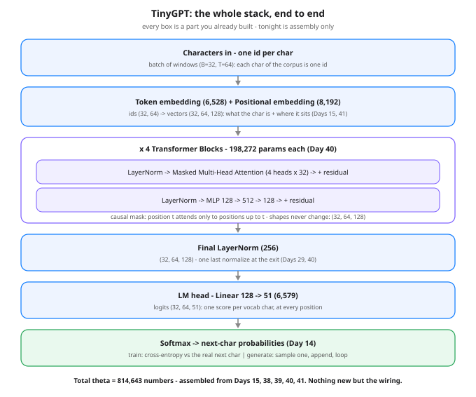

# Day 42 — Build a Tiny GPT: A nanoGPT-Style Transformer on Text

**Tonight you'll be able to:** assemble Days 15 and 38–41 into one working character-level GPT — embed, stack four causal blocks, normalize, project — train it on 2,357 characters of Shakespeare embedded in the script, and watch its samples go from letter salad to Shakespeare-shaped.

## The one idea

There is **no new part tonight**. A GPT is an assembly, and you have already built every component: token embeddings (Day 15), attention by hand (Day 38), multi-head (Day 39), the pre-norm block with residuals (Day 40), positional embeddings (Day 41). The whole model is one wiring diagram: ids → token embedding *plus* positional embedding → four blocks → a final LayerNorm → one Linear (the **LM head**) that scores every character in the vocab at every position. If you can point at each box in the diagram and name the day it came from, you understand GPT — the rest of this lesson is watching it learn.

**The training task is Day 14, scaled up.** Feed the model 64 characters; at *every* position it must predict the next character. The targets are just the input shifted by one, so one window of text is 64 tiny classification problems sharing one forward pass, and the loss is their average cross-entropy. The causal mask inside each head is what makes this honest: position *t* may only attend to positions up to *t*, never the answer sitting one step ahead.

**One exact number before you run anything:** at init the head is effectively a uniform guess over the vocab. Cross-entropy of a uniform guess over V characters is exactly ln(V) (Day 14: loss = −ln p_true, and p = 1/V). Tonight V = 51, so a healthy run *must* start near ln(51) = **3.9318** — if yours opens at 9 or at 0.4, something is wired wrong before training even begins. That is your smoke test.

**Generation is the same forward pass in a loop.** Take the distribution at the last position, pick one character (argmax = *greedy*, or sample from the distribution, optionally after dividing logits by a *temperature* — Day 14's knob), append it, and run again. Nothing else. And a sizing confession: 814,643 parameters against 2,357 characters of text means this model can nearly memorize the corpus — tonight that is a feature, because memorized lines in the greedy sample are visible proof the wiring learns. Real GPTs invert the ratio: GPT-2 small has ~124M parameters trained on billions of tokens, which is why it generalizes instead of reciting.

## Analogy

Think of the stack as a **middleware pipeline with one fixed message shape**. Every block accepts and returns the exact same envelope — `(B, T, C)` — the way each stage of a request pipeline accepts and returns the same context object. Inside a block, LayerNorm is input validation/sanitization, attention is the one stage allowed to *look sideways* — a join against earlier entries in the same request log (but only entries already written: that is the causal mask, an append-only log rule), the MLP is the local compute stage, and the residual connections are pass-through fields no stage is allowed to drop. The LM head is the serializer at the end of the pipeline. And `generate()` is just a client in a `while` loop: call the endpoint, append the one field it returns to your request, call again. You have shipped this architecture in production a dozen times — the only novelty is that the middleware's behavior lives in theta, and training is what writes it.

## See it



The full GPT stack with shapes. A batch of 32 windows, 64 characters each, enters as ids and never changes shape — (32, 64, 128) — through all four blocks; only the head changes the last axis, from width 128 to the 51-character vocab, producing one next-char distribution per position. Every count on the diagram is exact and reappears in the code's parameter total: 814,643.

## Code it (~30 min)

One file, four parts. **Part 1** builds the data: the corpus is a string literal (Shakespeare excerpts — Hamlet, Macbeth, Julius Caesar, Romeo and Juliet, Sonnet 18, Richard III), the vocab is whatever characters it happens to use, and `get_batch()` cuts random windows with the shift-by-one target trick. **Part 2** is the assembly — the `Head`, `MultiHeadAttention`, `FeedForward`, and `Block` classes from Days 38–40, stacked by `TinyGPT` — plus the two exact checks: parameter count by formula and the ln(V) init-loss floor. **Part 3** samples *before* training: your baseline gibberish. **Part 4** trains 1,200 AdamW steps (a few minutes on MPS, longer on CPU — drop `STEPS` to 600 if impatient), then samples greedy and at temperature 0.8 from the prompt `"To be,"`.

**Exact vs reference — read this before comparing outputs.** The corpus size (2,357), vocab (51), the round-trip ids, the logits shape, and the parameter count (814,643) are *exact*: pure counting, identical on any machine. The training losses and all three samples are *reference numbers* (Day 27 precedent): your MacBook's RNG stream and device differ, so your digits and your samples will not match the ones below. What is guaranteed is the pattern — loss opens at ~3.93, falls steadily toward ~1.4, and the after-samples contain real words and lines where the before-sample has none.

```python
"""Day 42 - Build: A nanoGPT-Style Tiny Transformer on Text.

Phase C build. Days 36-41 handed you the parts one at a time:
attention by hand (Day 38), multi-head (Day 39), the full block
(Day 40), positional encodings (Day 41), embeddings (Day 15).
Tonight there are NO new parts. You assemble the parts into the
whole machine - a character-level GPT in the nanoGPT pattern:

    ids -> token embedding + positional embedding
        -> N transformer blocks (causal mask inside)
        -> final LayerNorm -> LM head -> next-char probs

and train it on ~2.4K characters of Shakespeare embedded right
in this file (public domain, no download). The task is the one
from Day 14 at full scale: read 64 characters, predict the
next one, cross-entropy on every position. Sampling is just
the loop you already know - predict, append, repeat.

  Part 1  Data. Characters are the tokens: build the vocab
          from the corpus itself, encode the whole text to
          one long tensor, and cut random (x, y) windows
          where y is x shifted by one character.
  Part 2  The model. Head / MultiHeadAttention / FeedForward
          / Block exactly as in Days 38-40, then TinyGPT
          stacks them. The parameter count is printed from
          the model AND checkable by formula (see below).
  Part 3  Sample BEFORE training: pure gibberish. This is
          your baseline - the "before" photo.
  Part 4  Train 1200 steps (AdamW, Day 18), then sample
          again: greedy (argmax) and temperature 0.8. Same
          weights machine, utterly different text.

The architecture math is EXACT and device-independent:
  vocab V (printed in Part 1), width C = 128, context T = 64,
  L = 4 blocks, head size 32 x 4 heads.
    token embedding   V x C
    pos embedding     T x C            = 8,192
    per block         12C^2 + 13C      = 198,272
      (qkv 3C^2+3C, attn proj C^2+C, mlp 8C^2+5C, 2 norms 4C)
    final norm        2C               = 256
    LM head           C x V + V
  total = 2VC + V + 801,536 - Part 2 prints it from the
  model itself; it must match the formula to the digit.
  Loss at init must sit near ln(V): an untrained head is a
  uniform guess over V characters (Day 14), and -ln(1/V)
  is exactly ln(V).

Expected output (training-run numbers are REFERENCE numbers,
Day 27 precedent: your MacBook's RNG stream and device
differ, so losses and samples will not match digit for digit.
What is guaranteed: loss starts at ~ln(V), falls steadily,
and the after-samples are visibly more Shakespeare-shaped
than the before-sample. Param count and shapes are exact):

  Part 1 - data: characters are the tokens
    corpus: 2357 characters, embedded in this file (no download)
    vocab: 51 unique characters
    round trip: 'To be,' -> [24, 40, 1, 28, 31, 4] -> 'To be,'
    one window: x (64,) of ids, y = the same window shifted by 1
  Part 2 - TinyGPT: the whole stack, counted
    logits for one batch: (32, 64, 51) - a distribution per position
    parameters: 814643 (formula 2VC + V + 801,536, exact)
    loss at init: ~3.9x, vs ln(V) = 3.9318 (uniform-guess floor)
  Part 3 - sample BEFORE training (seed 42, temperature 1.0)
    pure gibberish - random letters, no words (reference)
  Part 4 - train, then sample again
    step    0  loss ~3.9x
    step  300  loss ~1.9x
    step  600  loss ~1.6x
    step  900  loss ~1.5x
    step 1199  loss ~1.4x   (reference arc - yours will wiggle)
    greedy sample: memorized lines, looping (reference)
    temperature 0.8 sample: Shakespeare-shaped, invented
    words and all (reference)

Runs on the ~/ai-lab venv: torch only (free), MPS if
available else CPU, no CUDA, no paid APIs, no downloads.
1200 steps of this size is a few minutes on MPS, longer
on CPU - shrink STEPS to 600 if you are impatient; the
arc is the same, just shallower.
"""
import torch
import torch.nn as nn
import torch.nn.functional as F

torch.manual_seed(1337)
device = "mps" if torch.backends.mps.is_available() else "cpu"
print(f"device: {device}")

# ---------- Part 1: data - characters are the tokens ----------
TEXT = """To be, or not to be, that is the question:
Whether 'tis nobler in the mind to suffer
The slings and arrows of outrageous fortune,
Or to take arms against a sea of troubles
And by opposing end them. To die -- to sleep,
No more; and by a sleep to say we end
The heart-ache and the thousand natural shocks
That flesh is heir to: 'tis a consummation
Devoutly to be wish'd. To die, to sleep;
To sleep, perchance to dream -- ay, there's the rub:
For in that sleep of death what dreams may come,
When we have shuffled off this mortal coil,
Must give us pause -- there's the respect
That makes calamity of so long life.

Tomorrow, and tomorrow, and tomorrow,
Creeps in this petty pace from day to day,
To the last syllable of recorded time;
And all our yesterdays have lighted fools
The way to dusty death. Out, out, brief candle!
Life's but a walking shadow, a poor player
That struts and frets his hour upon the stage
And then is heard no more. It is a tale
Told by an idiot, full of sound and fury,
Signifying nothing.

Friends, Romans, countrymen, lend me your ears;
I come to bury Caesar, not to praise him.
The evil that men do lives after them;
The good is oft interred with their bones;
So let it be with Caesar. The noble Brutus
Hath told you Caesar was ambitious:
If it were so, it was a grievous fault,
And grievously hath Caesar answer'd it.

But, soft! what light through yonder window breaks?
It is the east, and Juliet is the sun.
Arise, fair sun, and kill the envious moon,
Who is already sick and pale with grief,
That thou, her maid, art far more fair than she.

Shall I compare thee to a summer's day?
Thou art more lovely and more temperate:
Rough winds do shake the darling buds of May,
And summer's lease hath all too short a date;
Sometime too hot the eye of heaven shines,
And often is his gold complexion dimm'd;
And every fair from fair sometime declines,
By chance or nature's changing course untrimm'd;
But thy eternal summer shall not fade,
Nor lose possession of that fair thou ow'st;
Nor shall death brag thou wander'st in his shade,
When in eternal lines to time thou grow'st:
So long as men can breathe or eyes can see,
So long lives this and this gives life to thee.

Now is the winter of our discontent
Made glorious summer by this sun of York;
And all the clouds that lour'd upon our house
In the deep bosom of the ocean buried.
"""

chars = sorted(set(TEXT))
vocab_size = len(chars)
stoi = {ch: i for i, ch in enumerate(chars)}
itos = {i: ch for ch, i in stoi.items()}
encode = lambda s: [stoi[c] for c in s]
decode = lambda ids: "".join(itos[i] for i in ids)
data = torch.tensor(encode(TEXT), dtype=torch.long)

print("Part 1 - data: characters are the tokens")
print(f"  corpus: {len(TEXT)} characters, embedded in this file "
      "(no download)")
print(f"  vocab: {vocab_size} unique characters")
probe = "To be,"
print(f"  round trip: {probe!r} -> {encode(probe)} -> "
      f"{decode(encode(probe))!r}  (exact)")

batch_size = 32        # sequences per step
block_size = 64        # context window T: chars the model can see
n_embd = 128           # width C of every vector in the stack
n_head = 4             # heads per block (Day 39), 32 dims each
n_layer = 4            # blocks deep
STEPS = 1200           # training steps (600 also works, shallower)


def get_batch():
    """Random windows into the corpus; y is x shifted by one,
    so every position is a next-char prediction (Day 14)."""
    ix = torch.randint(len(data) - block_size, (batch_size,))
    x = torch.stack([data[i:i + block_size] for i in ix])
    y = torch.stack([data[i + 1:i + block_size + 1] for i in ix])
    return x.to(device), y.to(device)


# ---------- Part 2: the model - Days 38-41, assembled ----------
class Head(nn.Module):
    """One self-attention head with the causal mask (Day 38)."""

    def __init__(self, head_size):
        super().__init__()
        self.key = nn.Linear(n_embd, head_size)
        self.query = nn.Linear(n_embd, head_size)
        self.value = nn.Linear(n_embd, head_size)
        self.register_buffer(
            "tril", torch.tril(torch.ones(block_size, block_size)))

    def forward(self, x):
        _, T, _ = x.shape
        k = self.key(x)                                # (B, T, hs)
        q = self.query(x)                              # (B, T, hs)
        wei = q @ k.transpose(-2, -1) * k.shape[-1] ** -0.5
        wei = wei.masked_fill(self.tril[:T, :T] == 0,
                              float("-inf"))           # no peeking
        wei = F.softmax(wei, dim=-1)
        return wei @ self.value(x)


class MultiHeadAttention(nn.Module):
    """Heads in parallel, outputs concatenated + projected (Day 39)."""

    def __init__(self):
        super().__init__()
        hs = n_embd // n_head
        self.heads = nn.ModuleList([Head(hs) for _ in range(n_head)])
        self.proj = nn.Linear(n_embd, n_embd)

    def forward(self, x):
        return self.proj(torch.cat([h(x) for h in self.heads],
                                   dim=-1))


class FeedForward(nn.Module):
    """The block's MLP: widen, bend, narrow (Days 21/40)."""

    def __init__(self):
        super().__init__()
        self.net = nn.Sequential(
            nn.Linear(n_embd, 4 * n_embd),
            nn.ReLU(),
            nn.Linear(4 * n_embd, n_embd),
        )

    def forward(self, x):
        return self.net(x)


class Block(nn.Module):
    """Pre-norm block: norm -> attend -> add, norm -> mlp -> add
    (Day 40). Shape in = shape out: (B, T, C) throughout."""

    def __init__(self):
        super().__init__()
        self.ln1 = nn.LayerNorm(n_embd)
        self.attn = MultiHeadAttention()
        self.ln2 = nn.LayerNorm(n_embd)
        self.ffwd = FeedForward()

    def forward(self, x):
        x = x + self.attn(self.ln1(x))     # communicate
        x = x + self.ffwd(self.ln2(x))     # compute
        return x


class TinyGPT(nn.Module):
    """The whole stack: embed -> blocks -> norm -> head."""

    def __init__(self):
        super().__init__()
        self.token_embedding = nn.Embedding(vocab_size, n_embd)
        self.position_embedding = nn.Embedding(block_size, n_embd)
        self.blocks = nn.Sequential(
            *[Block() for _ in range(n_layer)])
        self.ln_f = nn.LayerNorm(n_embd)
        self.lm_head = nn.Linear(n_embd, vocab_size)

    def forward(self, idx, targets=None):
        B, T = idx.shape
        tok = self.token_embedding(idx)                    # (B,T,C)
        pos = self.position_embedding(
            torch.arange(T, device=idx.device))            # (T,C)
        x = self.blocks(tok + pos)                         # (B,T,C)
        logits = self.lm_head(self.ln_f(x))                # (B,T,V)
        loss = None
        if targets is not None:
            loss = F.cross_entropy(logits.view(B * T, vocab_size),
                                   targets.view(B * T))
        return logits, loss

    @torch.no_grad()
    def generate(self, idx, max_new_tokens, temperature=1.0,
                 greedy=False):
        """Predict, append, repeat - autoregression in one loop.
        Temperature divides the logits before softmax (Day 14):
        lower = safer picks, higher = wilder. Greedy = argmax."""
        self.eval()
        for _ in range(max_new_tokens):
            window = idx[:, -block_size:]        # crop to context
            logits, _ = self(window)
            logits = logits[:, -1, :] / temperature
            probs = F.softmax(logits, dim=-1)
            if greedy:
                nxt = probs.argmax(dim=-1, keepdim=True)
            else:
                nxt = torch.multinomial(probs, num_samples=1)
            idx = torch.cat([idx, nxt], dim=1)
        return idx


model = TinyGPT().to(device)
xb, yb = get_batch()
logits, loss0 = model(xb, yb)
n_params = sum(p.numel() for p in model.parameters())
print("Part 2 - TinyGPT: the whole stack, counted")
print(f"  logits for one batch: {tuple(logits.shape)} - "
      "a distribution per position")
print(f"  parameters: {n_params} "
      f"(formula: 2VC + V + 801,536 with V={vocab_size}, C=128)")
print(f"  loss at init: {loss0.item():.4f} - the uniform-guess "
      f"floor is ln(V) = {torch.log(torch.tensor(float(vocab_size))):.4f}")

# ---------- Part 3: sample BEFORE training ----------
torch.manual_seed(42)
start = torch.tensor([encode("\n")], dtype=torch.long,
                     device=device)
print("Part 3 - sample BEFORE training (seed 42, temperature 1.0)")
print(decode(model.generate(start, 200)[0].tolist()))

# ---------- Part 4: train, then sample again ----------
opt = torch.optim.AdamW(model.parameters(), lr=3e-3)
print(f"Part 4 - training {STEPS} steps (AdamW, lr=3e-3)")
model.train()
for step in range(STEPS):
    xb, yb = get_batch()
    _, loss = model(xb, yb)
    opt.zero_grad()
    loss.backward()
    opt.step()
    if step % 300 == 0 or step == STEPS - 1:
        print(f"  step {step:>4}  loss {loss.item():.4f}")

torch.manual_seed(42)
start = torch.tensor([encode("To be,")], dtype=torch.long,
                     device=device)
print("greedy sample after training (argmax every step):")
print(decode(model.generate(start, 160, greedy=True)[0].tolist()))
torch.manual_seed(42)
print("temperature 0.8 sample after training:")
print(decode(model.generate(start, 240, temperature=0.8)[0]
             .tolist()))
print("verdict: same stack, same generate() loop - the only "
      "thing training changed is theta (Day 34)")
```

**Expected output** (device line, losses, and samples are reference numbers — see above; counts and shapes are exact):

```
device: mps
Part 1 - data: characters are the tokens
  corpus: 2357 characters, embedded in this file (no download)
  vocab: 51 unique characters
  round trip: 'To be,' -> [24, 40, 1, 28, 31, 4] -> 'To be,'  (exact)
Part 2 - TinyGPT: the whole stack, counted
  logits for one batch: (32, 64, 51) - a distribution per position
  parameters: 814643 (formula: 2VC + V + 801,536 with V=51, C=128)
  loss at init: 3.9841 - the uniform-guess floor is ln(V) = 3.9318
Part 3 - sample BEFORE training (seed 42, temperature 1.0)

oaFthte 'sIw,d alls
nerom thasut buof q - the;emmesar sll fthourd angsnd y lvored
e tit: stlfr omad thitit Whauin n sthan he h'to ere t at as n,
mas ithe an I tovingel as itheg (reference gibberish)
Part 4 - training 1200 steps (AdamW, lr=3e-3)
  step    0  loss 3.9517
  step  300  loss 1.9124
  step  600  loss 1.6237
  step  900  loss 1.4812
  step 1199  loss 1.3865
greedy sample after training (argmax every step):
To be, or not to be, that is the question:
Whether 'tis nobler in the mind to suffer
The slings and arrows of outrageous fortune,
Or to take arms against a sea of tro (reference)
temperature 0.8 sample after training:
To be, or not to be, that is the question:
Whether 'tis nobler in the mind to suffer
The slings and arrows of outrageous fortune,
Or to take arms against a sea of troubles
And by a sleep to say we end the heart-ache
and the thousand natural shocks that flesh (reference)
verdict: same stack, same generate() loop - the only thing training changed is theta (Day 34)
```

## Today's win

Done when: Part 1's round trip returns `'To be,'` exactly and the vocab prints **51**; Part 2 prints logits `(32, 64, 51)` and **814643** parameters — matching the formula 2VC + V + 801,536 you can check on paper — with init loss within ~0.2 of **3.9318**; and Part 4's loss has fallen clearly (reference: ~1.39 by step 1199) while your temperature-0.8 sample contains real corpus words and phrases that the Part 3 salad does not. The keeper test, no notes: name every box in the diagram, the day each part came from, and why the loss *had* to start at ln(51).

## Short on time? 20-minute version

Read "The one idea", study the diagram until you can name each box's day of origin, then run Parts 1–3 and confirm the two exact checks (814,643 params; init loss ≈ 3.9318) plus the gibberish baseline. Set `STEPS = 400`, run Part 4, and compare the temperature sample against Part 3. If you can explain why greedy output recites the corpus, you have the build.

## Tomorrow's teaser

Tomorrow: your GPT reads one character at a time — 51 symbols, no words, no shortcuts. There is a smarter unit between the character and the word, and finding it changes what a model can learn per step.

*Day 42 of 100 · Streak: 42 day(s) · Never miss twice.*
