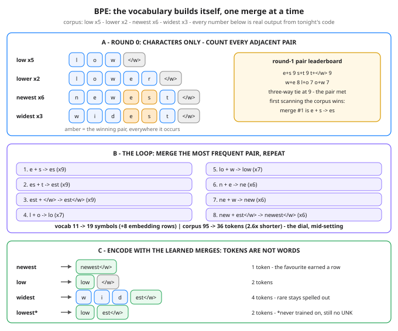

# Day 43 — Tokenization: BPE Intuition

**Tonight you'll be able to:** run the byte-pair merge loop by hand on a four-word corpus until you can call the next merge before the code does — and explain why a model reads tokens instead of characters or words, why a common word costs 1 token and a rare one 4, and why a word the tokenizer never saw still can't break it.

## The one idea

Day 42's tiny GPT read text one *character* at a time — simple, and not what real models do. Between your raw text and Day 15's embedding lookup sits a step we skipped: the **tokenizer**. It chops text into **tokens** — chunks that are sometimes a whole word, sometimes a syllable, sometimes a single letter — and swaps each chunk for an integer id. The model never sees letters or words. It sees ids, and each id is one row of the embedding table.

Why not stay with characters? Think of it as one dial with two bad ends. **Characters:** the vocabulary is tiny, but sequences balloon — a page of text becomes thousands of steps, and everything downstream (attention time, context space, cost) is spent *per token*, so characters make every text long. **Words:** sequences shrink, but the vocabulary explodes — every word in every form needs its own embedding row — and the first word the vocab never saw is unrepresentable: the dreaded **UNK**, a dead end. Tokens are the learned middle setting of that dial: *vocabulary size vs sequence length*. Every vocab entry costs an embedding row and must appear often enough in training to earn a good vector; every merge you skip costs sequence length on every text, forever.

**Byte-Pair Encoding (BPE)** learns where to set the dial, from data, with one move repeated. Start from the smallest possible vocab — individual characters, plus one housekeeping symbol `</w>` marking end-of-word, so word-final pieces can differ from mid-word ones. Then loop: **count every adjacent pair in the corpus (weighted by word frequency), merge the most frequent pair into a new symbol, add it to the vocab.** That is the entire algorithm. Tonight you run 8 rounds and stop at 19 symbols; GPT-2's tokenizer ran the same loop over real text until its vocab held 50,257 symbols. (Production BPE starts from the 256 possible *bytes* rather than characters — same loop, and it's why any input at all, any language or emoji, stays representable.)

Because merges are bought with frequency, the results are not words. In tonight's corpus, `newest` (x6) earns a single token; `widest` (x3) stays in 4 pieces; and `lowest` — never in training — still encodes as `[low, est</w>]`, two known pieces. There is no UNK: worst case, a strange string falls back to smaller and smaller pieces, down to single characters. It also explains a famous quirk: ask a model how many letters are in a word and it may fumble — it never saw the letters, it saw chunks.

One practical consequence to file away: everything downstream is denominated in tokens. A context window is a token budget, and an API bill is a token count (the dollar math gets its own day later). When someone says a model "read a 200-page document," the honest unit is tokens.

## Analogy

BPE is a **compression dictionary, learned once and shared** — the LZ77/gzip pattern from your storage world. A compressor scans data, notices strings that repeat, and replaces later occurrences with a short reference into a dictionary instead of spelling them out. BPE does the same accounting ahead of time: one pass over a training corpus, counting which adjacent chunks repeat most, and the most reusable chunks win permanent slots in a fixed codebook. Two consequences carry over exactly. First, the dictionary must be *agreed*: encode and decode only work if both sides hold the same codebook — which is why the tokenizer ships as part of the model artifact, like a schema version pinned to the weights; tokenize with the wrong one and the ids point at the wrong embedding rows, the same garbage as decoding with the wrong codebook. Second, the difference: gzip's dictionary is built per file from that file's redundancy, while BPE's is built once from a corpus by pure frequency — it is a Huffman-flavoured codebook (frequent -> cheap) for chunks instead of symbols.

Trading version, one line: frequency earns the abbreviation — your desk shorthand exists for the names you touch daily, never for the one-off ticker you spell out in full.

## See it



Panel A: round 0 — the corpus as bare characters plus `</w>`, with the round-1 pair leaderboard; the amber pair (`e + s`, 9 occurrences) is the merge the loop is about to make, in both words where it occurs. Panel B: all 8 merges with their counts, and the trade they bought — vocab 11 -> 19 against corpus 95 -> 36 tokens. Panel C: encoding after training — the favourite collapses to 1 token, the rare word stays in 4 pieces, and `lowest`, never trained on, still encodes cleanly.

## Code it (~30 min)

One file, pure standard library — a tokenizer is string surgery, so tonight there is no torch and no GPU at all; it runs as-is in `~/ai-lab`. **Part 1** lays out the corpus as characters, prints the round-1 pair table, and makes you call the first merge (watch the three-way tie at 9 — the tie-break rule is stated and matters). **Part 2** is the whole algorithm: count pairs, merge the winner, repeat 8 times, printing the vocab size and corpus token total each round so you can watch the dial trade entries for length. **Part 3** encodes four words with the learned merges — including one the corpus never contained — and prints the token ids, because ids are all the model ever gets.

```python
"""Day 43 - Tokenization: BPE Intuition.

Day 42's tiny GPT read text one CHARACTER at a time.
Real models don't. Before the embedding lookup (Day 15)
ever runs, a tokenizer chops text into TOKENS - chunks
that are sometimes a whole word, sometimes a syllable,
sometimes a single letter - and swaps each chunk for an
id. The model only ever sees the ids.

Why tokens? One dial with two bad ends:
  characters - vocab is tiny, but sequences balloon:
               every chunk of text costs hundreds of
               steps, and attention pays per step.
  words      - sequences shrink, but the vocab explodes
               (every word, every form), and a word the
               vocab never saw is UNREPRESENTABLE - the
               dreaded UNK, a dead end.
Tokens are the learned middle: BYTE-PAIR ENCODING (BPE)
learns the chunks from data. Start from characters, then
repeat one move - count every adjacent pair, merge the
most frequent one into a new symbol - until the vocab
reaches its budget. Frequent strings collapse into one
token; rare strings stay spelled out in pieces. So a
token is NOT a word: a common word costs 1 token, a rare
word costs 4, and a word training never saw still encodes
as known pieces - no UNK, ever.

Tonight's corpus is four trading-desk words with made-up
frequencies, small enough to run the whole loop by hand:

  Part 1  The starting point: characters + an end-of-word
          marker </w>. The round-1 pair table goes up so
          you can call the first merge before the loop
          does (three pairs tie at 9 - the tie-break rule
          is part of the lesson).
  Part 2  The merge loop, 8 rounds. Each round prints the
          winning pair, the new symbol, the vocab size and
          the corpus token total - watch the trade happen:
          vocab 11 -> 19 buys corpus 95 -> 36 tokens.
  Part 3  Encode with the learned merges: newest = 1
          token, low = 2, widest = 4, and "lowest" - a
          word training NEVER saw - still encodes as 2
          known pieces. Plus the ids: tokens are just row
          numbers in Day 15's embedding table.

Runs anywhere Python 3 runs: standard library only - a
tokenizer is string surgery, no torch, no GPU, no paid
APIs, no downloads. In the ~/ai-lab venv it works exactly
as-is. No RNG: every printed number is exact.

Expected output:

  Part 1 - the starting point: characters, no chunks yet
    low     x5  as symbols: [l, o, w, </w>]
    lower   x2  as symbols: [l, o, w, e, r, </w>]
    newest  x6  as symbols: [n, e, w, e, s, t, </w>]
    widest  x3  as symbols: [w, i, d, e, s, t, </w>]
    vocab: 11 symbols - d, e, i, l, n, o, r, s, t, w, </w>
    the whole corpus at character level: 95 tokens
    round-1 pair counts, top of the table:
      e + s     9
      s + t     9
      t + </w>  9
      w + e     8
      l + o     7
      o + w     7
    three pairs tie at 9 - first met in scan order wins: e + s (9)
  Part 2 - the merge loop: 8 rounds of one move
    round 1: e + s -> es  (9 occurrences)  vocab 12  corpus 95 -> 86 tokens
    round 2: es + t -> est  (9 occurrences)  vocab 13  corpus 86 -> 77 tokens
    round 3: est + </w> -> est</w>  (9 occurrences)  vocab 14  corpus 77 -> 68 tokens
    round 4: l + o -> lo  (7 occurrences)  vocab 15  corpus 68 -> 61 tokens
    round 5: lo + w -> low  (7 occurrences)  vocab 16  corpus 61 -> 54 tokens
    round 6: n + e -> ne  (6 occurrences)  vocab 17  corpus 54 -> 48 tokens
    round 7: ne + w -> new  (6 occurrences)  vocab 18  corpus 48 -> 42 tokens
    round 8: new + est</w> -> newest</w>  (6 occurrences)  vocab 19  corpus 42 -> 36 tokens
    final vocab: 19 symbols (ids 0-18, one embedding row each)
    the trade: +8 vocab entries bought a corpus of 95 -> 36 tokens (2.6x shorter)
  Part 3 - encode with the learned merges: tokens != words
    newest  -> [newest</w>]  ids [18]  (1 token)  the corpus favourite
    low     -> [low, </w>]  ids [15, 10]  (2 tokens)  common, but never merged with </w>
    widest  -> [w, i, d, est</w>]  ids [9, 2, 0, 13]  (4 tokens)  rarer - stays in pieces
    lowest  -> [low, est</w>]  ids [15, 13]  (2 tokens)  NEVER in training - still no UNK
    decode check: join the pieces, </w> becomes a space -
      [low, est</w>] decodes back to 'lowest'
    verdict: the vocab is learned, not designed - frequency
      decides what earns a single token, and every string
      stays representable. Tokens are the unit everything
      downstream counts: context windows and API bills
      are both denominated in them.
"""

CORPUS = {"low": 5, "lower": 2, "newest": 6, "widest": 3}
END = "</w>"          # end-of-word marker: one extra symbol
NUM_MERGES = 8


def pair_counts(words):
    """Count adjacent pairs across the corpus, weighted by
    word frequency. The dict keeps first-encounter order
    (corpus order, left to right) - that order is the
    tie-break rule when two pairs share the top count."""
    counts = {}
    for symbols, freq in words.items():
        for a, b in zip(symbols, symbols[1:]):
            counts[(a, b)] = counts.get((a, b), 0) + freq
    return counts


def merge_pair(symbols, pair, new):
    """One left-to-right pass replacing every non-overlapping
    occurrence of pair with the new merged symbol."""
    merged = []
    i = 0
    while i < len(symbols):
        if i < len(symbols) - 1 and (symbols[i], symbols[i + 1]) == pair:
            merged.append(new)
            i += 2
        else:
            merged.append(symbols[i])
            i += 1
    return merged


def show(symbols):
    return "[" + ", ".join(symbols) + "]"


# ---------- Part 1: characters only, and the first call ----------
print("Part 1 - the starting point: characters, no chunks yet")
words = {}
for word, freq in CORPUS.items():
    words[tuple(list(word) + [END])] = freq
    print(f"  {word:<7} x{freq}  as symbols: {show(list(word) + [END])}")
vocab = sorted({s for symbols in words for s in symbols if s != END})
vocab.append(END)
total = sum(len(symbols) * freq for symbols, freq in words.items())
print(f"  vocab: {len(vocab)} symbols - {', '.join(vocab)}")
print(f"  the whole corpus at character level: {total} tokens")
counts = pair_counts(words)
top = sorted(counts.items(), key=lambda kv: -kv[1])[:6]
print("  round-1 pair counts, top of the table:")
for (a, b), n in top:
    print(f"    {a} + {b:<5} {n}")
best, best_n = max(counts.items(), key=lambda kv: kv[1])
print(f"  three pairs tie at 9 - first met in scan order wins: "
      f"{best[0]} + {best[1]} ({best_n})")

# ---------- Part 2: the merge loop ----------
print(f"Part 2 - the merge loop: {NUM_MERGES} rounds of one move")
merges = []
for rnd in range(1, NUM_MERGES + 1):
    counts = pair_counts(words)
    (a, b), n = max(counts.items(), key=lambda kv: kv[1])
    new = a + b
    merges.append(((a, b), new))
    words = {tuple(merge_pair(list(symbols), (a, b), new)): freq
             for symbols, freq in words.items()}
    vocab.append(new)
    new_total = sum(len(symbols) * freq
                    for symbols, freq in words.items())
    print(f"  round {rnd}: {a} + {b} -> {new}  ({n} occurrences)"
          f"  vocab {len(vocab)}  corpus {total} -> {new_total} tokens")
    total = new_total
print(f"  final vocab: {len(vocab)} symbols "
      f"(ids 0-{len(vocab) - 1}, one embedding row each)")
print(f"  the trade: +{len(vocab) - 11} vocab entries bought a corpus "
      f"of 95 -> {total} tokens (2.6x shorter)")

# ---------- Part 3: encode - tokens are not words ----------
print("Part 3 - encode with the learned merges: tokens != words")
ids = {symbol: i for i, symbol in enumerate(vocab)}


def encode(word):
    symbols = list(word) + [END]
    for pair, new in merges:
        symbols = merge_pair(symbols, pair, new)
    return symbols


for word, note in (("newest", "the corpus favourite"),
                   ("low", "common, but never merged with </w>"),
                   ("widest", "rarer - stays in pieces"),
                   ("lowest", "NEVER in training - still no UNK")):
    tokens = encode(word)
    token_ids = [ids[t] for t in tokens]
    print(f"  {word:<7} -> {show(tokens)}  ids {token_ids}"
          f"  ({len(tokens)} token{'s' if len(tokens) > 1 else ''})"
          f"  {note}")
print("  decode check: join the pieces, </w> becomes a space -")
joined = "".join(encode("lowest")).replace(END, " ").strip()
print(f"    [low, est</w>] decodes back to '{joined}'")
print("  verdict: the vocab is learned, not designed - frequency")
print("    decides what earns a single token, and every string")
print("    stays representable. Tokens are the unit everything")
print("    downstream counts: context windows and API bills")
print("    are both denominated in them.")
```

**Expected output:**

```
Part 1 - the starting point: characters, no chunks yet
  low     x5  as symbols: [l, o, w, </w>]
  lower   x2  as symbols: [l, o, w, e, r, </w>]
  newest  x6  as symbols: [n, e, w, e, s, t, </w>]
  widest  x3  as symbols: [w, i, d, e, s, t, </w>]
  vocab: 11 symbols - d, e, i, l, n, o, r, s, t, w, </w>
  the whole corpus at character level: 95 tokens
  round-1 pair counts, top of the table:
    e + s     9
    s + t     9
    t + </w>  9
    w + e     8
    l + o     7
    o + w     7
  three pairs tie at 9 - first met in scan order wins: e + s (9)
Part 2 - the merge loop: 8 rounds of one move
  round 1: e + s -> es  (9 occurrences)  vocab 12  corpus 95 -> 86 tokens
  round 2: es + t -> est  (9 occurrences)  vocab 13  corpus 86 -> 77 tokens
  round 3: est + </w> -> est</w>  (9 occurrences)  vocab 14  corpus 77 -> 68 tokens
  round 4: l + o -> lo  (7 occurrences)  vocab 15  corpus 68 -> 61 tokens
  round 5: lo + w -> low  (7 occurrences)  vocab 16  corpus 61 -> 54 tokens
  round 6: n + e -> ne  (6 occurrences)  vocab 17  corpus 54 -> 48 tokens
  round 7: ne + w -> new  (6 occurrences)  vocab 18  corpus 48 -> 42 tokens
  round 8: new + est</w> -> newest</w>  (6 occurrences)  vocab 19  corpus 42 -> 36 tokens
  final vocab: 19 symbols (ids 0-18, one embedding row each)
  the trade: +8 vocab entries bought a corpus of 95 -> 36 tokens (2.6x shorter)
Part 3 - encode with the learned merges: tokens != words
  newest  -> [newest</w>]  ids [18]  (1 token)  the corpus favourite
  low     -> [low, </w>]  ids [15, 10]  (2 tokens)  common, but never merged with </w>
  widest  -> [w, i, d, est</w>]  ids [9, 2, 0, 13]  (4 tokens)  rarer - stays in pieces
  lowest  -> [low, est</w>]  ids [15, 13]  (2 tokens)  NEVER in training - still no UNK
  decode check: join the pieces, </w> becomes a space -
    [low, est</w>] decodes back to 'lowest'
  verdict: the vocab is learned, not designed - frequency
    decides what earns a single token, and every string
    stays representable. Tokens are the unit everything
    downstream counts: context windows and API bills
    are both denominated in them.
```

## Today's win

Done when your run matches on all four checks: the merge sequence `es, est, est</w>, lo, low, ne, new, newest</w>`; final vocab `19`; corpus total `95 -> 36` tokens; and the encodes — `newest` 1 token, `low` 2, `widest` 4, `lowest` exactly `[low, est</w>]`. The keeper test, no notes: hand someone a new tiny corpus and call its first merge from the pair counts; state the dial in one sentence (vocab size vs sequence length); and explain why `lowest` can never produce an UNK. If you can, you own tokenization — the front door every LLM text walks through.

## Short on time? 20-minute version

Read "The one idea", study Panel B of the diagram until you can reproduce the 8 merges in order, then run the code and verify just two things: round 1's winner (`e + s`, on the tie-break) and `lowest` encoding to `[low, est</w>]`. If both land, you have the concept — the pair table and the ids are the victory lap.

## Tomorrow's teaser

Tomorrow: the tiny transformer goes back into training — and you learn to read its loss curve like a dashboard, including the moment it tells you to stop.
