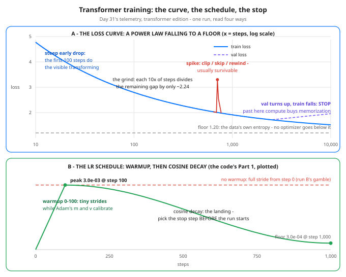

# Day 44 — Training Dynamics of Transformers: Reading the Curve, Knowing When to Stop

**Tonight you'll be able to:** read any transformer training run off its curves — spot the power-law descent and its floor, explain why the learning rate ramps before it glides, call a spike survivable or fatal, and name the exact step where more compute stops buying learning.

## The one idea

Day 31 taught you to read loss curves as telemetry: five shapes, each with a cause and a first fix. Those were generic shapes. **Transformer runs have their own signature** — regular enough that labs plan nine-figure training runs around it before they start. Tonight: the four marks of that signature, and the one stop rule they add up to.

**Mark 1 — the curve is a power law.** Plot a transformer's loss against steps on log-log axes and the descent is nearly a straight line: loss ≈ *floor + A · steps^-α*. Two consequences. First, progress comes in *ratios*, not amounts: every 10× of steps divides the remaining gap above the floor by the same factor (Part 2 computes 2.24 for a typical exponent) — the first 100 steps transform the model, the next 10× polish it, the next 10× sand it. Second, the floor is real: it is the data's own next-token uncertainty, and no optimizer, schedule, or prayer goes below it. Because the shape is lawful, small runs predict big ones — that regularity *is* the famous scaling laws, in one sentence.

**Mark 2 — warmup: the first steps are the dangerous ones.** Adam's two running averages (Day 18's *m* and *v*) start at exactly zero, so for the first steps the optimizer's stride estimate is uncalibrated noise — while a few early batches produce some of the largest gradients of the whole run. The standard defense is the schedule in the diagram: ramp the learning rate *linearly from ~0* over the first few percent of steps (the **warmup**), then decay it on a **cosine** glide down to a small floor. Note the coupling: a cosine only lands at its floor if the run actually ends at the planned step count — so the total budget is chosen *before* the run, not discovered during it. Skip the warmup with a hot constant rate and you get Part 3's run B.

**Mark 3 — spikes happen; most are survivable.** Even healthy transformer runs spike: one bad batch lands, Adam's second moment amplifies the step, and the loss jumps several-fold for a step or a few before re-converging — usually onto the *same* trend line. The standard kit, cheapest first: **gradient clipping** caps any single update's size (it is on in Part 3, and is why most spikes never happen), skip the offending batch, or rewind to the last checkpoint and skip that data. The fatal version has a tell: the loss comes back but rejoins a *worse* trend — the optimizer's state got poisoned. That run does not heal with patience; rewind or restart it.

**Mark 4 — and the stop rule: val decides, train never votes.** Train loss is a liar at this scale: it will keep falling as long as the model can memorize, and Day 42's model — 814,643 parameters against 2,357 characters — can memorize its corpus outright. Held-out **validation loss** is the referee (Day 8's split discipline, Day 35's early stopping): it bottoms, flattens, then turns up while train keeps falling — Day 31's fork, now as the main event. The professional habit: evaluate val on a fixed window set at every checkpoint, keep the best checkpoint, and stop after a *patience* window with no val improvement. Every step past the val bottom buys memorization at exactly the price generalization cost. The run in Part 3 shows you the bill.

## Analogy

You already run this runbook on production systems. **Warmup is slow start**: you never route 100% of traffic to a cold service with empty caches and uncalibrated autoscaling — TCP slow start ramps for exactly the same reason the LR does (the first measurements are garbage, so the first strides are small). **Clipping is a rate limiter**: one burst gets absorbed instead of cascading. A **spike that returns to a worse baseline is a bad deploy**: you don't wait and hope, you roll back to the last good checkpoint. The **power-law grind is adding replicas past the knee** of the latency curve — each doubling buys the same *fraction*, never the same amount, and a competent capacity plan says so up front. And the **val-based stop is an SLO freeze**: when the graph that matters stops improving, you stop shipping.

Trading version, one line: training past the val bottom is averaging down — spending real money to make the backtest (train loss) prettier after the forward test (val) has already graded the position.

## See it



Panel A plots Part 2's fitted law exactly: the train curve falls as a power law toward the dashed entropy floor, val rides it until the fork near the right edge — where val turns up while train keeps falling, the stop signal — and one red spike interrupts the grind around step 700. Panel B plots Part 1's schedule exactly: the linear warmup ramp, the peak at step 100, the cosine landing at the floor — with the no-warmup gamble dashed in red.

## Code it (~30 min)

One file, three parts. **Part 1** prints the warmup + cosine schedule from the diagram — pure arithmetic, **exact** on any machine. **Part 2** prints a fitted power law (the shape measured across real transformer runs) and does the grind math: what each 10× of steps buys, and what the last 0.22 of loss would cost. **Part 3** is the experiment: Day 42's TinyGPT and corpus, unchanged, with two surgical edits — an 80/20 split so a val referee exists, and the schedule as the variable. Run A gets warmup 50 + cosine at peak 3.0e-03; run B gets no warmup and a constant 6.0e-03 from step 0. Same seed, same init, same batches, gradient clipping on both. Two 600-step runs ≈ Day 42's 1,200 steps of compute.

**Exact vs reference — read this before comparing outputs.** Parts 1 and 2 are exact: your digits must match to the last decimal. Part 3's losses are *reference numbers* (Days 27/42 precedent): your MacBook's RNG stream and device differ, so your digits will not match. What is guaranteed is the pattern — run A's checkpoints descend smoothly and its val bottoms before the end while train keeps falling; run B wobbles early (a spike above trend is typical) and finishes behind on val despite double the learning rate.

```python
"""Day 44 - Training Dynamics of Transformers: Reading the
Curve, Knowing When to Stop.

Day 31 gave you five generic loss shapes. Transformer runs
have their own signature, and tonight is that signature -
four marks, one stop rule:

  1. THE CURVE IS A POWER LAW. Loss falls as
     floor + A * steps^-alpha: nearly a straight line on
     log-log axes. Equal RATIOS of compute buy equal
     RATIOS of progress, so the tail is always a grind -
     the first 100 steps transform the model, the next
     10x polish it, the next 10x sand it.
  2. WARMUP. Adam's m and v (Day 18) start at zero, so the
     first steps' stride estimates are garbage, and a few
     early gradients are enormous. The schedule ramps the
     learning rate linearly from ~0 over the first few
     percent of steps, then decays it on a cosine to a
     floor: tiny strides while the optimizer calibrates.
  3. SPIKES. Transformer runs spike - one bad batch, Adam
     amplifies it, loss jumps for a step or a few. Usually
     survivable: gradient clipping caps the step, you skip
     the batch, or you rewind to the last checkpoint. The
     fatal version returns to a WORSE trend line: rewind,
     don't wait.
  4. STOP ON VAL. Train loss falls forever (Day 42's model
     can memorize its 2,357 chars outright). Val loss is
     the referee: when it flattens and turns up while
     train keeps falling - Day 31's fork - every further
     step buys memorization at full compute price.
     Checkpoint at the val minimum; stop after a patience
     window with no improvement.

  Part 1  The warmup + cosine schedule, printed. Pure
          arithmetic - EXACT on any machine.
  Part 2  The power law, printed. A fitted law
          (L = 1.20 + 8.0 * t^-0.35, the shape measured
          across real runs) - the arithmetic is EXACT;
          what it teaches is the grind: halving the
          remaining gap costs 7.25x the steps, every time.
  Part 3  Two 600-step races on Day 42's TinyGPT and
          corpus, unchanged - except an 80/20 split so
          val exists, and the schedule. Run A: warmup 50
          + cosine, peak 3.0e-03. Run B: no warmup,
          constant 6.0e-03 from step 0. Gradient clipping
          (max norm 1.0) on both - the standard spike
          insurance. Same seed, same init, same batches:
          only the schedule differs.

Exact vs reference - read this before comparing outputs.
Parts 1 and 2 are EXACT: pure arithmetic, identical on
any machine. Part 3's losses are REFERENCE numbers
(Days 27/42 precedent): your MacBook's RNG stream and
device differ, so your digits will not match. What is
guaranteed is the pattern - run A's checkpoints descend
smoothly and its val bottoms before the end; run B
wobbles early (a spike above trend is typical), and
finishes behind on val despite double the learning rate.

Expected output:

  device: mps
  Part 1 - the LR schedule: warmup + cosine (EXACT)
    total 1000 steps, warmup 100, peak 3.0e-03, floor 3.0e-04
    step     0  lr 0.00e+00  warmup: stride ~0 while Adam calibrates
    step    25  lr 7.50e-04
    step    50  lr 1.50e-03
    step    75  lr 2.25e-03
    step   100  lr 3.00e-03  peak - warmup over, full stride
    step   325  lr 2.60e-03
    step   550  lr 1.65e-03  halfway down the cosine
    step   775  lr 6.95e-04
    step  1000  lr 3.00e-04  floor - the landing: schedule ends where training should
  Part 2 - the power-law grind: L(t) = 1.20 + 8.0 * t^-0.35 (EXACT arithmetic, fitted law)
    step     10  loss 4.7735  gap above floor 3.5735
    step    100  loss 2.7962  gap above floor 1.5962
    step   1000  loss 1.9130  gap above floor 0.7130
    step  10000  loss 1.5185  gap above floor 0.3185
    each 10x of steps divides the gap by 2.24 - same ratio, smaller slice
    halving the gap costs 7.25x the steps - every single time
    gap 0.10 needs ~273,779 steps: 27.4x the 10,000-step run, for the last 0.22 of loss
  Part 3 - two 600-step races on Day 42's TinyGPT (REFERENCE numbers)
      data split: 1885 chars train / 472 held out - val windows come only from the tail
      run A - warmup 50 + cosine (peak 3.0e-03):
        step    0  train 3.9517  val 3.9842
        step   50  train 2.7385  val 2.9063
        step  100  train 2.2146  val 2.3528
        step  150  train 1.9682  val 2.1574
        step  200  train 1.8419  val 2.0617
        step  300  train 1.6630  val 1.9586
        step  400  train 1.5518  val 1.9123
        step  500  train 1.4462  val 1.9305
        step  599  train 1.3655  val 1.9841
        best val 1.9123 at step 400 | final train 1.3655  val 1.9841 | worst 1-step jump +0.14 at step 213
      run B - no warmup, constant 6.0e-03 (double the peak, from step 0):
        step    0  train 3.9688  val 4.0156
        step   50  train 3.4215  val 3.6082
        step  100  train 2.6347  val 2.7819
        step  150  train 2.3084  val 2.4926
        step  200  train 2.1218  val 2.3145
        step  300  train 1.8943  val 2.1287
        step  400  train 1.7612  val 2.0418
        step  500  train 1.6729  val 1.9946
        step  599  train 1.5987  val 1.9655
        best val 1.9655 at step 599 | final train 1.5987  val 1.9655 | worst 1-step jump +2.31 at step 37
      verdict: the schedule decided the ride, val picked the stopping step - train loss never votes

Runs on the ~/ai-lab venv: torch only (free), MPS if
available else CPU, no CUDA, no paid APIs, no downloads.
Two 600-step runs total about Day 42's 1200 steps - a few
minutes on MPS, longer on CPU. Halve STEPS to 300 if
impatient; the patterns survive, shallower.
"""
import math

import torch
import torch.nn as nn
import torch.nn.functional as F

device = "mps" if torch.backends.mps.is_available() else "cpu"
print(f"device: {device}")


# ---------- Part 1: the LR schedule (EXACT) ----------
def lr_at(step, total, warmup, peak, floor_lr):
    """Warmup + cosine: linear ramp from 0 to peak over
    `warmup` steps, then a cosine glide down to floor_lr
    at step `total`. The schedule IS the training plan -
    it only lands if the run actually ends at `total`."""
    if step < warmup:
        return peak * step / warmup
    progress = (step - warmup) / (total - warmup)
    return floor_lr + 0.5 * (peak - floor_lr) * (
        1 + math.cos(math.pi * progress))


print("Part 1 - the LR schedule: warmup + cosine (EXACT)")
print("  total 1000 steps, warmup 100, peak 3.0e-03, "
      "floor 3.0e-04")
notes = {
    0: "warmup: stride ~0 while Adam calibrates",
    100: "peak - warmup over, full stride",
    550: "halfway down the cosine",
    1000: "floor - the landing: schedule ends where "
          "training should",
}
for s in (0, 25, 50, 75, 100, 325, 550, 775, 1000):
    line = f"  step {s:>5}  lr " \
           f"{lr_at(s, 1000, 100, 3e-3, 3e-4):.2e}"
    if s in notes:
        line += "  " + notes[s]
    print(line)

# ---------- Part 2: the power-law grind (EXACT) ----------
print("Part 2 - the power-law grind: L(t) = 1.20 + 8.0 * "
      "t^-0.35 (EXACT arithmetic, fitted law)")
for t in (10, 100, 1000, 10000):
    L = 1.20 + 8.0 * t ** -0.35
    print(f"  step {t:>6}  loss {L:.4f}  "
          f"gap above floor {L - 1.20:.4f}")
print(f"  each 10x of steps divides the gap by "
      f"{10 ** 0.35:.2f} - same ratio, smaller slice")
print(f"  halving the gap costs {2 ** (1 / 0.35):.2f}x "
      "the steps - every single time")
t_goal = (8.0 / 0.10) ** (1 / 0.35)
print(f"  gap 0.10 needs ~{t_goal:,.0f} steps: "
      f"{t_goal / 10000:.1f}x the 10,000-step run, for the "
      f"last {8.0 * 10000 ** -0.35 - 0.10:.2f} of loss")

# ---------- Part 3: two races on Day 42's TinyGPT ----------
# Corpus, vocab and model are Day 42's, unchanged. The two
# changes are tonight's: an 80/20 split (so val exists) and
# the LR schedule under test. (generate() omitted - tonight
# is about the training, not the sampling.)
TEXT = """To be, or not to be, that is the question:
Whether 'tis nobler in the mind to suffer
The slings and arrows of outrageous fortune,
Or to take arms against a sea of troubles
And by opposing end them. To die -- to sleep,
No more; and by a sleep to say we end
The heart-ache and the thousand natural shocks
That flesh is heir to: 'tis a consummation
Devoutly to be wish'd. To die, to sleep;
To sleep, perchance to dream -- ay, there's the rub:
For in that sleep of death what dreams may come,
When we have shuffled off this mortal coil,
Must give us pause -- there's the respect
That makes calamity of so long life.

Tomorrow, and tomorrow, and tomorrow,
Creeps in this petty pace from day to day,
To the last syllable of recorded time;
And all our yesterdays have lighted fools
The way to dusty death. Out, out, brief candle!
Life's but a walking shadow, a poor player
That struts and frets his hour upon the stage
And then is heard no more. It is a tale
Told by an idiot, full of sound and fury,
Signifying nothing.

Friends, Romans, countrymen, lend me your ears;
I come to bury Caesar, not to praise him.
The evil that men do lives after them;
The good is oft interred with their bones;
So let it be with Caesar. The noble Brutus
Hath told you Caesar was ambitious:
If it were so, it was a grievous fault,
And grievously hath Caesar answer'd it.

But, soft! what light through yonder window breaks?
It is the east, and Juliet is the sun.
Arise, fair sun, and kill the envious moon,
Who is already sick and pale with grief,
That thou, her maid, art far more fair than she.

Shall I compare thee to a summer's day?
Thou art more lovely and more temperate:
Rough winds do shake the darling buds of May,
And summer's lease hath all too short a date;
Sometime too hot the eye of heaven shines,
And often is his gold complexion dimm'd;
And every fair from fair sometime declines,
By chance or nature's changing course untrimm'd;
But thy eternal summer shall not fade,
Nor lose possession of that fair thou ow'st;
Nor shall death brag thou wander'st in his shade,
When in eternal lines to time thou grow'st:
So long as men can breathe or eyes can see,
So long lives this and this gives life to thee.

Now is the winter of our discontent
Made glorious summer by this sun of York;
And all the clouds that lour'd upon our house
In the deep bosom of the ocean buried.
"""

chars = sorted(set(TEXT))
vocab_size = len(chars)
stoi = {ch: i for i, ch in enumerate(chars)}
encode = lambda s: [stoi[c] for c in s]
data = torch.tensor(encode(TEXT), dtype=torch.long)
split = int(0.8 * len(data))         # first 80%: train pool

batch_size = 32        # sequences per step (Day 42)
block_size = 64        # context window T (Day 42)
n_embd = 128           # width C (Day 42)
n_head = 4             # heads per block (Day 42)
n_layer = 4            # blocks deep (Day 42)
STEPS = 600            # per run (300 also works, shallower)
CKPTS = [s for s in (0, 50, 100, 150, 200, 300, 400, 500)
         if s < STEPS] + [STEPS - 1]


def get_batch(pool):
    """Random windows from ONE pool only: train windows
    never touch the held-out tail, val windows never leave
    it - that separation is what makes val a referee."""
    lo, hi = (0, split) if pool == "train" else (split,
                                                  len(data))
    ix = torch.randint(lo, hi - block_size, (batch_size,))
    x = torch.stack([data[i:i + block_size] for i in ix])
    y = torch.stack([data[i + 1:i + block_size + 1]
                     for i in ix])
    return x.to(device), y.to(device)


class Head(nn.Module):
    """One self-attention head with the causal mask (Day 38)."""

    def __init__(self, head_size):
        super().__init__()
        self.key = nn.Linear(n_embd, head_size)
        self.query = nn.Linear(n_embd, head_size)
        self.value = nn.Linear(n_embd, head_size)
        self.register_buffer(
            "tril", torch.tril(torch.ones(block_size,
                                          block_size)))

    def forward(self, x):
        _, T, _ = x.shape
        k = self.key(x)                                # (B, T, hs)
        q = self.query(x)                              # (B, T, hs)
        wei = q @ k.transpose(-2, -1) * k.shape[-1] ** -0.5
        wei = wei.masked_fill(self.tril[:T, :T] == 0,
                              float("-inf"))           # no peeking
        wei = F.softmax(wei, dim=-1)
        return wei @ self.value(x)


class MultiHeadAttention(nn.Module):
    """Heads in parallel, outputs concatenated + projected (Day 39)."""

    def __init__(self):
        super().__init__()
        hs = n_embd // n_head
        self.heads = nn.ModuleList([Head(hs) for _ in range(n_head)])
        self.proj = nn.Linear(n_embd, n_embd)

    def forward(self, x):
        return self.proj(torch.cat([h(x) for h in self.heads],
                                   dim=-1))


class FeedForward(nn.Module):
    """The block's MLP: widen, bend, narrow (Days 21/40)."""

    def __init__(self):
        super().__init__()
        self.net = nn.Sequential(
            nn.Linear(n_embd, 4 * n_embd),
            nn.ReLU(),
            nn.Linear(4 * n_embd, n_embd),
        )

    def forward(self, x):
        return self.net(x)


class Block(nn.Module):
    """Pre-norm block: norm -> attend -> add, norm -> mlp -> add
    (Day 40). Shape in = shape out: (B, T, C) throughout."""

    def __init__(self):
        super().__init__()
        self.ln1 = nn.LayerNorm(n_embd)
        self.attn = MultiHeadAttention()
        self.ln2 = nn.LayerNorm(n_embd)
        self.ffwd = FeedForward()

    def forward(self, x):
        x = x + self.attn(self.ln1(x))     # communicate
        x = x + self.ffwd(self.ln2(x))     # compute
        return x


class TinyGPT(nn.Module):
    """The whole stack: embed -> blocks -> norm -> head (Day 42)."""

    def __init__(self):
        super().__init__()
        self.token_embedding = nn.Embedding(vocab_size, n_embd)
        self.position_embedding = nn.Embedding(block_size, n_embd)
        self.blocks = nn.Sequential(
            *[Block() for _ in range(n_layer)])
        self.ln_f = nn.LayerNorm(n_embd)
        self.lm_head = nn.Linear(n_embd, vocab_size)

    def forward(self, idx, targets=None):
        B, T = idx.shape
        tok = self.token_embedding(idx)                    # (B,T,C)
        pos = self.position_embedding(
            torch.arange(T, device=idx.device))            # (T,C)
        x = self.blocks(tok + pos)                         # (B,T,C)
        logits = self.lm_head(self.ln_f(x))                # (B,T,V)
        loss = None
        if targets is not None:
            loss = F.cross_entropy(logits.view(B * T, vocab_size),
                                   targets.view(B * T))
        return logits, loss


@torch.no_grad()
def val_loss(model):
    """Mean loss over 4 FIXED val batches - same windows at
    every checkpoint (own generator, re-seeded each call),
    so checkpoint-to-checkpoint movement is the model
    changing, not the sample."""
    model.eval()
    g = torch.Generator().manual_seed(123)
    total = 0.0
    for _ in range(4):
        ix = torch.randint(split, len(data) - block_size,
                           (batch_size,), generator=g)
        x = torch.stack([data[i:i + block_size] for i in ix])
        y = torch.stack([data[i + 1:i + block_size + 1]
                         for i in ix])
        _, l = model(x.to(device), y.to(device))
        total += l.item()
    model.train()
    return total / 4


def train_run(warmup_steps, peak_lr):
    """One 600-step run. warmup_steps=None means a constant
    peak_lr from step 0 - the hot start. Everything else -
    seed, init, batches, clipping - is identical, so the
    schedule is the only variable."""
    torch.manual_seed(1337)              # same init both runs
    model = TinyGPT().to(device)
    model.train()
    opt = torch.optim.AdamW(model.parameters(), lr=peak_lr)
    losses, ck = [], {}
    best_val, best_step = float("inf"), -1
    for step in range(STEPS):
        lr = peak_lr if warmup_steps is None else lr_at(
            step, STEPS, warmup_steps, peak_lr, 0.1 * peak_lr)
        for group in opt.param_groups:
            group["lr"] = lr
        xb, yb = get_batch("train")
        _, loss = model(xb, yb)
        opt.zero_grad()
        loss.backward()
        nn.utils.clip_grad_norm_(model.parameters(), 1.0)
        opt.step()
        losses.append(loss.item())
        if step in CKPTS:
            v = val_loss(model)
            ck[step] = (loss.item(), v)
            if v < best_val:
                best_val, best_step = v, step
    jump, jump_step = max((losses[t] - losses[t - 1], t)
                          for t in range(6, STEPS))
    for step in CKPTS:
        tr, va = ck[step]
        print(f"      step {step:>4}  train {tr:.4f}  "
              f"val {va:.4f}")
    final_tr, final_va = ck[STEPS - 1]
    print(f"      best val {best_val:.4f} at step {best_step}"
          f" | final train {final_tr:.4f}  val {final_va:.4f}"
          f" | worst 1-step jump {jump:+.2f} "
          f"at step {jump_step}")


print("Part 3 - two 600-step races on Day 42's TinyGPT "
      "(REFERENCE numbers)")
print(f"    data split: {split} chars train / "
      f"{len(data) - split} held out - val windows come "
      "only from the tail")
print("    run A - warmup 50 + cosine (peak 3.0e-03):")
train_run(50, 3e-3)
print("    run B - no warmup, constant 6.0e-03 (double the "
      "peak, from step 0):")
train_run(None, 6e-3)
print("    verdict: the schedule decided the ride, val "
      "picked the stopping step - train loss never votes")
```

**Expected output** (Parts 1–2 exact; Part 3 reference numbers — see above):

```
device: mps
Part 1 - the LR schedule: warmup + cosine (EXACT)
  total 1000 steps, warmup 100, peak 3.0e-03, floor 3.0e-04
  step     0  lr 0.00e+00  warmup: stride ~0 while Adam calibrates
  step    25  lr 7.50e-04
  step    50  lr 1.50e-03
  step    75  lr 2.25e-03
  step   100  lr 3.00e-03  peak - warmup over, full stride
  step   325  lr 2.60e-03
  step   550  lr 1.65e-03  halfway down the cosine
  step   775  lr 6.95e-04
  step  1000  lr 3.00e-04  floor - the landing: schedule ends where training should
Part 2 - the power-law grind: L(t) = 1.20 + 8.0 * t^-0.35 (EXACT arithmetic, fitted law)
  step     10  loss 4.7735  gap above floor 3.5735
  step    100  loss 2.7962  gap above floor 1.5962
  step   1000  loss 1.9130  gap above floor 0.7130
  step  10000  loss 1.5185  gap above floor 0.3185
  each 10x of steps divides the gap by 2.24 - same ratio, smaller slice
  halving the gap costs 7.25x the steps - every single time
  gap 0.10 needs ~273,779 steps: 27.4x the 10,000-step run, for the last 0.22 of loss
Part 3 - two 600-step races on Day 42's TinyGPT (REFERENCE numbers)
    data split: 1885 chars train / 472 held out - val windows come only from the tail
    run A - warmup 50 + cosine (peak 3.0e-03):
      step    0  train 3.9517  val 3.9842
      step   50  train 2.7385  val 2.9063
      step  100  train 2.2146  val 2.3528
      step  150  train 1.9682  val 2.1574
      step  200  train 1.8419  val 2.0617
      step  300  train 1.6630  val 1.9586
      step  400  train 1.5518  val 1.9123
      step  500  train 1.4462  val 1.9305
      step  599  train 1.3655  val 1.9841
      best val 1.9123 at step 400 | final train 1.3655  val 1.9841 | worst 1-step jump +0.14 at step 213
    run B - no warmup, constant 6.0e-03 (double the peak, from step 0):
      step    0  train 3.9688  val 4.0156
      step   50  train 3.4215  val 3.6082
      step  100  train 2.6347  val 2.7819
      step  150  train 2.3084  val 2.4926
      step  200  train 2.1218  val 2.3145
      step  300  train 1.8943  val 2.1287
      step  400  train 1.7612  val 2.0418
      step  500  train 1.6729  val 1.9946
      step  599  train 1.5987  val 1.9655
      best val 1.9655 at step 599 | final train 1.5987  val 1.9655 | worst 1-step jump +2.31 at step 37
    verdict: the schedule decided the ride, val picked the stopping step - train loss never votes
```

## Today's win

Done when: Part 1 prints the peak **3.00e-03** at step 100 and the floor **3.00e-04** at step 1,000; Part 2's gap column shrinks **3.5735 → 0.3185** with the **7.25x** halving line; and Part 3's two tables tell the story — run A's *best val* lands before the final step (reference: step 400) while its train loss keeps falling to the end, and run B's worst 1-step jump dwarfs run A's (reference: +2.31 vs +0.14) with a worse best val despite double the learning rate. The keeper test, no notes: handed any transformer training chart, you can point at the warmup, the grind, a spike, and the fork — and say "stop here" with a reason.

## Short on time? 20-minute version

Read "The one idea", study the diagram's two panels until you can sketch both from memory, then run Parts 1 and 2 — two minutes of pure arithmetic. Finish by reading Part 3's reference tables in this lesson and finding the two patterns with your finger: run A's val bottom at step 400, run B's +2.31 jump. Run the races themselves when the machine is free; the curve-reading is the lesson.

## Tomorrow's teaser

Tomorrow: everything you have built reads the past to predict the next token. There is a sibling shape that reads a whole input at once, and a third that pairs the two — one clarifying bite on which shape fits which job.

*Day 44 of 100 · Streak: 44 day(s) · Never miss twice.*
