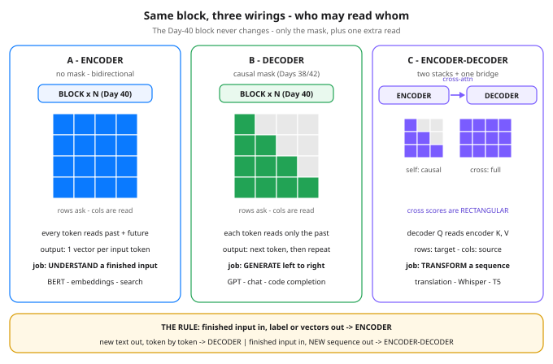

# Day 45 — Encoder vs Decoder vs Encoder-Decoder: Same Block, Three Wirings

**Tonight you'll be able to:** sort any transformer product into encoder, decoder, or encoder-decoder in one line — by asking who is allowed to read whom — and spot the one extra mechanism, cross-attention, that bridges two stacks.

## The one idea

Since Day 37 you have built exactly one object: the transformer block (Day 40) — attention, MLP, residuals, norms. Yet the products built from it look nothing alike: BERT classifies, GPT chats, Whisper transcribes. The block is not what differs. The **wiring** is — the rules for who is allowed to read whom inside attention. There are exactly three wirings in production, and sorting any model into one of them takes one question: *what exists when the model runs, and what has to be produced?*

**Encoder — reads everything at once.** Self-attention with **no mask**: token 1 attends to token 4 as freely as to itself (Part 1 — it actually leans on token 4 hardest). That is only legal because the whole input already exists: a sentence to classify, a document to embed, a ticket to route. The output is one context-soaked vector per input token, and training aims the stack at *understanding* — label the input, compare inputs, retrieve inputs. BERT is the canonical encoder, and the embedding models behind search and RAG are encoders too. What an encoder can never do is generate: nothing in its wiring enforces an order, and token 1 has already peeked at the ending.

**Decoder — reads only the past.** The same block with one change: the causal mask from Days 38 and 42 sets every future score to −∞ before the softmax, so future weights land on exactly zero (Part 2). Now the stack is safe to run as a generator — score the next token from the past only, append it, repeat. (The generation loop itself is Day 47's topic; tonight is the wiring that makes it legal.) GPT and every chat LLM you use are decoder-only stacks. The trade is real: a decoder reading a long contract can never let an early clause consult a later one, so per parameter it is a slightly worse *reader* — it pays that to be a writer.

**Encoder-decoder — two stacks and a bridge.** This is the original 2017 wiring, and the day's only new mechanism. An encoder stack reads the source completely — no mask, it all exists. A decoder stack generates the target causally, exactly as above. The bridge is **cross-attention**: each decoder block carries a second attention sublayer whose *queries come from the decoder's own states* while the *keys and values come from the encoder's output*. At shape level that is the whole trick (Part 3): the score matrix is **rectangular** — one row per target token written so far, one column per source token — the output length follows the queries, and the content flows from the encoder's memory. Translation is the problem shaped exactly like this: the French sentence is finished; the English one must be written a token at a time, each new word glancing back at the French. T5 is encoder-decoder, and so is Whisper — the "source sequence" there is audio, which is why it transcribes instead of chatting.

**The one-line rule.** Finished input in, a label or vectors out → **encoder**. New text out, generated token by token → **decoder**. Finished input in *and* a new sequence out → **encoder-decoder**. One honest trend note: general-purpose LLMs have consolidated on decoder-only — one stack is simpler to train and serve, and a decoder can do understanding jobs by generating the answer as text. Encoder-decoder survives where the in/out split is structural: translation, speech-to-text, document-to-summary pipelines.

## Analogy

Three read patterns you already operate. **Encoder = a batch analytics job over a fully loaded table**: the load finished before the job starts, every row may join against every other row, and the output is a materialized view — nobody runs it against a half-loaded table. **Decoder = writing the next entry of an append-only log**: causality there is not a preference, it is correctness — an entry that cited future entries would be corrupt. **Encoder-decoder = an ETL transform with a lookup**: the source is loaded and indexed first (the encoder's output), then the writer streams target rows out one at a time, and for each row it does an indexed lookup back into the source (cross-attention) to fetch exactly the rows this target row depends on. Same engine underneath all three; the access pattern is the architecture.

Trading version, one line: encoder = post-close analysis with the full day's tape on disk; decoder = live trading, where the next bar has not printed and never will early; encoder-decoder = turning a finished earnings call into a written summary, one sentence at a time, glancing back at the transcript.

## See it



Same block (Day 40), three wirings — read each grid as "rows ask, columns are read." Left: the encoder's full grid, every cell open. Middle: the decoder's causal triangle, the future half switched off. Right: the encoder-decoder's two grids — the decoder's own causal triangle, plus the rectangular cross grid whose rows are target tokens and columns are source tokens, every cell open. Learn to read a mask grid and you can sort any transformer product on sight.

## Code it (~30 min)

One file, one attention function, three wirings. Identity projections (`Wq = Wk = Wv = I`) keep Day 38's arithmetic fully on the table — the masks are the only moving parts. **Part 1** runs the encoder wiring on four tokens. **Part 2** changes exactly one argument and prints the same matrix again — diff the two by eye. **Part 3** feeds the same function queries from one sequence and keys/values from another, and prints the shapes that make cross-attention cross.

```python
"""Day 45 - Encoder vs Decoder vs Encoder-Decoder: Same Block, Three Wirings.

Days 37-42 you built one transformer block (Day 40) and ran
it decoder-style, behind a causal mask. Tonight that same
block gets sorted into the only three wiring patterns the
field ships. The difference is never the block - it is who
is allowed to READ whom inside attention:

  Encoder           self-attention, NO mask. Every token
                    reads every token, past and future.
                    Output: one informed vector per input
                    token. Built to UNDERSTAND a finished
                    input - BERT, embeddings, search.
  Decoder           self-attention WITH the causal mask
                    (Days 38/42). Each token reads only
                    itself and the past, so the stack can
                    GENERATE left to right - GPT, chat,
                    code completion.
  Encoder-decoder   two stacks. The encoder reads the
                    source fully (no mask - it all exists);
                    the decoder generates causally AND gets
                    one extra sublayer per block:
                    cross-attention, where the queries come
                    from decoder states and the keys/values
                    come from the encoder's output. Built to
                    turn one finished sequence into a NEW
                    sequence - translation, Whisper, T5.

  Part 1  One tiny attention() function, identity
          projections, four hand-set tokens. No mask: the
          bidirectional weight matrix. Token 1 already
          leans hardest on token 4 - exactly right for
          understanding, cheating for generation.
  Part 2  The SAME function, one argument different: the
          causal mask. Every future weight lands on
          exactly 0.0000 and every row still sums to 1.
          That mask is the entire difference between an
          encoder layer and a decoder layer.
  Part 3  Cross-attention at shape level. Queries from
          two decoder states, keys/values from three
          encoder states: the weight matrix is RECTANGULAR
          (2 x 3), its rows still softmax to 1, and the
          output carries the DECODER's length - queries
          ask, the memory answers.

Runs on the ~/ai-lab venv: torch only (free), CPU on
purpose (tiny data), no CUDA, no paid APIs, no downloads.
Every tensor is set by hand, so every number is exact -
no RNG anywhere in this lesson.

Expected output:

  Part 1 - ENCODER wiring: no mask, every token reads every token
    token 1 reads: 0.2212, 0.1091, 0.2212, 0.4486   row sum 1.0000
    token 2 reads: 0.1651, 0.3349, 0.3349, 0.1651   row sum 1.0000
    token 3 reads: 0.1651, 0.1651, 0.3349, 0.3349   row sum 1.0000
    token 4 reads: 0.1573, 0.0382, 0.1573, 0.6471   row sum 1.0000
    token 1 puts 0.4486 on token 4 - it reads the FUTURE, on purpose
    verdict: built to UNDERSTAND a finished input (BERT-style)
  Part 2 - DECODER wiring: same call + the causal mask (Days 38/42)
    token 1 reads: 1.0000, 0.0000, 0.0000, 0.0000   row sum 1.0000
    token 2 reads: 0.3302, 0.6698, 0.0000, 0.0000   row sum 1.0000
    token 3 reads: 0.2483, 0.2483, 0.5035, 0.0000   row sum 1.0000
    token 4 reads: 0.1573, 0.0382, 0.1573, 0.6471   row sum 1.0000
    biggest future weight anywhere: 0.0000 - the future is sealed
    token 4's row is unchanged: it has no future to hide
    verdict: same block + one mask, now it can GENERATE (GPT-style)
  Part 3 - CROSS-attention: Q from the decoder, K/V from the encoder
    shapes: Q (2, 2) from decoder, K (3, 2) and V (3, 2) from encoder
    weight matrix shape (2, 3) - RECTANGULAR: 2 asking, 3 answering
    decoder step 1 reads source: 0.4011, 0.1978, 0.4011   row sum 1.0000
    decoder step 2 reads source: 0.2483, 0.2483, 0.5035   row sum 1.0000
    output row 1: 0.8022, 0.5989   output row 2: 0.7517, 0.7517
    output shape (2, 2): length follows the QUERIES (decoder),
      content flows from the MEMORY (encoder output)
    verdict: TRANSFORM one finished sequence into a new one (T5/Whisper)
"""
import math

import torch


def attention(Q, K, V, mask=None):
    """Day 38's scaled dot-product attention, unchanged.

    Q (Tq, d), K (Tk, d), V (Tk, dv) -> (out (Tq, dv), weights (Tq, Tk)).
    mask: 1 = may read, 0 = blocked (score set to -inf pre-softmax).
    Self-attention is Q, K, V from the SAME sequence; cross-attention
    is Q from one sequence, K/V from another. One function, both.
    """
    d = Q.shape[-1]
    scores = Q @ K.T / math.sqrt(d)
    if mask is not None:
        scores = scores.masked_fill(mask == 0, float("-inf"))
    weights = torch.softmax(scores, dim=-1)
    return weights @ V, weights


row = lambda t: ", ".join(f"{v:.4f}" for v in t.tolist())

# Four hand-set tokens, d = 2. Identity projections (Wq = Wk = Wv = I)
# keep Day 38's arithmetic on the table - the mask is the only
# moving part today.
X = torch.tensor([[1.0, 0.0],     # the
                  [0.0, 1.0],     # cat
                  [1.0, 1.0],     # sat
                  [2.0, 0.0]])    # down

# ---------- Part 1: encoder wiring - no mask ----------
print("Part 1 - ENCODER wiring: no mask, every token reads every token")
_, w_enc = attention(X, X, X)
for i, w in enumerate(w_enc):
    print(f"  token {i + 1} reads: {row(w)}   row sum {w.sum().item():.4f}")
print(f"  token 1 puts {w_enc[0, 3].item():.4f} on token 4"
      " - it reads the FUTURE, on purpose")
print("  verdict: built to UNDERSTAND a finished input (BERT-style)")

# ---------- Part 2: decoder wiring - same call + causal mask ----------
print("Part 2 - DECODER wiring: same call + the causal mask (Days 38/42)")
causal = torch.tril(torch.ones(4, 4))          # 1 on/below diagonal
_, w_dec = attention(X, X, X, mask=causal)
for i, w in enumerate(w_dec):
    print(f"  token {i + 1} reads: {row(w)}   row sum {w.sum().item():.4f}")
future = w_dec.triu(diagonal=1).abs().max().item()
print(f"  biggest future weight anywhere: {future:.4f}"
      " - the future is sealed")
print("  token 4's row is unchanged: it has no future to hide")
print("  verdict: same block + one mask, now it can GENERATE (GPT-style)")

# ---------- Part 3: cross-attention - Q and K/V from different stacks ----
print("Part 3 - CROSS-attention: Q from the decoder, K/V from the encoder")
E = torch.tensor([[1.0, 0.0],     # encoder output, source token 1
                  [0.0, 1.0],     # encoder output, source token 2
                  [1.0, 1.0]])    # encoder output, source token 3
D = torch.tensor([[1.0, 0.0],     # decoder state, step 1
                  [1.0, 1.0]])    # decoder state, step 2
out, w_cross = attention(D, E, E)
print(f"  shapes: Q {tuple(D.shape)} from decoder,"
      f" K {tuple(E.shape)} and V {tuple(E.shape)} from encoder")
print(f"  weight matrix shape {tuple(w_cross.shape)}"
      " - RECTANGULAR: 2 asking, 3 answering")
for i, w in enumerate(w_cross):
    print(f"  decoder step {i + 1} reads source: {row(w)}"
          f"   row sum {w.sum().item():.4f}")
print(f"  output row 1: {row(out[0])}   output row 2: {row(out[1])}")
print(f"  output shape {tuple(out.shape)}: length follows the QUERIES"
      " (decoder),")
print("    content flows from the MEMORY (encoder output)")
print("  verdict: TRANSFORM one finished sequence into a new one"
      " (T5/Whisper)")
```

**Expected output:**

```
Part 1 - ENCODER wiring: no mask, every token reads every token
  token 1 reads: 0.2212, 0.1091, 0.2212, 0.4486   row sum 1.0000
  token 2 reads: 0.1651, 0.3349, 0.3349, 0.1651   row sum 1.0000
  token 3 reads: 0.1651, 0.1651, 0.3349, 0.3349   row sum 1.0000
  token 4 reads: 0.1573, 0.0382, 0.1573, 0.6471   row sum 1.0000
  token 1 puts 0.4486 on token 4 - it reads the FUTURE, on purpose
  verdict: built to UNDERSTAND a finished input (BERT-style)
Part 2 - DECODER wiring: same call + the causal mask (Days 38/42)
  token 1 reads: 1.0000, 0.0000, 0.0000, 0.0000   row sum 1.0000
  token 2 reads: 0.3302, 0.6698, 0.0000, 0.0000   row sum 1.0000
  token 3 reads: 0.2483, 0.2483, 0.5035, 0.0000   row sum 1.0000
  token 4 reads: 0.1573, 0.0382, 0.1573, 0.6471   row sum 1.0000
  biggest future weight anywhere: 0.0000 - the future is sealed
  token 4's row is unchanged: it has no future to hide
  verdict: same block + one mask, now it can GENERATE (GPT-style)
Part 3 - CROSS-attention: Q from the decoder, K/V from the encoder
  shapes: Q (2, 2) from decoder, K (3, 2) and V (3, 2) from encoder
  weight matrix shape (2, 3) - RECTANGULAR: 2 asking, 3 answering
  decoder step 1 reads source: 0.4011, 0.1978, 0.4011   row sum 1.0000
  decoder step 2 reads source: 0.2483, 0.2483, 0.5035   row sum 1.0000
  output row 1: 0.8022, 0.5989   output row 2: 0.7517, 0.7517
  output shape (2, 2): length follows the QUERIES (decoder),
    content flows from the MEMORY (encoder output)
  verdict: TRANSFORM one finished sequence into a new one (T5/Whisper)
```

## Today's win

Done when your run shows all three signatures: Part 1's token 1 putting `0.4486` on token 4 (an encoder reads the future, on purpose); Part 2's biggest future weight at exactly `0.0000` with every row still summing to `1.0000`; and Part 3's rectangular `(2, 3)` weight matrix producing an output at the decoder's length, `(2, 2)`. The keeper test, no notes allowed: name any product — a sentiment classifier, ChatGPT, a speech-to-text API — and sort it in one line using only "what goes in finished, what comes out new."

## Short on time? 20-minute version

Read "The one idea", then run Parts 1 and 2 and diff the two matrices row by row until the triangle is obvious. If you can say out loud why the *mask* — not the block — is what makes generation legal, and state the rule for all three wirings, you have the day; Part 3's bridge is one extra look at the same function.

## Tomorrow's teaser

Tomorrow: a guided read of the short 2017 paper this whole phase is named after. Bring today's three wirings — you will be able to spot each one in it.

Streak: 45 day(s) · Never miss twice.
