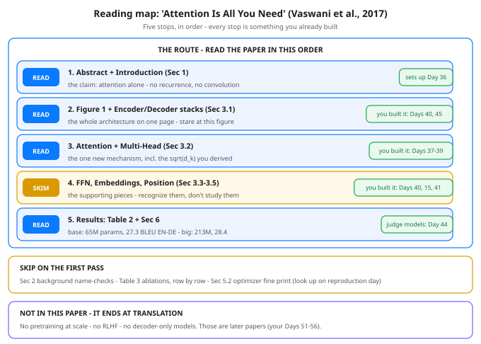

# Day 46 — "Attention Is All You Need": A Guided Read

**Tonight you'll be able to:** read the most-cited paper in modern AI like an engineer who has already built it — five stops, in order, with a skip list — and reproduce two of its headline numbers (the parameter count behind the reported 65M, and its learning-rate schedule) from the config alone.

## The one idea

Normally you read the paper first and implement later. You did it backwards on purpose: Days 36–45 built every mechanism in this paper with your own hands — Q/K/V attention (Day 37), scaled dot-product by hand (Day 38), multi-head (Day 39), the full block with residuals and norms (Day 40), sinusoidal position codes (Day 41), BPE (Day 43), and the encoder / decoder / encoder-decoder wiring (Day 45). So tonight there is nothing new to *learn* mechanically. The one idea is a reading skill: **a famous paper is an artifact with a load-bearing structure — a claim, one figure, one mechanism, one evidence table, and a boundary around what it does not say.** Read for that structure and you can walk through in an hour; read linearly, cover to cover, and you will drown in ablations.

**Stop 1 — Abstract + Introduction (§1): READ.** One task (machine translation), one bet, stated in the abstract's own words: an architecture "based solely on attention mechanisms, dispensing with recurrence and convolutions entirely." Everything else in the paper is evidence for that single sentence. You framed the same bet on Day 36.

**Stop 2 — Figure 1 + the stacks (§3.1): READ SLOWLY.** Figure 1 is the whole system on one page: the left tower is the encoder, the right tower is the decoder, each a stack of N = 6 layers, with one cross-attention bridge between them. Keep the figure open while reading anything else — every section is a zoom into one of its boxes. You assembled this exact wiring on Days 40 and 45.

**Stop 3 — Attention (§3.2): READ.** This is the paper's one new mechanism, and it is short: the scaled dot-product formula is your Day 38 code — including the divide-by-√d_k you derived from dot-product growth — and §3.2.2's "multi-head" is Day 39: run the same attention h = 8 times in parallel slices and concatenate. Nothing here should surprise your hands.

**Stop 4 — The supporting pieces (§3.3–3.5): SKIM.** The position-wise feed-forward net (Day 40's MLP, applied per position), embeddings (Day 15) with one detail worth noticing — the paper shares *one* weight matrix across encoder input, decoder input, and the pre-softmax projection (§3.4), which is why Part 1 of tonight's code counts the embedding once — and the sinusoidal positional encodings of Day 41. Recognize each piece, note where it lives, move on.

**Stop 5 — The results table (Table 2, §6): READ.** This is where the claim gets graded. The paper reports its base model at 65M parameters scoring 27.3 BLEU on English–German translation, and its big model (213M) at 28.4 — ahead of every RNN and CNN system listed. And the quiet bombshell for a systems brain: the base model trained in about 12 hours on 8 NVIDIA P100 GPUs (100,000 steps). The revolution shipped on hardware you could rent for a weekend.

**Skip on the first pass:** §2's background (a name-check of prior sequence models — context, not content), Table 3's ablation rows one by one (reproduction-day material), and §5.2's optimizer fine print beyond the schedule formula you will reproduce tonight. Skipping is not cheating; it is triage, and every scientist in the room did it too.

**What the paper does NOT contain** — know this cold, because it is the boundary that makes your citations accurate. There is *no pretraining at scale*: the paper trains one translator per language pair, supervised, from scratch, on about 4.5 million sentence pairs. There is *no RLHF, no preference learning* of any kind. And the hero is encoder-decoder — the *decoder-only* design that later ate the world is not in this paper; it arrives with the GPT line. The paper contributed the architecture and the shape of the training recipe at 2017 scale (65M parameters; modern LLMs are roughly a thousand times larger). Being able to say "that part isn't in Vaswani et al. — that's a later paper" is exactly what talking about this paper natively sounds like.

## Analogy

Read it the way you would read **the original design doc for a system you have already reimplemented**. Nobody reviews a design doc linearly. You check the doc's claims against your build ("does it actually dispense with recurrence? — yes, I never wrote a loop over time"), you read the sections that carry the invariants word by word (here: §3.2), you skim the parts your implementation already proves true, and you write down precisely which behaviors the doc never specified — because those are the ones later systems added on their own (here: pretraining, RLHF, decoder-only). Same skill, older artifact: your scientists cite papers the way engineers cite design docs — name, year, one claim. After tonight, "Vaswani et al. 2017" is a handle you can use with that precision.

## See it



The reading map. Five stops in order — abstract, Figure 1, the attention section, a skim of the supporting pieces, the results table — each tagged with the day you built what it describes. Below: what to skip on a first pass, and the paper's boundary: everything the modern LLM era added later lives *outside* this paper.

## Code it (~30 min)

No downloads tonight — you are not fetching the paper's PDF. Instead, the code reproduces **two of the paper's own numbers from its stated configuration**, the way you would sanity-check any design doc against its spec. It is pure standard-library Python (`math` only) — no torch, no numpy, nothing to install. **Part 1** recounts the base Transformer's parameters from the Table 3 config: one attention block is 4 matrices of d_model × d_model (the 8 heads are slices of them — Day 39), an encoder layer adds an FFN and 2 norms, a decoder layer adds a second attention and a third norm, and the embedding is counted *once* because §3.4 ties it three ways. Compare your total against the figure the paper reports in Table 2. **Part 2** evaluates the learning-rate schedule from §5.3 exactly as written — d_model^-0.5 scaling, warmup_steps = 4000 — at the steps that tell its story: a linear ramp, a peak, and a 1/√step tail that runs to the paper's own 100,000-step finish.

```python
"""Day 46 - "Attention Is All You Need": A Guided Read.

Days 36-45 you built every mechanism in the 2017 paper by
Vaswani et al.: Q/K/V attention (Day 37), scaled dot-product
by hand (Day 38), multi-head (Day 39), the full block (Day 40),
sinusoidal position codes (Day 41), BPE (Day 43), and the
encoder / decoder / encoder-decoder wiring (Day 45). Tonight
is not a new mechanism. Tonight the paper itself is the
artifact: a reading map of what to read, what to skip, and
which of your builds each section is describing - plus the
honest list of what the paper does NOT contain.

Tonight's code does not download the paper and calls no API.
It reproduces two of the paper's own numbers from its stated
configuration, the way you would sanity-check any design doc:

  Part 1  The parameter count. Section 5.3 / Table 3 of the
          paper give the base config: d_model = 512, N = 6
          layers per stack, h = 8 heads, d_ff = 2048, and a
          shared source-target BPE vocabulary of "about
          37,000" tokens (Section 5.1). The embedding matrix
          is shared three ways (encoder in, decoder in,
          pre-softmax out - Section 3.4), the positional
          encodings are fixed sinusoids (zero parameters -
          Day 41), and attention heads split d_model, so
          h = 8 changes no count: each attention block is
          still 4 matrices of d_model x d_model. Add up
          weights, biases, and LayerNorm gains/biases and
          compare with the number the paper reports for the
          base model in Table 2: 65M.
  Part 2  The learning-rate schedule, Section 5.3 verbatim:
              lrate = d_model^-0.5 * min(step^-0.5,
                                         step * warmup^-1.5)
          with warmup_steps = 4000. Print it across the run:
          a linear ramp for 4,000 steps, a peak, then an
          inverse-square-root decay. Base training ran
          100,000 steps (Section 5.3), so the last printed
          step is the end of the paper's own run.

Pure standard-library Python (math only): no torch, no
numpy, no downloads, no paid APIs. Runs identically in the
~/ai-lab venv on the MacBook. Every number is exact
arithmetic - no RNG anywhere in this lesson.

Expected output:

Part 1 - recount the base Transformer from its config (paper, Table 3)
  config: d_model 512, N 6 layers/stack, h 8 heads, d_ff 2048, vocab ~37,000 (shared)
  shared embedding (tied x3, Sec 3.4):    18,944,000
  one encoder layer:                       3,152,384
    x6 encoder layers:                   18,914,304
  one decoder layer:                       4,204,032
    x6 decoder layers:                   25,224,192
  final LayerNorm:                             1,024
  YOUR count:                             63,083,520  = 63.08M
  the paper reports (Table 2): 65M  ->  your count is 97.1% of it
  the ~3% gap is bookkeeping, not architecture: 'about 37,000' tokens
  is doing real work in that sentence (the gap = 3,743 tokens x 512).
Part 2 - the paper's learning-rate schedule (Sec 5.3, warmup 4,000)
  step       1  lr 1.75e-07   warming up (linear ramp)
  step     100  lr 1.75e-05   warming up (linear ramp)
  step   1,000  lr 1.75e-04   warming up (linear ramp)
  step   2,000  lr 3.49e-04   warming up (linear ramp)
  step   4,000  lr 6.99e-04   PEAK - warmup ends, decay takes over
  step  10,000  lr 4.42e-04   decaying as 1/sqrt(step)
  step  40,000  lr 2.21e-04   decaying as 1/sqrt(step)
  step 100,000  lr 1.40e-04   decaying as 1/sqrt(step)
  read: x40 from step 100 to the peak, then the peak only halves
  every time the step count quadruples - a long, gentle tail.
"""
import math

# ---------- Part 1: recount the base Transformer ----------
print("Part 1 - recount the base Transformer from its config "
      "(paper, Table 3)")
d_model = 512          # width of every sub-layer output (Sec 3.1)
n_layers = 6           # N: layers in EACH stack (Sec 3.1)
n_heads = 8            # h: heads split d_model into 8 x 64 (Sec 3.2.2)
d_ff = 2048            # inner width of the feed-forward net (Sec 3.3)
vocab = 37_000         # shared BPE vocab, "about 37,000" (Sec 5.1)

print(f"  config: d_model {d_model}, N {n_layers} layers/stack, "
      f"h {n_heads} heads, d_ff {d_ff}, vocab ~{vocab:,} (shared)")

# One multi-head attention block: Q, K, V and output projections,
# each d_model x d_model with a bias. h = 8 heads does NOT change
# the count - the heads are slices of these same matrices (Day 39).
attn = 4 * d_model * d_model + 4 * d_model
# One position-wise feed-forward net: d_model -> d_ff -> d_model (Day 40).
ffn = (d_model * d_ff + d_ff) + (d_ff * d_model + d_model)
# One LayerNorm: a gain and a bias per feature (Day 29).
norm = 2 * d_model

# Encoder layer: self-attention + FFN + 2 norms (Sec 3.1).
enc_layer = attn + ffn + 2 * norm
# Decoder layer: masked self-attention + cross-attention + FFN + 3 norms.
dec_layer = 2 * attn + ffn + 3 * norm
# Embeddings: ONE matrix, shared by encoder input, decoder input,
# and the pre-softmax projection (Sec 3.4). Positional encodings
# are fixed sinusoids - zero parameters (Day 41).
embedding = vocab * d_model

enc_total = n_layers * enc_layer
dec_total = n_layers * dec_layer
total = embedding + enc_total + dec_total + norm   # + final norm

print(f"  shared embedding (tied x3, Sec 3.4):  {embedding:>12,}")
print(f"  one encoder layer:                    {enc_layer:>12,}")
print(f"    x{n_layers} encoder layers:                 {enc_total:>12,}")
print(f"  one decoder layer:                    {dec_layer:>12,}")
print(f"    x{n_layers} decoder layers:                 {dec_total:>12,}")
print(f"  final LayerNorm:                      {norm:>12,}")
print(f"  YOUR count:                           {total:>12,}  "
      f"= {total / 1e6:.2f}M")
paper_params = 65_000_000                          # Table 2, base model
print(f"  the paper reports (Table 2): 65M  ->  your count is "
      f"{100 * total / paper_params:.1f}% of it")
gap_tokens = (paper_params - total) // d_model
print("  the ~3% gap is bookkeeping, not architecture: "
      "'about 37,000' tokens")
print(f"  is doing real work in that sentence (the gap = "
      f"{gap_tokens:,} tokens x {d_model}).")

# ---------- Part 2: the paper's learning-rate schedule ----------
print("Part 2 - the paper's learning-rate schedule "
      "(Sec 5.3, warmup 4,000)")
warmup = 4_000


def paper_lr(step):
    """Section 5.3, verbatim: d_model^-0.5 scaled, linear ramp
    during warmup, inverse-square-root decay after it. The min()
    is the whole trick - whichever term is smaller is in charge,
    and the two terms cross exactly at step = warmup."""
    return d_model ** -0.5 * min(step ** -0.5,
                                 step * warmup ** -1.5)


steps = [1, 100, 1_000, 2_000, 4_000, 10_000, 40_000, 100_000]
for s in steps:
    if s < warmup:
        phase = "warming up (linear ramp)"
    elif s == warmup:
        phase = "PEAK - warmup ends, decay takes over"
    else:
        phase = "decaying as 1/sqrt(step)"
    print(f"  step {s:>7,}  lr {paper_lr(s):.2e}   {phase}")
print("  read: x40 from step 100 to the peak, then the peak only "
      "halves")
print("  every time the step count quadruples - a long, gentle tail.")
```

**Expected output:**

```
Part 1 - recount the base Transformer from its config (paper, Table 3)
  config: d_model 512, N 6 layers/stack, h 8 heads, d_ff 2048, vocab ~37,000 (shared)
  shared embedding (tied x3, Sec 3.4):    18,944,000
  one encoder layer:                       3,152,384
    x6 encoder layers:                   18,914,304
  one decoder layer:                       4,204,032
    x6 decoder layers:                   25,224,192
  final LayerNorm:                             1,024
  YOUR count:                             63,083,520  = 63.08M
  the paper reports (Table 2): 65M  ->  your count is 97.1% of it
  the ~3% gap is bookkeeping, not architecture: 'about 37,000' tokens
  is doing real work in that sentence (the gap = 3,743 tokens x 512).
Part 2 - the paper's learning-rate schedule (Sec 5.3, warmup 4,000)
  step       1  lr 1.75e-07   warming up (linear ramp)
  step     100  lr 1.75e-05   warming up (linear ramp)
  step   1,000  lr 1.75e-04   warming up (linear ramp)
  step   2,000  lr 3.49e-04   warming up (linear ramp)
  step   4,000  lr 6.99e-04   PEAK - warmup ends, decay takes over
  step  10,000  lr 4.42e-04   decaying as 1/sqrt(step)
  step  40,000  lr 2.21e-04   decaying as 1/sqrt(step)
  step 100,000  lr 1.40e-04   decaying as 1/sqrt(step)
  read: x40 from step 100 to the peak, then the peak only halves
  every time the step count quadruples - a long, gentle tail.
```

## Today's win

Done when three things are true. (1) You can walk Figure 1 top to bottom and name the day you built each box. (2) Your run prints `YOUR count: 63,083,520 = 63.08M` at `97.1%` of the paper's reported 65M, and you can explain the gap in one sentence: the architecture matches exactly; the residual is the word "about" in "about 37,000 tokens" plus counting conventions. (3) You can state the schedule's shape from memory — linear ramp for 4,000 steps to a peak of 6.99e-04, then a 1/√step decay — and name three things that are *not* in the paper: pretraining at scale, RLHF, and decoder-only models. That is the whole paper, owned.

## Short on time? 20-minute version

Read stops 1, 2, and 5 (abstract, Figure 1, Table 2), glance at the diagram's skip and not-in-this-paper panels, then run the code. If you can say what the paper claims, what its one figure shows, what its headline numbers are, and where its boundary is, you have the guided read — the full §3.2 walk is a victory lap your hands already took on Days 38–39.

## Tomorrow's teaser

Tomorrow: the paper's model consumes whole sentences at training time — but a trained transformer has to *produce* its output one token at a time. How that generation loop runs, and who decides how daring each next token is allowed to be, is tomorrow's single idea.

Streak: 46 day(s) · Never miss twice.
