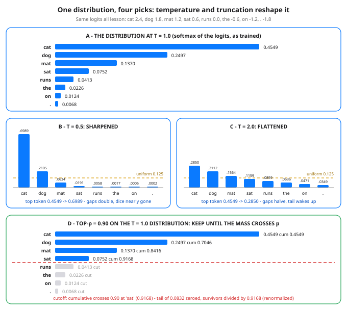

# Day 47 — Inference 1: Autoregressive Generation & Sampling

**Tonight you'll be able to:** read any next-token distribution and predict — in numbers, before running anything — what greedy, temperature, top-k and top-p will each do to it, then run the generation loop yourself and watch greedy walk into a loop that one sampled pick escapes.

## The one idea

A trained language model does exactly one thing: given the tokens so far, it returns a **probability distribution over the next token** — Day 14's softmax, stretched over the whole vocabulary. It never writes text. Text appears because a loop wraps that one-step predictor: **forward → distribution → pick ONE token → append it → forward again** on the now-longer sequence. *Autoregressive* just names the feedback: the model's own output becomes its next input. Day 42's tiny GPT ended with a `generate()` function; tonight we take that function apart. Everything in this lesson lives in the **pick** — the model proposes the same distribution no matter which rule you choose, and the rule alone decides what text comes out.

**Greedy** is the pick you already know: take the argmax, the single most likely token, every step. It is perfectly deterministic — same prompt, same text, forever — and that is exactly its failure mode. Greedy is locally safest and globally dull: it never takes a token whose payoff comes two steps later, and worse, it **loops**. Once the recent context repeats, the distribution repeats, the argmax repeats, and the cycle is self-sealing — Part 3's hand-built table walks *the cat sat on* straight back to *the* and around again, forever. (One precision worth keeping: the greedy path is not even the most probable *sequence* — it is a chain of individually most-probable tokens, which is a different thing.)

**Temperature** reshapes the distribution before the pick: divide every logit by `T`, then softmax as usual — `softmax(logits / T)`. The just-in-time math is one line of arithmetic: adjacent logits in tonight's table differ by 0.6, and dividing by `T = 0.5` makes that gap count *double* (1.2), while `T = 2` makes it count *half* (0.3). Bigger gaps after softmax mean a sharper distribution; smaller gaps mean a flatter one. So `T < 1` sharpens toward greedy (tonight's top token climbs 0.4549 → 0.6989), `T > 1` flattens toward the uniform 0.1250-per-token dice roll (top token falls to 0.2850, the tail wakes up), and the limits are exact: `T → 0` *is* greedy, `T → ∞` *is* uniform noise. Notice what temperature can never do: dividing by a positive `T` never reorders the logits, so **the ranking is frozen** — temperature changes how *often* the runners-up get picked under sampling, not who is on top.

**Top-k and top-p** attack a different problem: the tail. Every distribution has a long tail of tokens that are individually unlikely but collectively numerous — sample long enough and one of them fires, derailing the text. Both strategies **truncate the tail, then renormalize**: zero out the cut tokens, then divide each survivor by the mass that survived, because a sampler needs a distribution that sums to 1 (tonight, top-k's survivors are divided by 0.8416, top-p's by 0.9168). **Top-k** keeps a fixed count — the k largest, k = 3 tonight. **Top-p** (nucleus sampling) keeps the smallest set whose *cumulative* probability reaches p — tonight p = 0.90 keeps 4 tokens, because the running total crosses 0.90 only at the fourth (0.4549, 0.7046, 0.8416, 0.9168). That adaptivity is why top-p won: on a peaked distribution its nucleus might be 1–2 tokens, on a flat one it might be 40, while top-k's fixed 3 both strangles flat distributions and admits junk on peaked ones. Real samplers compose all of it in one fixed order — temperature, then truncate, then renormalize, then draw.

The draw itself is the last mechanic, and it is simpler than its name: **categorical sampling** means laying the probabilities end to end as slices of [0, 1) and dropping a uniform draw `u` into whichever slice it lands in — big tokens own wide slices, tail tokens slivers. `torch.multinomial` rolls that `u` for you; Part 3 instead lists its three draws in the code (0.75, 0.50, 0.60) so every output digit is exact and checkable. And the loop's exit is a pick too: it stops when the sampler lands on the end-of-sequence token (tonight's humble `.`) or a max-length cap cuts it off.

## Analogy

Think weighted load balancing, which you already run in your head. The next-token distribution is a set of **weights over replicas**. **Greedy** routes every request to the highest-weight node — deterministic, and a classic herding failure: one node takes everything, forever, even after it should have rotated (that is Part 3's loop, wearing a pager). **Sampling** is weighted-random routing: traffic spreads in proportion to the weights. **Temperature** is the exponent knob on those weights — crank it and small weight differences become decisive; soften it and routing evens out toward round-robin. **Top-p** is the health-check cutoff with brains: drop the tail of nodes whose combined weight is negligible *for this distribution's shape*, then renormalize the survivors' weights to sum to 1 so the balancer still balances.

Trading version, one line: the distribution is your candidate trades weighted by conviction — greedy always takes the single top signal (the same crowded trade at every rebalance), temperature scales how much conviction differences matter, and top-p is the liquidity filter that cuts the junk tail before you size what's left.

## See it



Panel A: tonight's one distribution at T = 1.0 — every strategy below starts from these exact bars. Panels B/C: the same logits at T = 0.5 and T = 2.0 (note the dashed uniform line at 0.125 — T = 2 is walking toward it, T = 0.5 is sprinting away). Panel D: top-p = 0.90 — keep tokens until the cumulative mass crosses 0.90 (it happens at *sat*, 0.9168), grey out the tail, and renormalize what survives.

## Code it (~30 min)

One fixed distribution, three parts, no RNG — every digit checkable. **Part 1** prints `softmax(logits / T)` at three temperatures so the sharpen/flatten numbers sit side by side. **Part 2** runs top-k and top-p on the T = 1.0 distribution and prints the renormalized survivors and the tail mass each one cut. **Part 3** is the loop itself on a hand-built bigram table (next-token logits per current token — the smallest possible "model"): greedy for 8 picks, then sampling with three fixed draws listed in the code, using an explicit cumulative-slice lookup so you can see exactly what `torch.multinomial` does with a draw it rolls itself.

```python
"""Day 47 - Inference 1: Autoregressive Generation & Sampling.

A trained model does not write text. It does exactly one
thing: given the tokens so far, it returns a probability
distribution over the NEXT token (Day 14's softmax over the
vocab). Generation is the loop wrapped around that:

    forward -> distribution -> PICK one token -> append ->
    forward again, one token longer.

The model proposes; the picking rule disposes. Tonight the
pick is the whole lesson, run on ONE fixed distribution so
every strategy's mechanics show up as numbers:

  Part 1  Temperature. Softmax(logits / T) at T = 0.5, 1.0,
          2.0 on the same logits. T rescales the gaps between
          logits: T < 1 sharpens toward greedy, T > 1 flattens
          toward uniform (0.1250 each here). It never changes
          the RANKING - argmax is 'cat' at every temperature.
  Part 2  Truncation. Top-k keeps the k biggest, top-p
          (nucleus) keeps the smallest set whose cumulative
          probability reaches p; both zero the tail and
          RENORMALIZE - divide what survives by the mass it
          kept, so it sums to 1 again. Top-p adapts its count
          to the shape: 4 tokens kept here, because the mass
          crosses 0.90 at the 4th.
  Part 3  The loop itself, on a hand-built bigram table
          (next-token logits per current token - the smallest
          possible "model"). Greedy from 'the' loops forever:
          the cat sat on the cat sat on... Sampling with
          three FIXED uniform draws picks a different token
          at step 1 and ends at '.' in three picks. Same
          table, same prompt - only the pick changed.

Sampling is shown the honest way: a draw u in [0, 1) lands
in a token's slice of the cumulative distribution. Real code
rolls that u with torch.multinomial; here the three draws
are listed in the code (0.75, 0.50, 0.60), so every output
digit is exact - no RNG anywhere in this lesson.

Runs on the ~/ai-lab venv: torch only (free), MPS if your
Mac offers it else CPU, no CUDA, no paid APIs, no downloads.

Expected output:

  Part 1 - one distribution, three temperatures: softmax(logits / T)
    logits: cat 2.4000, dog 1.8000, mat 1.2000, sat 0.6000, runs 0.0000, the -0.6000, on -1.2000, . -1.8000
    T=0.5 (sharpened): cat 0.6989, dog 0.2105, mat 0.0634, sat 0.0191, runs 0.0058, the 0.0017, on 0.0005, . 0.0002
    T=1.0 (as trained): cat 0.4549, dog 0.2497, mat 0.1370, sat 0.0752, runs 0.0413, the 0.0226, on 0.0124, . 0.0068
    T=2.0 (flattened): cat 0.2850, dog 0.2112, mat 0.1564, sat 0.1159, runs 0.0859, the 0.0636, on 0.0471, . 0.0349
    uniform would be 0.1250 per token; greedy pick is 'cat' at EVERY temperature - T moves the gaps, never the ranking
  Part 2 - truncate the tail, then renormalize (from the T=1.0 distribution)
    top-k k=3: kept cat, dog, mat (mass 0.8416) -> cat 0.5405, dog 0.2967, mat 0.1628; the other 5 tokens are now exactly 0
    top-p p=0.90: kept cat, dog, mat, sat (cumulative 0.4549, 0.7046, 0.8416, 0.9168) -> cat 0.4962, dog 0.2723, mat 0.1495, sat 0.0820
    tail mass removed: top-k cuts 0.1584, top-p cuts 0.0832 - renormalizing rescales the survivors back to a sum of 1
  Part 3 - the generation loop: predict -> pick -> append -> repeat
    greedy from 'the', 8 picks: the cat sat on the cat sat on the
    greedy is deterministic - and the argmax chain walks straight into a loop
    sampled from 'the', fixed draws [0.75, 0.5, 0.6]:
      after 'the'  draw 0.7500 -> 'dog'
      after 'dog'  draw 0.5000 -> 'runs'
      after 'runs'  draw 0.6000 -> '.'
    sampled result: the dog runs .  (stops at '.')
    verdict: same table, same prompt - only the pick changed the text
"""
import torch

device = torch.device("mps") if torch.backends.mps.is_available() \
    else torch.device("cpu")

fmt = lambda pairs: ", ".join(f"{t} {v:.4f}" for t, v in pairs)

# ---------- Part 1: temperature reshapes one distribution ----------
VOCAB = ["cat", "dog", "mat", "sat", "runs", "the", "on", "."]
logits = torch.tensor([2.4, 1.8, 1.2, 0.6, 0.0, -0.6, -1.2, -1.8],
                      device=device)

print("Part 1 - one distribution, three temperatures: "
      "softmax(logits / T)")
print(f"  logits: {fmt(zip(VOCAB, logits.tolist()))}")
for temp, tag in ((0.5, "sharpened"), (1.0, "as trained"),
                  (2.0, "flattened")):
    probs = torch.softmax(logits / temp, dim=0)
    print(f"  T={temp} ({tag}): {fmt(zip(VOCAB, probs.tolist()))}")
greedy = VOCAB[int(torch.argmax(logits).item())]
print(f"  uniform would be {1 / len(VOCAB):.4f} per token; greedy pick "
      f"is '{greedy}' at EVERY temperature - T moves the gaps, "
      "never the ranking")

# ---------- Part 2: truncate the tail, then renormalize ----------
probs = torch.softmax(logits, dim=0)                   # T=1.0 again

top_vals, top_idx = torch.topk(probs, 3)
kept_mass = top_vals.sum().item()
topk = [(VOCAB[int(i)], (v / top_vals.sum()).item())
        for v, i in zip(top_vals, top_idx)]
print("Part 2 - truncate the tail, then renormalize "
      "(from the T=1.0 distribution)")
print(f"  top-k k=3: kept {', '.join(t for t, _ in topk)} "
      f"(mass {kept_mass:.4f}) -> {fmt(topk)}; the other 5 tokens "
      "are now exactly 0")

sorted_probs, sorted_idx = torch.sort(probs, descending=True)
cum = torch.cumsum(sorted_probs, dim=0)
n_keep = int((cum < 0.90).sum().item()) + 1            # include the token that crosses p
p_mass = cum[n_keep - 1].item()
topp = [(VOCAB[int(i)], (v / sorted_probs[:n_keep].sum()).item())
        for v, i in zip(sorted_probs[:n_keep], sorted_idx[:n_keep])]
cum_kept = ", ".join(f"{c:.4f}" for c in cum[:n_keep].tolist())
print(f"  top-p p=0.90: kept {', '.join(t for t, _ in topp)} "
      f"(cumulative {cum_kept}) -> {fmt(topp)}")
print(f"  tail mass removed: top-k cuts {1 - kept_mass:.4f}, "
      f"top-p cuts {1 - p_mass:.4f} - renormalizing rescales the "
      "survivors back to a sum of 1")

# ---------- Part 3: the generation loop on a bigram table ----------
TOKENS = ["the", "cat", "dog", "sat", "runs", "on", "mat", "."]
TABLE = {  # next-token logits per current token, in TOKENS order
    "the":  [-2.0, 2.0, 1.4, -1.0, -1.5, -2.0, -1.0, -3.0],
    "cat":  [-2.0, -2.0, -1.5, 2.2, 0.5, -1.0, -0.5, -2.0],
    "dog":  [-2.0, -1.0, -2.5, 0.8, 2.2, -1.5, -2.0, -0.5],
    "sat":  [-1.0, -2.0, -2.0, -2.5, -1.0, 2.0, 1.2, -1.5],
    "runs": [0.5, -1.5, -1.0, -2.0, -2.0, -1.0, -1.5, 2.4],
    "on":   [2.0, -1.0, -1.0, -2.0, -2.0, -2.0, 1.4, -1.0],
    "mat":  [-1.0, -1.0, -2.0, -2.0, -2.0, -1.0, -2.0, 2.0],
    ".":    [2.0, -2.0, -2.0, -2.0, -2.0, -2.0, -2.0, -3.0],
}


def next_probs(token):
    row = torch.tensor(TABLE[token], device=device)
    return torch.softmax(row, dim=0)


def pick_from(probs, u):
    """One categorical draw, made visible: u lands in a token's
    slice of the cumulative distribution. torch.multinomial
    does exactly this with a u it rolls itself."""
    cum = torch.cumsum(probs, dim=0)
    return int((cum <= u).sum().item())


print("Part 3 - the generation loop: predict -> pick -> append -> "
      "repeat")
seq = ["the"]
for _ in range(8):
    seq.append(TOKENS[int(torch.argmax(
        next_probs(seq[-1])).item())])
print(f"  greedy from 'the', 8 picks: {' '.join(seq)}")
print("  greedy is deterministic - and the argmax chain walks "
      "straight into a loop")

draws = [0.75, 0.50, 0.60]
seq = ["the"]
print(f"  sampled from 'the', fixed draws {draws}:")
for u in draws:
    nxt = TOKENS[pick_from(next_probs(seq[-1]), u)]
    print(f"    after '{seq[-1]}'  draw {u:.4f} -> '{nxt}'")
    seq.append(nxt)
    if nxt == ".":
        break
print(f"  sampled result: {' '.join(seq)}  (stops at '.')")
print("  verdict: same table, same prompt - only the pick changed "
      "the text")
```

**Expected output:**

```
Part 1 - one distribution, three temperatures: softmax(logits / T)
  logits: cat 2.4000, dog 1.8000, mat 1.2000, sat 0.6000, runs 0.0000, the -0.6000, on -1.2000, . -1.8000
  T=0.5 (sharpened): cat 0.6989, dog 0.2105, mat 0.0634, sat 0.0191, runs 0.0058, the 0.0017, on 0.0005, . 0.0002
  T=1.0 (as trained): cat 0.4549, dog 0.2497, mat 0.1370, sat 0.0752, runs 0.0413, the 0.0226, on 0.0124, . 0.0068
  T=2.0 (flattened): cat 0.2850, dog 0.2112, mat 0.1564, sat 0.1159, runs 0.0859, the 0.0636, on 0.0471, . 0.0349
  uniform would be 0.1250 per token; greedy pick is 'cat' at EVERY temperature - T moves the gaps, never the ranking
Part 2 - truncate the tail, then renormalize (from the T=1.0 distribution)
  top-k k=3: kept cat, dog, mat (mass 0.8416) -> cat 0.5405, dog 0.2967, mat 0.1628; the other 5 tokens are now exactly 0
  top-p p=0.90: kept cat, dog, mat, sat (cumulative 0.4549, 0.7046, 0.8416, 0.9168) -> cat 0.4962, dog 0.2723, mat 0.1495, sat 0.0820
  tail mass removed: top-k cuts 0.1584, top-p cuts 0.0832 - renormalizing rescales the survivors back to a sum of 1
Part 3 - the generation loop: predict -> pick -> append -> repeat
  greedy from 'the', 8 picks: the cat sat on the cat sat on the
  greedy is deterministic - and the argmax chain walks straight into a loop
  sampled from 'the', fixed draws [0.75, 0.5, 0.6]:
    after 'the'  draw 0.7500 -> 'dog'
    after 'dog'  draw 0.5000 -> 'runs'
    after 'runs'  draw 0.6000 -> '.'
  sampled result: the dog runs .  (stops at '.')
  verdict: same table, same prompt - only the pick changed the text
```

## Today's win

Done when your run reproduces all three parts digit for digit: Part 1's top token walking `0.6989 / 0.4549 / 0.2850` across T = 0.5 / 1.0 / 2.0 with the ranking untouched; Part 2's renormalized survivors (top-k: `0.5405, 0.2967, 0.1628`; top-p: `0.4962, 0.2723, 0.1495, 0.0820`); and Part 3's contrast — greedy printing the loop `the cat sat on the cat sat on the` while the three fixed draws print `the dog runs .` and stop. The keeper test, no notes allowed: hand you any distribution, you can say which tokens survive top-p = 0.90, what the survivors renormalize to, and what greedy will say forever.

## Short on time? 20-minute version

Read "The one idea", stare at Panel D of the diagram until the cumulative-crossing rule is obvious, then run Part 1 and Part 3 only. If you can explain why temperature never changes the ranking and why greedy loops, you have the lesson — Part 2's renormalization arithmetic is the victory lap.

## Tomorrow's teaser

Tomorrow: this loop re-runs the whole model for every single token — the KV cache is why the first token is slow and the rest are fast.

Streak: 47 day(s) · Never miss twice.
