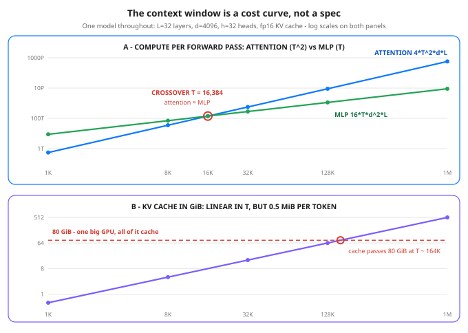

# Day 49 - Context Windows & Why Long Context Is Expensive

**Tonight you'll be able to:** read any model's context-window claim as a cost curve - compute the attention FLOPs, the MLP FLOPs, and the KV cache for a prompt of T tokens, name the crossover where attention takes over, and explain why a 1M-token window is priced like a different product, not a bigger one.

## The one idea

Two threads from earlier in Phase C meet tonight. From Days 37-38: attention means **every token looks at every other token** - that all-pairs look is the mechanism. From Day 48: the KV cache stores every past key and value so generation stays fast. Tonight's question is the one the spec sheets don't ask: **what does a context of T tokens actually cost?** A "context window" gets marketed like disk size - a bigger number, a better product. It is really a budget line with two very different growth rates, and the bill lands on whoever serves the model.

**Cost 1 - attention compute grows as T^2.** Each attention head builds a T x T score matrix (Day 38's `QK^T`): T tokens asking, T tokens answering. Across all heads and layers that is `L * h * T^2` score entries. The compute follows the same shape, and here is the formula tonight's code uses, stated so you can audit it: the two attention matmuls (`QK^T` and scores x V) cost **4 * T^2 * d FLOPs per layer** - 2 FLOPs (multiply + add) per term of each matmul. Double T and this cost doesn't double - it **quadruples**. At T = 1M the score entries alone number 1.13e+15.

**Cost 2 - the rest is "only" linear, but linear with a huge constant.** The MLP block processes each token independently: two matmuls, d -> 4d -> d, costing **16 * T * d^2 FLOPs per layer** - proportional to T, no T^2 term. The KV cache (Day 48) is linear too: K and V for every token in every layer, `2 * L * T * d` values in fp16. For tonight's model (L=32, d=4096) that constant is **0.5 MiB per token** - so the cache is 4 GiB at 8K, 64 GiB at 128K, and 512 GiB at 1M. And that is *one* sequence: serve 8 users at 128K concurrently and the cache line reads 512 GiB again. Linear doesn't mean small; it means the pain is predictable.

**The crossover tells you which cost runs the show.** Set the two compute formulas equal - `4*T^2*d = 16*T*d^2` - and T cancels down to **T* = 4d = 16,384 tokens** for this model. Below ~16K, the MLP is the bigger compute bill and attention is a rounding error (6% of the MLP at T = 1K) - which is why short-context models feel cheap. Above it, attention takes over and its lead doubles with every doubling: 2x the MLP at 32K, 8x at 128K, 64x at 1M. Put a time on the far end: attention alone at T = 1M is 576 PFLOPs of math for *one prompt's* prefill - at a round, assumed 1 PFLOP/s of effective compute, roughly ten minutes of arithmetic before the MLP is even counted. The marginal token isn't priced like the first token because it isn't built like it: the token at position 900,000 attends to 900,000 predecessors.

**That arithmetic is why the product landscape looks the way it does.** Long-context tiers are priced differently because cost per token genuinely rises with position - a flat per-token price at 1M would be a subsidy. And it is why a different architecture exists at all: instead of paying T^2 to re-read an entire library on every question, you can fetch just the relevant pages first - that idea gets its own day later in this phase (Day 58). One honest footnote on mitigations, as names only: the field fights this curve with sliding-window attention, sparse attention, RoPE scaling, and memory-efficient attention kernels. Each bends the curve by trading something away; none of them repeals the arithmetic above.

## Analogy

Think in cluster terms: attention is an **all-to-all shuffle**. T workers each exchange data with every other worker - double the workers and the shuffle traffic quadruples, while each worker's local compute merely doubles. That is exactly tonight's split: attention is the shuffle (T^2), the MLP is the local compute (T). Nobody provisions a cluster by saying "nodes: 1,000,000" as if the interconnect were free - yet that is precisely how context windows get advertised. The KV cache is the other half of the analogy: an in-memory session store that keeps *everything* every session ever produced. Growth is linear and predictable - and it is still the first thing to OOM the box, because the per-entry constant is fat and concurrency multiplies it.

Trading version, one line: cost per token is like slippage - looks flat and negligible at small size, quietly quadratic once your size *is* the market.

## See it



Panel A (log-log): attention compute grows as T^2 and crosses the merely-linear MLP at T = 16,384 = 4d - past that point attention is the bigger bill and its lead doubles with every doubling of T. Panel B: the KV cache is only linear, but at 0.5 MiB per token it eats an entire 80 GiB GPU by ~164K tokens - for one sequence, batch size 1.

## Code it (~30 min)

Pure arithmetic - no model, no torch, just the four formulas from "The one idea" applied to one stated config (L=32, d=4096, h=32 - roughly a 7B-class transformer with the standard 4x MLP). **Part 1** proves the doubling rule by division. **Part 2** prints the full bill at T = 1K / 8K / 32K / 128K / 1M - score entries, attention vs MLP FLOPs, cache in GiB. **Part 3** solves the crossover in closed form and verifies it by direct evaluation. Standard library only, so it runs in the `~/ai-lab` venv exactly as-is - every number is exact integer arithmetic, no RNG, nothing to download.

```python
"""Day 49 - Context Windows & Why Long Context Is Expensive.

Day 48 gave you the KV cache: past keys and values are kept so
each new token only attends to stored history. Tonight is the
bill for the whole window - the two costs that scale with the
context length T, for ONE forward pass over a prompt of T
tokens (prefill), batch size 1, on a fixed model:

    L = 32 layers, d = 4096 (model width), h = 32 heads,
    MLP hidden size 4d (the standard expansion).

The formulas (stated, so every number below is auditable):

  Score entries   Each head builds a T x T score matrix, so
                  entries = L * h * T^2. Quadratic in T.
  Attention FLOPs The two big matmuls per layer: QK^T and
                  (scores)V. A matmul of (T x d) by (d x T)
                  costs 2*T^2*d FLOPs (one multiply + one add
                  per term), so attention = 4 * T^2 * d per
                  layer, times L layers. Quadratic in T.
  MLP FLOPs       Two matmuls per layer, d -> 4d and 4d -> d:
                  2*T*d*4d + 2*T*4d*d = 16 * T * d^2 per
                  layer, times L. Only linear in T.
  KV cache bytes  K and V for every token in every layer,
                  fp16 (2 bytes): 2 * L * T * d * 2. Linear
                  in T - but the constant is huge.

  Part 1  The doubling rule. Take T from 4K to 8K and divide:
          attention cost x4, MLP cost x2, cache x2. Doubling
          the context is never a x2 decision for attention.
  Part 2  The cost table at T = 1K / 8K / 32K / 128K / 1M:
          score entries, attention vs MLP FLOPs, and the
          cache in GiB. Watch which column explodes.
  Part 3  The crossover. Solve 4*T^2*d = 16*T*d^2 on paper:
          T* = 4d = 16,384. Below it the MLP is the bigger
          bill; above it attention takes over, and by 1M it
          is 64x the MLP. There is no regime where a longer
          window gets cheaper per token.

Pure arithmetic - no torch needed, standard library only.
Runs anywhere Python 3.11+ runs, including the ~/ai-lab
venv on the MacBook. No CUDA, no paid APIs, no downloads,
no RNG: every number is exact integer arithmetic.

Expected output:

  Part 1 - the doubling rule: T = 4,096 -> 8,192
    attention FLOPs  x4.00   (quadratic: 2^2)
    MLP FLOPs        x2.00   (linear)
    KV cache         x2.00   (linear, but wait for Part 2)
  Part 2 - the bill at five context lengths (L=32, d=4096, h=32, fp16 cache)
      T         scores    attn     MLP  attn/MLP   KV cache
      1,024     1.07e+09    0.5T    8.8T     0.06     0.5 GiB
      8,192     6.87e+10   35.2T   70.4T     0.50     4.0 GiB
     32,768     1.10e+12  562.9T  281.5T     2.00    16.0 GiB
    131,072     1.76e+13    9.0P    1.1P     8.00    64.0 GiB
    1,048,576   1.13e+15  576.5P    9.0P    64.00   512.0 GiB
  Part 3 - the crossover: where attention catches the MLP
    4*T^2*d = 16*T*d^2  ->  T* = 4d = 16,384 tokens
    check at T*: attn 140.7T FLOPs = MLP 140.7T FLOPs  (equal: True)
    at T = 1M attention is 64.00x the MLP - and still climbing
    cache check: 0.5 MiB per token x 131,072 tokens = 64.0 GiB at 128K
    verdict: the window is a cost curve, not a spec - 4x attention compute and 2x cache for every 2x of context
"""
# The model - fixed all lesson. Roughly a 7B-class transformer
# with the standard 4x MLP expansion.
LAYERS = 32
D_MODEL = 4096
HEADS = 32
FP16_BYTES = 2

CONTEXTS = [1_024, 8_192, 32_768, 131_072, 1_048_576]


def score_entries(T):
    """Every head, every layer: one T x T matrix of scores."""
    return LAYERS * HEADS * T * T


def attn_flops(T):
    """QK^T plus (scores)V, all layers: 4 * T^2 * d per layer."""
    return 4 * T * T * D_MODEL * LAYERS


def mlp_flops(T):
    """d -> 4d -> d, all layers: 16 * T * d^2 per layer."""
    return 16 * T * D_MODEL * D_MODEL * LAYERS


def kv_bytes(T):
    """K and V, every token, every layer, stored in fp16."""
    return 2 * LAYERS * T * D_MODEL * FP16_BYTES


def fmt_flops(f):
    """Human units: T = teraFLOP (1e12), P = petaFLOP (1e15)."""
    if f >= 1e15:
        return f"{f / 1e15:.1f}P"
    return f"{f / 1e12:.1f}T"


def fmt_gib(b):
    return f"{b / 2**30:.1f} GiB"


# ---------- Part 1: the doubling rule ----------
print("Part 1 - the doubling rule: T = 4,096 -> 8,192")
t_small, t_big = 4_096, 8_192
print(f"  attention FLOPs  x{attn_flops(t_big) / attn_flops(t_small):.2f}"
      "   (quadratic: 2^2)")
print(f"  MLP FLOPs        x{mlp_flops(t_big) / mlp_flops(t_small):.2f}"
      "   (linear)")
print(f"  KV cache         x{kv_bytes(t_big) / kv_bytes(t_small):.2f}"
      "   (linear, but wait for Part 2)")

# ---------- Part 2: the bill at five context lengths ----------
print("Part 2 - the bill at five context lengths "
      "(L=32, d=4096, h=32, fp16 cache)")
print(f"  {'T':>9} {'scores':>10} {'attn':>7} {'MLP':>7}"
      f" {'attn/MLP':>8} {'KV cache':>9}")
for T in CONTEXTS:
    print(f"  {T:>9,} {score_entries(T):>10.2e}"
          f" {fmt_flops(attn_flops(T)):>7} {fmt_flops(mlp_flops(T)):>7}"
          f" {attn_flops(T) / mlp_flops(T):>8.2f}"
          f" {fmt_gib(kv_bytes(T)):>9}")

# ---------- Part 3: the crossover, and the cache constant ----------
print("Part 3 - the crossover: where attention catches the MLP")
t_star = 4 * D_MODEL                     # from 4*T^2*d = 16*T*d^2
print(f"  4*T^2*d = 16*T*d^2  ->  T* = 4d = {t_star:,} tokens")
print(f"  check at T*: attn {fmt_flops(attn_flops(t_star))} FLOPs"
      f" = MLP {fmt_flops(mlp_flops(t_star))} FLOPs"
      f"  (equal: {attn_flops(t_star) == mlp_flops(t_star)})")
big = CONTEXTS[-1]
print(f"  at T = 1M attention is "
      f"{attn_flops(big) / mlp_flops(big):.2f}x the MLP"
      " - and still climbing")
per_token_mib = kv_bytes(1) / 2**20
print(f"  cache check: {per_token_mib} MiB per token"
      f" x 131,072 tokens = {fmt_gib(kv_bytes(131_072))} at 128K")
print("  verdict: the window is a cost curve, not a spec - "
      "4x attention compute and 2x cache for every 2x of context")
```

**Expected output:**

```
Part 1 - the doubling rule: T = 4,096 -> 8,192
  attention FLOPs  x4.00   (quadratic: 2^2)
  MLP FLOPs        x2.00   (linear)
  KV cache         x2.00   (linear, but wait for Part 2)
Part 2 - the bill at five context lengths (L=32, d=4096, h=32, fp16 cache)
          T     scores    attn     MLP attn/MLP  KV cache
      1,024   1.07e+09    0.5T    8.8T     0.06   0.5 GiB
      8,192   6.87e+10   35.2T   70.4T     0.50   4.0 GiB
     32,768   1.10e+12  562.9T  281.5T     2.00  16.0 GiB
    131,072   1.76e+13    9.0P    1.1P     8.00  64.0 GiB
  1,048,576   1.13e+15  576.5P    9.0P    64.00 512.0 GiB
Part 3 - the crossover: where attention catches the MLP
  4*T^2*d = 16*T*d^2  ->  T* = 4d = 16,384 tokens
  check at T*: attn 140.7T FLOPs = MLP 140.7T FLOPs  (equal: True)
  at T = 1M attention is 64.00x the MLP - and still climbing
  cache check: 0.5 MiB per token x 131,072 tokens = 64.0 GiB at 128K
  verdict: the window is a cost curve, not a spec - 4x attention compute and 2x cache for every 2x of context
```

## Today's win

Done when your run prints the doubling rule (x4.00 / x2.00 / x2.00), the table's last row - ratio `64.00`, cache `512.0 GiB` - and Part 3's crossover check `(equal: True)` at T* = 16,384. Keeper test, no notes: someone quotes you a window size and you answer with the doubling rule ("twice the context = 4x the attention compute, 2x the cache"), estimate this model's cache at any T (0.5 MiB x T x batch), and say which side of 4d the workload sits on. The window is a cost curve, not a spec.

## Short on time? 20-minute version

Read "The one idea" and stare at the diagram until you can explain why the blue line must eventually cross the green one and why the purple line crosses the red dashed one. Then run only Parts 1 and 3 of the code. If you can state T* = 4d and the doubling rule out loud, you have tonight's idea - the table is the evidence, not the lesson.

## Tomorrow's teaser

Tomorrow: Phase C closes - everything from recurrence's fading memory to tonight's cost curve, assembled into one transformer mental model you can carry into any room.

Streak: 49 day(s) - Never miss twice.
