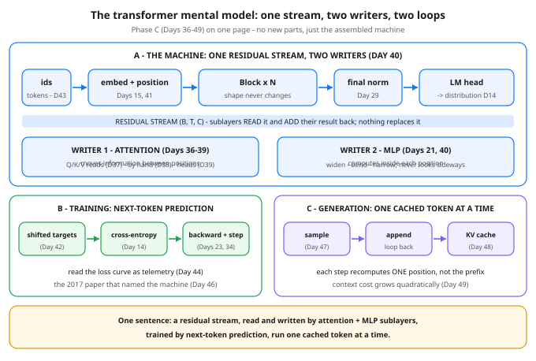

# Day 50 — Recap: The Transformer Mental Model, End to End

**Tonight you'll be able to:** compress all of Phase C (Days 36–49) into one sentence you can carry into any AI conversation — *a transformer is a residual stream read and written by attention and MLP sublayers, trained by next-token prediction, run one cached token at a time* — and trace one token's full journey through the machine with a shape at every stage.

## The one idea

Day 20 gave you Phase A in one sentence (learning = differentiable programming) and Day 34 gave you Phase B (a composed function + an optimizer). Phase C gets the same treatment tonight. Here is the sentence, and then we take it apart:

**A transformer is a residual stream read and written by attention and MLP sublayers, trained by next-token prediction, run one cached token at a time.**

**The residual stream** is the spine. From the moment token + position embeddings are added (Days 15, 41) until the final norm and LM head (Day 42), one tensor of shape `(B, T, C)` flows through every block *unchanged in shape*. Nothing in a block replaces it. Sublayers read a normalized copy of it and **add** their result back — that add is the residual connection, and it is why gradients and information both survive depth (Day 40). If you remember nothing else: the stream is the shared state; everything else is a worker that annotates it.

**Two kinds of writers, two different jobs.** The *attention* sublayer is the only one that moves information *between* positions: each position issues a query, matches it against every earlier position's key, and pulls a weighted mix of their values (Day 37's reads, Day 38's by-hand scores, Day 39's parallel heads) — and Day 36 is why this replaced recurrence: every position reads the whole past directly, in parallel, at any distance. The *MLP* sublayer does the opposite: it never looks sideways. It computes *inside* each position, widening, bending, narrowing (the Day 21 MLP, promoted into every block). Communication and computation, alternating, dozens of times — that alternation is the whole architecture.

**Trained by next-token prediction.** The training task never changed since Day 42: at every position, predict the next token; the targets are the inputs shifted by one; cross-entropy (Day 14) scores all positions at once. Day 34's editor does the rest — `backward()` prices every number in θ, the optimizer steps — and Day 44 taught you to read the resulting loss curve as telemetry. Day 45's decoder-only shape and Day 46's paper are this same machine, named.

**Run one cached token at a time.** Generation is the forward pass in a loop (Day 47): take the last position's distribution, pick a token (greedily, or sampled with temperature / top-k / top-p), append it, go again. The KV cache (Day 48) is what makes that loop affordable: keys and values of past positions are stored, so each step computes one new position against the stored prefix. Day 49 is the bill that remains — attention scores grow as T², so context is never free, cache or not.

Every Phase C day is a slot in this picture: 36–39 built the first writer, 40 assembled the block around the stream, 41–43 fed it (order, assembly, tokens), 44–46 trained and named it, 47–49 ran it. If a future paper or framework confuses you, ask which slot it changes — stream, writer, training, or the run loop. It will be one of the four.

## Analogy

Think of the residual stream as a **shared incident channel that nobody edits in place**. Every responder reads the full timeline and *appends* a note; the timeline itself is never rewritten, so nothing is ever lost and anyone can audit how the current picture was reached. Attention is the cross-team sync: a responder scans everyone else's earlier notes and pulls in the relevant ones (a quorum read over the log, Day 37's analogy at full size). The MLP is each responder going heads-down and thinking locally about their own item. Training is the post-incident process that rewrites the responders' *playbooks* (θ) based on how the final call scored. And generation is the channel in live use: one new note at a time, with the cached history pinned at the top so nobody re-reads the whole log for every reply — though the log's length is still on the bill (Day 49).

## See it



The one diagram to keep. Top: the machine &mdash; ids become embeddings, enter the residual stream, and are annotated by two kinds of writer (attention moves information between positions, the MLP computes inside each one) until the final norm and LM head turn the last position into a distribution. Bottom left: training &mdash; shifted targets, cross-entropy, backward + step. Bottom right: generation &mdash; sample, append, and lean on the KV cache. Every tag is a day you already did.

## Code it (~30 min)

One file, three views of the same machine, every weight filled from a deterministic integer pattern — no RNG, so shapes, counts, and picks are exact on any device. The model is Day 42's architecture at tracing size (vocab 16, width 32, 4 heads, 2 blocks, prompt `"to eat"`). **Part 1** stages one sequence by hand and prints the shape at *every* stage — embeddings, both writers inside block 1, the head, the final distribution, the greedy pick. **Part 2** reads the identical forward as training: shifted targets, one cross-entropy number, and θ counted exactly (27,024). **Part 3** appends the pick and runs *one cached decode step*: watch Q arrive as `(1, 4, 1, 8)`, K grow to `(1, 4, 7, 8)`, and the step's logits match a full 7-token forward to `0.000000`.

```python
"""Day 50 - Recap: The Transformer Mental Model, End to End.

Phase C recap. Days 36-49 handed you attention, heads, the
block, positions, tokens, a whole tiny GPT, sampling, the KV
cache and the context bill - fourteen days of parts. Tonight
there are NO new parts. Everything compresses into one
sentence, the Phase C upgrade of Day 34's sentence:

    A transformer is a residual stream read and written by
    attention and MLP sublayers, trained by next-token
    prediction, run one cached token at a time.

The residual stream is the (B, T, C) tensor that flows from
the embeddings to the head without ever changing shape.
Attention sublayers READ it and ADD information moved
between positions; MLP sublayers READ it and ADD information
computed inside each position (Day 40). Training is Day 34's
editor pointed at one task: predict the next token, score
with cross-entropy, let backward() price every number in
theta (Days 14, 42). Running it is a loop: take the last
position's distribution, pick one token, append it, repeat -
with the KV cache so each step recomputes one position
instead of the whole prefix (Days 47, 48).

  Part 1  The journey, staged by hand. One 6-token sequence
          through a tiny hand-set transformer (vocab 16,
          width 32, 4 heads, 2 blocks - Day 42's architecture
          at tracing size), printing the shape at EVERY
          stage: embed -> +pos -> block x2 -> norm -> head
          -> distribution -> greedy pick. Every writer's
          intermediate shapes appear inside block 1.
  Part 2  The same forward, read as training. Targets are
          the ids shifted by one; cross-entropy over all 6
          positions; theta counted exactly: 27,024 numbers.
  Part 3  Generation with the cache. Append the greedy pick,
          then run ONE decode step for the new position only:
          Q is (1, 4, 1, 8), K grows (1, 4, 6, 8) -> (1, 4, 7, 8),
          and the step's logits match a full 7-token forward
          to 0.000000 - the cache changes the cost, never
          the answer (Day 48).

Deterministic by construction: every weight is filled from
an integer pattern (no RNG anywhere), so shapes, counts,
the greedy picks and the cached-vs-full check are exact on
any device. The distribution and loss digits were verified
against a float32 numpy twin of this exact math; on MPS the
last printed digit may wobble, the picks will not.

Runs on the ~/ai-lab venv: torch only (free), MPS if
available else CPU, no CUDA, no paid APIs, no downloads.

Expected output:

  device: mps (or cpu)
  Part 1 - one sequence, staged by hand: 'to eat' (B=1, T=6, C=32)
    ids -> (1, 6)
    token embedding (Day 15) -> (1, 6, 32)
    + positional embedding (Day 41) -> (1, 6, 32)
    block 1 of 2 (Day 40):
      norm, then Q / K / V (Day 37) -> (1, 6, 32) each
      split into 4 heads (Day 39) -> (1, 4, 6, 8) each
      scores QK^T/sqrt(8), causal mask (Day 38) -> (1, 4, 6, 6)
      attention output, projected -> (1, 6, 32)
      stream += attention (residual) -> (1, 6, 32)
      MLP hidden, 32 -> 128 -> (1, 6, 128)
      stream += MLP (residual) -> (1, 6, 32)
    block 2 of 2: same shapes, its own theta -> (1, 6, 32)
    final LayerNorm (Day 29) -> (1, 6, 32)
    LM head: width -> vocab (Day 42) -> (1, 6, 16)
    last position -> softmax (Day 14) -> (16,)
    distribution (vocab order: e t a o i n s r h l d u . SP RET ,):
      0.0654, 0.0058, 0.1786, 0.0064, 0.1488, 0.0167, 0.0325, 0.0766, 0.0257, 0.0459, 0.0126, 0.0760, 0.0053, 0.1616, 0.0074, 0.1347  (sum 1.0000)
    greedy next token (Day 47): 'a' (id 2, p 0.1786)
  Part 2 - the same forward, read as training (Days 42, 44)
    targets = ids shifted by one -> (1, 6)
    cross-entropy over all 6 positions (Day 14): 3.4018
    uniform guess = ln(16) = 2.7726 - hand-set theta is untrained and scores worse; training is what closes the gap
    parameters: 27024 = tok emb 512 + pos emb 512 + 2 blocks x 12704 + final norm 64 + head 528 (exact)
    one backward() prices a gradient for every one of those numbers (Days 23, 34)
  Part 3 - generation: append the pick, then one cached step (Days 47, 48)
    append 'a' -> ids (1, 7); the new token sits at position 6
    prefill cache per block: K (1, 4, 6, 8), V (1, 4, 6, 8)
    decode step, position 6 only:
      embed the new token -> (1, 1, 32)
      Q for one position -> (1, 4, 1, 8)
      K after append -> (1, 4, 7, 8)
      scores: 1 query against 7 keys -> (1, 4, 1, 7)
      logits -> (1, 16)
    cached step vs full 7-token forward, last logits: max diff 0.000000
    next greedy pick: 'a' (p 0.1660)
    the step recomputed 1 position, not 7 - that gap is the KV-cache trade (Day 48), and it widens with context (Day 49)
"""
import math

import torch
import torch.nn as nn
import torch.nn.functional as F

device = "mps" if torch.backends.mps.is_available() else "cpu"
print(f"device: {device}")

# Tiny tracing-size version of Day 42's architecture.
CHARS = list("etaoinsrhldu. \n,")
stoi = {c: i for i, c in enumerate(CHARS)}
itos = {i: c for c, i in stoi.items()}
V = len(CHARS)          # vocab: 16 characters are the tokens (Day 43)
C = 32                  # width of the residual stream
H = 4                   # heads per block (Day 39)
HS = C // H             # 8 dims per head
L = 2                   # blocks deep
MAXT = 16               # positional table size
PROMPT = "to eat"


# ---------- deterministic weights: integer patterns, no RNG ----------
def pat(shape, mul, off, mod, cen, scale):
    n = 1
    for s in shape:
        n *= s
    v = ((torch.arange(n) * mul + off) % mod - cen).float() * scale
    return v.reshape(shape)


def fill(model):
    """Hand-set every parameter from a pattern, so the run is
    identical on any machine: embeddings from one pattern,
    projection matrices from a second, biases from a third,
    LayerNorm gains near 1. Same shape -> same pattern."""
    with torch.no_grad():
        for name, p in model.named_parameters():
            if name.startswith("tok_emb"):
                p.copy_(pat(tuple(p.shape), 5, 2, 9, 4, 0.11))
            elif name.startswith("pos_emb"):
                p.copy_(pat(tuple(p.shape), 5, 6, 9, 4, 0.11))
            elif (".ln" in name or name.startswith("ln_f")) \
                    and name.endswith("weight"):
                n = p.numel()
                p.copy_(1.0 + ((torch.arange(n) % 3) - 1).float()
                        * 0.05)
            elif ".ln" in name or name.startswith("ln_f"):  # norm bias
                p.copy_(pat(tuple(p.shape), 3, 0, 3, 1, 0.02))
            elif name.endswith("weight"):             # any Linear
                p.copy_(pat(tuple(p.shape), 7, 3, 11, 5, 0.06))
            else:                                     # any bias
                p.copy_(pat(tuple(p.shape), 3, 1, 5, 2, 0.05))
    return model


class Block(nn.Module):
    """Pre-norm block (Day 40): norm -> attend -> add,
    norm -> MLP -> add. The stream's shape never changes."""

    def __init__(self):
        super().__init__()
        self.ln1 = nn.LayerNorm(C)
        self.wq = nn.Linear(C, C)
        self.wk = nn.Linear(C, C)
        self.wv = nn.Linear(C, C)
        self.wo = nn.Linear(C, C)
        self.ln2 = nn.LayerNorm(C)
        self.mlp1 = nn.Linear(C, 4 * C)
        self.mlp2 = nn.Linear(4 * C, C)

    def heads(self, t):
        B, T, _ = t.shape
        return t.view(B, T, H, HS).transpose(1, 2)  # (B,H,T,HS)

    def attend(self, x, trace=None, cache=None):
        """Attention sublayer. cache=None: full causal pass,
        returns (out, (K, V)) in head shape. With a cache,
        x holds ONE new position: no mask, K/V get appended."""
        h = self.ln1(x)
        q, k, v = self.wq(h), self.wk(h), self.wv(h)
        if trace:
            trace.append(("norm, then Q / K / V (Day 37)",
                          f"{tuple(q.shape)} each"))
        q, k, v = self.heads(q), self.heads(k), self.heads(v)
        if trace:
            trace.append(("split into 4 heads (Day 39)",
                          f"{tuple(q.shape)} each"))
        if cache is not None:
            k = torch.cat([cache[0], k], dim=2)
            v = torch.cat([cache[1], v], dim=2)
        scores = q @ k.transpose(-2, -1) / math.sqrt(HS)
        if cache is None:
            T = x.shape[1]
            mask = torch.tril(torch.ones(T, T, device=x.device))
            scores = scores.masked_fill(mask == 0, float("-inf"))
            if trace:
                trace.append(("scores QK^T/sqrt(8), causal mask "
                              "(Day 38)", f"{tuple(scores.shape)}"))
        out = F.softmax(scores, dim=-1) @ v          # (B,H,T,HS)
        B, _, Tq, _ = out.shape
        out = self.wo(out.transpose(1, 2).reshape(B, Tq, C))
        if trace:
            trace.append(("attention output, projected",
                          f"{tuple(out.shape)}"))
        return out, (k, v), scores

    def staged(self, x, trace=None, cache=None):
        a, kv, scores = self.attend(x, trace, cache)
        x = x + a
        if trace:
            trace.append(("stream += attention (residual)",
                          f"{tuple(x.shape)}"))
        hid = self.mlp1(self.ln2(x))
        if trace:
            trace.append(("MLP hidden, 32 -> 128",
                          f"{tuple(hid.shape)}"))
        x = x + self.mlp2(F.relu(hid))
        if trace:
            trace.append(("stream += MLP (residual)",
                          f"{tuple(x.shape)}"))
        return x, kv, scores


class TinyTrace(nn.Module):
    """Day 42's stack at tracing size:
    embed -> +pos -> blocks -> final norm -> LM head."""

    def __init__(self):
        super().__init__()
        self.tok_emb = nn.Embedding(V, C)
        self.pos_emb = nn.Embedding(MAXT, C)
        self.blocks = nn.ModuleList([Block() for _ in range(L)])
        self.ln_f = nn.LayerNorm(C)
        self.head = nn.Linear(C, V)

    def embed(self, ids):
        T = ids.shape[1]
        pos = torch.arange(T, device=ids.device)
        return self.tok_emb(ids) + self.pos_emb(pos)

    def forward(self, ids, want_cache=False):
        x = self.embed(ids)
        caches = []
        for b in self.blocks:
            x, kv, _ = b.staged(x)
            caches.append(kv)
        logits = self.head(self.ln_f(x))
        return (logits, caches) if want_cache else logits

model = fill(TinyTrace()).to(device)
ids = torch.tensor([[stoi[c] for c in PROMPT]],
                   dtype=torch.long, device=device)

# ---------- Part 1: the journey, staged ----------
print(f"Part 1 - one sequence, staged by hand: {PROMPT!r} "
      f"(B=1, T=6, C=32)")
# Walk the stack manually so every stage prints exactly once.
print(f"  ids -> {tuple(ids.shape)}")
tok = model.tok_emb(ids)
print(f"  token embedding (Day 15) -> {tuple(tok.shape)}")
x = model.embed(ids)
print(f"  + positional embedding (Day 41) -> {tuple(x.shape)}")
tr = []
x, _, _ = model.blocks[0].staged(x, trace=tr)
print("  block 1 of 2 (Day 40):")
for label, shape in tr:
    print(f"    {label} -> {shape}")
x, _, _ = model.blocks[1].staged(x)
print(f"  block 2 of 2: same shapes, its own theta -> "
      f"{tuple(x.shape)}")
x = model.ln_f(x)
print(f"  final LayerNorm (Day 29) -> {tuple(x.shape)}")
logits = model.head(x)
print(f"  LM head: width -> vocab (Day 42) -> {tuple(logits.shape)}")
with torch.no_grad():
    probs = F.softmax(logits[0, -1], dim=-1)
print(f"  last position -> softmax (Day 14) -> {tuple(probs.shape)}")
fmt = lambda t: ", ".join(f"{v:.4f}" for v in t.tolist())
print("  distribution (vocab order: e t a o i n s r h l d u . "
      "SP RET ,):")
print(f"    {fmt(probs)}  (sum {probs.sum().item():.4f})")
greedy = int(probs.argmax().item())
print(f"  greedy next token (Day 47): {itos[greedy]!r} "
      f"(id {greedy}, p {probs[greedy].item():.4f})")

# ---------- Part 2: the same forward, read as training ----------
print("Part 2 - the same forward, read as training (Days 42, 44)")
targets = torch.tensor(
    [[stoi[c] for c in "o eat"] + [greedy]],
    dtype=torch.long, device=device)
print(f"  targets = ids shifted by one -> {tuple(targets.shape)}")
with torch.no_grad():
    full_logits = model(ids)
    loss = F.cross_entropy(full_logits.view(-1, V),
                           targets.view(-1))
print(f"  cross-entropy over all 6 positions (Day 14): "
      f"{loss.item():.4f}")
print(f"  uniform guess = ln(16) = {math.log(V):.4f} - hand-set "
      "theta is untrained and scores worse; training is what "
      "closes the gap")
n_params = sum(p.numel() for p in model.parameters())
print(f"  parameters: {n_params} = tok emb 512 + pos emb 512 + "
      "2 blocks x 12704 + final norm 64 + head 528 (exact)")
print("  one backward() prices a gradient for every one of "
      "those numbers (Days 23, 34)")

# ---------- Part 3: generation - append, then one cached step ----
print("Part 3 - generation: append the pick, then one cached "
      "step (Days 47, 48)")
_, caches = model(ids, want_cache=True)
ids7 = torch.cat([ids, torch.tensor([[greedy]], device=device)],
                 dim=1)
print(f"  append {itos[greedy]!r} -> ids {tuple(ids7.shape)}; "
      "the new token sits at position 6")
print(f"  prefill cache per block: K {tuple(caches[0][0].shape)}"
      f", V {tuple(caches[0][1].shape)}")
# Decode step: embed ONLY the new token, at its own position.
new_tok = ids7[:, -1:]
x1 = model.tok_emb(new_tok) + model.pos_emb(
    torch.tensor([6], device=device))
print(f"  decode step, position 6 only:")
print(f"    embed the new token -> {tuple(x1.shape)}")
step_scores = None
for li, b in enumerate(model.blocks):
    x1, kv, step_scores = b.staged(x1, cache=caches[li])
    if li == 0:
        print(f"    Q for one position -> (1, 4, 1, 8)")
        print(f"    K after append -> {tuple(kv[0].shape)}")
        print(f"    scores: 1 query against 7 keys -> "
              f"{tuple(step_scores.shape)}")
step_logits = model.head(model.ln_f(x1))[0, -1]
print(f"    logits -> {tuple(step_logits.shape)}")
with torch.no_grad():
    full7 = model(ids7)[0, -1]
diff = (step_logits - full7).abs().max().item()
print("  cached step vs full 7-token forward, last logits: "
      f"max diff {diff:.6f}")
p2 = F.softmax(step_logits, dim=-1)
g2 = int(p2.argmax().item())
print(f"  next greedy pick: {itos[g2]!r} (p {p2[g2].item():.4f})")
print("  the step recomputed 1 position, not 7 - that gap is "
      "the KV-cache trade (Day 48), and it widens with "
      "context (Day 49)")
print("verdict: one stream, two writers, two loops - every "
      "Phase C day is a slot in this picture (Days 36-49)")
```

**Expected output:**

```
  device: mps (or cpu)
  Part 1 - one sequence, staged by hand: 'to eat' (B=1, T=6, C=32)
    ids -> (1, 6)
    token embedding (Day 15) -> (1, 6, 32)
    + positional embedding (Day 41) -> (1, 6, 32)
    block 1 of 2 (Day 40):
      norm, then Q / K / V (Day 37) -> (1, 6, 32) each
      split into 4 heads (Day 39) -> (1, 4, 6, 8) each
      scores QK^T/sqrt(8), causal mask (Day 38) -> (1, 4, 6, 6)
      attention output, projected -> (1, 6, 32)
      stream += attention (residual) -> (1, 6, 32)
      MLP hidden, 32 -> 128 -> (1, 6, 128)
      stream += MLP (residual) -> (1, 6, 32)
    block 2 of 2: same shapes, its own theta -> (1, 6, 32)
    final LayerNorm (Day 29) -> (1, 6, 32)
    LM head: width -> vocab (Day 42) -> (1, 6, 16)
    last position -> softmax (Day 14) -> (16,)
    distribution (vocab order: e t a o i n s r h l d u . SP RET ,):
      0.0654, 0.0058, 0.1786, 0.0064, 0.1488, 0.0167, 0.0325, 0.0766, 0.0257, 0.0459, 0.0126, 0.0760, 0.0053, 0.1616, 0.0074, 0.1347  (sum 1.0000)
    greedy next token (Day 47): 'a' (id 2, p 0.1786)
  Part 2 - the same forward, read as training (Days 42, 44)
    targets = ids shifted by one -> (1, 6)
    cross-entropy over all 6 positions (Day 14): 3.4018
    uniform guess = ln(16) = 2.7726 - hand-set theta is untrained and scores worse; training is what closes the gap
    parameters: 27024 = tok emb 512 + pos emb 512 + 2 blocks x 12704 + final norm 64 + head 528 (exact)
    one backward() prices a gradient for every one of those numbers (Days 23, 34)
  Part 3 - generation: append the pick, then one cached step (Days 47, 48)
    append 'a' -> ids (1, 7); the new token sits at position 6
    prefill cache per block: K (1, 4, 6, 8), V (1, 4, 6, 8)
    decode step, position 6 only:
      embed the new token -> (1, 1, 32)
      Q for one position -> (1, 4, 1, 8)
      K after append -> (1, 4, 7, 8)
      scores: 1 query against 7 keys -> (1, 4, 1, 7)
      logits -> (1, 16)
    cached step vs full 7-token forward, last logits: max diff 0.000000
    next greedy pick: 'a' (p 0.1660)
    the step recomputed 1 position, not 7 - that gap is the KV-cache trade (Day 48), and it widens with context (Day 49)
```

## Today's win

Done when your run shows the journey end to end: Part 1's shapes marching `(1, 6)` → `(1, 6, 32)` → `(1, 4, 6, 6)` scores → `(1, 6, 16)` logits, a distribution summing to `1.0000`, and greedy pick `'a'`; Part 2's cross-entropy `3.4018` and the exact count `27024`; Part 3's cached-vs-full max diff `0.000000`. The keeper test, no notes allowed: someone says "transformer" and you say the sentence — then point at any stage and name the day it came from.

## Short on time? 20-minute version

Read "The one idea", study the diagram until you can redraw its three panels from memory, then run only Part 1 and read its shape trace like a story: stream in, writers annotate, distribution out. If you can say the sentence and explain why the decode step in Part 3 is cheaper than a full forward, you have the recap — Parts 2 and 3 are the victory lap.

## Tomorrow's teaser

Tomorrow: Phase D opens — the same next-token prediction, pointed at a very much larger pile of text.

*Streak: 50 day(s) · Never miss twice.*
