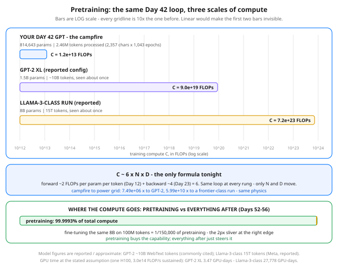

# Day 51 — Pretraining: What It Actually Is

**Tonight you'll be able to:** read any model announcement off three numbers — N, D, and C ≈ 6ND — explain why your Day 42 GPT memorized while frontier models generalize, and why every Phase D lesson after tonight lives in a rounding error.

## The one idea

**Pretraining** is the first, giant phase of making a language model: start from random weights, run next-token prediction (Day 14's task, Day 42's loop) on raw text, and let the optimizer grind the loss down. The model that comes out is a **base model** — a pure text predictor, nothing more. Phase D starts here because everything after tonight (Days 52–56) is small print on top of this one run.

**There is no new algorithm.** A frontier pretraining run is your Day 42 script with three dials turned: **N**, the parameter count; **D**, the training tokens processed; and **C**, the compute, measured in FLOPs (floating-point operations — the multiply-adds, Day 12). The dials are welded together by the one formula in the diagram: **C ≈ 6ND**. The 6 is not magic: a token's forward pass costs ~2 FLOPs per parameter it touches, and the backward pass costs about twice the forward (Day 23's blame flows through every weight twice). 2 + 4 = 6, per parameter, per token. It ignores attention's own smaller term, and it is still the formula the industry budgets clusters with.

**Scale changes the data relationship, not just the bill.** Your Day 42 corpus was 2,357 characters, and training recycled it ~1,043 times — memorization was mathematically guaranteed, which is why the greedy sample recited lines. A frontier run inverts that: ~15 trillion tokens against 8B parameters is 1,875 tokens per parameter, seen roughly once. The model *cannot* memorize its corpus; the only way to keep the loss falling is to compress — to learn the grammar, facts, code patterns, and reasoning shapes that generated the text. Generalization isn't a virtue the lab chose; at that ratio it's the only option left.

**The data is a curated mixture, not a scrape.** One honest paragraph: a real corpus blends filtered web crawl, books, code, encyclopedias, and papers, then survives deduplication, quality filtering, and decontamination (scrubbing test-set answers out). The mixture ratios — how much code, how much math, how much of which languages — are product decisions that shape the final model's skills, and most of the actual engineering hours in a pretraining program go into that pipeline, not the model code. It's an ETL system with SLOs, run by people with your skill set.

**And then the strange part: capabilities nobody trained for show up.** Nobody writes a loss term for translation, arithmetic, or summarizing — yet as next-token loss falls far enough, a base model starts doing all three, plus answering questions in context from a few examples. Labs call these *emergent* capabilities. The honest caveat: researchers argue about whether the jumps are truly sudden or partly an artifact of how we score them. What nobody argues with is the direction — predicting text well enough, at enough scale, forces a model to internalize a working model of the world that produced the text. That is what the 99.9993% buys.

## Analogy

Your Day 42 run is a **campfire**; a pretraining run is a **power grid**. Same physics — combustion then, combustion now; cross-entropy then, cross-entropy now — and nobody would call a grid "just a bigger campfire" with a straight face, because at grid scale entirely new phenomena become the job: transmission losses, load balancing, cascading failures, a control room watching telemetry (Day 31's loss curves, staffed by hundreds). The loop didn't change. The scale changed what the loop *is*. Systems version, since it's your native tongue: it's the same binary — Conveyor on one laptop is a demo, Conveyor at exabyte scale is a different discipline, and the discipline lives in the scale, not the code.

## See it



Three runs of the identical training loop on a log scale. Left: your Day 42 GPT — 814,643 params, a 2,357-char corpus recycled ~1,043 times, 1.20e+13 FLOPs. Middle: GPT-2 XL (reported config). Right: a Llama-3-class run (reported) — 5.99e+10 times your compute. Bottom: the split that frames Phase D — pretraining is 99.9993% of the total compute; fine-tuning is the 2-pixel sliver.

## Code it (~30 min)

Pure arithmetic tonight — stdlib Python, no torch, runs anywhere in seconds, every digit exact. **Part 1** prices your Day 42 run with C ≈ 6ND (tokens processed = 1,200 steps × batch 32 × 64 chars). **Part 2** prices two published configs with the same formula — GPT-2 XL and a Llama-3-class run; their N and D are *reported / approximate* figures, as labeled, while the arithmetic on them is exact. **Part 3** turns FLOPs into GPU-days at one stated assumption (an H100 sustaining 3.0e14 FLOP/s, ~30% of peak). **Part 4** computes the pretrain-vs-fine-tune split that the rest of Phase D lives inside.

```python
"""Day 51 - Pretraining: What It Actually Is.

Phase D opener. There is no new training loop tonight.
Pretraining is the Day 42 loop - read text, predict the next
token, cross-entropy, backward, step - run at civilizational
scale. What changes is not the algorithm; it is three dials:

    N  parameters        (Day 42: 814,643 - GPT-2: billions)
    D  training tokens   (Day 42: 2.4K chars, seen ~1,043x -
                          frontier runs: trillions, seen ~once)
    C  compute, in FLOPs (floating-point operations)

and the three are welded together by one rule of thumb:

    C ~ 6 * N * D

Why 6? One token's forward pass costs about 2 FLOPs per
parameter (a multiply + an add for every weight it touches,
Day 12), and the backward pass costs about twice the
forward (Day 23's blame has to flow through every weight
again, both ways). 2 + 4 = 6 FLOPs per parameter per token.
It is an approximation - it ignores attention's own term -
and it is the formula the whole industry budgets with.

  Part 1  Your Day 42 run, priced. Tokens processed =
          1,200 steps x batch 32 x 64 chars. Same corpus
          recycled ~1,043 times: that is why it memorized.
  Part 2  Two published configs, priced with the same
          formula. GPT-2 XL (1.5B params, ~10B tokens,
          reported figures) and a Llama-3-class run (8B
          params, 15T tokens, reported "over 15 trillion").
          Ratios vs Day 42 are the lesson: scale is not
          a dial you nudge, it is orders of magnitude.
  Part 3  GPU time. At one stated assumption - an H100
          sustaining 3.0e14 FLOP/s in a real training run
          (roughly 30% of its peak; big models never see
          peak) - turn FLOPs into GPU-days.
  Part 4  The split that frames all of Phase D. Fine-tune
          the same 8B model on a large SFT corpus (100M
          tokens) and its compute is a rounding error next
          to pretraining. Days 52-56 live in that sliver:
          pretraining is where the capability - and the
          bill - is; everything after is steering.

Published model figures are reported / approximate, as
labeled - GPT-2's token count is the commonly cited ~10B
for WebText, Llama 3's 15T is Meta's reported "over 15
trillion tokens". The arithmetic on them is exact.

Runs anywhere: pure stdlib Python, no torch needed, no
downloads, no APIs. Deterministic - every number below
is reproducible to the digit.

Expected output:

  Part 1 - your Day 42 run, priced with C ~ 6ND
    N = 814,643 params, corpus = 2,357 chars
    D = 1,200 steps x 32 batch x 64 chars = 2,457,600 tokens processed
    corpus recycled: 1042.7 epochs (why it memorized, Day 42)
    C = 6 x 814,643 x 2,457,600 = 1.20e+13 FLOPs
  Part 2 - published configs, same formula (reported / approximate)
    GPT-2 XL:        N = 1.50e+09, D = 1.00e+10  ->  C = 9.00e+19 FLOPs  (7.49e+06 x Day 42)
      tokens per param: 6.7
    Llama-3-class:   N = 8.00e+09, D = 1.50e+13  ->  C = 7.20e+23 FLOPs  (5.99e+10 x Day 42)
      tokens per param: 1,875.0
  Part 3 - GPU time at 3.0e14 FLOP/s per H100 (stated assumption)
    Day 42 run:      0.0400 GPU-seconds (your MacBook took minutes - a 815K model cannot fill even one GPU; the rate assumes a big model can)
    GPT-2 XL:        3.47 GPU-days
    Llama-3-class:   27,778 GPU-days = 76.1 GPU-years on ONE H100
      ...or about 13.6 days on 2,048 H100s (illustrative arithmetic, not Meta's actual schedule)
  Part 4 - pretrain vs fine-tune: where Phase D's compute lives
    pretrain 8B on 15T tokens:      C = 7.20e+23 FLOPs
    fine-tune 8B on 100M tokens:    C = 4.80e+18 FLOPs
    fine-tune is 1/150,000 of pretraining - pretraining share of total: 99.9993%
    verdict: pretraining buys the capability; Days 52-56 just steer it
"""


def flops(n_params, n_tokens):
    """The industry rule of thumb: C ~ 6 * N * D."""
    return 6 * n_params * n_tokens


# ---------- Part 1: your Day 42 run, priced ----------
print("Part 1 - your Day 42 run, priced with C ~ 6ND")
N42 = 814_643                      # Day 42's exact parameter count
CORPUS = 2_357                     # chars of Shakespeare (Day 42)
D42 = 1_200 * 32 * 64              # steps x batch x context
C42 = flops(N42, D42)
print(f"  N = {N42:,} params, corpus = {CORPUS:,} chars")
print(f"  D = 1,200 steps x 32 batch x 64 chars = {D42:,} tokens "
      "processed")
print(f"  corpus recycled: {D42 / CORPUS:.1f} epochs "
      "(why it memorized, Day 42)")
print(f"  C = 6 x {N42:,} x {D42:,} = {C42:.2e} FLOPs")

# ---------- Part 2: published configs, same formula ----------
print("Part 2 - published configs, same formula "
      "(reported / approximate)")
CONFIGS = (
    ("GPT-2 XL:", 1.5e9, 1.0e10),        # WebText, ~10B tokens
    ("Llama-3-class:", 8.0e9, 1.5e13),   # reported: 15T+ tokens
)
for name, n, d in CONFIGS:
    c = flops(n, d)
    print(f"  {name:<16} N = {n:.2e}, D = {d:.2e}  ->  "
          f"C = {c:.2e} FLOPs  ({c / C42:.2e} x Day 42)")
    print(f"    tokens per param: {d / n:,.1f}")

# ---------- Part 3: GPU time at a stated assumption ----------
print("Part 3 - GPU time at 3.0e14 FLOP/s per H100 "
      "(stated assumption)")
RATE = 3.0e14                      # ~30% of H100 peak, sustained
DAY = 86_400                       # seconds
print(f"  Day 42 run:      {C42 / RATE:.4f} GPU-seconds "
      "(your MacBook took minutes - a 815K model cannot fill "
      "even one GPU; the rate assumes a big model can)")
for name, n, d in CONFIGS:
    gpu_days = flops(n, d) / RATE / DAY
    extra = (f" = {gpu_days / 365.25:.1f} GPU-years on ONE H100"
             if gpu_days > 1_000 else "")
    days = (f"{gpu_days:,.0f}" if gpu_days >= 100
            else f"{gpu_days:.2f}")
    print(f"  {name:<16} {days} GPU-days{extra}")
llama_days = flops(8.0e9, 1.5e13) / RATE / DAY
print(f"    ...or about {llama_days / 2048:.1f} days on 2,048 H100s "
      "(illustrative arithmetic, not Meta's actual schedule)")

# ---------- Part 4: pretrain vs fine-tune ----------
print("Part 4 - pretrain vs fine-tune: where Phase D's compute "
      "lives")
C_PRE = flops(8.0e9, 1.5e13)
C_FT = flops(8.0e9, 1.0e8)         # a large SFT corpus: 100M tokens
print(f"  pretrain 8B on 15T tokens:      C = {C_PRE:.2e} FLOPs")
print(f"  fine-tune 8B on 100M tokens:    C = {C_FT:.2e} FLOPs")
print(f"  fine-tune is 1/{C_PRE / C_FT:,.0f} of pretraining - "
      f"pretraining share of total: "
      f"{100 * C_PRE / (C_PRE + C_FT):.4f}%")
print("  verdict: pretraining buys the capability; "
      "Days 52-56 just steer it")
```

**Expected output:**

```
Part 1 - your Day 42 run, priced with C ~ 6ND
  N = 814,643 params, corpus = 2,357 chars
  D = 1,200 steps x 32 batch x 64 chars = 2,457,600 tokens processed
  corpus recycled: 1042.7 epochs (why it memorized, Day 42)
  C = 6 x 814,643 x 2,457,600 = 1.20e+13 FLOPs
Part 2 - published configs, same formula (reported / approximate)
  GPT-2 XL:        N = 1.50e+09, D = 1.00e+10  ->  C = 9.00e+19 FLOPs  (7.49e+06 x Day 42)
    tokens per param: 6.7
  Llama-3-class:   N = 8.00e+09, D = 1.50e+13  ->  C = 7.20e+23 FLOPs  (5.99e+10 x Day 42)
    tokens per param: 1,875.0
Part 3 - GPU time at 3.0e14 FLOP/s per H100 (stated assumption)
  Day 42 run:      0.0400 GPU-seconds (your MacBook took minutes - a 815K model cannot fill even one GPU; the rate assumes a big model can)
  GPT-2 XL:        3.47 GPU-days
  Llama-3-class:   27,778 GPU-days = 76.1 GPU-years on ONE H100
    ...or about 13.6 days on 2,048 H100s (illustrative arithmetic, not Meta's actual schedule)
Part 4 - pretrain vs fine-tune: where Phase D's compute lives
  pretrain 8B on 15T tokens:      C = 7.20e+23 FLOPs
  fine-tune 8B on 100M tokens:    C = 4.80e+18 FLOPs
  fine-tune is 1/150,000 of pretraining - pretraining share of total: 99.9993%
  verdict: pretraining buys the capability; Days 52-56 just steer it
```

## Today's win

Done when your run prints `C = 1.20e+13 FLOPs` for Day 42, the two ratios (`7.49e+06 x` and `5.99e+10 x`), `27,778 GPU-days` for the Llama-3-class run, and the split: `99.9993%`. The keeper test, no notes: someone announces a model with N params trained on D tokens — you produce C and a GPU-days estimate on the spot, and you can say where the 6 comes from and why Day 42 memorized while a 15-trillion-token run cannot.

## Short on time? 20-minute version

Read "The one idea" and study the ladder until the three bars feel obvious, then run the code once and narrate it: where the 6 comes from, why 1,043 epochs forced memorization, and why fine-tuning is a sliver. If you can do that narration without looking, you have Day 51 — the mixture and emergence paragraphs are a second pass.

## Tomorrow's teaser

Tomorrow: the base model will happily complete your sentence — but ask it a question and it may just ask three more. There's a second, far cheaper training phase that teaches it to follow instructions instead, and Phase D's remaining days all live in its budget.

*Day 51 of 100 · Streak: 51 day(s) · Never miss twice.*
