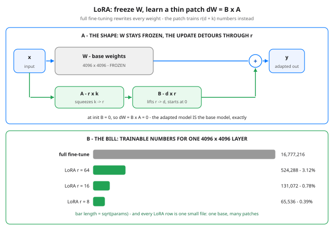

# Day 53 — Fine-Tuning 2: LoRA / QLoRA

**Tonight you'll be able to:** explain why fine-tuning a huge model does not require training all of it — freeze W, train a low-rank patch ΔW = B·A with r(d + k) numbers instead of d × k, prove the patch starts as exactly zero, and merge it back into a single matrix for serving.

## The one idea

Yesterday's SFT recipe (Day 52) has a brutal line item. **Full fine-tuning** puts a gradient and optimizer state on *every* weight: in fp32 with Adam that is the weights, the grads, and Adam's two moment buffers — roughly four copies of the model in memory while training — plus one full model copy on disk *per task*. A 7B model is ~28 GB of fp32 weights; fine-tune it three ways for three tasks and you are storing and shuttling ~84 GB of near-identical numbers.

The observation behind **LoRA** (low-rank adaptation, Hu et al. 2021): the *update* a pretrained layer needs for a new task is **low-rank** — it lives in a much smaller space than the full d × k matrix. Rank, visually: how many independent directions the update actually uses. If ΔW only needs r independent directions, don't learn ΔW directly — **factor it**: ΔW = B·A, where A squeezes the k inputs down to r numbers and B lifts r back up to d outputs. r is a dial you choose; 8, 16, 64 are typical.

So freeze W solid and train only A and B. Trainable count per layer = **r(d + k)**. At 4096 × 4096 with r = 16 that is 131,072 numbers instead of 16,777,216 — 0.78% — and the grads and Adam state shrink by the same factor. The deliverable per task is no longer a model: it is an **adapter file** (0.50 MiB for that layer at r = 16) sitting next to ONE shared frozen base. Ten tasks = one base + ten small files.

The init is the elegant part. A starts random (small random values, so the patch *can* learn); **B starts at exactly zero** — so ΔW = B·A = 0 on step zero, and the adapted model behaves *exactly* as the base model. Training starts from the base model's behavior, not from noise; B is the first thing that moves, and A follows. Real LoRA also scales the patch by alpha/r so that swapping r doesn't silently rescale the update — the code sets alpha = 1.

Serving is one line of algebra: **merge**. W′ = W + B·A is just another d × k matrix — fold the patch in once and inference runs the original architecture at the original cost, zero extra latency. Or don't merge: keep one base hot in memory and swap adapters per task or per request.

**QLoRA** (Dettmers et al. 2023) is the same patch on a base frozen harder: W is stored in **4-bit** precision (a special format called NF4) instead of 16-bit, so the base takes roughly a quarter of the memory; values are dequantized on the fly during the forward pass, and the LoRA adapters on top still train in 16-bit. That is how a 65B model was fine-tuned on a single 48 GB GPU. The honest costs: dequantizing burns some compute on every step, and a coarsely stored base caps how much the adapters can fix. Quantization itself gets the full treatment on Day 65 — today, the patch is the concept.

## Analogy

Full fine-tuning is **rebuilding the whole binary from source for every customer config** — and shipping a separate full binary per customer. LoRA is **patching a frozen binary**: the shipped artifact never changes, and each task is a small patch file against it. A zero patch leaves the binary bit-for-bit identical (that's B = 0 at init). The patch is stored, reviewed, and shipped on its own — megabytes, not gigabytes. And at release time you choose: link the patch in permanently (merge, W′ = W + B·A) or keep applying it at load time (swap adapters). One more systems dividend: a rebuild can break anything in the binary; a patch can only move the r(d + k) numbers it touches.

## See it



Top: the frozen path (x → W → +) with the adapter detour underneath it — A squeezes k inputs down to r, B lifts them back to d, and the two paths add. B starts at zero, so on day one the detour contributes exactly nothing. Bottom: the bill for one 4096 × 4096 layer — full fine-tuning trains all 16,777,216 weights; a LoRA patch trains r(d + k), and each rank is a separate small adapter file against the same frozen base.

## Code it (~30 min)

One file, four parts, every weight hand-set — no RNG, every digit exact and twin-verified. **Part 1** builds `LoRALinear` around a frozen `Linear(3, 2)` and proves the init: B = 0, so adapted outputs match the plain Linear with max diff 0.000000. **Part 2** trains ONLY A and B for 30 SGD steps on a toy target — the loss falls while W stays bit-for-bit identical. **Part 3** merges W′ = W + B·A into a fresh Linear and checks it reproduces the adapted layer exactly. **Part 4** does the accounting for one real 4096 × 4096 layer at r = 8/16/64.

```python
"""Day 53 - Fine-Tuning 2: LoRA / QLoRA.

Yesterday (Day 52) SFT taught the basic recipe - and its price:
full fine-tuning rewrites EVERY weight, so for every task you
pay for a full copy of the model plus the training state to
move it (grads + Adam's two states per weight). Tonight: don't
rebuild the binary. Ship a patch.

    LoRA: freeze W. Learn the update as a product of two thin
    matrices, dW = B x A, where the middle dimension r is tiny
    next to d and k. Trainable params per layer fall from
    d x k to r(d + k). A starts random-ish, B starts at ZERO -
    so at init dW = 0 and the adapted model is the base model,
    exactly. When training is done, merge: W' = W + B x A is
    one ordinary matrix again, and serving pays nothing extra.

  Part 1  Build LoRALinear by hand around a frozen Linear.
          Hand-set W and A, B zero-init: the adapted layer's
          outputs match the plain Linear with max diff 0.
  Part 2  Train ONLY A and B on a toy target (SGD, 30 steps).
          The loss falls, dW = B x A fills in - and W itself
          is bit-for-bit untouched, because the optimizer was
          never handed it.
  Part 3  Merge: W' = W + B x A in a fresh Linear reproduces
          the adapted layer exactly. One matrix, zero extra
          latency, and the adapter file you kept is 5 numbers.
  Part 4  The bill at real scale: one 4096 x 4096 layer.
          Full FT trains 16,777,216 params; LoRA r=16 trains
          131,072 - 0.78% - and the adapter is a 0.50 MiB file.

QLoRA (theory section) is this same patch on a base frozen
harder: W stored in 4 bits instead of 16, dequantized on the
fly, adapters still trained in 16-bit. Quantization gets its
own day (Day 65); tonight the patch is the concept.

Runs on the ~/ai-lab venv: torch only (free), CPU on purpose
(tiny hand-set matrices, so every digit is exact - no RNG
anywhere), no CUDA, no paid APIs, no downloads. Every claimed
number below was verified with a float32/float64 numpy twin
of the exact training math.

Expected output:

  Part 1 - at init, the adapted layer IS the base layer
    base Linear(3, 2): 8 params - and LoRA freezes every one
    LoRA r=1 patch: A (1, 3) + B (2, 1) = 5 trainable params
    plain Linear preds:   3.5000, 2.5000, -3.0000, 3.5000
    adapted preds, init:  3.5000, 2.5000, -3.0000, 3.5000
    max diff at init: 0.000000  (B = 0 -> dW = B x A = 0 -> base model, exactly)
  Part 2 - train ONLY the patch (SGD lr=0.05, 30 steps, MSE to y)
    step  0: loss 4.4375
    step 10: loss 0.7976
    step 20: loss 0.5837
    step 30: loss 0.5399
    W after training == W before: True  (frozen means frozen)
    dW = B x A after training:
      row 0: 0.5477, -0.2824, 0.6127
      row 1: 0.5445, -0.2807, 0.6092
    the full 2x3 update, written by 5 numbers - rank 1 by construction
  Part 3 - merge: fold the patch into W and serve one matrix
    merged weight W' = W + dW:
      row 0: 1.5477, 0.2176, -0.3873
      row 1: 0.5445, 1.7193, 1.6092
    merged layer vs adapted layer: max diff 0.000000
    one matrix again - inference pays zero extra latency
  Part 4 - the bill at real scale: ONE 4096 x 4096 layer
    full fine-tune: 16,777,216 trainable params
      fp32 weights 64 MiB - weights + grads + Adam m/v = 256 MiB per layer
    LoRA r= 8: 65,536 trainable = 0.39% of full - adapter file 0.25 MiB
    LoRA r=16: 131,072 trainable = 0.78% of full - adapter file 0.50 MiB
    LoRA r=64: 524,288 trainable = 3.12% of full - adapter file 2.00 MiB
    verdict: freeze the binary, train the patch, merge before shipping
"""
import torch
import torch.nn as nn

fmt = lambda t: ", ".join(f"{v:.4f}" for v in t.flatten().tolist())


class LoRALinear(nn.Module):
    """A frozen nn.Linear plus a trainable low-rank patch.

    forward(x) = base(x) + scaling * (x @ A.T @ B.T)
               = (W + scaling * B x A) x + b

    W never trains: every base parameter is frozen, and the
    optimizer is only ever handed A and B. A is (r, d_in) -
    it squeezes the input down to r numbers. B is (d_out, r) -
    it lifts them back. B starts at zero, so the patch
    contributes exactly nothing until training moves it.
    scaling = alpha / r keeps the patch's size steady when
    you change r (alpha=1 here, so scaling is 1 / r).
    """

    def __init__(self, base, r, alpha=1.0):
        super().__init__()
        self.base = base
        for p in self.base.parameters():
            p.requires_grad_(False)            # freeze W and b
        d_out, d_in = base.weight.shape
        self.r = r
        self.scaling = alpha / r
        self.A = nn.Parameter(torch.zeros(r, d_in))
        self.B = nn.Parameter(torch.zeros(d_out, r))   # zero-init

    def forward(self, x):
        patch = (x @ self.A.T) @ self.B.T      # squeeze, then lift
        return self.base(x) + self.scaling * patch

    def merged_weight(self):
        """W' = W + scaling * B x A - the patch, folded in."""
        with torch.no_grad():
            return self.base.weight + self.scaling * (self.B @ self.A)


# ---------- Part 1: at init, adapted == base, exactly ----------
print("Part 1 - at init, the adapted layer IS the base layer")
W0 = torch.tensor([[1.0, 0.5, -1.0], [0.0, 2.0, 1.0]])
b0 = torch.tensor([0.5, -0.5])
base = nn.Linear(3, 2)
with torch.no_grad():
    base.weight.copy_(W0)
    base.bias.copy_(b0)
lora = LoRALinear(base, r=1, alpha=1.0)
with torch.no_grad():
    # In real LoRA, A is drawn random; here it is hand-set so
    # every digit is checkable. B stays zero - that is the init.
    lora.A.copy_(torch.tensor([[0.5, -1.0, 0.25]]))
n_frozen = sum(p.numel() for p in lora.parameters()
               if not p.requires_grad)
n_train = sum(p.numel() for p in lora.parameters() if p.requires_grad)
print(f"  base Linear(3, 2): {n_frozen} params - and LoRA freezes "
      "every one")
print(f"  LoRA r=1 patch: A (1, 3) + B (2, 1) = {n_train} trainable "
      "params")
X = torch.tensor([[1.0, 2.0, -1.0], [0.5, 0.0, 4.0]])
y = torch.tensor([[4.0, 1.0], [0.0, 6.0]])
with torch.no_grad():
    plain = nn.functional.linear(X, W0, b0)
    adapted = lora(X)
    diff0 = (plain - adapted).abs().max().item()
print(f"  plain Linear preds:   {fmt(plain)}")
print(f"  adapted preds, init:  {fmt(adapted)}")
print(f"  max diff at init: {diff0:.6f}  (B = 0 -> dW = B x A = 0 "
      "-> base model, exactly)")

# ---------- Part 2: train ONLY the patch ----------
print("Part 2 - train ONLY the patch (SGD lr=0.05, 30 steps, "
      "MSE to y)")
opt = torch.optim.SGD([lora.A, lora.B], lr=0.05)   # W not handed over
for step in range(31):
    loss = ((lora(X) - y) ** 2).mean()
    if step % 10 == 0:
        print(f"  step {step:>2}: loss {loss.item():.4f}")
    if step < 30:
        opt.zero_grad()
        loss.backward()
        opt.step()
with torch.no_grad():
    dW = lora.B @ lora.A                       # scaling is 1.0 (r=1)
    w_same = bool(torch.equal(lora.base.weight, W0))
print(f"  W after training == W before: {w_same}  (frozen means "
      "frozen)")
print("  dW = B x A after training:")
for i in range(dW.shape[0]):
    print(f"    row {i}: {fmt(dW[i])}")
print("  the full 2x3 update, written by 5 numbers - rank 1 by "
      "construction")

# ---------- Part 3: merge for serving ----------
print("Part 3 - merge: fold the patch into W and serve one matrix")
merged = nn.Linear(3, 2)
with torch.no_grad():
    merged.weight.copy_(lora.merged_weight())
    merged.bias.copy_(lora.base.bias)
    mdiff = (merged(X) - lora(X)).abs().max().item()
    Wp = lora.merged_weight()
print("  merged weight W' = W + dW:")
for i in range(Wp.shape[0]):
    print(f"    row {i}: {fmt(Wp[i])}")
print(f"  merged layer vs adapted layer: max diff {mdiff:.6f}")
print("  one matrix again - inference pays zero extra latency")

# ---------- Part 4: the bill at real scale ----------
print("Part 4 - the bill at real scale: ONE 4096 x 4096 layer")
d = k = 4096
full = d * k
print(f"  full fine-tune: {full:,} trainable params")
print(f"    fp32 weights {full * 4 / 2**20:.0f} MiB - weights + "
      f"grads + Adam m/v = {full * 16 / 2**20:.0f} MiB per layer")
for r in (8, 16, 64):
    n = r * (d + k)
    print(f"  LoRA r={r:>2}: {n:,} trainable = {100 * n / full:.2f}% "
          f"of full - adapter file {n * 4 / 2**20:.2f} MiB")
print("  verdict: freeze the binary, train the patch, merge "
      "before shipping")
```

**Expected output:**

```
  Part 1 - at init, the adapted layer IS the base layer
    base Linear(3, 2): 8 params - and LoRA freezes every one
    LoRA r=1 patch: A (1, 3) + B (2, 1) = 5 trainable params
    plain Linear preds:   3.5000, 2.5000, -3.0000, 3.5000
    adapted preds, init:  3.5000, 2.5000, -3.0000, 3.5000
    max diff at init: 0.000000  (B = 0 -> dW = B x A = 0 -> base model, exactly)
  Part 2 - train ONLY the patch (SGD lr=0.05, 30 steps, MSE to y)
    step  0: loss 4.4375
    step 10: loss 0.7976
    step 20: loss 0.5837
    step 30: loss 0.5399
    W after training == W before: True  (frozen means frozen)
    dW = B x A after training:
      row 0: 0.5477, -0.2824, 0.6127
      row 1: 0.5445, -0.2807, 0.6092
    the full 2x3 update, written by 5 numbers - rank 1 by construction
  Part 3 - merge: fold the patch into W and serve one matrix
    merged weight W' = W + dW:
      row 0: 1.5477, 0.2176, -0.3873
      row 1: 0.5445, 1.7193, 1.6092
    merged layer vs adapted layer: max diff 0.000000
    one matrix again - inference pays zero extra latency
  Part 4 - the bill at real scale: ONE 4096 x 4096 layer
    full fine-tune: 16,777,216 trainable params
      fp32 weights 64 MiB - weights + grads + Adam m/v = 256 MiB per layer
    LoRA r= 8: 65,536 trainable = 0.39% of full - adapter file 0.25 MiB
    LoRA r=16: 131,072 trainable = 0.78% of full - adapter file 0.50 MiB
    LoRA r=64: 524,288 trainable = 3.12% of full - adapter file 2.00 MiB
    verdict: freeze the binary, train the patch, merge before shipping
```

## Today's win

Done when your run shows all four: Part 1's max diff `0.000000` with 5 trainable vs 8 frozen params; Part 2's loss arc `4.4375 → 0.5399` with `W after training == W before: True` underneath; Part 3's merged max diff `0.000000`; and Part 4's row `LoRA r=16: 131,072 trainable = 0.78% of full`. The keeper test, no notes allowed: given any layer d × k and a rank r, you can state the trainable count r(d + k), explain why the model is untouched at init, and explain why merging costs nothing at inference.

## Short on time? 20-minute version

Read "The one idea", study the diagram, then run only Part 1 and Part 4. If you can say the two sentences — "B starts at zero, so the patch starts as exactly nothing" and "the patch trains r(d + k) numbers, not d × k" — you have LoRA. Parts 2–3 are the victory lap.

## Tomorrow's teaser

Tomorrow: SFT and LoRA teach a model to imitate good answers — but who decides which answers are good when there is no single right one?

Day 53 of 100 · Streak: 53 day(s) · Never miss twice.
