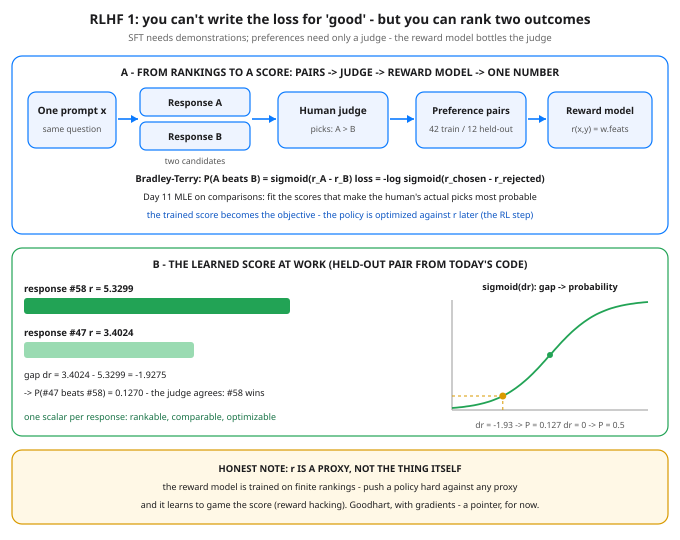

# RLHF 1: Why SFT Isn't Enough — Preferences & Reward Models

**Day 54 of 100** · Phase D — The Modern LLM Stack

Tonight you'll be able to: explain why SFT runs out of road on qualities nobody can demonstrate, turn a stack of A-vs-B rankings into a trainable scalar score with the Bradley–Terry loss, and train a reward model whose learned weights recover the judge's hidden values — plus name the proxy trap baked into the whole scheme.

## The one idea

SFT (Day 52) learns by **demonstration**: here is the prompt, here is the right response, minimize the distance. That works when a right response can be written down — a format, a fact, a procedure. It runs out of road on the qualities that make a model actually good to use: *helpful, honest, harmless, clear*. For an open-ended prompt there is no one correct response to copy — there are thousands of good ones and millions of bad ones, and you cannot write the loss for "good." Cross-entropy against a single reference even punishes a response that is *better* than the reference, just for being different.

But notice what you *can* do, reliably and fast: put two responses side by side and say which one is better. Ranking is a much weaker ask than demonstrating — and it turns out to be enough. **Preference data** is exactly that: for one prompt `x`, two candidate responses, and a human's pick of the winner. Real RLHF pipelines collect millions of these comparisons, because judging is cheap where authoring the perfect answer is not.

The **reward model** is the machine that bottles the judge. It is a function `rθ(x, y)` that takes a prompt and one response and returns a **single scalar score** — how good this response is, as a number. In production it is usually a transformer (often initialized from the SFT model) with the language-model head replaced by a scalar head; tonight it is one `nn.Linear` over three response features, because the idea is the training signal, not the size. It is trained so that its scores *agree with the human's picks*: winner scores higher than loser, most of the time, by margins that reflect how clear the wins were.

The agreement rule is **Bradley–Terry** (1952, built for ranking chess players from match results): the probability that A beats B depends only on the *gap* between their scores, squashed through Day 14's sigmoid — `P(A beats B) = σ(r_A − r_B)`. Train with `loss = −log σ(r_chosen − r_rejected)`, averaged over pairs. You have seen this shape before: it is Day 11's maximum likelihood wearing a new dataset — choose the weights that make the human's *actual choices* most probable. Each pair's gradient does the obvious thing: push the winner's score up and the loser's down, with force proportional to how wrong the model currently is. Two consequences worth keeping: only gaps are real (add the same constant to every score and nothing changes — the same shift-invariance as Day 14's softmax), and a confident wrong ranking costs far more than a timid one (Part 1 of the code prints both).

Why bottle the judge at all? Because a scalar score is an **objective**. Once `rθ` exists, the language model itself (the *policy*) can be optimized to produce responses that score highly — that optimization is the RL step of RLHF, and tonight it is named only. The reward model is the bridge: human taste, which exists only as comparisons, becomes a target a training loop can climb.

**One honest paragraph.** The reward model is a *proxy*: a finite set of rankings, fit by a fallible network, standing in for "good." Proxies hold near the data they were fit on and bend under pressure — optimize a policy against `r` hard enough and it finds the score's blind spots (responses that *look* like what the judge rewarded: longer, more confident, more flattering) rather than becoming better. That failure has a name, **reward hacking** — Goodhart's law with gradients. It is the seed of half the alignment field's headaches; tonight it is a pointer, not a lesson.

> **Analogy — Elo ratings, and your own trading eye.** Chess never defined "good" as a formula; it defined an outcome (who beat whom) and let Bradley–Terry/Elo arithmetic distill thousands of results into one number per player. You already think this way about trades: asked to write the equation for a *good* trade you'd stall, but shown two completed trades you rank them instantly — entry quality, size discipline, exit — and your ranking is consistent enough to learn from. A reward model is that eye, trained: it watches enough of your A-vs-B calls to predict the next one, and the scalar it carries is your judgment in a form a training loop can use. Just remember the Elo caveat too: the rating predicts *match outcomes*, not chess truth — and a player who could play the rating instead of the game, would.

## See it



Top: the pipeline — one prompt, two candidates, a human pick, and the pair joins a training set; the reward model learns scores that make those picks probable under Bradley–Terry. Bottom: the trained score at work on a held-out pair from tonight's code — response #58 outscores #47, the gap Δr = −1.93 lands on the sigmoid at P = 0.127, and the hidden judge agrees. Footer: the proxy warning that shadows everything built on r.

## Code it (~30 min)

One file, three parts, no RNG — every "response" is a 3-feature vector `[correctness, detail, verbosity]` built by an integer formula, and the "human" is a hidden true utility (`2.0·correctness + 1.2·detail − 1.0·verbosity`, plus a listed noise term) that picks the winner of each pair. **Part 1** prints the Bradley–Terry table and one worked pair scored both ways. **Part 2** builds 42 train pairs and 12 held-out pairs on disjoint responses. **Part 3** trains the tiny reward model (`nn.Linear(3, 1)`, zero-init, SGD) with the BT loss and checks the recovered weights against the judge it never saw. Expected output is reference numbers from a verified float32 twin of the exact algorithm — your Mac's last digits may vary by a hair; the loss arc, the weight recovery, and the pair accuracies are the guarantee.

```python
"""Day 54 - RLHF 1: Why SFT Isn't Enough - Preferences & Reward Models.

SFT (Day 52) teaches by demonstration: here is the right answer,
copy it. But some targets cannot be demonstrated, only judged.
Nobody can write the one correct helpful, honest, harmless
response to an open-ended prompt - yet almost anyone can look
at two responses and say which is better. You cannot write the
loss for "good", but you can rank two outcomes.

RLHF's first move is to bottle that judgment:

  1. Sample two responses to the same prompt; a human picks
     the better one. That is a preference pair.
  2. Train a REWARD MODEL r_theta(x, y) - a network that takes
     a prompt + response and returns ONE scalar score - so
     that its scores agree with the human's picks.
  3. The learned score then becomes the objective: later, the
     policy (the LLM itself) is optimized to produce responses
     the reward model scores highly. That optimization step is
     the RL part; tonight we only build the score it will chase.

The training rule is Bradley-Terry (1952, from chess ratings):

    P(A beats B) = sigmoid(r_A - r_B)
    loss = -log sigmoid(r_chosen - r_rejected)

Only the GAP between scores matters, and the loss is exactly
Day 11's maximum likelihood, one comparison at a time: pick
the weights that make the human's actual choices most probable
under the model. Day 14's sigmoid does the gap-to-probability
conversion.

  Part 1  The Bradley-Terry table: score gaps -2..+2 become
          probabilities and losses. One worked pair, scored
          both ways - agreeing with the human is cheap,
          confidently disagreeing is expensive.
  Part 2  Synthetic preference data, built by formula (no
          RNG): 80 "responses", each a 3-feature vector
          (correctness, detail, verbosity). A hidden true
          utility - 2.0*correctness + 1.2*detail - 1.0*verbosity
          plus a listed deterministic noise term - plays the
          human: in each pair, the higher-utility response is
          "chosen". 42 train pairs, 12 held-out pairs on
          disjoint responses.
  Part 3  Train a tiny reward model - one nn.Linear(3, 1),
          zero-init, SGD lr=0.5, 300 full-batch epochs - with
          the Bradley-Terry loss. Watch the loss fall from
          0.6931 (=-log 0.5, no opinions) and the learned
          weights line up with the hidden true utility:
          rankings alone recover what the judge valued.

Honest note (the seed of a later problem): r is a LEARNED
PROXY for "good", not "good" itself. Optimize a policy against
it hard enough and the policy learns to game the score -
reward hacking, Goodhart's law with gradients. Tonight is a
pointer, not that lesson.

Runs on the ~/ai-lab venv: torch only (free), CPU on purpose
(tiny data, and float32 arithmetic you can twin by hand), no
CUDA, no paid APIs, no downloads. All data is built by the
integer formulas below - no RNG anywhere, so the numbers are
reproducible. Expected output below is reference numbers from
a verified float32 twin of this exact algorithm; your Mac's
last digits may vary by a hair, but the loss arc, the weight
recovery, and the pair accuracies are the guarantee.

Expected output:

  Part 1 - Bradley-Terry: a score gap becomes a probability
    dr = -2.0:  P(human picks the higher-utility response) = 0.1192   BT loss = 2.1269
    dr = -1.0:  P(human picks the higher-utility response) = 0.2689   BT loss = 1.3133
    dr = +0.0:  P(human picks the higher-utility response) = 0.5000   BT loss = 0.6931
    dr = +1.0:  P(human picks the higher-utility response) = 0.7311   BT loss = 0.3133
    dr = +2.0:  P(human picks the higher-utility response) = 0.8808   BT loss = 0.1269
    worked pair: r_chosen = 1.6000, r_rejected = 0.4000 -> dr = 1.2000, P = 0.7685, loss = 0.2633
    same pair, human flips the ranking: loss = 1.4633 (confidence in the wrong order is expensive)
  Part 2 - synthetic preference data (formula-built, no RNG)
    80 responses x 3 features [correctness, detail, verbosity]; hidden true utility w = [2.0000, 1.2000, -1.0000] + listed noise
    42 train pairs / 12 held-out pairs (disjoint responses); a coin flip scores 0.5000
    first train pair: chosen #61 [0.4500, 0.8125, 0.2647] (true u = 1.4503) beats rejected #0 [0.2500, 0.1250, 0.3529] (true u = 0.2171)
  Part 3 - train the reward model r = w.x (SGD lr=0.5, 300 epochs, full batch)
    epoch 0: loss 0.6931  (= -log 0.5: zero-init, the model has no opinions yet)
    epoch 75: loss 0.3059
    epoch 150: loss 0.2288
    epoch 225: loss 0.1925
    epoch 300: loss 0.1707
    learned w: [5.7572, 3.4427, -3.0144]   rescaled so w[0] = 2.0000: [2.0000, 1.1960, -1.0472]
    true w:    [2.0000, 1.2000, -1.0000]   cosine(learned, true) = 0.9998 - direction recovered from rankings alone
    pair accuracy: train 0.9524 (40/42)   held-out 0.8333 (10/12)
    gauge: held-out #47 scores r = 3.4024, #58 scores r = 5.3299 -> P(#47 beats #58) = 0.1270 (true utility agrees: #58 wins)
    verdict: nobody ever wrote down 'good' - 42 rankings taught a scalar score that generalizes
"""
import torch
import torch.nn as nn
import torch.nn.functional as F

fmt = lambda t: ", ".join(f"{v:.4f}" for v in t.flatten().tolist())

# ---------- Part 1: Bradley-Terry, the gap-to-probability rule ----------
print("Part 1 - Bradley-Terry: a score gap becomes a probability")
gaps = torch.tensor([-2.0, -1.0, 0.0, 1.0, 2.0])
probs = torch.sigmoid(gaps)                    # Day 14's sigmoid
for dr, p in zip(gaps.tolist(), probs.tolist()):
    print(f"  dr = {dr:+.1f}:  P(human picks the higher-utility "
          f"response) = {p:.4f}   BT loss = {-torch.log(torch.tensor(p)):.4f}")
r_c, r_r = 1.6, 0.4
p_win = torch.sigmoid(torch.tensor(r_c - r_r)).item()
print(f"  worked pair: r_chosen = {r_c:.4f}, r_rejected = {r_r:.4f} "
      f"-> dr = {r_c - r_r:.4f}, P = {p_win:.4f}, "
      f"loss = {-torch.log(torch.tensor(p_win)):.4f}")
print(f"  same pair, human flips the ranking: loss = "
      f"{-torch.log(torch.tensor(1.0 - p_win)):.4f} "
      "(confidence in the wrong order is expensive)")

# ---------- Part 2: formula-built preference data (no RNG) ----------
print("Part 2 - synthetic preference data (formula-built, no RNG)")
i = torch.arange(80)
# Three features in [0, 1], each from its own integer formula -
# exact arithmetic, identical on every machine.
X = torch.stack([
    ((i * 19 + 5) % 21) / 20.0,                # correctness
    ((i * 13 + 2) % 17) / 16.0,                # detail
    ((i * 47 + 12) % 35) / 34.0,               # verbosity
], dim=1).float()
W_TRUE = torch.tensor([2.0, 1.2, -1.0])        # the hidden judge
noise = 0.4 * (((i * 7 + 3) % 11) / 10.0 - 0.5)  # judge noise, listed
u = X @ W_TRUE + noise                         # true utility per response

perm = torch.argsort((i * 53) % 97)            # fixed shuffle, by formula
tr_resp, te_resp = perm[:56], perm[56:]


def make_pairs(resp, offsets):
    """Pair up responses; the higher-utility one is 'chosen'."""
    chosen, rejected = [], []
    for a, b in offsets(resp):
        a, b = int(a), int(b)
        if u[a] >= u[b]:
            chosen.append(a); rejected.append(b)
        else:
            chosen.append(b); rejected.append(a)
    return (torch.tensor(chosen), torch.tensor(rejected))


train_pairs = make_pairs(tr_resp, lambda r: (
    [(r[k], r[k + 28]) for k in range(28)]
    + [(r[k], r[k + 1]) for k in range(0, 27, 2)]))
test_pairs = make_pairs(te_resp, lambda r: (
    [(r[k], r[k + 12]) for k in range(12)]))
print(f"  80 responses x 3 features [correctness, detail, verbosity]; "
      f"hidden true utility w = [{fmt(W_TRUE)}] + listed noise")
print(f"  {len(train_pairs[0])} train pairs / {len(test_pairs[0])} "
      "held-out pairs (disjoint responses); a coin flip scores 0.5000")
c0, r0 = int(train_pairs[0][0]), int(train_pairs[1][0])
print(f"  first train pair: chosen #{c0} [{fmt(X[c0])}] "
      f"(true u = {u[c0]:.4f}) beats rejected #{r0} [{fmt(X[r0])}] "
      f"(true u = {u[r0]:.4f})")

# ---------- Part 3: train the reward model on rankings alone ----------
print("Part 3 - train the reward model r = w.x "
      "(SGD lr=0.5, 300 epochs, full batch)")
rm = nn.Linear(3, 1, bias=False)               # r_theta(x, y) = w . feats
with torch.no_grad():
    rm.weight.zero_()                          # no opinions yet
opt = torch.optim.SGD(rm.parameters(), lr=0.5)
Xc, Xr = X[train_pairs[0]], X[train_pairs[1]]  # chosen / rejected feats


def bt_loss(model, a, b):
    """-log sigmoid(r_chosen - r_rejected), averaged over pairs.
    Day 11's MLE: make the human's actual picks most probable."""
    return -F.logsigmoid(model(a).squeeze(1)
                         - model(b).squeeze(1)).mean()


for epoch in range(301):
    loss = bt_loss(rm, Xc, Xr)
    if epoch in (0, 75, 150, 225, 300):
        note = "  (= -log 0.5: zero-init, the model has no " \
               "opinions yet)" if epoch == 0 else ""
        print(f"  epoch {epoch}: loss {loss.item():.4f}{note}")
    if epoch == 300:
        break
    opt.zero_grad()
    loss.backward()
    opt.step()

w = rm.weight.detach().flatten()
rescaled = w * (2.0 / w[0])
cos = F.cosine_similarity(w, W_TRUE, dim=0).item()
print(f"  learned w: [{fmt(w)}]   rescaled so w[0] = 2.0000: "
      f"[{fmt(rescaled)}]")
print(f"  true w:    [{fmt(W_TRUE)}]   cosine(learned, true) = "
      f"{cos:.4f} - direction recovered from rankings alone")
with torch.no_grad():
    def pair_acc(pairs):
        a, b = X[pairs[0]], X[pairs[1]]
        return (rm(a) > rm(b)).float().mean().item(), len(pairs[0])
    acc_tr, n_tr = pair_acc(train_pairs)
    acc_te, n_te = pair_acc(test_pairs)
print(f"  pair accuracy: train {acc_tr:.4f} "
      f"({int(round(acc_tr * n_tr))}/{n_tr})   held-out {acc_te:.4f} "
      f"({int(round(acc_te * n_te))}/{n_te})")
a_id, b_id = int(te_resp[0]), int(te_resp[1])
with torch.no_grad():
    ra, rb = rm(X[a_id]).item(), rm(X[b_id]).item()
    p_ab = torch.sigmoid(torch.tensor(ra - rb)).item()
print(f"  gauge: held-out #{a_id} scores r = {ra:.4f}, #{b_id} scores "
      f"r = {rb:.4f} -> P(#{a_id} beats #{b_id}) = {p_ab:.4f} "
      f"(true utility agrees: #{b_id} wins)")
print("  verdict: nobody ever wrote down 'good' - 42 rankings taught "
      "a scalar score that generalizes")
```

**Expected output:**

```
Part 1 - Bradley-Terry: a score gap becomes a probability
  dr = -2.0:  P(human picks the higher-utility response) = 0.1192   BT loss = 2.1269
  dr = -1.0:  P(human picks the higher-utility response) = 0.2689   BT loss = 1.3133
  dr = +0.0:  P(human picks the higher-utility response) = 0.5000   BT loss = 0.6931
  dr = +1.0:  P(human picks the higher-utility response) = 0.7311   BT loss = 0.3133
  dr = +2.0:  P(human picks the higher-utility response) = 0.8808   BT loss = 0.1269
  worked pair: r_chosen = 1.6000, r_rejected = 0.4000 -> dr = 1.2000, P = 0.7685, loss = 0.2633
  same pair, human flips the ranking: loss = 1.4633 (confidence in the wrong order is expensive)
Part 2 - synthetic preference data (formula-built, no RNG)
  80 responses x 3 features [correctness, detail, verbosity]; hidden true utility w = [2.0000, 1.2000, -1.0000] + listed noise
  42 train pairs / 12 held-out pairs (disjoint responses); a coin flip scores 0.5000
  first train pair: chosen #61 [0.4500, 0.8125, 0.2647] (true u = 1.4503) beats rejected #0 [0.2500, 0.1250, 0.3529] (true u = 0.2171)
Part 3 - train the reward model r = w.x (SGD lr=0.5, 300 epochs, full batch)
  epoch 0: loss 0.6931  (= -log 0.5: zero-init, the model has no opinions yet)
  epoch 75: loss 0.3059
  epoch 150: loss 0.2288
  epoch 225: loss 0.1925
  epoch 300: loss 0.1707
  learned w: [5.7572, 3.4427, -3.0144]   rescaled so w[0] = 2.0000: [2.0000, 1.1960, -1.0472]
  true w:    [2.0000, 1.2000, -1.0000]   cosine(learned, true) = 0.9998 - direction recovered from rankings alone
  pair accuracy: train 0.9524 (40/42)   held-out 0.8333 (10/12)
  gauge: held-out #47 scores r = 3.4024, #58 scores r = 5.3299 -> P(#47 beats #58) = 0.1270 (true utility agrees: #58 wins)
  verdict: nobody ever wrote down 'good' - 42 rankings taught a scalar score that generalizes
```

> **Today's win.** Done when your run shows the full arc: Part 1's worked pair at loss `0.2633` (and `1.4633` when flipped); Part 3's loss falling `0.6931 → 0.1707`; learned weights rescaling to `[2.0000, 1.1960, −1.0472]` against the true `[2.0000, 1.2000, −1.0000]` with cosine `0.9998`; and held-out pair accuracy `0.8333` (10/12) against the 0.5000 coin flip. Keeper test, no notes: explain why the loss at zero-init is *exactly* 0.6931, why only score *gaps* are real, and why nobody in this pipeline ever wrote down what "good" means.

> **Short on time? 20-minute version.** Read "The one idea" and study the diagram's two panels. Then run the code and look at exactly three things: Part 1's loss column (confidence in the wrong order is what costs), Part 3's rescaled-vs-true weights, and the held-out accuracy. If you can say where the scalar score came from — and that it is a proxy, not the truth — you have the day.

> **Tomorrow's teaser.** Tomorrow: the reward model turns out to be optional — a newer method trains the policy directly on the preference pairs and skips the middleman entirely.

*Day 54 of 100 · Streak: 54 day(s) · Never miss twice.*
