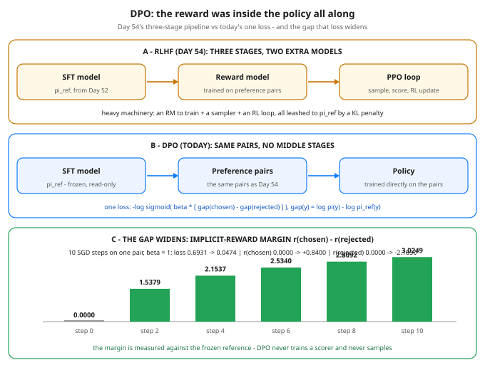

# DPO: Skip the Reward Model, Train on the Pairs — Day 55 of 100

Tonight you'll be able to: state the one identity that deletes Day 54's middle stages — `r(x, y) = β · log( π(y|x) / π_ref(y|x) )` — and train a toy policy directly on a preference pair with a classification-style loss, watching the chosen/rejected gap widen against the frozen reference.

## The one idea

Yesterday's RLHF pipeline (Day 54) was honest but heavy: SFT, then collect preference pairs, then train a **separate reward model** (RM) on those pairs, then run an **RL loop (PPO)** — sample from the policy, score the samples with the RM, update, repeat — with a KL penalty leashing the policy to the frozen reference model π_ref so it can't drift into gibberish that games the scorer. Three stages, two extra models to babysit, and a sampling infrastructure. Today's question: how much of that machinery is actually necessary?

**The insight is one line of algebra.** Solve Day 54's leashed objective exactly and the optimal policy has a closed form: π*(y|x) ∝ π_ref(y|x) · e^(r(x,y)/β) — the best policy is the reference, re-weighted by the reward. Flip that equation around and the reward falls out of the policy:

**r(x, y) = β · log( π(y|x) / π_ref(y|x) )**

Read it plainly: **a completion's reward IS how much more likely the policy makes it than the reference did**, scaled by β. (A per-prompt constant also appears in the algebra; it is the same for both completions in a pair, so it cancels — pairs are all we ever score.) Which means every policy already carries an *implicit* reward inside it. The RM was approximating a quantity the policy can compute about itself, exactly, for free.

**DPO (Direct Preference Optimization) just plugs the identity in.** Day 54's preference model said P(chosen beats rejected) = σ(r_w − r_l). Substitute the implicit rewards and train the policy to make the observed winner win:

`L = −log σ( β · [ (log π(y_w) − log π_ref(y_w)) − (log π(y_l) − log π_ref(y_l)) ] )`

That is a **classification loss** — the same sigmoid + cross-entropy shape as Day 14 — whose one "feature" is the gap difference: how much the policy has widened chosen-over-rejected *relative to where the reference started*. Its gradient does exactly what you'd write by hand: push log π(chosen) up, log π(rejected) down, with a push that fades as the margin grows (the sigmoid saturates). No RM is trained, nothing is sampled, no RL loop runs — the preference pairs become an ordinary offline training set, and yesterday's three stages collapse to one loss on the policy's logits.

**β is the leash.** It is the same β as Day 54's KL penalty, now sitting inside the loss, and it sets the exchange rate between *drift* and *reward*. Large β: a small log-prob shift already counts as a big reward, the sigmoid saturates early, the loss is satisfied after modest drift — a short leash, policy stays near π_ref. Small β: the loss stays hungry until the gap is enormous, so training drags the policy far from the reference before it is satisfied — a long leash. Part 3 puts numbers on it: reaching loss 0.10 takes a reward margin of 2.2522 at β = 1.0, but 22.5217 at β = 0.1.

**Honest limits.** DPO still eats preference data — the expensive human pairs from Day 54 are unchanged; only the modeling machinery shrank. And it can overfit the pairs: the loss is happiest when the gap explodes, not when the chosen answer is genuinely better. Watch today's Part 2 closely — the final margin of 3.0249 is mostly *crushing the rejected completion* (r falls to −2.1850) rather than lifting the chosen one (r rises only to +0.8400). That asymmetry is DPO's known failure flavor, visible in a 4-word toy.

> **Analogy.** RLHF is a **separate scoring service plus a control loop**: deploy the reward model as its own service, then run PPO as a reconciler that generates live traffic (samples), calls the scorer, and nudges the policy — two systems, a network hop, and a loop to babysit. DPO is what happens when you discover the scorer's output is a **pure function of state you already hold** — the log-prob ratio against a frozen snapshot. You inline it as a materialized expression, the service and the control loop both disappear, and the whole thing collapses into one batch training job over a static dataset.
>
> Trading version, one line: RM + PPO is hiring an analyst to score your trades and then optimizing your fills against his scores; DPO is noticing his score was only ever your drift versus the benchmark portfolio, scaled — so you optimize drift-vs-benchmark directly on the ranked trades you already have.

## See it



Top: Day 54's RLHF — SFT, then a reward model trained on the pairs, then a PPO loop sampling and scoring against it. Middle: DPO keeps the SFT model (frozen, as the reference) and the same pairs, and trains the policy directly — the loss compares each completion's log-prob against the reference's, so the scorer is never a separate object. Bottom: what the one loss does to a single pair over 10 steps — the implicit-reward margin starts at exactly 0 (policy = reference) and widens to 3.0249 as the loss falls 0.6931 → 0.0474.

## Code it (~30 min)

One file, one prompt, eight numbers to train. The vocab is four words ("warm, fresh, cold, stale"), the prompt is "The soup was", and both the policy and the frozen reference are explicit per-position probability tables — small enough that every score is computed by hand before any gradient flows. **Part 1** scores the pair by hand: sequence log-probs (Day 47's chain rule on a table), implicit rewards at the start (both exactly 0, because the policy starts *at* the reference), and the starting loss, log 2. **Part 2** runs 10 real SGD steps on the policy's logits with autograd — print the table each step and watch the gap widen and the rewards split. **Part 3** reruns with β = 0.1 to feel the leash change. No RNG: every probability is hand-set, so every digit is exact.

```python
"""Day 55 - RLHF 2: DPO, the Simpler Modern Alternative.

Day 54's RLHF pipeline had three stages after SFT: collect
preference pairs, train a separate reward model (RM) on them,
then run an RL loop (PPO) that samples from the policy, scores
the samples with the RM, and updates - with a KL penalty
leashing the policy to the frozen reference model pi_ref.

DPO (Direct Preference Optimization) deletes two of the three.
The key identity: in that KL-leashed objective, the OPTIMAL
policy already contains the reward -

    r(x, y) = beta * log( pi(y|x) / pi_ref(y|x) )

(read: a completion's reward IS how much more likely the
policy makes it than the reference did, scaled by beta; a
per-prompt constant cancels inside every pair). So instead of
training an RM to approximate r and then RL-ing against it,
plug the implicit reward straight into the preference model
from Day 54 - P(chosen beats rejected) = sigmoid(r_w - r_l) -
and train the POLICY on the pairs with a classification loss:

    L = -log sigmoid( beta * [ (log pi(y_w) - log pi_ref(y_w))
                             - (log pi(y_l) - log pi_ref(y_l)) ] )

No reward model. No sampling. No RL loop. One loss, whose
gradient widens the chosen-vs-rejected log-prob gap, measured
relative to the frozen reference.

  Part 1  Score one pair by hand. A 4-word vocab, one prompt,
          2-token completions, policy and reference as explicit
          probability tables. The policy starts AT the reference,
          so both implicit rewards are exactly 0 and the loss is
          log 2 - a coin flip - even though the raw log-prob gap
          already favors the chosen completion.
  Part 2  Real gradient steps on the policy's 8 logits (SGD,
          lr=0.5, 10 steps, beta=1.0): the loss falls, the gap
          widens, the implicit rewards split + / -, and the
          chosen tokens' probabilities climb while the rejected
          tokens' sink. Autograd computes the gradient; note it
          never touches the frozen reference's numbers.
  Part 3  Beta is the leash. Same pair, same 10 steps, only
          beta changes: beta=1.0 nearly satisfies the loss,
          beta=0.1 barely dents it - because beta is the
          exchange rate between drift and reward. Reaching
          loss 0.10 takes a reward margin of 2.2522 at beta=1.0
          but 22.5217 at beta=0.1: small beta leaves the loss
          hungry, so training would drag the policy far from
          the reference before it is satisfied.

Honest limits: DPO still eats preference pairs (the data cost
is unchanged) and it can overfit them - the loss is happiest
when the gap explodes, not when the chosen answer is good.

Runs on the ~/ai-lab venv: torch only (free), CPU on purpose
(8 parameters), no CUDA, no paid APIs, no downloads. Every
probability is set by hand - no RNG anywhere in this lesson.

Expected output:

  Part 1 - one preference pair, scored by hand (beta = 1.0)
    prompt: "The soup was" - completions are 2 tokens from a 4-word vocab
    ref probs, position 1: warm 0.4000, fresh 0.3000, cold 0.2000, stale 0.1000
    ref probs, position 2: warm 0.2500, fresh 0.4500, cold 0.2000, stale 0.1000
    chosen   "warm fresh":  log p_ref = log(0.40) + log(0.45) = -1.7148
    rejected "cold stale":  log p_ref = log(0.20) + log(0.10) = -3.9120
    policy starts AT the reference (same table), so both implicit rewards are 0:
      r = beta * (log p_policy - log p_ref):  chosen 0.0000, rejected 0.0000
      DPO margin = r_chosen - r_rejected = 0.0000
      DPO loss = -log sigmoid(0) = 0.6931  (= log 2 - a coin flip)
  Part 2 - train the policy on the pair (SGD lr=0.5, 10 steps, beta=1.0)
    step  0: loss 0.6931  logp chosen -1.7148  logp rejected -3.9120  gap 2.1972  r_chosen 0.0000  r_rejected 0.0000
    step  1: loss 0.3133  logp chosen -1.3823  logp rejected -4.5796  gap 3.1972  r_chosen 0.3325  r_rejected -0.6675
    step  2: loss 0.1946  logp chosen -1.2272  logp rejected -4.9623  gap 3.7351  r_chosen 0.4876  r_rejected -1.0503
    step  3: loss 0.1405  logp chosen -1.1336  logp rejected -5.2224  gap 4.0888  r_chosen 0.5812  r_rejected -1.3104
    step  4: loss 0.1098  logp chosen -1.0683  logp rejected -5.4193  gap 4.3509  r_chosen 0.6465  r_rejected -1.5072
    step  5: loss 0.0901  logp chosen -1.0190  logp rejected -5.5778  gap 4.5589  r_chosen 0.6958  r_rejected -1.6658
    step  6: loss 0.0764  logp chosen -0.9796  logp rejected -5.7108  gap 4.7312  r_chosen 0.7352  r_rejected -1.7988
    step  7: loss 0.0663  logp chosen -0.9471  logp rejected -5.8253  gap 4.8782  r_chosen 0.7677  r_rejected -1.9133
    step  8: loss 0.0585  logp chosen -0.9196  logp rejected -5.9260  gap 5.0064  r_chosen 0.7952  r_rejected -2.0139
    step  9: loss 0.0524  logp chosen -0.8957  logp rejected -6.0158  gap 5.1201  r_chosen 0.8191  r_rejected -2.1038
    step 10: loss 0.0474  logp chosen -0.8748  logp rejected -6.0970  gap 5.2221  r_chosen 0.8400  r_rejected -2.1850
    token probs after training (before -> after):
      P(warm | pos 1)   0.4000 -> 0.6331   (chosen token, pushed up)
      P(fresh | pos 2)  0.4500 -> 0.6586   (chosen token, pushed up)
      P(cold | pos 1)   0.2000 -> 0.0698   (rejected token, pushed down)
      P(stale | pos 2)  0.1000 -> 0.0323   (rejected token, pushed down)
    no reward model was trained, nothing was sampled - one loss on one pair
  Part 3 - beta is the leash (same pair, same 10 steps, only beta changes)
    beta = 1.0:  final loss 0.0474, reward margin 3.0249, P(warm | pos 1) 0.6331
    beta = 0.1:  final loss 0.6455, reward margin 0.0978, P(warm | pos 1) 0.4785
    margin needed to reach loss 0.10: beta=1.0 needs 2.2522, beta=0.1 needs 22.5217
    verdict: beta is the exchange rate between drift and reward - small beta
    leaves the loss hungry, so training would drag the policy far from ref
"""
import math

import torch
import torch.nn.functional as F

VOCAB = ["warm", "fresh", "cold", "stale"]
# The reference model pi_ref (the frozen SFT model): an explicit
# probability table, one row per completion position, for the
# prompt "The soup was". Rows sum to 1.
REF_PROBS = torch.tensor([[0.40, 0.30, 0.20, 0.10],     # position 1
                          [0.25, 0.45, 0.20, 0.10]])    # position 2
CHOSEN = torch.tensor([0, 1])      # "warm fresh"  (the human pick)
REJECTED = torch.tensor([2, 3])    # "cold stale"  (the human pass)
POS = torch.arange(2)
BETA = 1.0
LR = 0.5
STEPS = 10


def f4(v):
    """Format to 4 decimals, normalizing a signed zero."""
    s = f"{v:.4f}"
    return "0.0000" if s == "-0.0000" else s


def seq_logp_from_probs(probs, tokens):
    """Sequence log-prob = sum of per-token log probs (Day 47's
    chain rule, on a table instead of a model)."""
    return torch.log(probs[POS, tokens]).sum()


def seq_logp_from_logits(logits, tokens):
    return F.log_softmax(logits, dim=-1)[POS, tokens].sum()


LP_REF_W = seq_logp_from_probs(REF_PROBS, CHOSEN)
LP_REF_L = seq_logp_from_probs(REF_PROBS, REJECTED)


def dpo_stats(logits, beta):
    """Implicit rewards, margin and the DPO loss for the pair."""
    lp_w = seq_logp_from_logits(logits, CHOSEN)
    lp_l = seq_logp_from_logits(logits, REJECTED)
    r_w = beta * (lp_w - LP_REF_W)          # the identity, applied
    r_l = beta * (lp_l - LP_REF_L)
    margin = r_w - r_l
    loss = -F.logsigmoid(margin)            # classification loss
    return lp_w, lp_l, r_w, r_l, margin, loss


def run_dpo(beta, verbose=False):
    """Train ONLY the policy logits on the pair. The reference
    table is a constant - it is read, never updated."""
    logits = torch.log(REF_PROBS).clone().requires_grad_(True)
    opt = torch.optim.SGD([logits], lr=LR)
    last = None
    for step in range(STEPS + 1):
        lp_w, lp_l, r_w, r_l, margin, loss = dpo_stats(logits, beta)
        last = (loss.item(), margin.item())
        if verbose:
            print(f"  step {step:>2}: loss {f4(loss.item())}  "
                  f"logp chosen {f4(lp_w.item())}  "
                  f"logp rejected {f4(lp_l.item())}  "
                  f"gap {f4((lp_w - lp_l).item())}  "
                  f"r_chosen {f4(r_w.item())}  "
                  f"r_rejected {f4(r_l.item())}")
        if step == STEPS:
            break
        opt.zero_grad()
        loss.backward()
        opt.step()
    with torch.no_grad():
        probs = F.softmax(logits, dim=-1)
    return last, probs


# ---------- Part 1: score one pair by hand ----------
print("Part 1 - one preference pair, scored by hand (beta = 1.0)")
print('  prompt: "The soup was" - completions are 2 tokens from '
      "a 4-word vocab")
for t in range(2):
    table = ", ".join(f"{w} {f4(p)}"
                      for w, p in zip(VOCAB, REF_PROBS[t].tolist()))
    print(f"  ref probs, position {t + 1}: {table}")
print(f"  chosen   \"warm fresh\":  log p_ref = log(0.40) + "
      f"log(0.45) = {f4(LP_REF_W.item())}")
print(f"  rejected \"cold stale\":  log p_ref = log(0.20) + "
      f"log(0.10) = {f4(LP_REF_L.item())}")
# Policy starts AT the reference: same table, so log p_policy
# equals log p_ref for both completions and the rewards are 0.
r_w0 = BETA * (LP_REF_W - LP_REF_W)
r_l0 = BETA * (LP_REF_L - LP_REF_L)
margin0 = r_w0 - r_l0
loss0 = -F.logsigmoid(margin0)
print("  policy starts AT the reference (same table), so both "
      "implicit rewards are 0:")
print(f"    r = beta * (log p_policy - log p_ref):  "
      f"chosen {f4(r_w0.item())}, rejected {f4(r_l0.item())}")
print(f"    DPO margin = r_chosen - r_rejected = {f4(margin0.item())}")
print(f"    DPO loss = -log sigmoid(0) = {f4(loss0.item())}  "
      "(= log 2 - a coin flip)")

# ---------- Part 2: train the policy directly on the pair ----------
print("Part 2 - train the policy on the pair "
      "(SGD lr=0.5, 10 steps, beta=1.0)")
(_, _), probs = run_dpo(BETA, verbose=True)
print("  token probs after training (before -> after):")
for pos, tok, tag in ((0, 0, "chosen token, pushed up"),
                      (1, 1, "chosen token, pushed up"),
                      (0, 2, "rejected token, pushed down"),
                      (1, 3, "rejected token, pushed down")):
    print(f"    P({VOCAB[tok]} | pos {pos + 1})   "
          f"{f4(REF_PROBS[pos, tok].item())} -> "
          f"{f4(probs[pos, tok].item())}   ({tag})")
print("  no reward model was trained, nothing was sampled - "
      "one loss on one pair")

# ---------- Part 3: beta is the leash ----------
print("Part 3 - beta is the leash (same pair, same 10 steps, "
      "only beta changes)")
(loss_b1, margin_b1), probs_b1 = run_dpo(1.0)
(loss_b01, margin_b01), probs_b01 = run_dpo(0.1)
print(f"  beta = 1.0:  final loss {f4(loss_b1)}, "
      f"reward margin {f4(margin_b1)}, "
      f"P(warm | pos 1) {f4(probs_b1[0, 0].item())}")
print(f"  beta = 0.1:  final loss {f4(loss_b01)}, "
      f"reward margin {f4(margin_b01)}, "
      f"P(warm | pos 1) {f4(probs_b01[0, 0].item())}")
# Solve -log sigmoid(u) = 0.10 for u, then margin = u / beta.
u_need = math.log(math.exp(-0.1) / (1 - math.exp(-0.1)))
print(f"  margin needed to reach loss 0.10: beta=1.0 needs "
      f"{f4(u_need / 1.0)}, beta=0.1 needs {f4(u_need / 0.1)}")
print("  verdict: beta is the exchange rate between drift and "
      "reward - small beta")
print("  leaves the loss hungry, so training would drag the "
      "policy far from ref")
```

**Expected output:**

```
Part 1 - one preference pair, scored by hand (beta = 1.0)
  prompt: "The soup was" - completions are 2 tokens from a 4-word vocab
  ref probs, position 1: warm 0.4000, fresh 0.3000, cold 0.2000, stale 0.1000
  ref probs, position 2: warm 0.2500, fresh 0.4500, cold 0.2000, stale 0.1000
  chosen   "warm fresh":  log p_ref = log(0.40) + log(0.45) = -1.7148
  rejected "cold stale":  log p_ref = log(0.20) + log(0.10) = -3.9120
  policy starts AT the reference (same table), so both implicit rewards are 0:
    r = beta * (log p_policy - log p_ref):  chosen 0.0000, rejected 0.0000
    DPO margin = r_chosen - r_rejected = 0.0000
    DPO loss = -log sigmoid(0) = 0.6931  (= log 2 - a coin flip)
Part 2 - train the policy on the pair (SGD lr=0.5, 10 steps, beta=1.0)
  step  0: loss 0.6931  logp chosen -1.7148  logp rejected -3.9120  gap 2.1972  r_chosen 0.0000  r_rejected 0.0000
  step  1: loss 0.3133  logp chosen -1.3823  logp rejected -4.5796  gap 3.1972  r_chosen 0.3325  r_rejected -0.6675
  step  2: loss 0.1946  logp chosen -1.2272  logp rejected -4.9623  gap 3.7351  r_chosen 0.4876  r_rejected -1.0503
  step  3: loss 0.1405  logp chosen -1.1336  logp rejected -5.2224  gap 4.0888  r_chosen 0.5812  r_rejected -1.3104
  step  4: loss 0.1098  logp chosen -1.0683  logp rejected -5.4193  gap 4.3509  r_chosen 0.6465  r_rejected -1.5072
  step  5: loss 0.0901  logp chosen -1.0190  logp rejected -5.5778  gap 4.5589  r_chosen 0.6958  r_rejected -1.6658
  step  6: loss 0.0764  logp chosen -0.9796  logp rejected -5.7108  gap 4.7312  r_chosen 0.7352  r_rejected -1.7988
  step  7: loss 0.0663  logp chosen -0.9471  logp rejected -5.8253  gap 4.8782  r_chosen 0.7677  r_rejected -1.9133
  step  8: loss 0.0585  logp chosen -0.9196  logp rejected -5.9260  gap 5.0064  r_chosen 0.7952  r_rejected -2.0139
  step  9: loss 0.0524  logp chosen -0.8957  logp rejected -6.0158  gap 5.1201  r_chosen 0.8191  r_rejected -2.1038
  step 10: loss 0.0474  logp chosen -0.8748  logp rejected -6.0970  gap 5.2221  r_chosen 0.8400  r_rejected -2.1850
  token probs after training (before -> after):
    P(warm | pos 1)   0.4000 -> 0.6331   (chosen token, pushed up)
    P(fresh | pos 2)  0.4500 -> 0.6586   (chosen token, pushed up)
    P(cold | pos 1)   0.2000 -> 0.0698   (rejected token, pushed down)
    P(stale | pos 2)  0.1000 -> 0.0323   (rejected token, pushed down)
  no reward model was trained, nothing was sampled - one loss on one pair
Part 3 - beta is the leash (same pair, same 10 steps, only beta changes)
  beta = 1.0:  final loss 0.0474, reward margin 3.0249, P(warm | pos 1) 0.6331
  beta = 0.1:  final loss 0.6455, reward margin 0.0978, P(warm | pos 1) 0.4785
  margin needed to reach loss 0.10: beta=1.0 needs 2.2522, beta=0.1 needs 22.5217
  verdict: beta is the exchange rate between drift and reward - small beta
  leaves the loss hungry, so training would drag the policy far from ref
```

> **Today's win.** Done when your run shows all three proofs: Part 1's loss is exactly `0.6931` at margin `0.0000` — the coin flip you get when policy = reference, even though the raw gap already favors the chosen completion by `2.1972`; Part 2's final row reads loss `0.0474`, gap `5.2221`, r_chosen `+0.8400`, r_rejected `−2.1850`, with P(warm) climbed `0.4000 → 0.6331` and P(stale) sunk `0.1000 → 0.0323`; and Part 3's β contrast: final loss `0.0474` vs `0.6455`, margin-for-loss-0.10 `2.2522` vs `22.5217`. The keeper test, no notes allowed: write the implicit-reward identity from memory and explain, in one sentence each, why the RM is redundant and what β leashes.

> **Short on time? 20-minute version.** Read "The one idea", study panels B and C of the diagram until you can redraw them, then run Parts 1 and 2 only. If you can say out loud why the loss starts at log 2 when the policy equals the reference — and why most of the margin came from crushing the rejected completion — you have DPO. Part 3 is the victory lap.

> **Tomorrow's teaser.** Preference pairs are human — slow, expensive, and noisy. But some answers don't need an opinion at all: they're simply right or wrong, and a program can check. What changes when the judge is a checker instead of a person?

Day 55 of 100 · Streak: 55 day(s) · Never miss twice.
