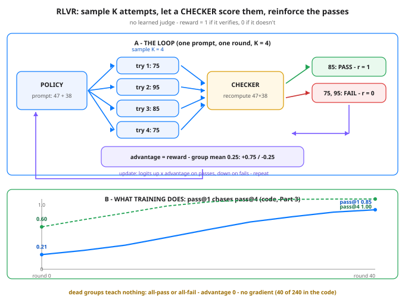

# RLVR: Reinforcement Learning With Verifiable Rewards — Day 56 of 100

Tonight you'll be able to: explain when a reward can be *checked* instead of judged, run the sample → check → group-relative update loop yourself, and read pass@1 chasing pass@4 — the recipe behind the reasoning-model jump.

## The one idea

Phase D so far has run on **judgment**. RLHF (Day 54) trains a reward model to imitate human preferences — a learned judge. DPO (Day 55) skips the judge but still learns from preferred-vs-rejected pairs. Either way the signal is somebody's opinion, and opinions can be flattered: a model that learns to *look* right to the judge scores like a model that *is* right. That failure has a name you know from metrics work — Goodhart: once the proxy becomes the target, it stops measuring the thing.

**RLVR — reinforcement learning with verifiable rewards** — asks a prior question: for this task, can correctness be *checked* by a program? If yes, skip the judge entirely. The answer to a math problem either matches or it doesn't. The code either passes its unit tests or it doesn't. The proof either verifies or it doesn't. The reward is a deterministic checker returning 1 or 0 — no learned model, no taste, nothing to sweet-talk. A wrong answer in a confident tone scores exactly the same as a wrong answer in a humble one: zero.

The loop is four steps, and the code runs all four. **(1) Sample K attempts** per prompt from the current policy — K chances, deliberately, because one greedy attempt hides what the policy can already do. **(2) Check each attempt** — reward 1 or 0, from the checker, recomputed fresh. **(3) Score each attempt against its own group:** advantage = reward − group mean. In a group of four with one pass, the pass gets +0.75 and each fail gets −0.25. **(4) Update:** push up the log-probability of each sampled answer in proportion to its advantage — passes become more likely, fails less, and the arithmetic guarantees the pushes and pulls balance inside the group.

**GRPO, in one paragraph:** that group-relative advantage *is* GRPO (Group Relative Policy Optimization), the algorithm DeepSeek used for its math and reasoning models. Classic policy gradient needs a second network — a critic — to estimate "how good is average here?" and subtract it as a baseline. GRPO deletes the critic: sample a group, and let the group's own mean be the baseline. (Some versions also divide by the group's standard deviation.) Simpler, cheaper, and the recipe behind the recent reasoning jump: models trained this way on math and code, where answers verify, learned to produce long chains of working-out that end in checkable — and increasingly correct — answers.

**Why it works is in the first numbers:** pass@1 vs pass@k. The toy policy's single-sample pass rate starts at 0.2081, but give it 4 samples and it passes 0.6034 of the time — and its greedy top pick is right on *zero* of six prompts. The capability is already in there, just unreliable. RLVR is a machine for converting "sometimes right" into "usually right": every pass the sampler stumbles into gets reinforced, every fail gets taxed, and pass@1 climbs toward pass@4. No new knowledge is injected — the distribution is reshaped around what already verifies.

**Honest limits, three.** First, scope: no checker, no RLVR — essays, bedside manner, and strategy have no unit test, which is why judgment-based methods aren't going away. Second, sparsity: a group where all K attempts fail (or all pass) has advantage exactly zero for everyone — *no contrast, no gradient*. In the code, 40 of 240 groups are dead that way; at real scale it's why prompt difficulty has to be matched to the model, neither hopeless nor trivial. Third, the checker itself becomes the spec: a model can learn to pass the tests as written — hardcode the expected outputs, exploit the harness — so the checker has to actually *be* the requirement, not a sketch of it. Sound familiar? It's the same discipline as writing tests you'd trust in prod.

> **Analogy:** You already live in both worlds. **RLHF is a code review by vibes:** a senior reviewer scores your diff on how it reads — and every engineer learns, consciously or not, to write code that *reviews* well. **RLVR is CI:** the test suite does not care how the code reads, who wrote it, or how confident the commit message sounds. It runs, and it passes or it fails. Your LeetCode drills work the same way — the judge accepts or it doesn't, and there is no partial credit for an elegant almost-solution. And in trading terms: a guru's rating is a judgment; a recomputed, checkable backtest statistic is a verification. RLVR only trains where the second kind exists — and where it exists, it trusts nothing else.

## See it



Panel A: the loop on one prompt — the policy samples K = 4 attempts, the checker recomputes 47 + 38 and gates each attempt to reward 1 or 0, and the group mean turns rewards into advantages (+0.75 for the pass, −0.25 per fail) that scale the update before the next round. Panel B: the code's real training curves — pass@4 starts far above pass@1 (the capability is already there, unreliably), and 40 rounds of group-relative updates pull pass@1 up toward it.

## Code it (~30 min)

One file, three parts, zero RNG — sampling uses fixed listed draws (a hash formula), so every digit below is exact on any machine. The policy is a hand-set softmax over four candidate answers for each of six two-digit additions; the checker stores no labels, it recomputes `a + b`. **Part 1** measures the headroom: pass@1 vs pass@4 vs the greedy pick. **Part 2** works one group by hand — samples, rewards, group mean, advantages. **Part 3** runs 40 rounds of the GRPO-style update (SGD on `−A · log p(sample)`) and prints the pass rates climbing, dead groups counted.

```python
"""Day 56 - RLVR: Reinforcement Learning With Verifiable Rewards.

Days 54-55 taught rewards that come from JUDGMENT: RLHF trains
a reward model on human preferences, DPO learns from preferred
vs rejected pairs. A judge can be flattered, gamed, Goodharted.
Tonight the reward comes from a CHECKER instead:

    reward = 1 if the answer verifies, 0 if it doesn't.

Math answer exact-matches, code passes its unit tests, a proof
verifies - no learned judge in the loop, nothing to sweet-talk.
Sample K attempts per prompt, score each 1/0, and push up the
probability of the ones that pass. The baseline is the group
itself: advantage = reward - group mean (GRPO's trick - the K
samples replace the critic network entirely).

  Part 1  The checker IS the reward. Six two-digit additions,
          four candidate answers each, a hand-set softmax
          policy. The checker stores no labels - it recomputes
          a + b and compares. pass@1 is 0.2081 but pass@4 is
          0.6034: the policy already passes SOMETIMES. That gap
          is the fuel RLVR burns.
  Part 2  One group, worked by hand: prompt 47 + 38, K = 4
          samples 75, 95, 85, 75 -> rewards 0, 0, 1, 0 -> group
          mean 0.25 -> advantages -0.25, -0.25, +0.75, -0.25.
          The passing sample gets pushed up 3x harder than
          each failing one gets pushed down.
  Part 3  Forty rounds of group-relative updates (SGD on the
          policy gradient -A * log p(sample)). pass@1 climbs
          0.2081 -> 0.8464, greedy goes 0/6 -> 6/6. And 40 of
          240 groups are DEAD - all-pass or all-fail, advantage
          exactly zero, no gradient: no contrast, no lesson.

Sampling uses FIXED listed draws (a hash formula, no RNG), so
every number below is exact and reproducible on any machine.

Runs on the ~/ai-lab venv: torch only (free), CPU or MPS,
no CUDA, no paid APIs, no downloads.

Expected output:

  Part 1 - the checker is the reward: no judge, just a + b
    47 + 38 = 85: choices 75, 85, 95, 84   p(correct) 0.2004
    26 + 49 = 75: choices 75, 65, 76, 85   p(correct) 0.2004
    58 + 27 = 85: choices 95, 84, 85, 75   p(correct) 0.1563
    39 + 44 = 83: choices 73, 93, 82, 83   p(correct) 0.2094
    64 + 18 = 82: choices 82, 72, 92, 81   p(correct) 0.2558
    35 + 57 = 92: choices 82, 102, 92, 91   p(correct) 0.2265
    pass@1 (expected over 1 sample):  0.2081
    pass@4 (expected over 4 samples): 0.6034
    greedy argmax correct: 0/6 - sampling finds passes the top pick misses
  Part 2 - one group, worked: prompt 47 + 38, round 0, K = 4 samples
    sampled answers: 75, 95, 85, 75
    checker rewards: 0, 0, 1, 0   group mean 0.25
    advantages (reward - mean): -0.25, -0.25, +0.75, -0.25
    the +0.75 sample gets pushed UP, the -0.25 samples DOWN
  Part 3 - group-relative training: 40 rounds, K = 4 per prompt, lr = 2.0
    round  0: pass@1 0.2081  pass@4 0.6034  greedy 0/6
    round  5: pass@1 0.2674  pass@4 0.7053  greedy 1/6
    round 10: pass@1 0.3424  pass@4 0.7997  greedy 4/6
    round 15: pass@1 0.4523  pass@4 0.8991  greedy 6/6
    round 20: pass@1 0.5656  pass@4 0.9574  greedy 6/6
    round 25: pass@1 0.6732  pass@4 0.9857  greedy 6/6
    round 30: pass@1 0.7463  pass@4 0.9952  greedy 6/6
    round 35: pass@1 0.8131  pass@4 0.9986  greedy 6/6
    round 40: pass@1 0.8464  pass@4 0.9993  greedy 6/6
    dead groups (all-pass or all-fail, zero advantage): 40 of 240
    final: pass@1 0.8464  pass@4 0.9993  greedy 6/6
    verdict: nobody judged style - a checker counted passes, and 'sometimes' became 'usually'
"""
import torch

# Six verifiable prompts: two-digit addition. The checker
# recomputes a + b - there is no label file to leak or game.
PROMPTS = [(47, 38), (26, 49), (58, 27), (39, 44), (64, 18), (35, 57)]
CHOICES = torch.tensor([[75, 85, 95, 84], [75, 65, 76, 85],
                        [95, 84, 85, 75], [73, 93, 82, 83],
                        [82, 72, 92, 81], [82, 102, 92, 91]])
# Hand-set starting policy: the correct answer is never the
# argmax, but it always has real probability mass (~0.16-0.26).
LOGITS0 = torch.tensor([[0.8, 0.2, 0.5, 0.0], [0.3, 0.9, 0.1, 0.6],
                        [0.7, 0.4, 0.1, 0.9], [0.2, 0.8, 0.5, 0.3],
                        [0.4, 0.7, 0.2, 0.1], [0.9, 0.3, 0.5, 0.6]])
CORRECT = [int((CHOICES[i] == PROMPTS[i][0] + PROMPTS[i][1])
               .nonzero()[0]) for i in range(len(PROMPTS))]
K, ROUNDS, LR = 4, 40, 2.0
P = len(PROMPTS)


def checker(p, a):
    """The whole reward model: recompute and compare. 1 or 0."""
    return int(CHOICES[p, a].item() == PROMPTS[p][0] + PROMPTS[p][1])


def draw_u(r, p, k):
    """Fixed listed draws - a hash, not an RNG. Same on every
    machine, every run, so the numbers below are exact."""
    return ((r * 2654435761 + p * 40503 + k * 65599 + 12345)
            % 100000) / 100000.0


def sample_group(probs_p, r, p):
    """Draw K answers from the policy by inverse-CDF on the
    fixed uniforms; score each with the checker."""
    cum = probs_p.cumsum(0)
    idxs = [min(int((cum <= draw_u(r, p, k)).sum().item()), 3)
            for k in range(K)]
    return idxs, [checker(p, a) for a in idxs]


def metrics(logits):
    probs = torch.softmax(logits, dim=1)
    pc = probs[torch.arange(P), torch.tensor(CORRECT)]
    pass1 = pc.mean().item()
    passk = (1 - (1 - pc) ** K).mean().item()
    greedy = int((logits.argmax(dim=1)
                  == torch.tensor(CORRECT)).sum().item())
    return probs, pass1, passk, greedy


# ---------- Part 1: the checker is the reward ----------
print("Part 1 - the checker is the reward: no judge, just a + b")
logits = LOGITS0.clone()
probs, pass1, passk, greedy = metrics(logits)
for p in range(P):
    a, b = PROMPTS[p]
    ch = ", ".join(str(int(v)) for v in CHOICES[p])
    print(f"  {a} + {b} = {a + b}: choices {ch}   "
          f"p(correct) {probs[p, CORRECT[p]].item():.4f}")
print(f"  pass@1 (expected over 1 sample):  {pass1:.4f}")
print(f"  pass@{K} (expected over {K} samples): {passk:.4f}")
print(f"  greedy argmax correct: {greedy}/6 - sampling finds "
      "passes the top pick misses")

# ---------- Part 2: one group, worked ----------
print("Part 2 - one group, worked: prompt 47 + 38, round 0, "
      "K = 4 samples")
idxs, rews = sample_group(probs[0].detach(), 0, 0)
mean = sum(rews) / K
adv = [r - mean for r in rews]
vals = ", ".join(str(int(CHOICES[0, a])) for a in idxs)
print(f"  sampled answers: {vals}")
print(f"  checker rewards: {', '.join(str(r) for r in rews)}   "
      f"group mean {mean:.2f}")
print(f"  advantages (reward - mean): "
      f"{', '.join(f'{v:+.2f}' for v in adv)}")
print("  the +0.75 sample gets pushed UP, the -0.25 samples DOWN")

# ---------- Part 3: group-relative training ----------
print(f"Part 3 - group-relative training: {ROUNDS} rounds, "
      f"K = {K} per prompt, lr = {LR}")
logits = LOGITS0.clone().requires_grad_(True)
opt = torch.optim.SGD([logits], lr=LR)
dead = 0
for r in range(ROUNDS + 1):
    with torch.no_grad():
        probs, pass1, passk, greedy = metrics(logits)
    if r % 5 == 0:
        print(f"  round {r:2d}: pass@1 {pass1:.4f}  "
              f"pass@{K} {passk:.4f}  greedy {greedy}/6")
    if r == ROUNDS:
        break
    logp = torch.log_softmax(logits, dim=1)
    terms = []
    for p in range(P):
        idxs, rews = sample_group(probs[p], r, p)
        if all(v == rews[0] for v in rews):
            dead += 1                      # no contrast, no signal
        mean = sum(rews) / K
        for k in range(K):
            adv = rews[k] - mean           # group-relative advantage
            terms.append(-adv * logp[p, idxs[k]])
    loss = torch.stack(terms).mean()       # -A * log p(sample)
    opt.zero_grad()
    loss.backward()
    opt.step()
print(f"  dead groups (all-pass or all-fail, zero advantage): "
      f"{dead} of {ROUNDS * P}")
print(f"  final: pass@1 {pass1:.4f}  pass@{K} {passk:.4f}  "
      f"greedy {greedy}/6")
print("  verdict: nobody judged style - a checker counted "
      "passes, and 'sometimes' became 'usually'")
```

**Expected output:**

```
Part 1 - the checker is the reward: no judge, just a + b
  47 + 38 = 85: choices 75, 85, 95, 84   p(correct) 0.2004
  26 + 49 = 75: choices 75, 65, 76, 85   p(correct) 0.2004
  58 + 27 = 85: choices 95, 84, 85, 75   p(correct) 0.1563
  39 + 44 = 83: choices 73, 93, 82, 83   p(correct) 0.2094
  64 + 18 = 82: choices 82, 72, 92, 81   p(correct) 0.2558
  35 + 57 = 92: choices 82, 102, 92, 91   p(correct) 0.2265
  pass@1 (expected over 1 sample):  0.2081
  pass@4 (expected over 4 samples): 0.6034
  greedy argmax correct: 0/6 - sampling finds passes the top pick misses
Part 2 - one group, worked: prompt 47 + 38, round 0, K = 4 samples
  sampled answers: 75, 95, 85, 75
  checker rewards: 0, 0, 1, 0   group mean 0.25
  advantages (reward - mean): -0.25, -0.25, +0.75, -0.25
  the +0.75 sample gets pushed UP, the -0.25 samples DOWN
Part 3 - group-relative training: 40 rounds, K = 4 per prompt, lr = 2.0
  round  0: pass@1 0.2081  pass@4 0.6034  greedy 0/6
  round  5: pass@1 0.2674  pass@4 0.7053  greedy 1/6
  round 10: pass@1 0.3424  pass@4 0.7997  greedy 4/6
  round 15: pass@1 0.4523  pass@4 0.8991  greedy 6/6
  round 20: pass@1 0.5656  pass@4 0.9574  greedy 6/6
  round 25: pass@1 0.6732  pass@4 0.9857  greedy 6/6
  round 30: pass@1 0.7463  pass@4 0.9952  greedy 6/6
  round 35: pass@1 0.8131  pass@4 0.9986  greedy 6/6
  round 40: pass@1 0.8464  pass@4 0.9993  greedy 6/6
  dead groups (all-pass or all-fail, zero advantage): 40 of 240
  final: pass@1 0.8464  pass@4 0.9993  greedy 6/6
  verdict: nobody judged style - a checker counted passes, and 'sometimes' became 'usually'
```

> **Today's win:** Done when your run matches the expected output on the numbers that matter: Part 1 pass@1 `0.2081` vs pass@4 `0.6034` with greedy at `0/6`; Part 2's advantages `-0.25, -0.25, +0.75, -0.25`; Part 3 ending at pass@1 `0.8464`, pass@4 `0.9993`, greedy `6/6`, with `40 of 240` dead groups. The keeper test, in plain words: given any task, you can say whether its reward is checkable or judged — and if it's checkable, sketch the four-step loop and name why the group mean replaces the critic.

> **Short on time? 20-minute version:** Read "The one idea" and study Panel A of the diagram until you can trace one attempt through it. Run the code and look at only two lines: Part 1's pass@1 vs pass@4 gap, and Part 3's round-40 line. If you can say out loud why a checker can't be flattered and why an all-fail group teaches nothing, you have RLVR — Part 2's hand-worked group is the victory lap.

> **Tomorrow's teaser:** Tomorrow: if a checker only exists for some tasks, how does anyone grade a model on the rest — what benchmarks actually measure, and where they quietly stop measuring it.

Streak: 56 day(s) · Never miss twice.
