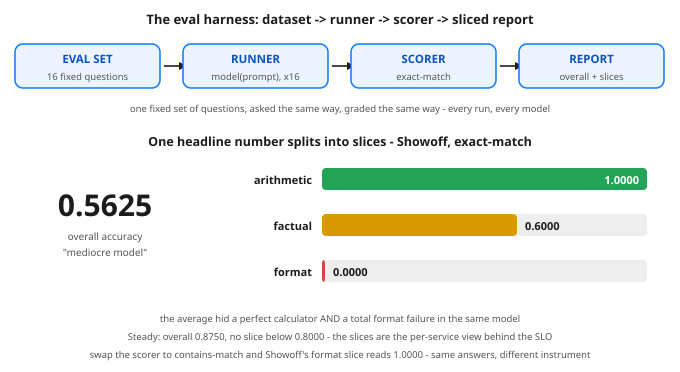

# Evals: How Anyone Knows a Model Is Good — Day 57 of 100

**Tonight you'll be able to:** read any benchmark claim like an engineer — know exactly what the instrument measures, the known ways it lies, and why the sliced report beats the headline number every time.

## The one idea

Every claim you have ever read — "Model X beats Model Y" — rests on an **eval**: a fixed set of questions, a **runner** that poses them to the model, and a **scorer** that grades the answers. The famous ones are called **benchmarks**: MMLU is roughly 16,000 multiple-choice questions across 57 subjects, and a model's score is plain accuracy — the fraction it gets right. That is all a benchmark number ever is. Which means an eval is a *measurement instrument*, and like every instrument you have trusted at 3am, it lies in known ways.

**Lie 1: contamination.** Benchmark questions live on the public web; pretraining (Day 51) scrapes the public web. When test questions end up in the training data, the model is reciting, not reasoning — this is Day 8's sin, training on the test set, committed at industry scale and usually by accident. The score inflates silently, and nobody can tell from the number. The defenses are unglamorous: private or freshly-written test sets, and treating any sudden score jump as a contamination suspect first.

**Lie 2: saturation and Goodhart.** A benchmark is useful only while models spread out along it. Once the leaders bunch at 88–92%, the remaining differences are noise — the test has *saturated*. Worse, Goodhart's law kicks in: when a measure becomes a target, it stops being a good measure. Labs (rationally) optimize for the famous tests, the tests stop measuring general ability, and the field retires them and writes harder ones. The cycle is the history of ML benchmarks in one sentence.

**Lie 3: the eval is not your deployment.** MMLU's distribution is exam questions. Your distribution is your users' prompts, your domain's vocabulary, your required output formats. A model can top every public benchmark and still fail your workload in ways no leaderboard shows — tonight's code has a model that is a perfect calculator and a total failure at the one thing the job required. The only eval that fully counts is built from *your* traffic: real prompts (sanitized), grouped into slices that match how the system can actually fail.

**And the ground truth is vibes.** For open-ended output — is this answer helpful, well-toned, safe? — no exact-match scorer exists. The original instrument is a human reading outputs and judging: a **vibes eval**. It is the ground truth everything else approximates, and it does not scale: slow, expensive, two raters disagree. So the field builds approximations — automatic scorers, model-as-judge setups — each cheaper and each with its own bias. Knowing which layer of approximation a number came from is most of eval literacy. The engineer's rules compress to three: never trust one number (slice it), know what your scorer rewards, and version your eval set like the test fixture it is.

> **Analogy.** You already run this exact system; it's called monitoring. A benchmark is a **synthetic check**: a canary pinging a fixed endpoint on a fixed schedule. It can be green while a whole region's real users are failing — because the canary's distribution is not the users' distribution. Contamination is the canary accidentally testing the cache-warming path instead of the real one. Saturation is the check that has passed 10,000 times in a row: it carries no information anymore. And the sliced report is the per-service, per-region breakdown you pull the moment the one green SLO number smells wrong. Vibes evals? That's the on-call engineer eyeballing staging and saying "looks fine" — genuinely informative, completely unscalable, and the thing every automated check is secretly trying to replace.

## See it



*Top: the harness pipeline — the same four boxes for a 16-question toy or a 16,000-question benchmark. Bottom: Showoff's headline 0.5625 splits into slices, and the average's "mediocre" verdict dissolves into one strength and one total failure.*

## Code it (~30 min)

Pure standard library tonight — no torch, no APIs, no downloads; this runs anywhere Python does, including your `~/ai-lab` venv. You build the whole instrument: a 16-question eval set in 3 slices, two fake "models" as deterministic rule functions (to a harness, a model is just prompt → response — swap in a real model call later and nothing else changes), two scorers, and the sliced report. This `run_eval()` shape is the one you will reuse on Day 96. Watch Part 3: not one answer changes, and a verdict flips anyway.

```python
"""Day 57 - Evals: How Anyone Knows a Model Is Good.

Days 51-56 built the modern stack: pretrain, SFT, LoRA, RLHF,
DPO, RLVR. Every one of those steps ends with the same question:
did the model actually get better? The answer comes from an
EVAL - a fixed set of questions, a runner that asks them, and
a scorer that grades the answers. An eval is a measurement
instrument, and like every instrument you have ever trusted
(or been burned by), it lies in known ways:

  - A benchmark score is accuracy on FIXED questions (MMLU is
    ~16k multiple-choice questions). It measures performance
    on that test, not on your users.
  - Contamination: if the test questions leaked into the
    training data, the model is reciting, not reasoning -
    Day 8's training-on-the-test-set, at industry scale.
  - Saturation / Goodhart: once everyone optimizes for a
    benchmark, scores bunch at the top and the number stops
    meaning anything. When a measure becomes a target...
  - The eval-vs-deployment gap: your distribution is not
    the benchmark's distribution. The only eval that fully
    counts is built from YOUR traffic.
  - Vibes evals (a human reads outputs and judges) are the
    unscalable ground truth every automatic scorer is
    approximating - "looks fine in staging", formalized.

Tonight you build the instrument itself: a mini eval harness,
the exact shape you will reuse on Day 96 - dataset, runner,
scorer, sliced report. Two fake "models" (deterministic rule
functions) take the same 16-question exam. The headline
numbers say one model wins. The SLICES say something more
useful, and swapping the scorer flips a verdict without a
single answer changing.

  Part 1  The eval set: 16 questions in 3 slices
          (arithmetic, factual recall, instruction format).
          A slice is a labeled subset you score separately -
          the per-service breakdown behind the one SLO number.
  Part 2  Exact-match run: overall accuracy + per-slice
          accuracy for both models. Steady wins overall -
          but Showoff is the better calculator, and its
          format slice is 0.00. The average hid both facts.
  Part 3  Same answers, different scorer: contains-match
          re-grades Showoff's format slice 0.00 -> 1.00 and
          ties the overall score. The instrument changed;
          the models didn't. Choose scorers like you choose
          alert thresholds: deliberately.

Pure standard library - no torch needed, no APIs, no
downloads, no RNG. Runs anywhere Python 3.11+ runs,
including the ~/ai-lab venv on your MacBook.

Expected output:

  Part 1 - the eval set: 16 questions, 3 slices
    arithmetic: 6 questions
    factual:    5 questions
    format:     5 questions
  Part 2 - exact-match scoring: the headline and the slices
    Steady   overall 14/16 = 0.8750
      arithmetic  5/6 = 0.8333
      factual     4/5 = 0.8000
      format      5/5 = 1.0000
    Showoff  overall  9/16 = 0.5625
      arithmetic  6/6 = 1.0000
      factual     3/5 = 0.6000
      format      0/5 = 0.0000
    headline says: Steady wins by 0.3125
    slices say: Showoff out-calculates Steady and cannot follow a format instruction at all
  Part 3 - same answers, different scorer (contains-match)
    Showoff format slice: exact 0.0000 -> contains 1.0000
    Showoff overall: exact 0.5625 -> contains 0.8750 (now TIED with Steady)
    one answer, two verdicts:
      prompt:   Reply with only the number: how many sides does a triangle have?
      expected: 3
      answer:   The answer is 3.
      exact-match: FAIL   contains-match: PASS
    verdict: never trust one number - slice it, and know what your scorer actually rewards
"""

# ---------- Part 1: the eval set ----------
# Each item: (slice, prompt, expected). In a real harness this
# lives in a versioned file - the test fixture of ML.
EVAL_SET = [
    # arithmetic - one right answer, machine-checkable
    ("arithmetic", "What is 7 + 5?", "12"),
    ("arithmetic", "What is 9 * 3?", "27"),
    ("arithmetic", "What is 48 / 6?", "8"),
    ("arithmetic", "What is 15 - 8?", "7"),
    ("arithmetic", "What is 6 * 7?", "42"),
    ("arithmetic", "What is 100 - 37?", "63"),
    # factual recall - one right answer, from memory
    ("factual", "What is the capital of France?", "Paris"),
    ("factual", "What is the chemical symbol for water?", "H2O"),
    ("factual", "How many days are in a leap year?", "366"),
    ("factual", "What planet is known as the Red Planet?", "Mars"),
    ("factual", "Who wrote the play Romeo and Juliet?",
     "William Shakespeare"),
    # format - the CONTENT is easy; obeying the instruction is the test
    ("format",
     "Reply with only the number: how many sides does a triangle have?",
     "3"),
    ("format",
     "Reply with only the word: what color do you get mixing blue "
     "and yellow paint?", "green"),
    ("format",
     "Reply with only the number: how many minutes are in 2 hours?",
     "120"),
    ("format",
     "Reply with only the word: what is the opposite of 'hot'?",
     "cold"),
    ("format",
     "Reply with only the number: how many legs does a spider have?",
     "8"),
]

print("Part 1 - the eval set: 16 questions, 3 slices")
_slices = []
for sl, _, _ in EVAL_SET:
    if sl not in _slices:
        _slices.append(sl)
for sl in _slices:
    n = sum(1 for s, _, _ in EVAL_SET if s == sl)
    print(f"  {sl + ':':<12}{n} questions")

# ---------- the two "models": deterministic rule functions ----------
# A model, to a harness, is just prompt -> response. These are
# lookup tables wearing a function signature - swap in a real
# model call later and the harness does not change (Day 96).
STEADY_ANSWERS = {
    "What is 7 + 5?": "12",
    "What is 9 * 3?": "27",
    "What is 48 / 6?": "8",
    "What is 15 - 8?": "7",
    "What is 6 * 7?": "42",
    "What is 100 - 37?": "67",                    # one slip
    "What is the capital of France?": "Paris",
    "What is the chemical symbol for water?": "H2O",
    "How many days are in a leap year?": "366",
    "What planet is known as the Red Planet?": "Mars",
    "Who wrote the play Romeo and Juliet?": "Shakespeare",  # short
    "Reply with only the number: how many sides does a triangle "
    "have?": "3",
    "Reply with only the word: what color do you get mixing blue "
    "and yellow paint?": "green",
    "Reply with only the number: how many minutes are in 2 hours?":
        "120",
    "Reply with only the word: what is the opposite of 'hot'?":
        "cold",
    "Reply with only the number: how many legs does a spider "
    "have?": "8",
}

SHOWOFF_ANSWERS = {
    "What is 7 + 5?": "12",
    "What is 9 * 3?": "27",
    "What is 48 / 6?": "8",
    "What is 15 - 8?": "7",
    "What is 6 * 7?": "42",
    "What is 100 - 37?": "63",                    # flawless math
    "What is the capital of France?": "Paris",
    "What is the chemical symbol for water?": "H2O",
    "How many days are in a leap year?": "365",   # close, wrong
    "What planet is known as the Red Planet?": "Mars",
    "Who wrote the play Romeo and Juliet?": "Shakespeare",
    # right content, wrapped in prose the instruction forbade:
    "Reply with only the number: how many sides does a triangle "
    "have?": "The answer is 3.",
    "Reply with only the word: what color do you get mixing blue "
    "and yellow paint?": "The color is green.",
    "Reply with only the number: how many minutes are in 2 hours?":
        "That would be 120 minutes.",
    "Reply with only the word: what is the opposite of 'hot'?":
        "The opposite is cold.",
    "Reply with only the number: how many legs does a spider "
    "have?": "A spider has 8 legs.",
}


def steady(prompt):
    return STEADY_ANSWERS[prompt]


def showoff(prompt):
    return SHOWOFF_ANSWERS[prompt]


# ---------- the scorers ----------
def exact_match(answer, expected):
    """PASS only if the whole answer IS the expected string
    (case/space-insensitive). Strict - this is how most
    benchmark harnesses grade short answers."""
    return answer.strip().lower() == expected.strip().lower()


def contains_match(answer, expected):
    """PASS if the expected string appears anywhere in the
    answer. Lenient - rewards right content in any wrapping."""
    return expected.strip().lower() in answer.strip().lower()


# ---------- the harness: dataset -> runner -> scorer -> report ----------
def run_eval(model, scorer):
    """Returns (n_correct, n_total, {slice: (n_correct, n_total)}).
    This function IS the deliverable - Day 96 reuses this shape."""
    total_ok, per_slice = 0, {}
    for sl, prompt, expected in EVAL_SET:
        ok = scorer(model(prompt), expected)
        c, n = per_slice.get(sl, (0, 0))
        per_slice[sl] = (c + int(ok), n + 1)
        total_ok += int(ok)
    return total_ok, len(EVAL_SET), per_slice


def report(name, model, scorer):
    ok, n, per_slice = run_eval(model, scorer)
    print(f"  {name:<9}overall {ok:>2}/{n} = {ok / n:.4f}")
    for sl in ("arithmetic", "factual", "format"):
        c, m = per_slice[sl]
        print(f"    {sl:<11} {c}/{m} = {c / m:.4f}")
    return ok / n


# ---------- Part 2: exact-match - headline vs slices ----------
print("Part 2 - exact-match scoring: the headline and the slices")
a_exact = report("Steady", steady, exact_match)
b_exact = report("Showoff", showoff, exact_match)
print(f"  headline says: Steady wins by {a_exact - b_exact:.4f}")
print("  slices say: Showoff out-calculates Steady and cannot "
      "follow a format instruction at all")

# ---------- Part 3: same answers, different scorer ----------
print("Part 3 - same answers, different scorer (contains-match)")
b_ok, _, b_slices = run_eval(showoff, contains_match)
b_fmt_exact = run_eval(showoff, exact_match)[2]["format"]
b_fmt_contains = b_slices["format"]
print(f"  Showoff format slice: exact "
      f"{b_fmt_exact[0] / b_fmt_exact[1]:.4f} -> contains "
      f"{b_fmt_contains[0] / b_fmt_contains[1]:.4f}")
print(f"  Showoff overall: exact {b_exact:.4f} -> contains "
      f"{b_ok / len(EVAL_SET):.4f} (now TIED with Steady)")
_p, _exp = EVAL_SET[11][1], EVAL_SET[11][2]
_ans = showoff(_p)
print("  one answer, two verdicts:")
print(f"    prompt:   {_p}")
print(f"    expected: {_exp}")
print(f"    answer:   {_ans}")
print(f"    exact-match: "
      f"{'PASS' if exact_match(_ans, _exp) else 'FAIL'}   "
      f"contains-match: "
      f"{'PASS' if contains_match(_ans, _exp) else 'FAIL'}")
print("  verdict: never trust one number - slice it, and know "
      "what your scorer actually rewards")
```

**Expected output:**

```
Part 1 - the eval set: 16 questions, 3 slices
  arithmetic: 6 questions
  factual:    5 questions
  format:     5 questions
Part 2 - exact-match scoring: the headline and the slices
  Steady   overall 14/16 = 0.8750
    arithmetic  5/6 = 0.8333
    factual     4/5 = 0.8000
    format      5/5 = 1.0000
  Showoff  overall  9/16 = 0.5625
    arithmetic  6/6 = 1.0000
    factual     3/5 = 0.6000
    format      0/5 = 0.0000
  headline says: Steady wins by 0.3125
  slices say: Showoff out-calculates Steady and cannot follow a format instruction at all
Part 3 - same answers, different scorer (contains-match)
  Showoff format slice: exact 0.0000 -> contains 1.0000
  Showoff overall: exact 0.5625 -> contains 0.8750 (now TIED with Steady)
  one answer, two verdicts:
    prompt:   Reply with only the number: how many sides does a triangle have?
    expected: 3
    answer:   The answer is 3.
    exact-match: FAIL   contains-match: PASS
  verdict: never trust one number - slice it, and know what your scorer actually rewards
```

## Today's win

You built a working eval harness from scratch — dataset, runner, two scorers, sliced report — and used it to catch what a headline number hides: Showoff (overall 0.5625) is a *better* calculator than Steady (arithmetic 1.0000 vs 0.8333) and a total format failure (0.0000), and re-grading with contains-match ties the race at 0.8750 without a single answer changing. You can now interrogate any benchmark claim: what's the set, what's the scorer, where are the slices, and who checked for contamination?

## Short on time? 20-minute version

Run `code.py` and read only Part 2's slice table and Part 3's flip. Then skim the three lies — contamination, saturation/Goodhart, eval-vs-deployment — and say each one back in monitoring language (canary testing the cache path; the check that always passes; green synthetic, red users). That's the day.

## Tomorrow's teaser

Tomorrow: your best model still can't answer questions about *your own documents* — it has simply never seen them. We start fixing that.

---

*Day 57 of 100 · Streak: 57 day(s) · Never miss twice.*
