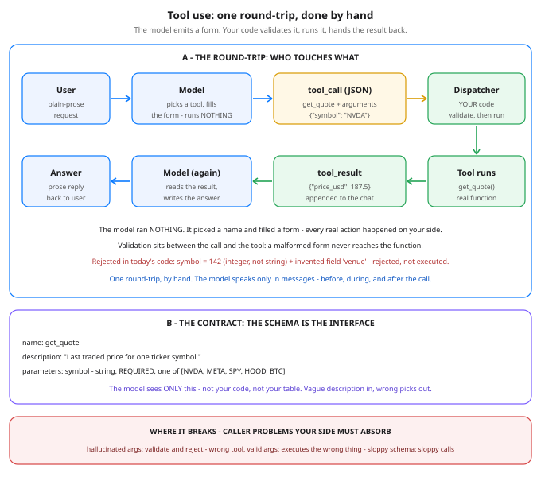

# Agents 1: Tool Use — Schemas In, Tool Calls Out

**Day 60 of 100** · Phase D — The modern LLM stack

Tonight you'll be able to: read a tool schema the way you'd read an API contract, trace one complete round-trip — user → tool_call → your dispatcher → tool_result → answer — and name the three ways the call breaks before it ever reaches your code.

## The one idea

A language model is a text machine sealed in a box. It reads messages and produces messages, and that is all it can do: it cannot check a price, write to a database, or run a single line of your code. Every real action a product takes "with AI" is *your* code acting. Tool use (also called function calling) is the protocol that bridges the gap — and once you see it as a protocol, there is nothing mystical left.

**Step 1 — you offer tools as schemas.** For each capability you are willing to expose, you write a **schema**: a name, a plain-language description, and typed parameters in **JSON Schema** form — each parameter's type, which ones are required, an `enum` when the value must come from a fixed list. That schema is the *only* thing the model ever learns about your tool. It never sees your implementation, your database, or your price table — just the contract.

**Step 2 — the model emits a tool_call, not prose.** When a request needs the outside world, the model answers with a structured object instead of a sentence: a tool name plus an **arguments** object that is *supposed* to match the schema. Hold the key fact in both hands: **the model has run nothing.** It has filled in a form and requested something. It is a caller, not an executor.

**Step 3 — your dispatcher validates, then executes.** Your code receives the call and checks the arguments against the schema — types, required fields, enum membership, no extra fields. Only a call that validates reaches the real function. The result is then appended to the conversation as a **tool_result** message, the model reads it, and only then writes the user-facing answer in prose. One round-trip: schema out, call back, result in, answer out. Tonight you do exactly one round-trip at a time, by hand — no framework, no API key.

**The failure modes, honestly.** (1) *Hallucinated arguments*: wrong types, invented fields, values that don't exist. The model is a confident form-filler, not a type checker — validation on your side of the boundary is not optional. (2) *Wrong tool picked*: every argument validates, the call executes perfectly, and it is still the wrong action — schemas check shape, never intent. (3) *The schema is the real interface design*: the model chooses tools and fills fields based entirely on your names and descriptions, so a vague description or a cryptic parameter name degrades a caller you cannot retrain. Writing a good tool schema is API design for a reader who reads literally and improvises confidently. Vendor wrappers differ (one API nests the call under a `function` key, another calls it a tool-use block) — the protocol underneath is identical.

## Analogy

You have written API contracts for callers on other teams — this is the same job, with one twist: **the caller is an eager junior dev who read your docs once, never saw your code, and fills in request bodies from your descriptions plus vibes.** He will cheerfully invent a field that doesn't exist and pass a number where your spec says string. You already know the correct response, because it's the one you use for any untrusted caller: validate at the boundary against the schema, reject with a precise error, never let an unvalidated request reach the handler. The model is a client you can never fire and never fully trust — so the contract has to do the work. Trading version, one line: the model is the analyst writing the order ticket, your dispatcher is the compliance check, and only validated tickets reach the desk.

## See it



One round-trip, serpentine: the user asks in prose, the model picks a tool and fills in the tool_call form, your dispatcher validates it against the schema and only then runs the real tool, and the tool_result travels back as a message so the model can write the prose answer. Panel B is the contract the model actually sees &mdash; the schema, and nothing else. The red strip is the honest part: all three failure modes are caller problems, and your side absorbs every one.

## Code it (~30 min)

One file, standard library only, no API key, nothing to install — it runs right in your `~/ai-lab` venv. The "model" is a scripted function returning pre-written `tool_call` dicts; in production that dict arrives inside a real model's response, and everything after it — validation, dispatch, result — is the production code you see here, unchanged. Three tools from your world: `get_quote` over a frozen demo price table (not live quotes), `add_watchlist_entry` against an in-memory list, and `convert_currency` at fixed rates. **Part 1** prints the contract exactly as the model sees it. **Part 2** runs three clean round-trips and prints the full transcript — user, tool_call, dispatcher verdict, tool_result, final answer. **Part 3** feeds the dispatcher one malformed call — a numeric "ticker" and an invented `venue` field — and shows the precise rejection the model would get back, with the tool never executed.

```python
"""Day 60 - Agents 1: Tool Use / Function Calling.

A language model is a text machine sealed in a box: it reads
messages and produces messages, and it cannot check a price,
write a database, or run one line of your code. Tool use is
the protocol that bridges the gap:

  1. You offer the model TOOLS as schemas - a name, a plain-
     language description, and typed parameters written as
     JSON Schema (types, required fields, enums). The schema
     is the ONLY thing the model knows about your tool. It
     never sees your implementation.
  2. When a request needs the outside world, the model does
     not answer in prose. It emits a structured TOOL_CALL:
     a tool name plus an arguments object that is supposed
     to match the schema. A form filled in - not code run.
     The model has executed nothing; it has requested
     something.
  3. YOUR dispatcher validates the arguments against the
     schema (types, required, enum, no extra fields). Only
     a call that validates gets executed, by your real code.
  4. The result goes back into the conversation as a
     TOOL_RESULT message. The model reads it and writes
     the final answer in prose. One round-trip, done by
     hand - that is today's whole lesson.

The failure modes are caller problems, and they are honest:
  - Hallucinated arguments: wrong types, invented fields,
    made-up values. The model is a confident form-filler,
    not a type checker - so validation on YOUR side of the
    boundary is not optional.
  - Wrong tool picked: every argument validates, the call
    executes perfectly, and it is still the wrong action.
    Schemas check shape, not intent.
  - The description IS the interface: the model picks tools
    and fills fields from your names and descriptions, so a
    vague description degrades a caller you cannot retrain.
    Schema design is interface design.

No API key, no network: the "model" below is a scripted
function returning pre-written tool_call dicts. In
production that dict arrives inside a real model's response
(vendor wrappers differ - the protocol is identical), and
everything after it - validation, dispatch, result - is
the same production code you see here. Stdlib only, runs
in the ~/ai-lab venv on the MacBook.

Expected output:

  Part 1 - the contract: 3 tools offered to the model as schemas
    the full get_quote schema, exactly as the model sees it:
      {
        "name": "get_quote",
        "description": "Last traded price for one ticker symbol.",
        "parameters": {
          "type": "object",
          "properties": {
            "symbol": {
              "type": "string",
              "enum": [
                "NVDA",
                "META",
                "SPY",
                "HOOD",
                "BTC"
              ]
            }
          },
          "required": [
            "symbol"
          ],
          "additionalProperties": false
        }
      }
    the other two, in shorthand:
    add_watchlist_entry - Add one ticker to the user's watchlist, with an optional free-text note.
      parameters: symbol: string (required); note: string (optional)
    convert_currency - Convert an amount between currencies at fixed demo rates.
      parameters: amount: number (required); from_currency: string (required); to_currency: string (required)
    the model sees ONLY this - never your code, never your data
  Part 2 - three clean round-trips, transcript in full
  --- round-trip 1 ---
    user: What's NVDA trading at?
    model -> tool_call {"id": "call_1", "name": "get_quote", "arguments": {"symbol": "NVDA"}}
    dispatcher: schema check PASSED for get_quote - executing YOUR code
    tool -> tool_result {"symbol": "NVDA", "price_usd": 187.5, "source": "frozen demo table"}
    model (final answer): NVDA last traded at $187.50 (frozen demo price).
  --- round-trip 2 ---
    user: Add HOOD to my watchlist - note: earnings next week.
    model -> tool_call {"id": "call_2", "name": "add_watchlist_entry", "arguments": {"symbol": "HOOD", "note": "earnings next week"}}
    dispatcher: schema check PASSED for add_watchlist_entry - executing YOUR code
    tool -> tool_result {"added": "HOOD", "note": "earnings next week", "watchlist": ["HOOD"], "size": 1}
    model (final answer): Added HOOD to your watchlist with the note 'earnings next week'. It now has 1 entry.
  --- round-trip 3 ---
    user: Convert 250 EUR to USD.
    model -> tool_call {"id": "call_3", "name": "convert_currency", "arguments": {"amount": 250, "from_currency": "EUR", "to_currency": "USD"}}
    dispatcher: schema check PASSED for convert_currency - executing YOUR code
    tool -> tool_result {"amount": 250, "from": "EUR", "to": "USD", "converted": 270.0, "source": "fixed demo rates"}
    model (final answer): 250 EUR = 270.00 USD (fixed demo rates).
  Part 3 - one malformed call: the model improvises
    user: What's the price of ticker 142 on the NASDAQ?
    model -> tool_call {"id": "call_4", "name": "get_quote", "arguments": {"symbol": 142, "venue": "NASDAQ"}}
    dispatcher: schema check FAILED for get_quote - tool NOT executed
    tool -> tool_result (what the model gets back): ERROR: argument 'symbol' must be type string, got integer (142); unexpected argument 'venue' (schema allows: symbol) - tool was NOT executed
    the precise error goes back as a message, so the model can fix its form -
    whether it gets that chance, and what happens next, is tomorrow's lesson
  verdict: the model fills in forms; your code validates, executes, and answers for what ran
"""
import json

# ---------- Part 1: the contract - tools offered as schemas ----------
TICKERS = ["NVDA", "META", "SPY", "HOOD", "BTC"]
CURRENCIES = ["USD", "EUR", "GBP", "JPY"]

TOOLS = [
    {
        "name": "get_quote",
        "description": "Last traded price for one ticker symbol.",
        "parameters": {
            "type": "object",
            "properties": {
                "symbol": {"type": "string", "enum": TICKERS},
            },
            "required": ["symbol"],
            "additionalProperties": False,
        },
    },
    {
        "name": "add_watchlist_entry",
        "description": "Add one ticker to the user's watchlist, "
                       "with an optional free-text note.",
        "parameters": {
            "type": "object",
            "properties": {
                "symbol": {"type": "string", "enum": TICKERS},
                "note": {"type": "string"},
            },
            "required": ["symbol"],
            "additionalProperties": False,
        },
    },
    {
        "name": "convert_currency",
        "description": "Convert an amount between currencies "
                       "at fixed demo rates.",
        "parameters": {
            "type": "object",
            "properties": {
                "amount": {"type": "number"},
                "from_currency": {"type": "string", "enum": CURRENCIES},
                "to_currency": {"type": "string", "enum": CURRENCIES},
            },
            "required": ["amount", "from_currency", "to_currency"],
            "additionalProperties": False,
        },
    },
]
SCHEMAS = {t["name"]: t for t in TOOLS}

# ---------- the real tools: plain functions, your code ----------
PRICE_TABLE = {   # frozen demo prices - NOT live quotes
    "NVDA": 187.50, "META": 585.20, "SPY": 662.10,
    "HOOD": 92.40, "BTC": 97400.00,
}
WATCHLIST = []    # in-memory only; gone when the script exits
RATES_TO_USD = {"USD": 1.0, "EUR": 1.08, "GBP": 1.27, "JPY": 0.0066}


def get_quote(symbol):
    return {"symbol": symbol, "price_usd": PRICE_TABLE[symbol],
            "source": "frozen demo table"}


def add_watchlist_entry(symbol, note=""):
    WATCHLIST.append(symbol)
    return {"added": symbol, "note": note,
            "watchlist": list(WATCHLIST), "size": len(WATCHLIST)}


def convert_currency(amount, from_currency, to_currency):
    usd = amount * RATES_TO_USD[from_currency]
    return {"amount": amount, "from": from_currency, "to": to_currency,
            "converted": round(usd / RATES_TO_USD[to_currency], 2),
            "source": "fixed demo rates"}


IMPLEMENTATIONS = {
    "get_quote": get_quote,
    "add_watchlist_entry": add_watchlist_entry,
    "convert_currency": convert_currency,
}

# ---------- the dispatcher: validate first, execute second ----------
TYPE_CHECKS = {
    "string": lambda v: isinstance(v, str),
    "number": lambda v: isinstance(v, (int, float))
    and not isinstance(v, bool),
    "integer": lambda v: isinstance(v, int)
    and not isinstance(v, bool),
    "boolean": lambda v: isinstance(v, bool),
}


def json_type(value):
    if isinstance(value, bool):
        return "boolean"
    if isinstance(value, int):
        return "integer"
    if isinstance(value, float):
        return "number"
    if isinstance(value, str):
        return "string"
    if isinstance(value, list):
        return "array"
    if isinstance(value, dict):
        return "object"
    return "null"


def validate(name, args):
    """Return a list of problems with this call ([] = valid)."""
    props = SCHEMAS[name]["parameters"]["properties"]
    required = SCHEMAS[name]["parameters"]["required"]
    problems = []
    for field in required:
        if field not in args:
            problems.append(f"missing required argument '{field}'")
    for field, spec in props.items():
        if field not in args:
            continue
        value = args[field]
        if not TYPE_CHECKS[spec["type"]](value):
            problems.append(
                f"argument '{field}' must be type {spec['type']}, "
                f"got {json_type(value)} ({value!r})")
        elif "enum" in spec and value not in spec["enum"]:
            problems.append(
                f"argument '{field}' must be one of {spec['enum']}, "
                f"got {value!r}")
    for extra in sorted(set(args) - set(props)):
        problems.append(
            f"unexpected argument '{extra}' "
            f"(schema allows: {', '.join(props)})")
    return problems


def dispatch(call):
    """The boundary. Nothing reaches a tool unvalidated."""
    name, args = call["name"], call["arguments"]
    if name not in SCHEMAS:
        return {"status": "error",
                "content": f"ERROR: unknown tool '{name}'"}
    problems = validate(name, args)
    if problems:
        return {"status": "rejected",
                "content": "ERROR: " + "; ".join(problems)
                + " - tool was NOT executed"}
    return {"status": "ok", "content": IMPLEMENTATIONS[name](**args)}


# ---------- the "model": scripted tool_call dicts ----------
SCRIPT = {
    "What's NVDA trading at?":
        {"name": "get_quote", "arguments": {"symbol": "NVDA"}},
    "Add HOOD to my watchlist - note: earnings next week.":
        {"name": "add_watchlist_entry",
         "arguments": {"symbol": "HOOD", "note": "earnings next week"}},
    "Convert 250 EUR to USD.":
        {"name": "convert_currency",
         "arguments": {"amount": 250, "from_currency": "EUR",
                       "to_currency": "USD"}},
    # The model improvises: a numeric "ticker" and a field
    # that does not exist in the schema.
    "What's the price of ticker 142 on the NASDAQ?":
        {"name": "get_quote",
         "arguments": {"symbol": 142, "venue": "NASDAQ"}},
}


def fake_model(user_text):
    """Stand-in for a real model: returns a tool_call dict."""
    return SCRIPT[user_text]


def fake_model_reply(name, result):
    """Stand-in for the model's final prose answer."""
    if name == "get_quote":
        return (f"{result['symbol']} last traded at "
                f"${result['price_usd']:,.2f} (frozen demo price).")
    if name == "add_watchlist_entry":
        return (f"Added {result['added']} to your watchlist with "
                f"the note '{result['note']}'. "
                f"It now has {result['size']} entry.")
    return (f"{result['amount']} {result['from']} = "
            f"{result['converted']:,.2f} {result['to']} "
            f"(fixed demo rates).")


def show_schema(tool):
    params = tool["parameters"]["properties"]
    bits = []
    for field, spec in params.items():
        req = field in tool["parameters"]["required"]
        bits.append(f"{field}: {spec['type']}"
                    + (" (required)" if req else " (optional)"))
    print(f"  {tool['name']} - {tool['description']}")
    print(f"    parameters: {'; '.join(bits)}")


# ---------- run the lesson ----------
print("Part 1 - the contract: 3 tools offered to the model as schemas")
print("  the full get_quote schema, exactly as the model sees it:")
print("   ", json.dumps(TOOLS[0], indent=2).replace("\n", "\n    "))
print("  the other two, in shorthand:")
for tool in TOOLS[1:]:
    show_schema(tool)
print("  the model sees ONLY this - never your code, never your data")

print("Part 2 - three clean round-trips, transcript in full")
requests = [
    "What's NVDA trading at?",
    "Add HOOD to my watchlist - note: earnings next week.",
    "Convert 250 EUR to USD.",
]
for i, request in enumerate(requests, start=1):
    call = fake_model(request)
    call = {"id": f"call_{i}", **call}
    print(f"--- round-trip {i} ---")
    print(f"  user: {request}")
    print(f"  model -> tool_call {json.dumps(call)}")
    outcome = dispatch(call)
    print(f"  dispatcher: schema check PASSED for {call['name']} "
          f"- executing YOUR code")
    print(f"  tool -> tool_result {json.dumps(outcome['content'])}")
    print(f"  model (final answer): "
          f"{fake_model_reply(call['name'], outcome['content'])}")

print("Part 3 - one malformed call: the model improvises")
request = "What's the price of ticker 142 on the NASDAQ?"
call = {"id": "call_4", **fake_model(request)}
print(f"  user: {request}")
print(f"  model -> tool_call {json.dumps(call)}")
outcome = dispatch(call)
print(f"  dispatcher: schema check FAILED for {call['name']} "
      f"- tool NOT executed")
print(f"  tool -> tool_result (what the model gets back): "
      f"{outcome['content']}")
print("  the precise error goes back as a message, so the model "
      "can fix its form -")
print("  whether it gets that chance, and what happens next, "
      "is tomorrow's lesson")
print("verdict: the model fills in forms; your code validates, "
      "executes, and answers for what ran")
```

**Expected output:**

```
Part 1 - the contract: 3 tools offered to the model as schemas
  the full get_quote schema, exactly as the model sees it:
    {
      "name": "get_quote",
      "description": "Last traded price for one ticker symbol.",
      "parameters": {
        "type": "object",
        "properties": {
          "symbol": {
            "type": "string",
            "enum": [
              "NVDA",
              "META",
              "SPY",
              "HOOD",
              "BTC"
            ]
          }
        },
        "required": [
          "symbol"
        ],
        "additionalProperties": false
      }
    }
  the other two, in shorthand:
  add_watchlist_entry - Add one ticker to the user's watchlist, with an optional free-text note.
    parameters: symbol: string (required); note: string (optional)
  convert_currency - Convert an amount between currencies at fixed demo rates.
    parameters: amount: number (required); from_currency: string (required); to_currency: string (required)
  the model sees ONLY this - never your code, never your data
Part 2 - three clean round-trips, transcript in full
--- round-trip 1 ---
  user: What's NVDA trading at?
  model -> tool_call {"id": "call_1", "name": "get_quote", "arguments": {"symbol": "NVDA"}}
  dispatcher: schema check PASSED for get_quote - executing YOUR code
  tool -> tool_result {"symbol": "NVDA", "price_usd": 187.5, "source": "frozen demo table"}
  model (final answer): NVDA last traded at $187.50 (frozen demo price).
--- round-trip 2 ---
  user: Add HOOD to my watchlist - note: earnings next week.
  model -> tool_call {"id": "call_2", "name": "add_watchlist_entry", "arguments": {"symbol": "HOOD", "note": "earnings next week"}}
  dispatcher: schema check PASSED for add_watchlist_entry - executing YOUR code
  tool -> tool_result {"added": "HOOD", "note": "earnings next week", "watchlist": ["HOOD"], "size": 1}
  model (final answer): Added HOOD to your watchlist with the note 'earnings next week'. It now has 1 entry.
--- round-trip 3 ---
  user: Convert 250 EUR to USD.
  model -> tool_call {"id": "call_3", "name": "convert_currency", "arguments": {"amount": 250, "from_currency": "EUR", "to_currency": "USD"}}
  dispatcher: schema check PASSED for convert_currency - executing YOUR code
  tool -> tool_result {"amount": 250, "from": "EUR", "to": "USD", "converted": 270.0, "source": "fixed demo rates"}
  model (final answer): 250 EUR = 270.00 USD (fixed demo rates).
Part 3 - one malformed call: the model improvises
  user: What's the price of ticker 142 on the NASDAQ?
  model -> tool_call {"id": "call_4", "name": "get_quote", "arguments": {"symbol": 142, "venue": "NASDAQ"}}
  dispatcher: schema check FAILED for get_quote - tool NOT executed
  tool -> tool_result (what the model gets back): ERROR: argument 'symbol' must be type string, got integer (142); unexpected argument 'venue' (schema allows: symbol) - tool was NOT executed
  the precise error goes back as a message, so the model can fix its form -
  whether it gets that chance, and what happens next, is tomorrow's lesson
verdict: the model fills in forms; your code validates, executes, and answers for what ran
```

## Today's win

Done when your transcript shows three `PASSED` round-trips with the right results — NVDA at $187.50, the watchlist at size 1 with its note, 250 EUR converted to 270.00 USD — and the fourth call **rejected before execution**, the error naming both problems: `symbol` must be type string, got integer (142), and unexpected argument `venue`. The keeper test, no notes allowed: someone asks "who executes the tool?" and you answer instantly — *my code does; the model only ever emits a form.*

## Short on time? 20-minute version

Read "The one idea", study the diagram's serpentine path until you can trace it with a finger, then run the code and read only Part 3's rejection closely. If you can explain why the validation lives on your side of the boundary — and why a call can validate perfectly and still be the wrong action — you have the day.

## Tomorrow's teaser

Tomorrow: one round-trip stops being the whole story — the model acts, reads the result, and decides what to do next, again and again until the job is done.

---

Day 60 of 100 · Streak: 60 day(s) · Never miss twice.
