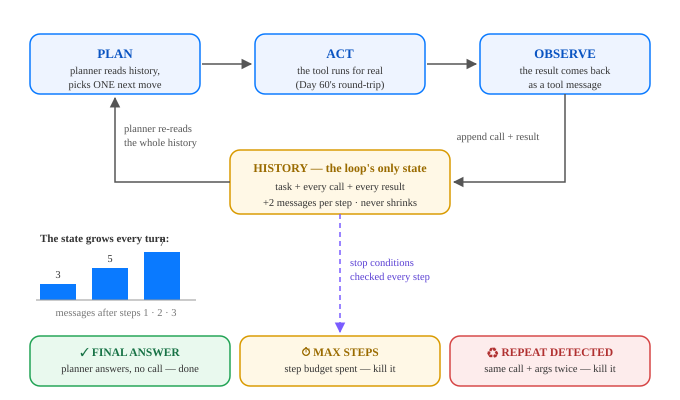

# Agents 2: The Agentic Loop — Plan, Act, Observe

**Day 61 of 100**

Tonight you'll be able to: put Day 60's tool round-trip in a loop — a planner that picks a tool, reads the result, picks the next one — and name the three stop conditions that keep an agent from spinning forever.

## The one idea

Day 60 gave a model *hands*: a tool schema, one validated call, one observation coming back. An **agent** is what you get when you put that round-trip in a loop and let the model decide when it's done:

- **Plan** — the model reads the *entire history* (task + everything so far) and emits either a tool call or a final answer.
- **Act** — your runtime executes the call for real. The model never touches anything directly.
- **Observe** — the result is appended to the history as a tool message, and you go around again.

Two facts do all the work. First: **the model is stateless between steps** — the history *is* the state, re-sent in full every step, growing by 2 messages per tool call (the call + its result). That's why long agent runs get slow and expensive, and why the history is the thing you log when debugging one. Second: **the planner decides, the runtime disposes.** Your code owns execution, state, and stopping. Today's planner is a small rule-based stand-in for an LLM — named honestly: a real model returns exactly the same shape of decision (`{"tool": ..., "args": ...}` or a final answer), just less predictably. Swap the planner, keep the loop — that's the architecture of every agent framework you'll meet.

Because the planner can improvise, it can also spin. So the loop needs **stop conditions**, checked every step: (1) a *final answer* — the normal exit; (2) *max_steps* — a hard step budget, spent either way; (3) *repeated-call detection* — the same tool with the same args as an earlier step can only return the same answer, so the loop is stuck by definition and gets killed. Agents failing in loops isn't an edge case; it's the default failure mode these three exits exist for.

> **Analogy:** Day 7's training loop and Day 34's recap gave you the reconcile loop: observe state, diff against desired, act, repeat — a Kubernetes controller. An agent is that same loop with one twist: **the controller can improvise its next action** instead of following fixed code paths. Wonderful when the task is open-ended; terrifying for the same reason. So you give it what you'd give any controller you don't fully trust: an iteration budget, a repeat/idempotency guard, and a hard kill switch. Trading version: it's the difference between a rules-based execution algo and a discretionary trader with your API keys — you cap the discretionary one's attempts.

## See it



*One trip around the loop = one tool call. The history grows +2 messages per step and is re-read in full at every PLAN — and any step can exit through one of the three stop conditions.*

## Code it (~30 min)

Stdlib only today — no torch, no APIs: plain `python3 code.py` in your `~/ai-lab` venv. The tools are Day 60's, over embedded closes. The task genuinely needs 5 calls across 3 tools: fetch both tickers' closes, compute both moves, then write the winner to the watchlist. Watch the `history` count in the trace — and stick around for Run 2, where the planner is sabotaged.

```python
"""Day 61 - Agents 2: The Agentic Loop (Plan -> Act -> Observe)

Day 60 gave a model hands: tool schemas + one call/observation round-trip.
Today we put that round-trip in a LOOP and it becomes an agent: the planner
picks a tool, sees the result, picks the next one, until the task is done.

The model is NOT the lesson - the control system around it is:
  * state        = the message history, which grows by 2 entries per step
  * stop rules   = final answer | max_steps budget | repeated-call detector

The planner here is a small rule-based stand-in for an LLM (named honestly:
a real model returns the same {"tool": ..., "args": ...} decisions, just
less predictably). Stdlib only, embedded data, fully deterministic.
Run in the ~/ai-lab venv:  python3 code.py
"""

import json

# ---------------------------------------------------------------- the world
CLOSES = {  # this week's daily closes, Mon..Fri (embedded, no API)
    "NVDA": [200.00, 204.00, 202.00, 208.00, 212.40],
    "AMD": [160.00, 158.40, 161.00, 159.50, 156.80],
}


class World:
    """The tools from Day 60, same schemas, now called repeatedly."""

    def __init__(self):
        self.watchlist = ["META"]

    def get_closes(self, ticker):
        return {"ticker": ticker, "closes": CLOSES[ticker]}

    def pct_change(self, ticker, first, last):
        return {"ticker": ticker, "pct": round((last - first) / first * 100, 2)}

    def add_to_watchlist(self, ticker):
        if ticker not in self.watchlist:
            self.watchlist.append(ticker)
        return {"added": ticker, "watchlist": list(self.watchlist)}


# ------------------------------------------------------------- the planners
def results_by(history, tool):
    """All observations so far for one tool, keyed by ticker."""
    out = {}
    for msg in history:
        if msg["role"] == "tool" and msg["name"] == tool:
            out[msg["result"]["ticker"]] = msg["result"]
    return out


def planner(history):
    """Rule-based stand-in for the LLM. Reads ONLY the history - exactly
    like a real model, which sees nothing but the conversation."""
    closes = results_by(history, "get_closes")
    for ticker in ("NVDA", "AMD"):
        if ticker not in closes:
            return {"thought": f"Need {ticker}'s closes before I can compare.",
                    "tool": "get_closes", "args": {"ticker": ticker}}
    changes = results_by(history, "pct_change")
    for ticker in ("NVDA", "AMD"):
        if ticker not in changes:
            c = closes[ticker]["closes"]
            return {"thought": f"Have {ticker} closes; compute the week's move.",
                    "tool": "pct_change",
                    "args": {"ticker": ticker, "first": c[0], "last": c[-1]}}
    added = [m for m in history
             if m["role"] == "tool" and m["name"] == "add_to_watchlist"]
    if not added:
        stronger = max(changes, key=lambda t: changes[t]["pct"])
        return {"thought": f"{stronger} is stronger "
                           f"({changes[stronger]['pct']:+.2f}%). Add it.",
                "tool": "add_to_watchlist", "args": {"ticker": stronger}}
    nvda, amd = changes["NVDA"]["pct"], changes["AMD"]["pct"]
    return {"thought": "Task complete - both compared, stronger one added.",
            "final": f"NVDA {nvda:+.2f}% beat AMD {amd:+.2f}% this week; "
                     f"NVDA added to the watchlist."}


def stubborn_planner(history):
    """A broken planner: whatever it observes, it asks for NVDA closes."""
    return {"thought": "Get NVDA's closes.",
            "tool": "get_closes", "args": {"ticker": "NVDA"}}


# ------------------------------------------------------------ the loop itself
def run_agent(task, plan_fn, world, max_steps=8):
    """THE AGENTIC LOOP. ~25 lines - this is the whole runtime."""
    tools = {"get_closes": world.get_closes,
             "pct_change": world.pct_change,
             "add_to_watchlist": world.add_to_watchlist}
    history = [{"role": "user", "text": task}]   # the state. It only grows.
    seen_calls = set()
    print(f"TASK: {task}")
    for step in range(1, max_steps + 1):
        decision = plan_fn(history)                       # PLAN
        print(f" step {step}: thought : {decision['thought']}")
        if "final" in decision:                           # stop rule 1
            history.append({"role": "assistant", "text": decision["final"]})
            print(f"         FINAL   : {decision['final']}")
            print(f"         stopped : final answer at step {step} "
                  f"| history = {len(history)} messages")
            return history
        call = (decision["tool"],
                json.dumps(decision["args"], sort_keys=True))
        if call in seen_calls:                            # stop rule 2
            print(f"         call    : {call[0]}({call[1]})")
            print(f"         STOPPED : repeated call detected - "
                  f"loop killed at step {step}, task NOT completed")
            return history
        seen_calls.add(call)
        result = tools[decision["tool"]](**decision["args"])   # ACT
        history.append({"role": "assistant", "call": call})    # record both
        history.append({"role": "tool", "name": decision["tool"],
                        "result": result})                     # OBSERVE
        print(f"         call    : {call[0]}({call[1]})")
        print(f"         observe : {json.dumps(result, sort_keys=True)}")
        print(f"         history : {len(history)} messages")
    print(f" STOPPED : max_steps={max_steps} spent, no final answer")  # rule 3
    return history


# -------------------------------------------------------------------- runs
TASK = "Compare NVDA and AMD this week; add the stronger one to my watchlist."

print("=== RUN 1: a working agent (planner + loop + tools) ===")
w1 = World()
run_agent(TASK, planner, w1)
print(f" watchlist after run 1: {w1.watchlist}")

print()
print("=== RUN 2: same loop, broken planner (repeats itself) ===")
w2 = World()
run_agent(TASK, stubborn_planner, w2)
print(f" watchlist after run 2: {w2.watchlist}  (unchanged - killed in time)")
```

**Expected output:**

```
=== RUN 1: a working agent (planner + loop + tools) ===
TASK: Compare NVDA and AMD this week; add the stronger one to my watchlist.
 step 1: thought : Need NVDA's closes before I can compare.
         call    : get_closes({"ticker": "NVDA"})
         observe : {"closes": [200.0, 204.0, 202.0, 208.0, 212.4], "ticker": "NVDA"}
         history : 3 messages
 step 2: thought : Need AMD's closes before I can compare.
         call    : get_closes({"ticker": "AMD"})
         observe : {"closes": [160.0, 158.4, 161.0, 159.5, 156.8], "ticker": "AMD"}
         history : 5 messages
 step 3: thought : Have NVDA closes; compute the week's move.
         call    : pct_change({"first": 200.0, "last": 212.4, "ticker": "NVDA"})
         observe : {"pct": 6.2, "ticker": "NVDA"}
         history : 7 messages
 step 4: thought : Have AMD closes; compute the week's move.
         call    : pct_change({"first": 160.0, "last": 156.8, "ticker": "AMD"})
         observe : {"pct": -2.0, "ticker": "AMD"}
         history : 9 messages
 step 5: thought : NVDA is stronger (+6.20%). Add it.
         call    : add_to_watchlist({"ticker": "NVDA"})
         observe : {"added": "NVDA", "watchlist": ["META", "NVDA"]}
         history : 11 messages
 step 6: thought : Task complete - both compared, stronger one added.
         FINAL   : NVDA +6.20% beat AMD -2.00% this week; NVDA added to the watchlist.
         stopped : final answer at step 6 | history = 12 messages
 watchlist after run 1: ['META', 'NVDA']

=== RUN 2: same loop, broken planner (repeats itself) ===
TASK: Compare NVDA and AMD this week; add the stronger one to my watchlist.
 step 1: thought : Get NVDA's closes.
         call    : get_closes({"ticker": "NVDA"})
         observe : {"closes": [200.0, 204.0, 202.0, 208.0, 212.4], "ticker": "NVDA"}
         history : 3 messages
 step 2: thought : Get NVDA's closes.
         call    : get_closes({"ticker": "NVDA"})
         STOPPED : repeated call detected - loop killed at step 2, task NOT completed
 watchlist after run 2: ['META']  (unchanged - killed in time)
```

> **Today's win:** You ran a complete agent end-to-end: 5 tool calls across 3 tools, a final answer at step 6, a 12-message history, and a watchlist that actually changed (NVDA in, on a +6.20% vs −2.00% week). Then the *same loop* strangled a broken planner at step 2 — repeat detected, watchlist untouched. You can now read any agent framework as: planner + this loop + these stop conditions.

> **Short on time? 20-minute version:** Read the diagram, run the code, then read only `run_agent()` — the whole runtime is ~25 lines. One tweak: pass `max_steps=3` to Run 1 and watch the budget exit kill a healthy agent mid-task. Three exits, all witnessed, 20 minutes.

> **Tomorrow's teaser:** Tomorrow: everything the planner knows arrives as text inside that history — including the instructions sitting at the very top of it. We learn to write those like engineers.

*Streak: 61 day(s) · Never miss twice.*
