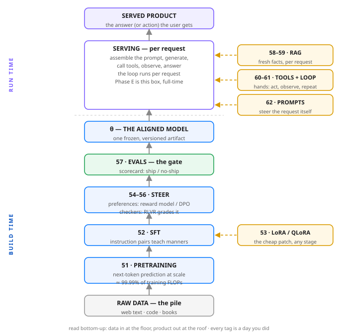

# Day 63 — Recap: The Full Modern Stack on One Page

**Tonight you'll be able to:** compress all of Phase D (Days 51–62) into one sentence you can carry into any system-design interview — *a frontier model is a pretrained next-token engine, taught manners by SFT, steered by preferences (RM/DPO) or checkers (RLVR), measured by evals, given fresh facts by RAG, and given hands by tools — and serving it is a separate discipline (Phase E)* — and read the whole stack as one manifest: artifact in, artifact out, compute share per stage.

## The one idea

Day 20 compressed Phase A into a sentence, Day 34 did Phase B, Day 50 did Phase C. Phase D gets the same treatment tonight. Here is the sentence, and then we take it apart:

**A frontier model is a pretrained next-token engine, taught manners by SFT, steered by preferences (RM/DPO) or checkers (RLVR), measured by evals, given fresh facts by RAG, and given hands by tools — and serving it is a separate discipline (Phase E).**

**Build (Days 51–53).** Everything starts as Day 50's machine, trained the Day 42 way — predict the next token — but on a pile so large that Day 51 needed its own arithmetic (C ≈ 6ND) to describe it. The output is a *base model*: immensely capable, no manners. SFT (Day 52) teaches the manners with (prompt, response) pairs and response-only loss. LoRA (Day 53) is not a stage but a *way to run stages*: freeze θ, train a tiny low-rank patch, merge it back — the difference between rebuilding a binary and shipping a hotfix.

**Steer (Days 54–56).** SFT can only clone demonstrations, so the stack adds two ways to say "better" without writing the perfect answer. *Preferences:* humans rank two responses, a reward model learns the ranking (Day 54), or DPO skips the middleman and trains on the pairs directly (Day 55). *Checkers:* where an answer can be verified — code compiles, math checks — RLVR (Day 56) pays the model only for work that passes, no human taste involved.

**Measure (Day 57).** Evals are the gate between "a checkpoint" and "a product." Benchmarks, slice analysis, vibes checks — imperfect instruments, honestly labeled as such on Day 57, but the rule stands: no scorecard, no ship. Nothing crosses into the served world without passing through this slot.

**Attach at serving time (Days 58–62).** The last four days change nothing about θ. RAG (Days 58–59) bolts fresh facts onto the request — retrieve chunks, stuff them into the prompt — because facts rot faster than models retrain. Tool use and the agent loop (Days 60–61) bolt on hands: the model calls functions, observes results, repeats. Prompt engineering (Day 62) is the cheapest attachment of all: structure in the request itself. Facts, hands, and steering text all live *outside* the artifact.

**The economics are the punchline.** In tonight's code, one plausible run of every stage is priced with 6ND: pretraining takes **99.9893%** of the training compute — one pretraining run equals 23,333 SFT runs. That asymmetry is *why* the stack has this shape. You train the expensive engine once, steer it for pocket change, and attach everything perishable at serving time. And serving itself — latency, batching, cost per token — is a whole separate discipline, which is why it gets its own phase starting tomorrow.

Every Phase D day is a slot in this picture: 51–53 build, 54–56 steer, 57 measures, 58–62 attach. If a new technique confuses you next year, ask which slot it changes. It will be one of the four.

## Analogy

Read the stack as a **release pipeline you already know how to run**. Pretraining is building the base OS image: the whole build farm, occupied for weeks, producing one artifact everything else derives from. SFT and LoRA are configuration layers on that image — tiny, fast, rebuilt a hundred times while the base image is built once. Preferences and RLVR are the review process that shapes what the team ships; evals are CI — the gate an artifact does not pass, it does not deploy. Then production is a different world with different on-call rules: the running service reads fresh state from a database instead of baking it into the image (RAG), calls downstream APIs instead of growing the binary (tools), and takes its behavior from the request and config, not from a rebuild (prompts). Build-time versus run-time — the oldest split in your world — is the whole diagram.

## See it



The one page to keep. Bottom: build time — raw data becomes a base model (51), learns manners (52, cheaply patched by 53), gets steered (54–56), and must pass the gate (57) before it counts as an artifact. Top: run time — the frozen model is served per request, with RAG, tools and prompts attached at serving time (58–62), never baked in. Phase E lives inside the serving box.

## Code it (~30 min)

One file, three views of the stack, in pure stdlib arithmetic — tonight the artifact *is* the map. The program is a **stack manifest**: the pipeline written the way you'd draw it in a system-design interview. **Part 1** prints the artifact chain — every stage's input and output, Day 51 to Day 62. **Part 2** prices each training stage with Day 51's rule (C ≈ 6ND, reference model 7B parameters) and prints its share of the total. **Part 3** groups the twelve days into four slots, prints the sentence, and asserts the verdict: shares sum to 100%, and pretraining alone is over 99.9% of it.

```python
"""Day 63 - Recap: The Full Modern Stack on One Page.

Phase D recap, same treatment as Days 20, 34 and 50: one
carry sentence, a slot map of every day in the phase, and a
small artifact that makes the map executable. The sentence:

    A frontier model is a pretrained next-token engine,
    taught manners by SFT, steered by preferences (RM/DPO)
    or checkers (RLVR), measured by evals, given fresh
    facts by RAG, and given hands by tools - and serving
    it is a separate discipline (Phase E).

Tonight the map becomes a MANIFEST: the stack written the
way you would draw it in a system-design interview. Every
stage declares its input artifact, its output artifact,
the data it eats, and its share of the training compute -
counted with Day 51's rule of thumb, C ~ 6 * N * D (six
times parameters times tokens seen).

Reference model, stated so the arithmetic is checkable:
N = 7e9 parameters, pretrained on 1.4e12 tokens. The
post-training token counts are one plausible run of each
stage, stated in the table - change them and the verdict
does not move, because pretraining is not ahead by a
little. It is ahead by four orders of magnitude.

  Part 1  The artifact chain: what each stage hands the
          next - corpus to base model to instruct model
          to aligned model to frozen artifact - plus the
          two serving-time attachments, which train
          nothing: RAG's index and the agent's tools.
  Part 2  The compute table: 6ND per training stage and
          each stage's share of the total. Evals spend
          inference, not gradient; serving stages spend
          nothing at build time at all.
  Part 3  The slot map + checks: build (51-53), steer
          (54-56), measure (57), serve-time (58-62) -
          and the printed sentence, for your notes.

Pure stdlib, deterministic arithmetic only - no RNG, no
torch needed, no APIs, no downloads. Runs as-is in the
~/ai-lab venv on the MacBook.

Expected output:

  Part 1 - the stack as an artifact chain (Days 51-62)
    Day 51  Pretraining   raw text corpus -> base model (theta)
    Day 52  SFT           base model -> instruct model
    Day 53  LoRA run      instruct model -> adapter (delta-W)
    Day 54  Reward model  instruct model -> reward model r(x, y)
    Day 55  DPO           instruct model -> aligned model
    Day 56  RLVR          instruct model -> reasoning model
    Day 57  Evals         candidate model -> scorecard: ship / no-ship
    Day 58  RAG index     his documents -> vector index
    Day 59  RAG loop      vector index + question -> grounded answer
    Day 60  Tool use      aligned model -> model that calls functions
    Day 61  Agent loop    model + tools -> agent: plan-act-observe
    Day 62  Prompts       any request -> structured request
    read it bottom-up in the diagram: every arrow is a
    handoff you could version, store, and roll back.
  Part 2 - training compute by stage (C ~ 6ND, Day 51)
    day  stage             tokens      FLOPs  share
     51  Pretraining     1.40e+12   5.88e+22  99.9893%
     52  SFT             6.00e+07   2.52e+18  0.0043%
     53  LoRA run        1.00e+07   4.20e+17  0.0007%
     54  Reward model    2.00e+07   8.40e+17  0.0014%
     55  DPO             1.00e+07   4.20e+17  0.0007%
     56  RLVR            5.00e+07   2.10e+18  0.0036%
     57  Evals                  -          -  no training
     58  RAG index              -          -  no training
     59  RAG loop               -          -  no training
     60  Tool use               -          -  no training
     61  Agent loop             -          -  no training
     62  Prompts                -          -  no training
    total training compute: 5.88e+22 FLOPs
    one pretraining run = 23,333 SFT runs
    everything after Day 51 is a rounding error in FLOPs -
    which is exactly why the stack is economical: train the
    engine once, steer it cheaply, attach facts and hands
    at serving time instead of retraining.
  Part 3 - the slot map
    BUILD (51-53)      make the engine, then teach it manners - LoRA is how you run these stages cheaply
    STEER (54-56)      preferences point it (RM, DPO); checkers grade it (RLVR) - two ways to say 'better'
    MEASURE (57)       evals are the gate between a checkpoint and a product - no scorecard, no ship
    SERVE-TIME (58-62) RAG bolts on fresh facts, tools bolt on hands, prompts steer the request - zero retraining
    the sentence:
      A frontier model is a pretrained next-token engine, taught manners
      by SFT, steered by preferences (RM/DPO) or checkers (RLVR),
      measured by evals, given fresh facts by RAG, and given hands by
      tools - and serving it is a separate discipline (Phase E).
    checks: shares sum to 100.0000% - pretraining share 99.9893% > 99.9% - serving stages train 0 parameters
  verdict: twelve days, four slots, one pipeline - if a new technique confuses you, ask which slot it changes.
"""
import textwrap

N = 7_000_000_000  # reference model: 7B parameters


def flops(tokens):
    """Day 51's rule: training compute ~ 6 * N * D FLOPs."""
    return 6 * N * tokens


# The manifest. tokens=None marks a stage that runs no
# gradient training: a gate (evals) or a serving-time
# attachment (RAG, tools, the agent loop, prompts).
STAGES = [
    # day, stage, input artifact, output artifact, data, train tokens
    (51, "Pretraining", "raw text corpus", "base model (theta)",
     "unlabeled tokens", 1_400_000_000_000),
    (52, "SFT", "base model", "instruct model",
     "(prompt, response) pairs", 60_000_000),
    (53, "LoRA run", "instruct model", "adapter (delta-W)",
     "task pairs, 0.1% of theta trained", 10_000_000),
    (54, "Reward model", "instruct model", "reward model r(x, y)",
     "chosen / rejected pairs", 20_000_000),
    (55, "DPO", "instruct model", "aligned model",
     "the same pairs, no RM trained", 10_000_000),
    (56, "RLVR", "instruct model", "reasoning model",
     "problems + a checker", 50_000_000),
    (57, "Evals", "candidate model", "scorecard: ship / no-ship",
     "benchmark sets (inference only)", None),
    (58, "RAG index", "his documents", "vector index",
     "chunks + embeddings", None),
    (59, "RAG loop", "vector index + question", "grounded answer",
     "top-k chunks in the prompt", None),
    (60, "Tool use", "aligned model", "model that calls functions",
     "tool schemas (JSON)", None),
    (61, "Agent loop", "model + tools", "agent: plan-act-observe",
     "tool results, fed back", None),
    (62, "Prompts", "any request", "structured request",
     "instructions + examples", None),
]

# ---------- Part 1: the artifact chain ----------
print("Part 1 - the stack as an artifact chain (Days 51-62)")
for day, stage, inp, out, data, _ in STAGES:
    print(f"  Day {day}  {stage:<13} {inp} -> {out}")
print("  read it bottom-up in the diagram: every arrow is a")
print("  handoff you could version, store, and roll back.")

# ---------- Part 2: who eats the compute ----------
print("Part 2 - training compute by stage (C ~ 6ND, Day 51)")
total = sum(flops(t) for *_, t in STAGES if t)
print(f"  {'day':>3}  {'stage':<13} {'tokens':>10}  "
      f"{'FLOPs':>9}  share")
for day, stage, _, _, _, t in STAGES:
    if t is None:
        print(f"  {day:>3}  {stage:<13} {'-':>10}  {'-':>9}  "
              "no training")
    else:
        share = 100.0 * flops(t) / total
        print(f"  {day:>3}  {stage:<13} {t:>10.2e}  "
              f"{flops(t):>9.2e}  {share:.4f}%")
pre_share = 100.0 * flops(STAGES[0][5]) / total
print(f"  total training compute: {total:.2e} FLOPs")
print(f"  one pretraining run = "
      f"{flops(STAGES[0][5]) // flops(STAGES[1][5]):,} SFT runs")
print("  everything after Day 51 is a rounding error in FLOPs -")
print("  which is exactly why the stack is economical: train the")
print("  engine once, steer it cheaply, attach facts and hands")
print("  at serving time instead of retraining.")

# ---------- Part 3: the slot map + the sentence ----------
print("Part 3 - the slot map")
SLOTS = [
    ("BUILD (51-53)", "make the engine, then teach it manners - "
     "LoRA is how you run these stages cheaply"),
    ("STEER (54-56)", "preferences point it (RM, DPO); checkers "
     "grade it (RLVR) - two ways to say 'better'"),
    ("MEASURE (57)", "evals are the gate between a checkpoint "
     "and a product - no scorecard, no ship"),
    ("SERVE-TIME (58-62)", "RAG bolts on fresh facts, tools bolt "
     "on hands, prompts steer the request - zero retraining"),
]
for name, desc in SLOTS:
    print(f"  {name:<18} {desc}")
SENTENCE = ("A frontier model is a pretrained next-token engine, "
            "taught manners by SFT, steered by preferences (RM/DPO) "
            "or checkers (RLVR), measured by evals, given fresh "
            "facts by RAG, and given hands by tools - and serving "
            "it is a separate discipline (Phase E).")
print("  the sentence:")
for line in textwrap.wrap(SENTENCE, 66):
    print(f"    {line}")
shares_sum = sum(100.0 * flops(t) / total
                 for *_, t in STAGES if t)
assert abs(shares_sum - 100.0) < 1e-6
assert pre_share > 99.9
print(f"  checks: shares sum to {shares_sum:.4f}% - pretraining "
      f"share {pre_share:.4f}% > 99.9% - serving stages train "
      "0 parameters")
print("verdict: twelve days, four slots, one pipeline - if a new "
      "technique confuses you, ask which slot it changes.")
```

**Expected output:**

```
Part 1 - the stack as an artifact chain (Days 51-62)
  Day 51  Pretraining   raw text corpus -> base model (theta)
  Day 52  SFT           base model -> instruct model
  Day 53  LoRA run      instruct model -> adapter (delta-W)
  Day 54  Reward model  instruct model -> reward model r(x, y)
  Day 55  DPO           instruct model -> aligned model
  Day 56  RLVR          instruct model -> reasoning model
  Day 57  Evals         candidate model -> scorecard: ship / no-ship
  Day 58  RAG index     his documents -> vector index
  Day 59  RAG loop      vector index + question -> grounded answer
  Day 60  Tool use      aligned model -> model that calls functions
  Day 61  Agent loop    model + tools -> agent: plan-act-observe
  Day 62  Prompts       any request -> structured request
  read it bottom-up in the diagram: every arrow is a
  handoff you could version, store, and roll back.
Part 2 - training compute by stage (C ~ 6ND, Day 51)
  day  stage             tokens      FLOPs  share
   51  Pretraining     1.40e+12   5.88e+22  99.9893%
   52  SFT             6.00e+07   2.52e+18  0.0043%
   53  LoRA run        1.00e+07   4.20e+17  0.0007%
   54  Reward model    2.00e+07   8.40e+17  0.0014%
   55  DPO             1.00e+07   4.20e+17  0.0007%
   56  RLVR            5.00e+07   2.10e+18  0.0036%
   57  Evals                  -          -  no training
   58  RAG index              -          -  no training
   59  RAG loop               -          -  no training
   60  Tool use               -          -  no training
   61  Agent loop             -          -  no training
   62  Prompts                -          -  no training
  total training compute: 5.88e+22 FLOPs
  one pretraining run = 23,333 SFT runs
  everything after Day 51 is a rounding error in FLOPs -
  which is exactly why the stack is economical: train the
  engine once, steer it cheaply, attach facts and hands
  at serving time instead of retraining.
Part 3 - the slot map
  BUILD (51-53)      make the engine, then teach it manners - LoRA is how you run these stages cheaply
  STEER (54-56)      preferences point it (RM, DPO); checkers grade it (RLVR) - two ways to say 'better'
  MEASURE (57)       evals are the gate between a checkpoint and a product - no scorecard, no ship
  SERVE-TIME (58-62) RAG bolts on fresh facts, tools bolt on hands, prompts steer the request - zero retraining
  the sentence:
    A frontier model is a pretrained next-token engine, taught manners
    by SFT, steered by preferences (RM/DPO) or checkers (RLVR),
    measured by evals, given fresh facts by RAG, and given hands by
    tools - and serving it is a separate discipline (Phase E).
  checks: shares sum to 100.0000% - pretraining share 99.9893% > 99.9% - serving stages train 0 parameters
verdict: twelve days, four slots, one pipeline - if a new technique confuses you, ask which slot it changes.
```

## Today's win

Done when your run prints the whole stack: Part 1's twelve-stage artifact chain (corpus → base model → instruct model → aligned model, plus the serving-time attachments), Part 2's compute table with pretraining at **99.9893%** and the line *one pretraining run = 23,333 SFT runs*, and Part 3's checks line confirming the shares sum to 100.0000%. The keeper test, no notes allowed: someone says "frontier model pipeline" and you say the sentence — then take any technique they name and file it: build, steer, measure, or attach.

## Short on time? 20-minute version

Read "The one idea" and study the diagram until you can redraw it: a vertical pipeline, four build-time stages under one frozen artifact, attachments hanging off the serving box. Then run the code and read only Part 2's table — the 99.9893% is the number that explains the entire architecture of the industry. If you can say the sentence and explain why RAG is drawn on the side instead of in the column, you have the recap.

## Tomorrow's teaser

Tomorrow: Phase E opens — we climb inside the serving box at the top of tonight's diagram, where the question stops being "how do we build it" and becomes "how do we run it for a thousand people at once."

*Streak: 63 day(s) · Never miss twice.*
