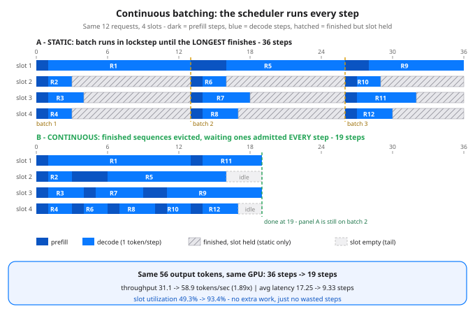

# Day 64 — Inference Serving 1: vLLM & Continuous Batching

**Tonight you'll be able to:** explain why a generation server lives or dies by its scheduler — and prove, with a simulation you can audit by hand, that re-scheduling after *every* token step instead of every batch nearly doubles throughput on the same GPU.

## The one idea

Days 47–49 were about *one* generation: the autoregressive loop (Day 47), the KV cache that makes each pass cheap (Day 48), and why long context makes each pass pricier (Day 49). A **serving engine** — **vLLM** is the open-source default — runs many generations at once on one GPU. The weights are shared; each sequence carries its own KV cache. The scarce resource is the next **step**: one iteration in which the GPU advances a whole batch of sequences by one token each. And since one pass for four sequences costs about the same time as one pass for one (Day 13's throughput machine — decode reads the weights once per step, and every sequence in the batch rides that read), serving is mostly one problem: **keep the batch full.** That is a scheduling problem.

**Static batching** is the naive schedule, and the pre-vLLM default: collect N requests, run them in lockstep until the *longest* output finishes, then form the next batch. Two wastes are baked in. First, the **ragged finish**: output lengths vary wildly and are unknown in advance, so a 2-token answer sits in its slot for 11 more steps while a 12-token answer in the same batch finishes — the slot is occupied, computing padding, producing nothing. Second, **no mid-batch admissions**: a request that arrives one step after a batch forms waits for the entire next batch, however many slots are sitting idle-held.

**Continuous batching** — vLLM's headline trick, from the Orca paper's *iteration-level scheduling* — moves the scheduling decision to where the work actually is: **after every single step**. A sequence that emits its last token is evicted that step; a waiting request takes the freed slot on the very next step. The batch stops being a cohort that lives and dies together and becomes a rolling window over the request stream, its membership changing every iteration. Same model, same GPU, same requests — only the scheduler changed.

One paragraph on vLLM's other idea, **PagedAttention**, because it is what lets the batches get big: a sequence's KV cache (Day 48) was traditionally reserved as one contiguous slab sized for the maximum possible length — mostly never used, and the slabs fragment GPU memory like a heap with no compaction. PagedAttention chops each sequence's KV cache into fixed-size blocks that can live anywhere in GPU memory, with a per-sequence block table mapping logical blocks to physical ones. That is virtual-memory paging, verbatim, applied to KV: waste drops to the last partially-filled block per sequence, far more sequences fit at once, and continuous batching gets a deeper pool to schedule.

Three numbers to read in the code: **throughput** (output tokens per second — the business metric), **average latency** (steps from arrival to last token — the user's metric), and **slot utilization** (useful slot-steps ÷ makespan × slots — the waste metric). Tonight's simulation holds everything constant except the scheduling policy, so any gap between the two runs is the scheduler's fault alone.

## Analogy

You have debugged this exact bug in distributed systems: **the barrier and the straggler**. Static batching is a MapReduce stage with a barrier at the end — the stage closes when the *slowest* shard finishes, early finishers idle at the barrier, and the next stage cannot start a minute early. One 12-token request is the straggler task that sets the makespan for three finished workers. Continuous batching is the fix you would reach for there: a **work-stealing event loop**. Every iteration is a scheduling point; a slot is a worker that pulls the next request the instant it frees up. Admissions **coalesce** whatever is waiting into whatever slots are free, each step — nobody waits to assemble a perfect batch of four. And PagedAttention is your OS course verbatim: fixed-size pages, a page table per process, no contiguous allocation, no external fragmentation — just pointed at KV cache instead of RAM.

## See it



Two Gantt timelines — same 12 requests, same 4 slots, same step cost. Top (static): three lockstep batches; R2 finishes at step 3 but its slot stays hatched-idle until the batch ends at 13, and batch 3's requests sit fully arrived while batch 2 runs. Bottom (continuous): every slot is refilled the step it frees — slot 4 serves six requests back to back — and the whole workload is done at step 19, while the static run is still inside batch 2. All numbers from the simulation below.

## Code it (~30 min)

A discrete-event simulation in pure stdlib — no torch, no GPU, no server: tonight the model *is* a cost model, stated in the docstring so every number can be audited. Twelve requests with fixed arrivals, prompt sizes, and output lengths (embedded, no randomness); one step = 50 ms; prompts prefill in 128-token chunks; at most 4 sequences hold slots. **Part 1** prints the workload and the slot-step arithmetic. **Part 2** runs static batching and prints each batch's duration and idle-held waste. **Part 3** runs continuous batching and prints each slot's timeline run-length encoded, so you can recount every step by hand. Runs as-is in the `~/ai-lab` venv: `python3 code.py`.

```python
"""Day 64 - Inference Serving 1: vLLM & Continuous Batching.

Phase E opens. Day 47: generation is a loop - one forward pass
per token. Day 48: the KV cache makes each pass cheap. Day 49:
longer context makes each pass pricier. Tonight the question
moves up one level: you are not running ONE generation, you
are running a SERVER - many requests, one GPU, and a scheduler
deciding which sequences get the next step.

The one concept: generation is iterative, so requests finish
at different steps. STATIC batching (the old way) forms a
batch, runs it in lockstep until the LONGEST request finishes,
and only then starts the next batch: finished sequences keep
their slot (their remaining steps are padding) and new
requests cannot join mid-batch. CONTINUOUS batching - the
vLLM / Orca idea, also called iteration-level scheduling -
re-runs the scheduler after EVERY step: a sequence that
finishes is evicted immediately and a waiting request takes
its slot on the very next step. Same model, same requests,
radically different utilization.

This is a discrete-event SIMULATION in pure stdlib - no torch,
no GPU, no server. The workload is a fixed embedded list of
12 requests (no random anywhere), and the cost model is a toy,
stated up front so every printed number can be audited by hand:

  COST MODEL
  - Time moves in steps. One step = one decode iteration of
    the whole batch = STEP_MS (50 ms) of wall clock, however
    many sequences are active - the GPU runs the batch in
    parallel, and up to MAX_BATCH the step cost is flat.
  - Prefill (Day 48): a prompt is processed in chunks of
    PREFILL_CHUNK (128) tokens, one chunk per step, inside
    the sequence's own slot. Every prompt below is a multiple
    of 128, so prefill steps are exact integers.
  - Decode: one output token per sequence per step. A request
    therefore needs prefill_steps + output_tokens slot-steps
    of real work - its "slot-steps" column in Part 1.
  - At most MAX_BATCH (4) sequences hold slots at any step.
  - Finish time = the step count at which a request's last
    token lands. Latency = finish - arrival, in steps.
  - Static policy: batches of MAX_BATCH in arrival order; a
    batch starts at max(previous batch end, last member's
    arrival) and runs max(slot-steps of its members) steps;
    every member's slot is held until the batch ends.
  - Continuous policy: at the start of each step, waiting
    requests (arrival <= now) are admitted FIFO into free
    slots; every active sequence advances one step; a
    sequence finishing at the end of a step frees its slot
    for the next step.

  Part 1  The workload: 12 requests, arrivals, prompt sizes,
          output lengths, and the slot-step arithmetic.
  Part 2  Static batching: 3 lockstep batches - per-batch
          duration and idle-held slot-steps printed so the
          waste is auditable line by line.
  Part 3  Continuous batching: the same 12 requests under
          per-step scheduling - per-slot timelines printed
          run-length encoded, so you can recount every step.
  Verdict: throughput (output tokens/sec), average latency,
          and slot utilization, side by side.

Runs anywhere Python 3.11+ runs - stdlib only, no downloads,
no paid APIs. On the MacBook: just `python3 code.py` in the
~/ai-lab venv (torch not even needed tonight).

Expected output:

  Part 1 - the workload: 12 requests, 4 slots, one step = 50 ms
    req  arrive  prompt  prefill  output  slot-steps
    R1   0       128     1        12      13
    R2   0       128     1        2       3
    R3   0       128     1        3       4
    R4   0       128     1        2       3
    R5   0       384     3        10      13
    R6   0       128     1        2       3
    R7   0       128     1        4       5
    R8   0       128     1        3       4
    R9   1       256     2        8       10
    R10  3       128     1        2       3
    R11  6       128     1        5       6
    R12  10      128     1        3       4
    totals: 56 output tokens, 71 useful slot-steps of real work
  Part 2 - STATIC batching: lockstep until the longest finishes
    batch 1: R1 R2 R3 R4  starts 0  runs 13 steps (longest member)  idle-held 29 slot-steps
    batch 2: R5 R6 R7 R8  starts 13  runs 13 steps (longest member)  idle-held 27 slot-steps
    batch 3: R9 R10 R11 R12  starts 26  runs 10 steps (longest member)  idle-held 17 slot-steps
    makespan: 36 steps = 1.80 s   finish order: R2@3 R4@3 R3@4 R1@13 R6@16 R8@17 R7@18 R5@26 R10@29 R12@30 R11@32 R9@36
    output tokens: 56   throughput: 31.1 tokens/sec
    latency (steps): avg 17.25   max 35   (x 50 ms per step)
    slot-steps: useful 71 of 144 capacity   utilization 49.3%   wasted 73
  Part 3 - CONTINUOUS batching: re-schedule after every step
      slot 1: R1 x13  R11 x6
      slot 2: R2 x3  R5 x13  idle x3
      slot 3: R3 x4  R7 x5  R9 x10
      slot 4: R4 x3  R6 x3  R8 x4  R10 x3  R12 x4  idle x2
    makespan: 19 steps = 0.95 s   finish order: R2@3 R4@3 R3@4 R6@6 R7@9 R8@10 R1@13 R10@13 R5@16 R12@17 R9@19 R11@19
    output tokens: 56   throughput: 58.9 tokens/sec
    latency (steps): avg 9.33   max 18   (x 50 ms per step)
    slot-steps: useful 71 of 76 capacity   utilization 93.4%   wasted 5
  Verdict - same 12 requests, same model, only the scheduler changed
    throughput:  31.1 -> 58.9 tokens/sec (1.89x)
    avg latency: 17.25 -> 9.33 steps
    utilization: 49.3% -> 93.4% of slot-steps useful
    the GPU did no extra work - the scheduler just stopped wasting steps
"""
from collections import namedtuple

STEP_MS = 50            # one decode iteration of the batch
PREFILL_CHUNK = 128     # prompt tokens processed per prefill step
MAX_BATCH = 4           # sequences (slots) on the GPU at once

Req = namedtuple("Req", ["name", "arrival", "prompt", "output"])


def prefill_steps(req):
    assert req.prompt % PREFILL_CHUNK == 0
    return req.prompt // PREFILL_CHUNK


def slot_steps(req):
    """Real work a request needs: prefill steps + decode steps."""
    return prefill_steps(req) + req.output


# The workload: a fixed, embedded stream - no randomness.
# (name, arrival step, prompt tokens, output tokens)
REQUESTS = [Req(*row) for row in (
    ("R1", 0, 128, 12),
    ("R2", 0, 128, 2),
    ("R3", 0, 128, 3),
    ("R4", 0, 128, 2),
    ("R5", 0, 384, 10),
    ("R6", 0, 128, 2),
    ("R7", 0, 128, 4),
    ("R8", 0, 128, 3),
    ("R9", 1, 256, 8),
    ("R10", 3, 128, 2),
    ("R11", 6, 128, 5),
    ("R12", 10, 128, 3),
)]


def run_static(reqs):
    """Lockstep batches. Returns (makespan, finishes, slots, batches).

    slots[s] = list of (start, req, held_end): the request does
    its own work on steps [start, start + slot_steps) but the
    slot is held until held_end (the batch end)."""
    order = sorted(reqs, key=lambda r: r.arrival)   # stable: ties keep list order
    groups = [order[i:i + MAX_BATCH]
              for i in range(0, len(order), MAX_BATCH)]
    finishes, slots, batches = {}, [[] for _ in range(MAX_BATCH)], []
    t = 0
    for group in groups:
        start = max(t, max(r.arrival for r in group))
        dur = max(slot_steps(r) for r in group)
        for slot_i, r in enumerate(group):
            finishes[r.name] = start + slot_steps(r)
            slots[slot_i].append((start, r, start + dur))
        batches.append((start, group, dur))
        t = start + dur
    return t, finishes, slots, batches


def run_continuous(reqs):
    """Iteration-level scheduling. Returns (makespan, finishes, slots).

    slots[s] = list of (start, req, end) with end = finish step:
    no held time - a slot is freed the step its sequence ends."""
    waiting = sorted(reqs, key=lambda r: r.arrival)
    slots = [[] for _ in range(MAX_BATCH)]
    finishes = {}
    active = [None] * MAX_BATCH        # per slot: [req, progress, start]
    t = 0
    while len(finishes) < len(reqs):
        for s in range(MAX_BATCH):     # admit into free slots, FIFO
            if active[s] is None and waiting and waiting[0].arrival <= t:
                r = waiting.pop(0)
                active[s] = [r, 0, t]
        for s in range(MAX_BATCH):     # one step of work per sequence
            if active[s] is not None:
                active[s][1] += 1
                r, progress, start = active[s]
                if progress == slot_steps(r):
                    finishes[r.name] = t + 1
                    slots[s].append((start, r, t + 1))
                    active[s] = None
        t += 1
    return t, finishes, slots


def report(label, reqs, makespan, finishes):
    useful = sum(slot_steps(r) for r in reqs)
    capacity = makespan * MAX_BATCH
    total_out = sum(r.output for r in reqs)
    seconds = makespan * STEP_MS / 1000
    lat = [finishes[r.name] - r.arrival for r in reqs]
    print(f"  makespan: {makespan} steps = {seconds:.2f} s   "
          f"finish order: " + " ".join(
              f"{r.name}@{finishes[r.name]}" for r in
              sorted(reqs, key=lambda r: finishes[r.name])))
    print(f"  output tokens: {total_out}   "
          f"throughput: {total_out / seconds:.1f} tokens/sec")
    print(f"  latency (steps): avg {sum(lat) / len(lat):.2f}   "
          f"max {max(lat)}   (x {STEP_MS} ms per step)")
    print(f"  slot-steps: useful {useful} of {capacity} capacity   "
          f"utilization {100 * useful / capacity:.1f}%   "
          f"wasted {capacity - useful}")
    return total_out / seconds, sum(lat) / len(lat), 100 * useful / capacity


def rle(slots, makespan):
    """Run-length encode each slot's timeline, idles included."""
    lines = []
    for s, events in enumerate(slots):
        parts, cursor = [], 0
        for start, r, end in events:
            if start > cursor:
                parts.append(f"idle x{start - cursor}")
            parts.append(f"{r.name} x{end - start}")
            cursor = end
        if cursor < makespan:
            parts.append(f"idle x{makespan - cursor}")
        lines.append(f"    slot {s + 1}: " + "  ".join(parts))
    return lines


def main():
    print("Part 1 - the workload: 12 requests, 4 slots, "
          f"one step = {STEP_MS} ms")
    print(f"  {'req':<5}{'arrive':<8}{'prompt':<8}{'prefill':<9}"
          f"{'output':<8}slot-steps")
    for r in REQUESTS:
        print(f"  {r.name:<5}{r.arrival:<8}{r.prompt:<8}"
              f"{prefill_steps(r):<9}{r.output:<8}{slot_steps(r)}")
    total_out = sum(r.output for r in REQUESTS)
    useful = sum(slot_steps(r) for r in REQUESTS)
    print(f"  totals: {total_out} output tokens, "
          f"{useful} useful slot-steps of real work")

    print("Part 2 - STATIC batching: lockstep until the longest finishes")
    makespan_s, fin_s, slots_s, batches = run_static(REQUESTS)
    for i, (start, group, dur) in enumerate(batches):
        idle = sum(dur - slot_steps(r) for r in group)
        names = " ".join(r.name for r in group)
        print(f"  batch {i + 1}: {names}  starts {start}  "
              f"runs {dur} steps (longest member)  "
              f"idle-held {idle} slot-steps")
    static = report("static", REQUESTS, makespan_s, fin_s)

    print("Part 3 - CONTINUOUS batching: re-schedule after every step")
    makespan_c, fin_c, slots_c = run_continuous(REQUESTS)
    for line in rle(slots_c, makespan_c):
        print(line)
    cont = report("continuous", REQUESTS, makespan_c, fin_c)

    print("Verdict - same 12 requests, same model, only the scheduler changed")
    print(f"  throughput:  {static[0]:.1f} -> {cont[0]:.1f} tokens/sec "
          f"({cont[0] / static[0]:.2f}x)")
    print(f"  avg latency: {static[1]:.2f} -> {cont[1]:.2f} steps")
    print(f"  utilization: {static[2]:.1f}% -> {cont[2]:.1f}% of slot-steps useful")
    print("  the GPU did no extra work - the scheduler just stopped "
          "wasting steps")


if __name__ == "__main__":
    main()
```

**Expected output:**

```
Part 1 - the workload: 12 requests, 4 slots, one step = 50 ms
  req  arrive  prompt  prefill  output  slot-steps
  R1   0       128     1        12      13
  R2   0       128     1        2       3
  R3   0       128     1        3       4
  R4   0       128     1        2       3
  R5   0       384     3        10      13
  R6   0       128     1        2       3
  R7   0       128     1        4       5
  R8   0       128     1        3       4
  R9   1       256     2        8       10
  R10  3       128     1        2       3
  R11  6       128     1        5       6
  R12  10      128     1        3       4
  totals: 56 output tokens, 71 useful slot-steps of real work
Part 2 - STATIC batching: lockstep until the longest finishes
  batch 1: R1 R2 R3 R4  starts 0  runs 13 steps (longest member)  idle-held 29 slot-steps
  batch 2: R5 R6 R7 R8  starts 13  runs 13 steps (longest member)  idle-held 27 slot-steps
  batch 3: R9 R10 R11 R12  starts 26  runs 10 steps (longest member)  idle-held 17 slot-steps
  makespan: 36 steps = 1.80 s   finish order: R2@3 R4@3 R3@4 R1@13 R6@16 R8@17 R7@18 R5@26 R10@29 R12@30 R11@32 R9@36
  output tokens: 56   throughput: 31.1 tokens/sec
  latency (steps): avg 17.25   max 35   (x 50 ms per step)
  slot-steps: useful 71 of 144 capacity   utilization 49.3%   wasted 73
Part 3 - CONTINUOUS batching: re-schedule after every step
    slot 1: R1 x13  R11 x6
    slot 2: R2 x3  R5 x13  idle x3
    slot 3: R3 x4  R7 x5  R9 x10
    slot 4: R4 x3  R6 x3  R8 x4  R10 x3  R12 x4  idle x2
  makespan: 19 steps = 0.95 s   finish order: R2@3 R4@3 R3@4 R6@6 R7@9 R8@10 R1@13 R10@13 R5@16 R12@17 R9@19 R11@19
  output tokens: 56   throughput: 58.9 tokens/sec
  latency (steps): avg 9.33   max 18   (x 50 ms per step)
  slot-steps: useful 71 of 76 capacity   utilization 93.4%   wasted 5
Verdict - same 12 requests, same model, only the scheduler changed
  throughput:  31.1 -> 58.9 tokens/sec (1.89x)
  avg latency: 17.25 -> 9.33 steps
  utilization: 49.3% -> 93.4% of slot-steps useful
  the GPU did no extra work - the scheduler just stopped wasting steps
```

## Today's win

Done when your run reproduces the verdict block — static: 36 steps, 31.1 tokens/sec, 49.3% utilization; continuous: 19 steps, 58.9 tokens/sec, 93.4% — and you can point at slot 2 in Part 3 and name the step R5 took over R2's slot (step 3, the step right after R2 finished). The keeper sentence: **batching is a scheduling policy, not a property of the model** — swap the policy and the same GPU serves ~1.9× the tokens. Phase E is open: you now own the serving layer's central idea.

## Short on time? 20-minute version

Read "The one idea", study the Gantt diagram until you can explain the hatched bars, then run the code and read only the three Verdict lines. If you can say what the hatched steps cost and why per-step scheduling deletes them, you have the day — the PagedAttention paragraph is the victory lap.

## Tomorrow's teaser

Tomorrow: serving, part 2 — the model itself goes on a diet. What happens to speed, memory, and answer quality when the weights stop using full precision?

Streak: 64 day(s) · Never miss twice.
