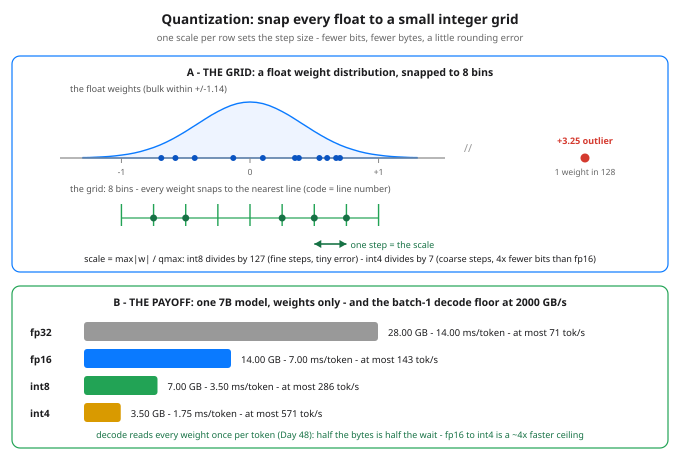

# Day 65 — Inference Serving 2: Quantization, INT8/INT4 Intuition

**Tonight you'll be able to:** explain how one scale and a pocketful of integer codes can stand in for a float weight, compute the ~4× memory-and-bandwidth win of fp16→int4 for a 7B model, and say exactly what the rounding error costs — and what keeps it inside budget.

## The one idea

Day 64 made each step cheaper by filling it with more requests. Today makes the *model itself* cheaper to move. The whole trick is one line:

**Store an integer code plus one shared scale: `w ≈ scale × q`. Rebuilding the float is a single multiply, done on the fly as the weight is used.**

Concretely: take a row of weights, find its largest magnitude, and divide the range into a small ladder of landing spots. **int8** gives you 255 spots (codes −127…127), **int4** gives you 15 (codes −7…7). The **scale** is the distance between spots: `scale = max|w| / qmax`. Each weight is stored as just its spot number — 8 bits or 4 bits instead of fp16's 16 — plus the one scale per row, which is rounding error's entire price list: a weight can be off by at most half a step, so a *smaller step is a smaller error budget*. A variant called **asymmetric** quantization adds one more shared number, a **zero-point**, so the ladder can start somewhere other than zero when a row's range is skewed; the symmetric version in today's code is the same idea with the zero-point pinned at 0.

**Why it pays twice.** First, capacity: a 7B model is 14 GB in fp16 and 3.5 GB in int4 — it fits on a smaller GPU and leaves room for the KV cache (Days 48–49) to grow. Second, and bigger: Day 48 showed batch-1 decode is *bandwidth-bound* — the arithmetic is trivial, the wait is dragging every weight out of memory once per token. Bytes are the wait. Quarter the bytes and the speed ceiling rises ~4×, with the *same* math happening upstairs. This is also why quantization matters far less for training: training is compute-bound and re-reads weights in big batches, so the bandwidth discount buys little there.

**The cost, honestly.** Rounding error is real and it is not uniform. An int8 step on a typical row is ~0.0055 wide, so errors stay in the third decimal — in practice int8 weight quantization is usually near-free. An int4 step is ~0.1 wide, and individual weights can come back badly wrong (+0.3500 returns as +0.3003 in Part 1). Two things save the model: a neuron's output is a sum of hundreds of products (Day 12), and independent rounding errors partly cancel in the sum; and the fixes in the next paragraph keep the worst errors from happening in the first place. Whether the *model's answers* stay inside budget is an eval question (Day 57's discipline) — you measure it, you don't assume it.

**The outlier problem, and its standard answers (names to recognize).** Real weight rows contain a few values many times larger than the bulk. One outlier stretches its whole row's scale — Part 2 plants a single +3.25 and watches its row's int4 step blow up to 0.4643, crushing every small weight in that row, while per-row scales at least quarantine the damage to that row. Production schemes go further: **per-group scales** (a fresh scale every 64–128 weights, so an outlier only poisons its own small group — this is what GPTQ and AWQ ship, and what QLoRA's 4-bit base used on Day 53), and **mixed precision**, where the few outlier channels are simply kept in fp16 while everything else goes int8 (the LLM.int8() approach). Today's code quantizes *weights*; *activations* and the *KV cache* can be quantized too, but they are touchier — activation outliers move from token to token — so names like SmoothQuant exist mostly to tame those. Same grid idea, harder neighborhoods.

## Analogy

**Lossy compression with an SLO — a trade you already run.** Nobody stores raw WAV when MP3's error sits below what the listener can detect, and nobody ships uncompressed logs when a codec keeps every dashboard readable. Quantization is that decision for weights: you set an error budget (the SLO), pick the cheapest format whose measured error stays inside it, and you *measure before you ship* — Part 2 is the error report, Part 3 is the savings report, and the order matters. Your storage brain already knows the shape of the trick, too: codes + one scale per group is dictionary encoding with the dictionary reduced to a ruler. The failure mode is also familiar: lossy is a contract, not a vibe — exceed the budget on the one row with the outlier and the pager goes off.

## See it



Top: real weights bunch near zero with one far outlier; a quantizer keeps only the grid lines and snaps every weight to the nearest one — the distance between lines is the scale, and half that distance is the worst-case rounding error. Bottom: the same 7B model at four precisions — int4 is a quarter of fp16's bytes, and because batch-1 decode must read every byte once per token, the speed ceiling rises with the shrink.

## Code it (~30 min)

One file, three parts, no RNG — the "weight matrix" is built from a sine/cosine formula so every digit is exact, and one outlier is planted at `[2, 7]` so you can watch it do damage. **Part 1** snaps row 0 to the int8 and int4 grids and brings the values back. **Part 2** prints the full error bill — fp16 cast vs int8 vs int4 — and isolates the outlier row. **Part 3** counts bytes for the toy matrix and a 7B model, then converts bytes into the decode speed ceiling at 2000 GB/s. Runs in your `~/ai-lab` venv on CPU; torch only, nothing to download.

```python
"""Day 65 - Inference Serving 2: Quantization, INT8/INT4 Intuition.

Yesterday (Day 64) was about feeding the GPU more requests per
step. Today is about making each step cheaper to feed: shrink
the weights themselves.

    Quantization = store each weight as a small integer code
    plus one shared scale:  w ~= scale * q.  Dequantizing is
    one multiply. Fewer bits per weight means fewer bytes to
    store AND fewer bytes to drag through memory on every
    generated token - and Day 48 showed decode is a memory
    problem, not a math problem.

The scheme used here is symmetric per-row quantization:
for each row, scale = max|w| / qmax (127 for int8, 7 for
int4), q = round(w / scale). One honest paragraph each on
the two standard refinements lives in the lesson: asymmetric
grids add a zero-point for skewed ranges, and per-group
scales (a fresh scale every 64-128 weights, the GPTQ/AWQ
style) shrink the rounding error further.

  Part 1  One row, snapped to the grid. Row 0's first six
          weights become int8 codes and int4 codes, then
          come back - int4's coarser steps are visible to
          the naked eye (+0.3500 returns as +0.3003).
  Part 2  The error bill. Max and RMS error of the round
          trip over all 128 weights: fp16 cast vs int8 vs
          int4. Then the outlier tax: one planted +3.25
          weight stretches its own row's int4 scale to
          0.464286, so that row's small weights land on
          +-0.4643 steps (max err 0.2186) while every other
          row stays <= 0.0804 - per-row scales quarantine
          the damage to the row that caused it.
  Part 3  The payoff. Byte counts for the toy matrix and
          for a 7B model, then the decode consequence: at
          batch 1 every weight is read once per token, so
          at 2000 GB/s of memory bandwidth the fp16->int4
          cut lifts the theoretical ceiling from 142.9 to
          571.4 tokens/sec. Same FLOPs, a quarter of the
          bytes - that is the whole trade.

Runs on the ~/ai-lab venv: torch only (free), CPU on
purpose (tiny matrix), no CUDA, no paid APIs, no downloads.
The weight matrix is built from a sine/cosine formula -
deterministic, no RNG anywhere, every number exact.

Expected output:

  Part 1 - one row, snapped to the grid (symmetric, per-row scale)
    row 0 weights: +0.3500, +0.6004, +0.7007, +0.6661, +0.5416, +0.3809
    int8 scale 0.005517 -> codes +63, +109, +127, +121, +98, +69
      dequantized: +0.3476, +0.6014, +0.7007, +0.6676, +0.5407, +0.3807
    int4 scale 0.100101 -> codes +3, +6, +7, +7, +5, +4
      dequantized: +0.3003, +0.6006, +0.7007, +0.7007, +0.5005, +0.4004
  Part 2 - the error bill: round trip vs the original, all 128 weights
    fp16 cast:  max err 0.000392  rms err 0.000120
    int8:       max err 0.012666  rms err 0.003344
    int4:       max err 0.218647  rms err 0.063629
    outlier row 2 at int4: scale 0.464286, row max err 0.2186
    every other row at int4: max err <= 0.0804 - damage quarantined
  Part 3 - the payoff: bytes, then the decode speed limit
    toy 8x16 matrix: fp32 512 B | fp16 256 B | int8 128 B | int4 64 B
      (+ 8 fp32 row scales = 32 B - the grid's only overhead here)
    a 7B model, weights only, batch-1 decode (all weights read per token):
      fp32: 28.00 GB -> 14.00 ms/token floor at 2000 GB/s -> at most 71.4 tok/s
      fp16: 14.00 GB ->  7.00 ms/token floor at 2000 GB/s -> at most 142.9 tok/s
      int8:  7.00 GB ->  3.50 ms/token floor at 2000 GB/s -> at most 285.7 tok/s
      int4:  3.50 GB ->  1.75 ms/token floor at 2000 GB/s -> at most 571.4 tok/s
    verdict: fp16 -> int4 moves 4x fewer bytes; decode is bandwidth-bound,
    so the speed ceiling rises ~4x. You pay in rounding error, not dollars.
"""
import torch

# A stand-in "weight matrix": formula-built (sines/cosines), so it
# has the bell-ish spread of real weights - most values small, a few
# near +-1 - plus ONE planted outlier at [2, 7], the troublemaker
# every quantization paper complains about.
rows = torch.arange(8, dtype=torch.float64).unsqueeze(1)
cols = torch.arange(16, dtype=torch.float64).unsqueeze(0)
W = (0.8 * torch.sin(0.9 * rows + 0.4 * cols)
     + 0.35 * torch.cos(0.6 * cols - 1.1 * rows)).float()
W[2, 7] = 3.25


def quantize_per_row(w, qmax):
    """Symmetric per-row quantization. Returns (codes, scales, dequant).
    scale = max|w| / qmax per row; codes = round(w / scale), clipped."""
    scale = w.abs().amax(dim=1, keepdim=True) / qmax
    codes = torch.clamp(torch.round(w / scale), -qmax, qmax)
    return codes, scale.squeeze(1), codes * scale


def err_stats(deq):
    err = (deq.double() - W.double())
    return err.abs().max().item(), err.pow(2).mean().sqrt().item()


sfmt = lambda t: ", ".join(f"{v:+.4f}" for v in t.tolist())
ifmt = lambda t: ", ".join(f"{int(v):+d}" for v in t.tolist())

# ---------- Part 1: one row, snapped to the grid ----------
print("Part 1 - one row, snapped to the grid (symmetric, per-row scale)")
codes8, scales8, deq8 = quantize_per_row(W, 127)
codes4, scales4, deq4 = quantize_per_row(W, 7)
print(f"  row 0 weights: {sfmt(W[0, :6])}")
print(f"  int8 scale {scales8[0]:.6f} -> codes {ifmt(codes8[0, :6])}")
print(f"    dequantized: {sfmt(deq8[0, :6])}")
print(f"  int4 scale {scales4[0]:.6f} -> codes {ifmt(codes4[0, :6])}")
print(f"    dequantized: {sfmt(deq4[0, :6])}")

# ---------- Part 2: the error bill ----------
print("Part 2 - the error bill: round trip vs the original, "
      "all 128 weights")
for label, deq in (("fp16 cast", W.half().float()),
                   ("int8", deq8), ("int4", deq4)):
    mx, rms = err_stats(deq)
    print(f"  {label + ':':<11} max err {mx:.6f}  rms err {rms:.6f}")
row_err4 = (deq4 - W).abs().amax(dim=1)
others_max = torch.cat([row_err4[:2], row_err4[3:]]).max().item()
print(f"  outlier row 2 at int4: scale {scales4[2]:.6f}, "
      f"row max err {row_err4[2]:.4f}")
print(f"  every other row at int4: max err <= {others_max:.4f} "
      "- damage quarantined")

# ---------- Part 3: the payoff ----------
print("Part 3 - the payoff: bytes, then the decode speed limit")
n = W.numel()
print(f"  toy 8x16 matrix: fp32 {n * 4} B | fp16 {n * 2} B | "
      f"int8 {n} B | int4 {n // 2} B")
print(f"    (+ {W.shape[0]} fp32 row scales = {W.shape[0] * 4} B "
      "- the grid's only overhead here)")
print("  a 7B model, weights only, batch-1 decode "
      "(all weights read per token):")
for label, bytes_per in (("fp32", 4.0), ("fp16", 2.0),
                         ("int8", 1.0), ("int4", 0.5)):
    gb = 7e9 * bytes_per / 1e9
    ms = gb / 2000 * 1000                    # at 2000 GB/s bandwidth
    print(f"    {label}: {gb:5.2f} GB -> {ms:5.2f} ms/token floor "
          f"at 2000 GB/s -> at most {1000 / ms:.1f} tok/s")
print("  verdict: fp16 -> int4 moves 4x fewer bytes; decode is "
      "bandwidth-bound,")
print("  so the speed ceiling rises ~4x. You pay in rounding "
      "error, not dollars.")
```

**Expected output:**

```
Part 1 - one row, snapped to the grid (symmetric, per-row scale)
  row 0 weights: +0.3500, +0.6004, +0.7007, +0.6661, +0.5416, +0.3809
  int8 scale 0.005517 -> codes +63, +109, +127, +121, +98, +69
    dequantized: +0.3476, +0.6014, +0.7007, +0.6676, +0.5407, +0.3807
  int4 scale 0.100101 -> codes +3, +6, +7, +7, +5, +4
    dequantized: +0.3003, +0.6006, +0.7007, +0.7007, +0.5005, +0.4004
Part 2 - the error bill: round trip vs the original, all 128 weights
  fp16 cast:  max err 0.000392  rms err 0.000120
  int8:       max err 0.012666  rms err 0.003344
  int4:       max err 0.218647  rms err 0.063629
  outlier row 2 at int4: scale 0.464286, row max err 0.2186
  every other row at int4: max err <= 0.0804 - damage quarantined
Part 3 - the payoff: bytes, then the decode speed limit
  toy 8x16 matrix: fp32 512 B | fp16 256 B | int8 128 B | int4 64 B
    (+ 8 fp32 row scales = 32 B - the grid's only overhead here)
  a 7B model, weights only, batch-1 decode (all weights read per token):
    fp32: 28.00 GB -> 14.00 ms/token floor at 2000 GB/s -> at most 71.4 tok/s
    fp16: 14.00 GB ->  7.00 ms/token floor at 2000 GB/s -> at most 142.9 tok/s
    int8:  7.00 GB ->  3.50 ms/token floor at 2000 GB/s -> at most 285.7 tok/s
    int4:  3.50 GB ->  1.75 ms/token floor at 2000 GB/s -> at most 571.4 tok/s
  verdict: fp16 -> int4 moves 4x fewer bytes; decode is bandwidth-bound,
  so the speed ceiling rises ~4x. You pay in rounding error, not dollars.
```

## Today's win

Done when your run matches the lesson's digits: row 0's int4 codes are `+3, +6, +7, +7, +5, +4` and `+0.3500` comes back as `+0.3003`; the error table reads fp16 `0.000392` / int8 `0.012666` / int4 `0.218647` max error; and the 7B table lands on `3.50 GB` and `571.4 tok/s` for int4. The keeper test, no notes: given any model size and precision, you can produce its weight bytes, its batch-1 decode floor at a stated bandwidth, and one sentence on what the outliers will do to it.

## Short on time? 20-minute version

Read "The one idea" and study the diagram until you can sketch the grid and the scale arrow from memory, then run only Parts 1 and 2 of the code. If you can say out loud why the step size *is* the error budget — and why the +3.25 weight only ruins its own row — you have the concept; Part 3 is arithmetic you can redo any time.

## Tomorrow's teaser

Tomorrow: two serving systems can both advertise "fast" and mean opposite things by it — you'll learn which clock a serving number is actually quoting before you trust it.

Streak: 65 day(s) · Never miss twice.
