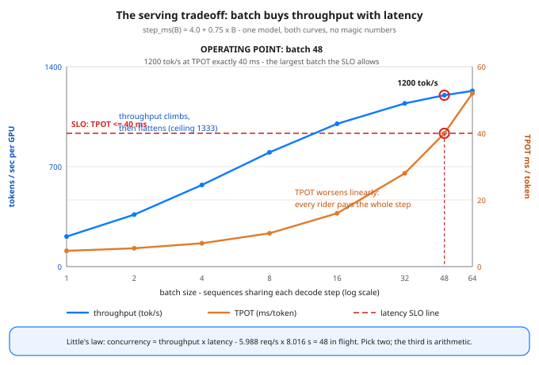

# Day 66 — Latency vs Throughput: The Serving Tradeoff

**Tonight you'll be able to:** read any serving setup on its two clocks — TTFT (prefill-bound) and TPOT (step-bound) — sweep batch size against a stated step-time model, and use Little's law to pick the operating point that meets the latency SLO at the best $/token instead of the biggest benchmark number.

## The one idea

Every serving system you will ever capacity-plan runs on **two clocks**, and they fail differently. **TTFT — time to first token** — is how long a user stares at a blank screen. It is paid once per request and dominated by **prefill**: the prompt is processed all at once, in parallel, compute-bound (Day 48). **TPOT — time per output token** — is the drip rate after that: how fast the answer streams. It is paid once per generated token, and it *is* the decode step time — one step reads the weights from memory once and emits exactly one token per sequence, which is why decode is bandwidth-bound (Day 48 again). A user's total wait is `TTFT + (tokens - 1) * TPOT` — and the two terms have different bottlenecks, so they have different fixes. Tuning one clock with the other clock's tool is the classic serving own-goal.

**Batching is how you spend one clock to buy the other.** A decode step has a fixed cost — launching the kernels and reading the weights — no matter how many sequences ride it. Put 1 sequence on the step and that sequence alone pays the whole read; put 48 on it (Day 64's continuous batching is what makes this practical) and the read is amortized 48 ways. So tokens/sec per GPU climbs steeply with batch size. But the step also gets *slower* as riders are added — more KV cache to read, more logits to write — and every rider waits for the whole step, every token. Throughput rises and flattens toward a ceiling; TPOT worsens linearly, forever. There is no batch size that is best at both. There is only a curve, and a point on it.

**Little's law is the conservation law that keeps you honest:** `concurrency = throughput * latency`. Requests in flight = requests completed per second * seconds each one spends inside. It is pure bookkeeping — it held for your thread pools and connection pools, and it holds here: if 6 requests/sec complete and each spends 8 s generating, you have 48 in flight, whether you planned for them or not. The practical consequence: you cannot independently promise high throughput, low latency, and low concurrency. Pick two and the third is arithmetic. An SLO is how you make the pick deliberately: state the latency budget first (say, p95 TPOT <= 40 ms — about 25 tokens/sec per user, faster than anyone reads), then run the *largest batch that still meets it*. That point is where the GPU earns the most tokens per dollar without a user ever feeling the trade — and it is exactly where tonight's sweep lands.

**The model, stated so you can audit every number:** `step_ms(B) = 4.0 + 0.75*B` (4.0 ms fixed: launch + one full weight read; 0.75 ms per sequence riding the step), prefill at 0.02 ms/token over an 800-token prompt, 200 output tokens. Real engines differ in the constants — quantized weights (Day 65) shrink the fixed read, faster memory raises it less — but never in the shape: throughput concave and saturating at `1000/0.75 = 1333 tok/s`, TPOT a straight line up. Learn the shape once and every vendor benchmark becomes a claim about two constants you can ask for.

## Analogy

This is a capacity review you have already run a hundred times, wearing new labels. A database connection pool: batch size is pool size, the step's fixed 4.0 ms is the per-query overhead you amortize by keeping connections busy, TPOT is per-query latency, throughput is QPS — and Little's law is the reason a pool of 50 at 10 QPS means 5-second waits are *somewhere* in your system, whatever the dashboard's averages say. Or a highway: batching is carpooling. One GPU "trip" (the weight read) happens either way; the only question is how many passengers split it — and past a point the on-ramp queue (each rider's TPOT) costs more than the shared trip saves. Nobody sizes a pool or a fleet by "max possible"; you size it at the latency budget. Serving is the same discipline with tokens instead of queries: **the SLO chooses the batch, not the benchmark.**

## See it



One stated model (`step_ms(B) = 4.0 + 0.75*B`), both curves drawn from it. Blue: tokens/sec per GPU — steep early gains as the fixed weight read is amortized, flattening toward the 1333 tok/s ceiling. Orange: TPOT — a straight line up, because every sequence riding a step pays the whole step. The dashed red SLO line (TPOT <= 40 ms) cuts the orange curve at batch 48: the operating point, 1200 tok/s at exactly the budget. One step further right buys +2.6% throughput for a blown SLO.

## Code it (~30 min)

Pure Python standard library — no torch, no GPU, no benchmark to argue with: a stated model, swept honestly. **Part 1** prices one request on both clocks at batch 1 vs batch 48. **Part 2** sweeps batch 1→64 and checks Little's law on every row (`lambda * W` must return the batch). **Part 3** picks the operating point: the largest batch inside the TPOT budget, the bad trade one step past it, and a first cost sketch (the full $/token treatment is Day 72). Change any of the five constants at the top and re-run — the verdict moves, the shape doesn't.

```python
"""Day 66 - Latency vs Throughput: The Serving Tradeoff.

Phase E. Yesterday's quantization (Day 65) made each step
cheaper; Day 64's continuous batching decides how many
sequences share a step. Tonight is the capacity review for
that step: serving runs on TWO clocks, and batching trades
one against the other.

  TTFT  time to first token. Paid once per request, before
        anything streams. Dominated by prefill: the prompt
        is processed in parallel, compute-bound (Day 48).
  TPOT  time per output token. Paid once per generated
        token. It IS the decode step time: one step reads
        the weights once and emits one token for every
        sequence in the batch (Day 48's KV cache makes the
        step mostly a weight read, i.e. bandwidth-bound).

The step-time model - stated, not magic. Every number in
this lesson comes from these five constants:

  step_ms(B)   = 4.0 + 0.75 * B        (decode step)
                 4.0 ms fixed: launch + one full read of
                 the weights from HBM, shared by the batch
                 0.75 ms per sequence riding the step
  prefill_ms   = 0.02 * prompt_tokens  (parallel, compute)
  prompt       = 800 tokens, output = 200 tokens
  TPOT budget  = 40 ms/token  (= 25 tok/s per user: a fast
                 reader streams comfortably above this)

  Part 1  One request, two clocks. At batch 1 and batch
          48: TTFT, TPOT, and the total time to produce
          a 200-token answer. The first token is a sprint;
          the other 199 are a toll road.
  Part 2  The sweep, batch 1 -> 64. Bigger batch: the
          fixed 4.0 ms is amortized over more sequences,
          so tokens/sec per GPU climbs steeply then flattens
          toward the 1000/0.75 = 1333 tok/s ceiling - while
          TPOT worsens linearly and TTFT creeps up. The
          last column checks Little's law on every row:
          concurrency = req/s x latency, exactly B.
  Part 3  The operating point. The largest batch inside
          the TPOT budget wins the GPU's throughput at the
          best $/token - and one batch step past it buys
          almost no throughput for a blown SLO. Little's
          law is the conservation law: concurrency,
          throughput and latency - pick two, the third is
          arithmetic. Full cost math is Day 72.

Pure standard library: no torch, no GPU, no APIs - this is
a model on purpose, so the tradeoff's SHAPE is auditable
arithmetic, not a benchmark. Real engines differ in the
constants, never in the shape. Runs anywhere Python 3 runs,
including the ~/ai-lab venv on the MacBook.

Expected output:

  Part 1 - one request, two clocks (800-token prompt, 200-token answer)
    batch  1: TTFT  20.75 ms (once)   TPOT  4.75 ms x 199 tokens   total 0.966 s   user sees 210.5 tok/s
    batch 48: TTFT  56.00 ms (once)   TPOT 40.00 ms x 199 tokens   total 8.016 s   user sees 25.0 tok/s
    TTFT is paid once and is prefill-bound; TPOT is paid
    per token and is step-bound. Different clocks,
    different bottlenecks, different fixes.
  Part 2 - the sweep: batch trades TPOT for throughput
    batch  TPOT ms  TTFT ms  total s    tok/s   req/s  lam x W
        1     4.75    20.75    0.966    210.5   1.035     1.00
        2     5.50    21.50    1.116    363.6   1.792     2.00
        4     7.00    23.00    1.416    571.4   2.825     4.00
        8    10.00    26.00    2.016    800.0   3.968     8.00
       16    16.00    32.00    3.216   1000.0   4.975    16.00
       32    28.00    44.00    5.616   1142.9   5.698    32.00
       48    40.00    56.00    8.016   1200.0   5.988    48.00
       64    52.00    68.00   10.416   1230.8   6.144    64.00
    lam x W = concurrency = batch, every row: Little's
    law holds exactly, because it is bookkeeping, not luck.
  Part 3 - the operating point (SLO: TPOT <= 40 ms)
    largest batch inside budget: 48 (TPOT 40.00 ms, 1200.0 tok/s decode, 1197.6 tok/s end-to-end)
    batch 64: TPOT 52.00 ms breaks the SLO for only +2.6% throughput - a bad trade
    cost sketch @ $2/GPU-hr, batch  1: $2.68 per 1M tokens
    cost sketch @ $2/GPU-hr, batch 48: $0.46 per 1M tokens
    verdict: you cannot cheat Little's law - concurrency =
    throughput x latency. You can only CHOOSE the point on
    the curve: the largest batch the latency SLO allows.
"""

# ---- the model: five constants, everything derives ----
STEP_BASE_MS = 4.0        # fixed per step: launch + weight read
STEP_PER_SEQ_MS = 0.75    # marginal cost per batched sequence
PREFILL_MS_PER_TOKEN = 0.02
PROMPT_TOKENS = 800
OUTPUT_TOKENS = 200
TPOT_BUDGET_MS = 40.0     # SLO: at most 40 ms per output token
GPU_USD_PER_HOUR = 2.0    # sketch only - full cost math Day 72


def step_ms(batch):
    """One decode step: every sequence in the batch emits
    exactly one token, so step time == TPOT."""
    return STEP_BASE_MS + STEP_PER_SEQ_MS * batch


def ttft_ms(batch):
    """Prefill the 800-token prompt (parallel compute), plus
    waiting for the in-flight decode step to finish so the
    new sequence can join the batch (Day 64)."""
    return PREFILL_MS_PER_TOKEN * PROMPT_TOKENS + step_ms(batch)


def total_ms(batch):
    """One full request: TTFT once, then TPOT per token."""
    return ttft_ms(batch) + (OUTPUT_TOKENS - 1) * step_ms(batch)


def decode_tok_s(batch):
    """Tokens/sec during decode: B tokens per step."""
    return 1000.0 * batch / step_ms(batch)


def req_per_s(batch):
    """Steady-state completions: B requests finish per
    total_ms window (Little's-law throughput)."""
    return 1000.0 * batch / total_ms(batch)


# ---------- Part 1: one request, two clocks ----------
print("Part 1 - one request, two clocks "
      "(800-token prompt, 200-token answer)")
for b in (1, 48):
    print(f"  batch {b:>2}: TTFT {ttft_ms(b):6.2f} ms (once)   "
          f"TPOT {step_ms(b):5.2f} ms x {OUTPUT_TOKENS - 1} tokens   "
          f"total {total_ms(b) / 1000:.3f} s   "
          f"user sees {1000.0 / step_ms(b):.1f} tok/s")
print("  TTFT is paid once and is prefill-bound; TPOT is paid")
print("  per token and is step-bound. Different clocks,")
print("  different bottlenecks, different fixes.")

# ---------- Part 2: the sweep ----------
print("Part 2 - the sweep: batch trades TPOT for throughput")
print(f"  {'batch':>5} {'TPOT ms':>8} {'TTFT ms':>8} {'total s':>8} "
      f"{'tok/s':>8} {'req/s':>7} {'lam x W':>8}")
for b in (1, 2, 4, 8, 16, 32, 48, 64):
    lam = req_per_s(b)
    little = lam * total_ms(b) / 1000.0      # should equal b
    print(f"  {b:>5} {step_ms(b):>8.2f} {ttft_ms(b):>8.2f} "
          f"{total_ms(b) / 1000:>8.3f} {decode_tok_s(b):>8.1f} "
          f"{lam:>7.3f} {little:>8.2f}")
print("  lam x W = concurrency = batch, every row: Little's")
print("  law holds exactly, because it is bookkeeping, not luck.")

# ---------- Part 3: the operating point ----------
print(f"Part 3 - the operating point (SLO: TPOT <= "
      f"{TPOT_BUDGET_MS:.0f} ms)")
ok = [b for b in range(1, 65) if step_ms(b) <= TPOT_BUDGET_MS]
best = max(ok)
over = best + 16
gain = decode_tok_s(over) / decode_tok_s(best) - 1.0
print(f"  largest batch inside budget: {best} "
      f"(TPOT {step_ms(best):.2f} ms, "
      f"{decode_tok_s(best):.1f} tok/s decode, "
      f"{req_per_s(best) * OUTPUT_TOKENS:.1f} tok/s end-to-end)")
print(f"  batch {over}: TPOT {step_ms(over):.2f} ms breaks the SLO "
      f"for only +{gain * 100:.1f}% throughput - a bad trade")
for b in (1, best):
    e2e = req_per_s(b) * OUTPUT_TOKENS
    cost = GPU_USD_PER_HOUR / (e2e * 3600.0) * 1_000_000
    print(f"  cost sketch @ ${GPU_USD_PER_HOUR:.0f}/GPU-hr, batch "
          f"{b:>2}: ${cost:.2f} per 1M tokens")
print("  verdict: you cannot cheat Little's law - concurrency =")
print("  throughput x latency. You can only CHOOSE the point on")
print("  the curve: the largest batch the latency SLO allows.")
```

**Expected output:**

```
Part 1 - one request, two clocks (800-token prompt, 200-token answer)
  batch  1: TTFT  20.75 ms (once)   TPOT  4.75 ms x 199 tokens   total 0.966 s   user sees 210.5 tok/s
  batch 48: TTFT  56.00 ms (once)   TPOT 40.00 ms x 199 tokens   total 8.016 s   user sees 25.0 tok/s
  TTFT is paid once and is prefill-bound; TPOT is paid
  per token and is step-bound. Different clocks,
  different bottlenecks, different fixes.
Part 2 - the sweep: batch trades TPOT for throughput
  batch  TPOT ms  TTFT ms  total s    tok/s   req/s  lam x W
      1     4.75    20.75    0.966    210.5   1.035     1.00
      2     5.50    21.50    1.116    363.6   1.792     2.00
      4     7.00    23.00    1.416    571.4   2.825     4.00
      8    10.00    26.00    2.016    800.0   3.968     8.00
     16    16.00    32.00    3.216   1000.0   4.975    16.00
     32    28.00    44.00    5.616   1142.9   5.698    32.00
     48    40.00    56.00    8.016   1200.0   5.988    48.00
     64    52.00    68.00   10.416   1230.8   6.144    64.00
  lam x W = concurrency = batch, every row: Little's
  law holds exactly, because it is bookkeeping, not luck.
Part 3 - the operating point (SLO: TPOT <= 40 ms)
  largest batch inside budget: 48 (TPOT 40.00 ms, 1200.0 tok/s decode, 1197.6 tok/s end-to-end)
  batch 64: TPOT 52.00 ms breaks the SLO for only +2.6% throughput - a bad trade
  cost sketch @ $2/GPU-hr, batch  1: $2.68 per 1M tokens
  cost sketch @ $2/GPU-hr, batch 48: $0.46 per 1M tokens
  verdict: you cannot cheat Little's law - concurrency =
  throughput x latency. You can only CHOOSE the point on
  the curve: the largest batch the latency SLO allows.
```

## Today's win

Done when your sweep shows: `lambda * W` returning the batch exactly on all eight rows (Little's law, verified not asserted); throughput flattening (1142.9 → 1200.0 → 1230.8 tok/s across batches 32/48/64) while TPOT marches linearly (28 → 40 → 52 ms); and Part 3 naming **batch 48** as the operating point — TPOT exactly 40.00 ms, 1200.0 tok/s decode, $0.46 per 1M tokens vs $2.68 at batch 1. The keeper sentence, no notes: *batching trades TPOT for throughput along a fixed curve, Little's law forbids cheating it, so the latency SLO picks the batch.*

## Short on time? 20-minute version

Read "The one idea" and study the diagram until you can sketch both curves and the SLO cut from memory. Then run only Part 2 and Part 3 of the code and say the verdict out loud: why 48 and not 64. If you can explain why lambda * W *must* equal the batch, you have the lesson — Part 1 is the warm-up lap.

## Tomorrow's teaser

Tomorrow: you'll be making serving decisions like this weekly — so we set up the notebook every experiment, sweep, and regression gets logged in, before the wins evaporate into scrollback.

---
Streak: 66 day(s) · Never miss twice.
