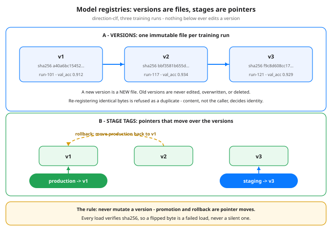

# Day 68 — Model Registries & Versioning: The Model Is a Build Artifact

**Tonight you'll be able to:** explain why a trained model deserves the same treatment as a shipped binary — immutable versions, content hashes, lineage, and stage tags that move without renaming anything — and prove the one rule that makes it work: never mutate a version.

## The one idea

Day 67 left you with experiment runs: a pile of trained models and the
metrics each one scored. Tonight the pile gets a system. A model
registry is a catalog where each trained model is stored as a
**versioned artifact** — the same treatment you give a build
artifact in a container registry, with four properties attached to every entry:

- **Immutable versions.** Registering a model mints `v1`,
`v2`, `v3` — one file per training run. A version, once
written, is never edited. A better model is a *new* version, never an
overwrite. That is what makes "which model is in production?" an answerable
question instead of a forensic one.
- **Content hash.** Each version carries a sha256 digest of its
exact bytes (Day 24's `state_dict`, saved to disk). The digest is the
version's identity: two models with the same digest *are* the same model,
and a load that recomputes a different digest has caught a corrupted or tampered
artifact before it serves a single prediction.
- **Lineage.** Each version records where it came from: the run
that produced it (Day 67), the data snapshot it trained on, and its metrics.
When production misbehaves, lineage is how you answer "what changed?" — the same
question a deploy diff answers for a service.
- **Stage tags.** `staging` and `production`
are not versions; they are *pointers to* versions, kept in one small file.
Promotion moves the pointer from `v1` to `v2`. It rewrites
no model bytes, retrains nothing, and takes one line. Rollback is the same move,
backwards — which is only possible because the old version was never deleted or
edited.

The one rule, said as a deploy rule you already live by: never mutate
a version; promotion is a pointer move, exactly like a container tag moving over
immutable image digests. Every production incident story in ML that
starts "we can't reproduce what was serving" traces back to breaking this rule —
someone overwrote `model.pkl`, or served "the latest file," and the
bytes that made the bad predictions are gone. A registry makes that story
structurally impossible: the file you served is still there, under its digest,
and the tag that pointed at it is a one-line change you can read in the
log.

## Analogy

Your home turf, one-to-one. A container registry stores immutable
images addressed by digest, and a tag like `prod` is a
mutable pointer that moves across digests. You would never docker push
prod over an existing digest and call it a deploy — you push a new digest
and move the tag, because the old image must stay runnable for rollback. A model
registry is the same machine with weights in place of layers: version = digest,
stage tag = image tag, `resolve("name@production")` = pulling
`name:prod` and verifying the digest on arrival. If you have ever
rolled a service back by moving a tag, you already know how to roll a model
back — the code tonight is that move, with the hash check your registry would do
for you.

## See it



Top: versions are immutable files — one per training run, each with its sha256 digest and lineage. Bottom: stage tags are pointers over those versions; production moves v1 → v2 and rolls back to v1 without touching any model bytes. The footer is the rule the whole lesson hangs on, plus the hash check on every load.

## Code it (~30 min)

One file, stdlib only, no installs — the registry is ~120 lines on a
plain directory. **Part 1** registers three versions of
`direction-clf` (Day 32's model, all grown up) and refuses a
duplicate. **Part 2** moves the stage pointers and resolves
`direction-clf@production` with a hash check on every load.
**Part 3** rolls production back to v1, prints the registry
table, and flips one byte in v3's stored file to prove a tampered artifact
fails loudly. The fake weights are deterministic formula bytes standing in for a
real `state_dict`. The whole registry lives in a self-cleaning temp
dir — **your run leaves nothing behind** (the final line proves
it).

```python
"""Day 68 - Model Registries & Versioning: The Model Is a Build Artifact.

Day 67 left you with experiment runs - a pile of trained models
and the metrics each one scored. Tonight, the one idea that
turns that pile into something you can ship:

    A trained model is a BUILD ARTIFACT. Give it what every
    artifact you already ship has: immutable versions, a
    content hash, lineage, and stage tags that move.

The registry built here (stdlib only, ~120 lines) enforces
the one rule that makes the rest work:

    NEVER MUTATE A VERSION. Promotion is a pointer move -
    exactly like a container tag moving over immutable image
    digests. Rollback is the same move, backwards.

  Part 1  Register three versions of one model. Each gets the
          next version number, a sha256 digest of its exact
          bytes, and a lineage record (which run, which data
          snapshot, which metrics). Re-registering identical
          bytes is refused as a duplicate - content decides
          identity, not the caller.
  Part 2  Stage tags: staging and production are pointers in
          one small JSON file. Moving production v1 -> v2
          rewrites no model bytes. resolve("name@production")
          follows the pointer, loads the exact bytes, and
          VERIFIES the sha256 on every load.
  Part 3  Rollback = move the production pointer back to v1,
          one line, because v1 was never deleted or edited.
          Then the tamper demo: flip one byte in v3's stored
          file and the load raises - a registry that cannot
          detect a changed artifact is just a folder.

The fake "weights" are deterministic bytes from a formula
(stand-ins for a Day 24 state_dict saved to disk). The whole
registry lives in a self-cleaning temp dir: your run leaves
nothing behind on the MacBook.

Runs anywhere Python 3.11+ runs: standard library ONLY -
no torch, no installs, no APIs, no downloads.

Expected output:

  Part 1 - register: every version immutable, hashed, traced
    registered direction-clf v1  sha256 a40a6bc15452...  48 bytes  run-101  val_acc 0.912
    registered direction-clf v2  sha256 bbf3581b655d...  48 bytes  run-117  val_acc 0.934
    registered direction-clf v3  sha256 f9c8d608cc17...  48 bytes  run-121  val_acc 0.929
    dedup: those exact bytes are already v2 - no new version created
  Part 2 - stage tags are pointers; promotion moves the pointer
    staging -> v1, production -> v1   (first deploy)
    resolve direction-clf@production -> v1  (48 bytes, sha256 verified on load)
    staging -> v3   (newest candidate, still being evaluated)
    promote: production -> v2   (pointer move only - v1's bytes untouched)
    resolve direction-clf@production -> v2  (48 bytes, sha256 verified on load)
  Part 3 - rollback is a pointer move; tampering is caught
    rollback: production -> v1   (one pointer move, no rebuild, no retrain)
    resolve direction-clf@production -> v1  (48 bytes, sha256 verified on load)
    registry table - direction-clf
      version  digest          run      val_acc  stage
      v1       a40a6bc15452    run-101  0.912    production
      v2       bbf3581b655d    run-117  0.934    -
      v3       f9c8d608cc17    run-121  0.929    staging
    tamper: flipped one byte in v3's stored file
    load v3 RAISED: integrity check failed for direction-clf v3 (sha256 mismatch)
  cleanup: temp registry deleted - nothing left behind (exists: False)
"""
import hashlib
import json
import shutil
import tempfile
from pathlib import Path


def make_weights(k, n=48):
    """Deterministic fake weights: byte i is a formula of k and i.
    Same k -> same bytes -> same digest, every run, every machine."""
    return bytes((k * 31 + 7 * i + i * i) % 256 for i in range(n))


class Registry:
    """A mini model registry on a plain directory.

    Layout:  <root>/<name>/blobs/<digest>.bin    (the artifacts)
             <root>/<name>/versions/v<N>.json    (lineage records)
             <root>/<name>/stages.json           (tag -> version)
    """

    def __init__(self, root):
        self.root = Path(root)

    def _dir(self, name):
        d = self.root / name
        (d / "blobs").mkdir(parents=True, exist_ok=True)
        (d / "versions").mkdir(parents=True, exist_ok=True)
        return d

    def _versions(self, name):
        d = self._dir(name)
        return sorted(int(p.stem[1:]) for p in d.glob("versions/v*.json"))

    def register_model(self, name, weights, metrics, run_id, data_ref):
        """Store weights as the next immutable version - or refuse,
        if these exact bytes are already registered (dedup)."""
        digest = hashlib.sha256(weights).hexdigest()
        d = self._dir(name)
        for v in self._versions(name):
            meta = json.loads((d / "versions" / f"v{v}.json").read_text())
            if meta["digest"] == digest:
                print(f"  dedup: those exact bytes are already v{v}"
                      " - no new version created")
                return v
        version = (self._versions(name) or [0])[-1] + 1
        (d / "blobs" / f"{digest}.bin").write_bytes(weights)
        meta = {"name": name, "version": version, "digest": digest,
                "size": len(weights), "metrics": metrics,
                "run_id": run_id, "data": data_ref}
        (d / "versions" / f"v{version}.json").write_text(
            json.dumps(meta, indent=2))
        print(f"  registered {name} v{version}  sha256 {digest[:12]}..."
              f"  {len(weights)} bytes  {run_id}"
              f"  val_acc {metrics['val_acc']:.3f}")
        return version

    def set_stage(self, name, stage, version):
        """Move a stage tag. This is the ONLY thing promotion and
        rollback ever do - one pointer in one JSON file."""
        d = self._dir(name)
        f = d / "stages.json"
        stages = json.loads(f.read_text()) if f.exists() else {}
        stages[stage] = version
        f.write_text(json.dumps(stages, indent=2))

    def stages(self, name):
        f = self._dir(name) / "stages.json"
        return json.loads(f.read_text()) if f.exists() else {}

    def load_version(self, name, version):
        """Load one version's exact bytes - and verify the hash.
        A changed artifact is a failed load, never a silent one."""
        d = self._dir(name)
        meta = json.loads((d / "versions" / f"v{version}.json").read_text())
        blob = (d / "blobs" / f"{meta['digest']}.bin").read_bytes()
        if hashlib.sha256(blob).hexdigest() != meta["digest"]:
            raise ValueError(f"integrity check failed for {name} v{version}"
                             " (sha256 mismatch)")
        return blob, meta

    def resolve(self, ref):
        """'name@stage' -> follow the tag, load, verify, print."""
        name, stage = ref.split("@")
        version = self.stages(name)[stage]
        blob, meta = self.load_version(name, version)
        print(f"  resolve {ref} -> v{version}  ({len(blob)} bytes,"
              " sha256 verified on load)")
        return blob, meta

    def table(self, name):
        stages = self.stages(name)
        by_version = {v: s for s, v in stages.items()}
        print(f"  registry table - {name}")
        print("    version  digest          run      val_acc  stage")
        for v in self._versions(name):
            meta = json.loads((self._dir(name) / "versions"
                               / f"v{v}.json").read_text())
            print(f"    v{v:<7} {meta['digest'][:12]}    {meta['run_id']}"
                  f"  {meta['metrics']['val_acc']:.3f}    "
                  f"{by_version.get(v, '-')}")


root = Path(tempfile.mkdtemp(prefix="day68-registry-"))
try:
    reg = Registry(root)
    NAME = "direction-clf"          # Day 32's model, all grown up

    print("Part 1 - register: every version immutable, hashed, traced")
    w1 = make_weights(1)
    w2 = make_weights(2)
    w3 = make_weights(3)
    reg.register_model(NAME, w1, {"val_acc": 0.912}, "run-101",
                       "features@2026-10-15")
    reg.register_model(NAME, w2, {"val_acc": 0.934}, "run-117",
                       "features@2026-10-22")
    reg.register_model(NAME, w3, {"val_acc": 0.929}, "run-121",
                       "features@2026-10-22")
    reg.register_model(NAME, w2, {"val_acc": 0.934}, "run-117",
                       "features@2026-10-22")   # identical bytes again

    print("Part 2 - stage tags are pointers; promotion moves the pointer")
    reg.set_stage(NAME, "staging", 1)
    reg.set_stage(NAME, "production", 1)
    print("  staging -> v1, production -> v1   (first deploy)")
    reg.resolve(f"{NAME}@production")
    reg.set_stage(NAME, "staging", 3)
    print("  staging -> v3   (newest candidate, still being evaluated)")
    reg.set_stage(NAME, "production", 2)
    print("  promote: production -> v2   (pointer move only"
          " - v1's bytes untouched)")
    reg.resolve(f"{NAME}@production")

    print("Part 3 - rollback is a pointer move; tampering is caught")
    reg.set_stage(NAME, "production", 1)
    print("  rollback: production -> v1   (one pointer move,"
          " no rebuild, no retrain)")
    reg.resolve(f"{NAME}@production")
    reg.table(NAME)
    blob_path = root / NAME / "blobs" / \
        f"{hashlib.sha256(w3).hexdigest()}.bin"
    data = bytearray(blob_path.read_bytes())
    data[0] ^= 0xFF                              # flip every bit of byte 0
    blob_path.write_bytes(bytes(data))
    print("  tamper: flipped one byte in v3's stored file")
    try:
        reg.load_version(NAME, 3)
        print("  load v3: NO ERROR - the registry failed you")
    except ValueError as e:
        print(f"  load v3 RAISED: {e}")
finally:
    shutil.rmtree(root, ignore_errors=True)
print(f"cleanup: temp registry deleted - nothing left behind"
      f" (exists: {root.exists()})")
```

**Expected output:**

```
Part 1 - register: every version immutable, hashed, traced
  registered direction-clf v1  sha256 a40a6bc15452...  48 bytes  run-101  val_acc 0.912
  registered direction-clf v2  sha256 bbf3581b655d...  48 bytes  run-117  val_acc 0.934
  registered direction-clf v3  sha256 f9c8d608cc17...  48 bytes  run-121  val_acc 0.929
  dedup: those exact bytes are already v2 - no new version created
Part 2 - stage tags are pointers; promotion moves the pointer
  staging -> v1, production -> v1   (first deploy)
  resolve direction-clf@production -> v1  (48 bytes, sha256 verified on load)
  staging -> v3   (newest candidate, still being evaluated)
  promote: production -> v2   (pointer move only - v1's bytes untouched)
  resolve direction-clf@production -> v2  (48 bytes, sha256 verified on load)
Part 3 - rollback is a pointer move; tampering is caught
  rollback: production -> v1   (one pointer move, no rebuild, no retrain)
  resolve direction-clf@production -> v1  (48 bytes, sha256 verified on load)
  registry table - direction-clf
    version  digest          run      val_acc  stage
    v1       a40a6bc15452    run-101  0.912    production
    v2       bbf3581b655d    run-117  0.934    -
    v3       f9c8d608cc17    run-121  0.929    staging
  tamper: flipped one byte in v3's stored file
  load v3 RAISED: integrity check failed for direction-clf v3 (sha256 mismatch)
cleanup: temp registry deleted - nothing left behind (exists: False)
```

## Today's win

Done when your run shows all three proofs: Part 1's three digests with
the dedup refusal ("those exact bytes are already v2"); Part 2's
`production → v2` pointer move followed by a resolve that still
verifies sha256 on load; and Part 3's one-line rollback to v1 plus the tamper
demo ending in `integrity check failed` — not a silent load. The
keeper test, no notes allowed: given a production incident, you can say which
version served, which run and data made it, and how you roll back in one
pointer move.

## Short on time? 20-minute version

Read "The one idea", study the diagram until you can redraw its two
panels from memory, then run only Parts 2 and 3. If you can say out loud why
promotion and rollback are pointer moves and why a version must never be
mutated, you have the lesson — Part 1 is the setup.

## Tomorrow's teaser

Tomorrow: what keeps a registry fed — the day-to-day work behind the
models that land in it, and where their data comes from.

Streak: 68 day(s) · Never miss twice.
