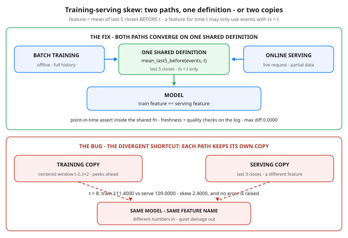

# Day 69 of 100 — Data Pipelines for ML: What 'MLOps' Actually Means Day-to-Day

**Tonight you'll be able to:** spot training-serving skew in the wild, state the point-in-time law that prevents its worst form, and enforce both with one shared feature definition that the training path and the serving path both import.

## The one idea

Strip the vendor keynotes away and MLOps day-to-day is plumbing: getting data from where it is produced to where a model trains and serves, in the right shape, at the right time, with ongoing proof it is still right. For a systems engineer this is familiar ground — pipelines, schemas, freshness, checks. There is exactly one new failure mode, and it has no real analogue in ordinary software: when the data is wrong, the model does not crash. It just gets quietly worse.

The name for it is training-serving skew. A feature is a number computed from raw data that the model consumes — tonight’s example is “mean of last 5 closes before t.” Training computes features offline: a batch job over the full historical table, run once. Serving computes the “same” feature online: a live job over whatever data has arrived so far, per request. Two codebases, possibly two authors, two moments in time — and no compiler anywhere forcing them to agree. A window quietly differs, a filter changes, a boundary lands one tick off, and the model’s production inputs drift away from the inputs it was validated on. The offline metrics were honest. Production is simply a different distribution than the one in the report.

The nastiest subspecies is the point-in-time violation. The offline job has the entire future sitting in its table, one WHERE clause away. If the feature for a prediction at time t is computed using any event with ts ≥ t, training has peeked. That is Day 32’s no-peeking rule — fit your window on data that existed, standardize with train stats only — promoted from a notebook habit to a systems law:
A feature for a prediction at time t may only use data that existed at t (ts < t).

Violate it and the training metrics are fiction: the model “learned” from information it can never possess live, so the backtest glows and production bleeds. Respect it in a hand-run notebook and you are one engineer being careful; the production fix has to be structural.

The fix is a contract, not a tool. (1) One feature definition in one place — a single function or module that both paths import; copy-paste is where skew is born. (2) Point-in-time correctness enforced inside that definition, asserted in code, not hoped for in review. (3) Freshness checks — how old is the newest data this feature just read? A silently stalled upstream feed should page a human, not propagate into predictions. (4) Quality checks — null rates, value ranges, and row counts inside expected bands, the data version of a health endpoint. (5) Version the definition like an API schema — change it, and both paths change together, under a new version.

The tooling around that contract is interchangeable plumbing: Airflow or Dagster schedules the batch path, Kafka carries the stream, dbt shapes the tables, Feast/Tecton-style feature stores exist precisely to serve one definition to both paths, and Great Expectations-style checks guard quality. Learn the contract and every one of those tools is a weekend read. Learn a tool without the contract and you have bought a faster way to skew.

## Analogy

Two replicas of the same derived state, maintained by different code — your storage brain already knows this story. If the write path maintains a view one way and the repair job rebuilds it with slightly different logic, the replicas diverge with no error anywhere; every operator just sees two plausible-looking copies. The fix was never “be more careful” — it is one shared implementation, plus checksums that fail loudly when copies disagree. Skew is that bug wearing an ML costume, and the shared feature definition plus the point-in-time assert is the same cure.

Trading version, one line: your backtest’s indicator computed with the day’s final close vs the live indicator at 10am — same name, different number, and the backtest always looks smarter.

## See it



*Top: the fix &mdash; batch training and online serving are different jobs reading different data, but both arrows converge on ONE shared feature definition, so agreement is structural, not coincidental. Bottom: the bug, drawn as the divergent shortcut &mdash; each path keeps a private copy that bypasses the shared box (the training copy even peeks into the future), and the model receives different numbers under the same feature name, with no error raised.*

## Code it (~30 min)

One file, standard library only — tonight is a data-path lesson, no torch. A 12-tick event log stands in for the production table or topic. Part 1 implements the spec and the two buggy private copies (training peeks with a centered window; serving quietly uses 3 closes) and prints the skew table. Part 2 replaces both copies with one shared function that both paths import, and re-measures. Part 3 feeds that function’s guard a poisoned window and watches it fail loudly.

```python
"""Day 69 - Data Pipelines for ML: What "MLOps" Actually Means Day-to-Day.

Phase E. Strip the buzzword and MLOps day-to-day is mostly
plumbing around the model - and the #1 production ML failure
is not the model at all. It is the data path, specifically:

    TRAINING-SERVING SKEW - the feature computed one way in
    training (offline batch job, full history on disk) and
    another way at serving (online job, partial live data),
    so the two silently disagree. The model was validated on
    one set of numbers and is fed a different set in prod.
    No exception, no crash - just quiet degradation.

The nastiest subspecies is a point-in-time violation: the
offline job computes a feature for a prediction at time t
using data that did not exist at t. That is Day 32's
no-peeking rule promoted from a notebook habit to a systems
law: a feature for time t may only use events with ts < t.

The fix is a contract, not a tool: ONE feature definition in
ONE place, imported by both paths, with the point-in-time
rule asserted inside it - plus freshness and quality checks
on the log it reads. Feature stores, schedulers and stream
processors are interchangeable brands of plumbing; the
contract is the part that cannot be bought.

  Part 1  The bug. One event log of price ticks, one spec
          ("mean of last 5 closes BEFORE t"), and two buggy
          copies: the training job uses a centered window
          that peeks at ticks after t; the serving job uses
          the last 3 closes. Print the skew table - the two
          paths disagree by whole points, silently.
  Part 2  The fix. Both paths import the SAME function.
          Features come out identical (max diff 0.0), and a
          freshness check reports how stale the newest
          usable event is.
  Part 3  The guard. The shared function asserts
          point-in-time correctness. Feed it a poisoned
          window with the tick AT t smuggled in and it fails
          loudly - the exact failure Part 1 let through.

Pure standard library - no torch needed tonight, this is a
data-path lesson. Runs in the ~/ai-lab venv on the MacBook:
no CUDA, no paid APIs, no downloads, fully deterministic.

Expected output:

  Part 1 - two copies of "the same" feature: the skew
    spec: mean of last 5 closes BEFORE t
      t      spec     train     serve     skew
      6  103.8000  108.0000  105.3333   2.6667
      8  107.0000  111.4000  109.0000   2.4000
      9  108.0000  113.6000  109.6667   3.9333
    max skew 3.9333 - and note train != spec either: the peek inflated it
    no exception, no log line - the model just eats different numbers in prod
  Part 2 - ONE shared definition, imported by both paths
      t     train     serve     diff
      6  103.8000  103.8000   0.0000
      8  107.0000  107.0000   0.0000
      9  108.0000  108.0000   0.0000
    max diff 0.0000 - same code, same window, same numbers, by construction
    freshness check: newest event usable at t=9 is ts=8 (1 tick old) - OK
  Part 3 - the point-in-time guard fails loudly
    a poisoned window for t=8 smuggles in the tick AT ts=8 (the one being predicted)
    AssertionError: point-in-time violation: event ts=8 is not < t=8
    in Part 1's training job that same event passed silently - the silence is the bug class
    verdict: one definition, shared by both paths, point-in-time asserted - that IS the MLOps job
"""

# One source of truth: an append-only event log of price ticks.
# (ts, close) - in prod this is your Kafka topic / S3 partition;
# the shape is identical: timestamped facts, arriving in order.
EVENTS = [
    (0, 100.0), (1, 102.0), (2, 101.0), (3, 105.0),
    (4, 103.0), (5, 108.0), (6, 107.0), (7, 112.0),
    (8, 110.0), (9, 115.0), (10, 113.0), (11, 118.0),
]

# The spec, in one sentence: for a prediction at time t, the
# feature is the mean of the last 5 closes that existed BEFORE
# t. Everything below is either obeying this or violating it.


# ---------- Part 1: two private copies of the feature ----------
def buggy_train_feature(events, t):
    """Offline batch job. The engineer had the whole table, so
    they grabbed a 'centered' window around t - which peeks at
    ticks at t+1 and t+2 that did not exist at prediction time."""
    window = [c for ts, c in events if t - 2 <= ts <= t + 2]
    return sum(window) / len(window)


def buggy_serve_feature(events, t):
    """Online job. Someone 'optimized' it to the last 3 closes
    before t. Point-in-time legal - but it is a DIFFERENT
    feature wearing the same name."""
    window = [c for ts, c in events if ts < t][-3:]
    return sum(window) / len(window)


def spec_feature(events, t):
    """What the spec actually says - ground truth for the table."""
    window = [c for ts, c in events if ts < t][-5:]
    return sum(window) / len(window)


print('Part 1 - two copies of "the same" feature: the skew')
print("  spec: mean of last 5 closes BEFORE t")
print(f"  {'t':>3} {'spec':>9} {'train':>9} {'serve':>9} {'skew':>8}")
max_skew = 0.0
for t in (6, 8, 9):
    spec = spec_feature(EVENTS, t)
    tr = buggy_train_feature(EVENTS, t)
    sv = buggy_serve_feature(EVENTS, t)
    skew = abs(tr - sv)
    max_skew = max(max_skew, skew)
    print(f"  {t:>3} {spec:>9.4f} {tr:>9.4f} {sv:>9.4f} {skew:>8.4f}")
print(f"  max skew {max_skew:.4f} - and note train != spec either: "
      "the peek inflated it")
print("  no exception, no log line - the model just eats "
      "different numbers in prod")

# ---------- Part 2: one shared definition, both paths ----------
def assert_point_in_time(window_events, t):
    """The systems law, enforced: every event a feature uses
    must have existed strictly before the prediction time."""
    for ts, _ in window_events:
        assert ts < t, (f"point-in-time violation: event ts={ts} "
                        f"is not < t={t}")


def mean_last5_before(events, t):
    """THE feature definition - the only one. The training job
    and the serving job both import this exact function."""
    window = [(ts, c) for ts, c in events if ts < t][-5:]
    assert_point_in_time(window, t)
    return sum(c for _, c in window) / len(window)


print("Part 2 - ONE shared definition, imported by both paths")
print(f"  {'t':>3} {'train':>9} {'serve':>9} {'diff':>8}")
max_diff = 0.0
for t in (6, 8, 9):
    tr = mean_last5_before(EVENTS, t)   # training path calls it
    sv = mean_last5_before(EVENTS, t)   # serving path calls it
    max_diff = max(max_diff, abs(tr - sv))
    print(f"  {t:>3} {tr:>9.4f} {sv:>9.4f} {abs(tr - sv):>8.4f}")
print(f"  max diff {max_diff:.4f} - same code, same window, "
      "same numbers, by construction")
newest = max(ts for ts, _ in EVENTS if ts < 9)
print(f"  freshness check: newest event usable at t=9 is ts={newest} "
      f"({9 - newest} tick old) - OK")

# ---------- Part 3: the guard fails loudly ----------
print("Part 3 - the point-in-time guard fails loudly")
poisoned = [(ts, c) for ts, c in EVENTS if ts < 8][-4:] + [(8, 110.0)]
print("  a poisoned window for t=8 smuggles in the tick AT ts=8 "
      "(the one being predicted)")
try:
    assert_point_in_time(poisoned, 8)
    print("  NOT REACHED - the guard let a future event through")
except AssertionError as e:
    print(f"  AssertionError: {e}")
print("  in Part 1's training job that same event passed silently - "
      "the silence is the bug class")
print("  verdict: one definition, shared by both paths, point-in-time "
      "asserted - that IS the MLOps job")
```

**Expected output:**

```
Part 1 - two copies of "the same" feature: the skew
  spec: mean of last 5 closes BEFORE t
    t      spec     train     serve     skew
    6  103.8000  108.0000  105.3333   2.6667
    8  107.0000  111.4000  109.0000   2.4000
    9  108.0000  113.6000  109.6667   3.9333
  max skew 3.9333 - and note train != spec either: the peek inflated it
  no exception, no log line - the model just eats different numbers in prod
Part 2 - ONE shared definition, imported by both paths
    t     train     serve     diff
    6  103.8000  103.8000   0.0000
    8  107.0000  107.0000   0.0000
    9  108.0000  108.0000   0.0000
  max diff 0.0000 - same code, same window, same numbers, by construction
  freshness check: newest event usable at t=9 is ts=8 (1 tick old) - OK
Part 3 - the point-in-time guard fails loudly
  a poisoned window for t=8 smuggles in the tick AT ts=8 (the one being predicted)
  AssertionError: point-in-time violation: event ts=8 is not < t=8
  in Part 1's training job that same event passed silently - the silence is the bug class
  verdict: one definition, shared by both paths, point-in-time asserted - that IS the MLOps job
```

## Today's win

Done when your run shows all three: Part 1’s skew table with max skew 3.9333 (and the training copy inflated to 113.6000 at t=9 by peeking); Part 2’s max diff 0.0000 from one imported definition, with the freshness check passing; and Part 3’s AssertionError naming the violating event (ts=8 is not < t=8). The keeper test, no notes allowed: someone shows you any ML system and you ask, “Where does the feature definition live, and do both paths import it?” If the answer is “two places,” you have found the bug before it ships.

## Short on time? 20-minute version

Read “The one idea,” study the diagram, then run the code and stare at exactly two lines: Part 1’s max skew 3.9333 and Part 2’s max diff 0.0000. If you can explain why the first number is silent and the second is structural — not careful, structural — you have the day.

## Tomorrow's teaser

Tomorrow: the model is live and the features finally agree — and then the world starts changing underneath it. How would you even know?

Streak: 69 day(s) · Never miss twice.
