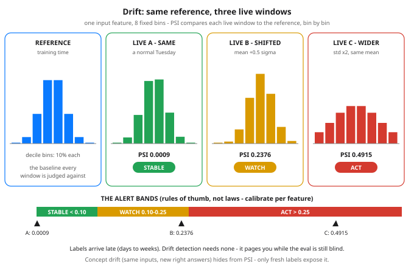

# Day 70 — Monitoring Models in Prod: Drift

**Tonight you'll be able to:** explain why a deployed model decays silently while every dashboard stays green, tell data drift from concept drift, and run a PSI drift check that pages you weeks before the labels can.

## The one idea

A model's best day is deployment day. The model never changes after that — frozen weights, frozen code — but the **world keeps moving**: a new client version changes what users send, a marketing push changes *who* the users are, a competitor changes what your prices mean. The model keeps answering, at full confidence, with a map of a territory that no longer exists. That silent decay is **drift**, and it is silent in the worst way: no exception, no latency spike, HTTP 200s all the way down — while accuracy rots. You cannot wait for accuracy to tell you, because **labels arrive late**: fraud is confirmed weeks after the transaction, churn is only known next month. So you monitor what you can see *today*: the distributions (Day 10's vocabulary, now on watch duty).

Two kinds, and the difference is the whole lesson. **Data drift** (input drift): the inputs changed — `P(x)` moved. New user mix, an upstream team "improving" a feature, a sensor swapped. You can *see* this one, because inputs arrive with every request; no labels required. **Concept drift**: the relationship changed — `P(y|x)` moved. The *same* inputs now deserve *different* answers: fraudsters adapt to your detector, a "good" credit risk in a boom is a bad one in a bust. Concept drift is invisible in the inputs — nothing you histogram will show it. Only fresh labels expose it, which is exactly why data-drift alerting matters: it is the early warning you *can* have.

**The detector: PSI — Population Stability Index.**

Freeze the training-time distribution of one feature as the **reference**. Cut it into 10 bins at its deciles (each bin holds 10% by construction), then for any live window, compare the share of requests landing in each bin: `PSI = sum over bins of (live% - ref%) * ln(live% / ref%)`. Identical distributions score 0; every bin that gained or lost share adds a positive term, so PSI is one auditable number per feature. The industry bands, inherited from credit scoring: **< 0.10 stable, 0.10–0.25 watch, > 0.25 act** (retrain, roll back, or page a human). Label them honestly: these are *rules of thumb, not laws* — a feature that naturally breathes with the season needs looser bands than one that should be bedrock. One mechanical detail that bites in production: a live bin can be *empty*, and `ln(0)` is -inf, so every share is floored at `eps = 1e-4` before the ratio — big enough to keep the math finite, small enough to barely move a real bin.

Cheapest signal of all: **prediction drift**. Histogram the model's *own outputs* — they need no labels either, they exist the instant you serve, and they move when the inputs do. Run PSI per input feature *and* on the prediction stream, alert on the bands, and treat every alert as a hypothesis, not a verdict: the confirmation step is re-running your eval on fresh labels when they finally land (Day 57). Drift pages you early; the eval tells you whether it actually cost accuracy.

## Analogy

You already run this system — it's called Prometheus. A service can return 200s all day while its latency *histogram* slides sideways, and the histogram alert fires long before the error-rate alert ever could. A model endpoint is the same shape of liar: uptime green, p99 beautiful, and the input histogram quietly sliding off a cliff. Drift monitoring is nothing more exotic than putting a histogram alert on the model's inputs and outputs and paging on distribution shift instead of on downtime — the ML version of the alerts you already trust.

Trading version, one line: regime change. A strategy fitted in a low-vol regime doesn't throw errors when vol triples — it just bleeds, trade by trade. You don't watch the P&L for the first warning; you watch the vol itself. Drift is watching the vol.

## See it



Left: the reference histogram, the feature as it looked at training time. Then three live windows of the same feature: A barely moved (PSI 0.0009, STABLE), B slid half a sigma to the right (PSI 0.2376, WATCH), C kept its mean exactly but doubled its spread (PSI 0.4915, ACT). The strip underneath plots all three on the rule-of-thumb alert bands. Bars are drawn from the same formula-built samples as the code (8 fixed display bins); PSI itself is computed on the reference's 10 decile bins.

## Code it (~30 min)

One feature, one reference, three live windows — and not a single random number. Every "sample" is formula-built from a fixed quantile grid of a normal distribution, so the numbers below are exact on any machine. **Part 1** builds the training-time reference, N(50, 10), and its decile bins. **Part 2** runs three live windows through PSI: a normal Tuesday (mean 50.3), a +0.5-sigma mean shift, and a variance blow-up (std x2, mean untouched — the case a mean-only alert sleeps through). **Part 3** adds prediction drift: a toy model flags any request with feature > 65 as "large", and you watch its predicted flag rate move with the inputs — no labels anywhere in sight.

```python
"""Day 70 - Monitoring Models in Prod: Drift.

A deployed model does not crash when it goes stale. It keeps
answering, confidently, while the world it was trained on
quietly moves out from under it. That silent decay is DRIFT,
and catching it is a monitoring problem - the ML version of
your Prometheus alerts.

Two kinds, one paragraph each:
  Data (input) drift    - the inputs changed: P(x) moved.
                          New user mix, a client update, a
                          sensor swapped. You can SEE this
                          one - inputs arrive with every
                          request, no labels required.
  Concept drift         - the relationship changed: P(y|x)
                          moved. Same inputs, different right
                          answers (fraudsters adapt, tastes
                          change). Invisible until labels
                          land - which is why it is the
                          dangerous one.

Today's detector is the Population Stability Index (PSI):
bin the live inputs using the TRAINING reference's decile
bins, then

    PSI = sum over bins of (live% - ref%) * ln(live% / ref%)

Identical distributions score 0; every bin that gained or
lost share adds a positive term. Industry rule-of-thumb
bands (rules of thumb, not laws - calibrate per feature):
    PSI < 0.10          stable
    0.10 <= PSI < 0.25  watch - investigate
    PSI >= 0.25         act - retrain / roll back / page

Empty-bin guard: a live bin can hold 0 requests, and
ln(0) is -inf, so every share is floored at eps = 1e-4
before the ratio. Small enough to barely move a real bin,
big enough to keep the math finite.

  Part 1  The reference: one input feature as it looked at
          training time - formula-built from a fixed
          quantile grid of N(50, 10), no RNG anywhere, so
          every digit below is exact and reproducible.
  Part 2  Three live windows vs the reference: no drift,
          a +0.5-sigma mean shift, and a variance blow-up
          (std x2, mean untouched - the case a mean-only
          alert sleeps through). PSI + verdict per window.
  Part 3  Prediction drift, the cheap always-on signal:
          a toy model flags feature > 65 as "large". Watch
          its predicted flag rate move with the inputs -
          computable the second predictions are served,
          long before any label exists.

The workflow this plugs into: drift alerts are the EARLY
WARNING. Confirmation is re-running your eval (Day 57) on
fresh labels when they finally arrive.

Runs on the ~/ai-lab venv: numpy only (free), no torch
needed, no APIs, no downloads, no RNG.

Expected output:

  Part 1 - the reference: what "normal" looked like at training time
    reference feature: n=2000  mean 50.00  std 10.00  (formula-built, no RNG)
    10 bins cut at the reference deciles - each bin holds 10.0% by construction
    PSI = sum over bins of (live% - ref%) * ln(live% / ref%)
    empty-bin guard: every share is floored at eps=0.0001 before the log
  Part 2 - three live windows vs the reference
    no drift          PSI 0.0009   mean shift +0.03 sigma  -> STABLE
    mean shift        PSI 0.2376   mean shift +0.50 sigma  -> WATCH
    variance blow-up  PSI 0.4915   mean shift +0.00 sigma  -> ACT
    read: the variance case never moved its mean - a mean-only alert sleeps through it
  Part 3 - prediction drift: the cheap always-on signal (no labels needed)
    toy model flags any request with feature > 65 as 'large'
    training-time flag rate: 0.067
    no drift          predicted flag rate 0.071
    mean shift        predicted flag rate 0.159
    variance blow-up  predicted flag rate 0.227
    verdict: inputs moved first, predictions followed - accuracy can only confirm it when labels land
"""
import numpy as np
from statistics import NormalDist

ND = NormalDist()          # standard normal, for its inverse CDF
EPS = 1e-4                 # empty-bin guard (see docstring)


def sample(mu, sigma, n):
    """Deterministic 'sample' of N(mu, sigma): evaluate the
    inverse CDF on a fixed midpoint grid. No RNG - the same
    numbers on every machine, every run."""
    p = (np.arange(n) + 0.5) / n
    z = np.array([ND.inv_cdf(float(pi)) for pi in p])
    return mu + sigma * z


def shares(x, edges):
    """Fraction of x in each bin, floored at EPS so ln() in
    the PSI sum never sees a zero."""
    counts, _ = np.histogram(x, bins=edges)
    return np.clip(counts / counts.sum(), EPS, None)


def psi(live_shares, ref_shares):
    return float(np.sum((live_shares - ref_shares)
                        * np.log(live_shares / ref_shares)))


def verdict(value):
    if value < 0.10:
        return "STABLE"
    if value < 0.25:
        return "WATCH"
    return "ACT"


# ---------- Part 1: the reference ----------
print("Part 1 - the reference: what \"normal\" looked like "
      "at training time")
ref = sample(50.0, 10.0, 2000)
deciles = [50.0 + 10.0 * ND.inv_cdf(q / 10) for q in range(1, 10)]
edges = np.array([-np.inf] + deciles + [np.inf])
ref_shares = shares(ref, edges)
print(f"  reference feature: n={len(ref)}  mean {ref.mean():.2f}  "
      f"std {ref.std():.2f}  (formula-built, no RNG)")
print("  10 bins cut at the reference deciles - each bin holds "
      "10.0% by construction")
print("  PSI = sum over bins of (live% - ref%) * ln(live% / ref%)")
print(f"  empty-bin guard: every share is floored at eps={EPS} "
      "before the log")

# ---------- Part 2: three live windows ----------
print("Part 2 - three live windows vs the reference")
scenarios = (
    ("no drift", sample(50.3, 10.0, 1731)),       # a normal Tuesday
    ("mean shift", sample(55.0, 10.0, 2000)),      # +0.5 sigma
    ("variance blow-up", sample(50.0, 20.0, 2000)),  # std x2
)
live_windows = {}
for name, live in scenarios:
    live_windows[name] = live
    value = psi(shares(live, edges), ref_shares)
    shift = (live.mean() - ref.mean()) / ref.std()
    print(f"  {name:<17} PSI {value:.4f}   mean shift "
          f"{shift:+.2f} sigma  -> {verdict(value)}")
print("  read: the variance case never moved its mean - a "
      "mean-only alert sleeps through it")

# ---------- Part 3: prediction drift ----------
print("Part 3 - prediction drift: the cheap always-on signal "
      "(no labels needed)")
print("  toy model flags any request with feature > 65 as 'large'")
print(f"  training-time flag rate: {(ref > 65).mean():.3f}")
for name, live in scenarios:
    print(f"  {name:<17} predicted flag rate "
          f"{(live > 65).mean():.3f}")
print("  verdict: inputs moved first, predictions followed - "
      "accuracy can only confirm it when labels land")
```

**Expected output:**

```
Part 1 - the reference: what "normal" looked like at training time
  reference feature: n=2000  mean 50.00  std 10.00  (formula-built, no RNG)
  10 bins cut at the reference deciles - each bin holds 10.0% by construction
  PSI = sum over bins of (live% - ref%) * ln(live% / ref%)
  empty-bin guard: every share is floored at eps=0.0001 before the log
Part 2 - three live windows vs the reference
  no drift          PSI 0.0009   mean shift +0.03 sigma  -> STABLE
  mean shift        PSI 0.2376   mean shift +0.50 sigma  -> WATCH
  variance blow-up  PSI 0.4915   mean shift +0.00 sigma  -> ACT
  read: the variance case never moved its mean - a mean-only alert sleeps through it
Part 3 - prediction drift: the cheap always-on signal (no labels needed)
  toy model flags any request with feature > 65 as 'large'
  training-time flag rate: 0.067
  no drift          predicted flag rate 0.071
  mean shift        predicted flag rate 0.159
  variance blow-up  predicted flag rate 0.227
  verdict: inputs moved first, predictions followed - accuracy can only confirm it when labels land
```

## Today's win

Done when your run shows the three verdicts — no drift `PSI 0.0009 -> STABLE`, mean shift `0.2376 -> WATCH`, variance blow-up `0.4915 -> ACT` — and the flag rates walking up behind them: `0.071 / 0.159 / 0.227` against the training-time `0.067`. The keeper test, no notes allowed: hand you any deployed model and you can say what you would histogram (each input feature, plus the predictions), what the reference is (the training-time distribution, frozen), which band pages you (> 0.25, rule of thumb), and what confirms the page (the Day 57 eval, once labels land).

## Short on time? 20-minute version

Read "The one idea", study the diagram until you can sketch the three live windows from memory, then run only Part 2. If you can say out loud why window C pages you while a mean-only alert sleeps through it — and why no histogram can ever catch concept drift — you have the lesson. Part 3 is the victory lap.

## Tomorrow's teaser

Tomorrow: the model you've learned to watch becomes a service — you'll stand it up behind a tiny API, with the metrics on it that tonight's alerts would read.

Day 70 of 100 · Streak: 70 day(s) · Never miss twice.
