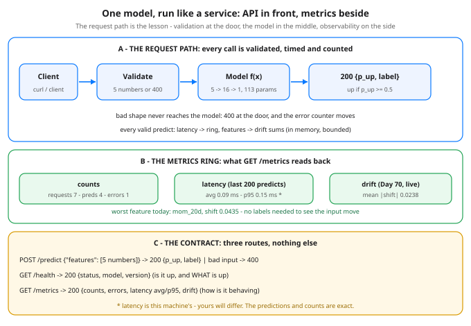

# Day 71 of 100 — Build: Serve a Model Behind a Tiny API With Metrics

Tonight you'll be able to: run a trained model like a real service: an HTTP endpoint with input validation, latency metrics, and live input-drift monitoring — in pure stdlib Python.

## The one idea

A model in a notebook is a function: input in, prediction out. A model in production is a **system**, and systems answer four questions a function never has to: *what is the input contract, what happens on bad input, how fast is it, and has the world moved since training?* Tonight you build the smallest thing that answers all four, in pure stdlib Python.
**The contract is three routes.** `POST /predict` takes a JSON body with exactly the five features the model was trained on (Day 32/35's direction features: ret_1d, mom_5d, mom_20d, vol_5d, up_frac_14d) and returns `{p_up, label}`. `GET /health` answers "is it up, and *what* is up" — status plus model name and version, so a load balancer (or you, at 2am) can tell which artifact is serving. `GET /metrics` answers "how is it behaving" — counts, errors, latency, drift.
**Validation happens at the door, not in the model.** The handler checks the shape — a list of exactly five finite numbers — before the forward pass runs. Bad input gets a `400` with a reason, and the error counter moves. This is Day 12's shape contract enforced over HTTP: a model must never see a shape it wasn't trained on, because silently feeding it garbage produces a confident-looking number that means nothing.
**Metrics are a bounded ring, not a log.** Latency for each predict goes into a deque capped at 200 entries, so memory can't grow with traffic. `/metrics` reports the average *and* the p95 — the average hides the slow tail, and the tail is where your users live (Day 66's tradeoff, measured here instead of theorized). Everything is in memory: restart the process and the counters zero, exactly like a process-local metrics registry before the scraper arrives.
**The drift stat is Day 70's, computed live.** No labels are needed: the service keeps a running sum of the features it has seen, so it can compare the live input means against the training reference means from the artifact. Today's selftest numbers say the input world has already shifted a little — mean |shift| 0.0238, worst feature mom_20d at 0.0435. That is the whole point of monitoring: you see the ground move *before* your accuracy numbers (which need labels, and arrive late) tell you anything.
**The artifact is the Day 68 registry idea, embedded.** The weights below are hand-set stand-ins for a trained artifact — in a real deploy, this JSON is what the registry hands you at deploy time: name, version, feature list, training reference stats, thetas. The code never imports torch: a forward pass was never the hard part (Day 34). The hard part is everything around it, and that is what you are building tonight.

## Analogy

Think of it as a tiny Conveyor or S3 service, not a model file. Nobody ships a storage engine without an API surface, a health endpoint, and metrics — the binary+config split from Day 34 is doing the work again: the artifact (config: name, version, thetas) is loaded by the service (binary: handler, validation, metrics ring), and the two change on different clocks. A registry swap (Day 68) redeploys the config without touching the service, and `/health` proves *which* artifact is live — the same reason a real deploy stamps its build version on its health check.\n\nTrading version, one line: this is a broker gateway, not a strategy — orders are validated before they reach the book, every fill is timed, and the moment the incoming flow stops looking like the flow you backtested on, the drift stat rings the bell before your P&L does.

## See it



Top: the request path — client, validation door, model, response, with the error counter on bad input. Middle: the metrics ring — counts, latency (last 200 predicts, avg + p95), and Day 70's drift stat computed from live traffic, worst feature mom_20d. Bottom: the whole contract — three routes, and nothing else. Restart zeroes the ring: this is a process-local registry, not a database.

## Code it (~30 min)

One file, stdlib only — `http.server`, `json`, `math`, `time`, nothing to install. It has two modes. <strong>Normal mode</strong> (`python3 code.py`) serves on `http://127.0.0.1:8000` for you to curl by hand. <strong>Selftest mode</strong> (`python3 code.py --selftest`) is the verifiable path: it boots the same server on an ephemeral port, fires a real client through it — one health check, four valid predicts, one invalid predict that must come back 400, then a metrics read — prints everything, and exits. No server is left running after it. The predictions below are exact; the latency numbers are this machine's (rounded), yours will differ.

```python
"""Day 71 - Build: Serve a Model Behind a Tiny API With Metrics.

Phase E capstone build. Days 64-70 were the serving stack one
idea at a time - batching, quantization, the latency/throughput
tradeoff, tracking, registries, pipelines, drift monitoring.
Tonight it all becomes one running service:

    client -> HTTP API -> model -> response
                    |
                    +-> metrics ring (counts, latency, drift)

The service contract (the whole lesson in three routes):

  POST /predict   {"features": [f1..f5]} -> 200 {"p_up", "label"}
                  anything else          -> 400 {"error": ...}
  GET  /health    -> 200 {"status": "ok", "model", "version"}
  GET  /metrics   -> 200 counts, error count, latency avg + p95
                  from an in-memory ring, and the Day 70 drift
                  stat live: mean |shift| of the input feature
                  means vs the training reference means.

The model is Day 35's direction MLP (5 features -> 16 -> 1,
113 params): ret_1d, mom_5d, mom_20d, vol_5d, up_frac_14d in,
P(next day up) out. In a real deploy the weights below would be
loaded from Day 68's registry; here the artifact is embedded as
JSON with hand-set stand-in weights so this file runs anywhere,
and the forward pass is pure Python - no torch needed, because
a forward pass was never the hard part (Day 34).

Pure standard library only (http.server, json, math, time).
Runs on the ~/ai-lab MacBook, no CUDA, no paid APIs, nothing
to install, nothing leaves localhost.

Two modes:

  python3 code.py             serve on http://127.0.0.1:8000
                              (curl examples print at startup)
  python3 code.py --selftest  boot on an ephemeral port, fire
                              1 health + 4 valid predicts + 1
                              invalid (400) + 1 metrics read,
                              print everything, exit.

Expected output (--selftest; predictions, status codes and
counts are exact - latency is this machine's, yours differ):

  == selftest: server on an ephemeral port, firing real HTTP ==
  GET  /health   -> 200  {"status": "ok", "model": "direction-mlp", "version": "day35-v1"}
  POST /predict  -> 200  p_up 0.5109  label up
  POST /predict  -> 200  p_up 0.4215  label down
  POST /predict  -> 200  p_up 0.4314  label down
  POST /predict  -> 200  p_up 0.6189  label up
  POST /predict  -> 400  {"error": "features must be a list of 5 numbers"}  (only 2 features sent)
  GET  /metrics  -> 200
    requests_total 7   predictions 4   errors 1
    predict latency ms: avg 0.09  p95 0.15  (machine-dependent)
    drift vs training means: mean |shift| 0.0238, worst mom_20d 0.0435 (n=4 inputs)
  selftest OK - the model is a service now: validated in, timed, counted, drift-watched
"""
import http.client
import json
import math
import sys
import threading
import time
from collections import deque
from http.server import BaseHTTPRequestHandler, ThreadingHTTPServer

# ---------- the model artifact (Day 68's registry, embedded) ----------
# Stand-in weights, hand-set by formula. In production this JSON
# is what the registry hands you at deploy time: name, version,
# the feature contract, the training reference stats, thetas.
ARTIFACT_JSON = """
{"name": "direction-mlp", "version": "day35-v1", "arch": "5->16->1",
 "features": ["ret_1d", "mom_5d", "mom_20d", "vol_5d", "up_frac_14d"],
 "train_feature_mean": [0.0012, 0.006, 0.018, 0.011, 0.53],
 "W1": [[-1.8, -0.45, 0.9, -1.8, -0.45], [1.35, -1.35, 0.0, 1.35, -1.35],
        [0.45, 1.8, -0.9, 0.45, 1.8], [-0.45, 0.9, -1.8, -0.45, 0.9],
        [-1.35, 0.0, 1.35, -1.35, 0.0], [1.8, -0.9, 0.45, 1.8, -0.9],
        [0.9, -1.8, -0.45, 0.9, -1.8], [0.0, 1.35, -1.35, 0.0, 1.35],
        [-0.9, 0.45, 1.8, -0.9, 0.45], [-1.8, -0.45, 0.9, -1.8, -0.45],
        [1.35, -1.35, 0.0, 1.35, -1.35], [0.45, 1.8, -0.9, 0.45, 1.8],
        [-0.45, 0.9, -1.8, -0.45, 0.9], [-1.35, 0.0, 1.35, -1.35, 0.0],
        [1.8, -0.9, 0.45, 1.8, -0.9], [0.9, -1.8, -0.45, 0.9, -1.8]],
 "b1": [-0.1, -0.05, 0.0, 0.05, 0.1, -0.1, -0.05, 0.0, 0.05, 0.1,
        -0.1, -0.05, 0.0, 0.05, 0.1, -0.1],
 "W2": [-1.0, -0.25, 0.5, -1.0, -0.25, 0.5, -1.0, -0.25, 0.5, -1.0,
        -0.25, 0.5, -1.0, -0.25, 0.5, -1.0],
 "b2": -0.1}
"""
ART = json.loads(ARTIFACT_JSON)
N_FEATURES = len(ART["features"])


def forward(x):
    """Day 34's composed function, pure Python: L2(sigmoid(relu(L1(x))))."""
    h = [max(0.0, sum(ART["W1"][j][i] * x[i] for i in range(N_FEATURES))
             + ART["b1"][j])
         for j in range(len(ART["b1"]))]
    logit = sum(ART["W2"][j] * h[j] for j in range(len(h))) + ART["b2"]
    return 1.0 / (1.0 + math.exp(-logit))          # sigmoid (Day 14)


def validate(body):
    """The API's input contract. Returns (features, error-or-None).
    A model must never see a shape it wasn't trained on - reject
    at the door, count it, and say why (Day 12's shape contract,
    enforced over HTTP)."""
    feats = body.get("features") if isinstance(body, dict) else None
    if (not isinstance(feats, list) or len(feats) != N_FEATURES
            or any(isinstance(v, bool) or not isinstance(v, (int, float))
                   or not math.isfinite(v) for v in feats)):
        return None, f"features must be a list of {N_FEATURES} numbers"
    return [float(v) for v in feats], None


# ---------- metrics: counts, a latency ring, the drift stat ----------
class Metrics:
    """In-memory only - a restart zeroes it, like a process's
    Prometheus registry before the scrape. The latency ring is
    bounded (last 200 predicts) so memory can't grow with traffic."""

    def __init__(self):
        self.lock = threading.Lock()
        self.requests_total = 0
        self.predictions = 0
        self.errors = 0
        self.latencies_ms = deque(maxlen=200)      # the ring
        self.input_sum = [0.0] * N_FEATURES        # for live means
        self.n_inputs = 0

    def count_request(self):
        with self.lock:
            self.requests_total += 1

    def record_predict(self, latency_ms, feats):
        with self.lock:
            self.predictions += 1
            self.latencies_ms.append(latency_ms)
            for i, v in enumerate(feats):
                self.input_sum[i] += v
            self.n_inputs += 1

    def record_error(self):
        with self.lock:
            self.errors += 1

    def snapshot(self):
        with self.lock:
            lat = sorted(self.latencies_ms)
            if lat:
                avg = sum(lat) / len(lat)
                p95 = lat[max(0, math.ceil(0.95 * len(lat)) - 1)]
            else:
                avg = p95 = 0.0
            if self.n_inputs:
                live = [s / self.n_inputs for s in self.input_sum]
                shifts = [abs(live[i] - ART["train_feature_mean"][i])
                          for i in range(N_FEATURES)]
                drift = {
                    "n_inputs": self.n_inputs,
                    "mean_abs_shift": round(sum(shifts) / N_FEATURES, 4),
                    "worst_feature": ART["features"][shifts.index(max(shifts))],
                    "worst_shift": round(max(shifts), 4),
                }
            else:
                drift = {"n_inputs": 0}
            return {
                "model": ART["name"], "version": ART["version"],
                "requests_total": self.requests_total,
                "predictions": self.predictions,
                "errors": self.errors,
                "latency_ms": {"count": len(lat), "avg": round(avg, 2),
                               "p95": round(p95, 2)},
                "drift_vs_training": drift,
            }


METRICS = Metrics()


# ---------- the HTTP layer: routing, validation, timing ----------
class Handler(BaseHTTPRequestHandler):
    def log_message(self, *args):                  # keep stdout clean
        pass

    def _send(self, code, payload):
        raw = json.dumps(payload).encode()
        self.send_response(code)
        self.send_header("Content-Type", "application/json")
        self.send_header("Content-Length", str(len(raw)))
        self.end_headers()
        self.wfile.write(raw)

    def do_GET(self):
        METRICS.count_request()
        if self.path == "/health":
            self._send(200, {"status": "ok", "model": ART["name"],
                             "version": ART["version"]})
        elif self.path == "/metrics":
            self._send(200, METRICS.snapshot())
        else:
            METRICS.record_error()
            self._send(404, {"error": f"no route {self.path}"})

    def do_POST(self):
        METRICS.count_request()
        if self.path != "/predict":
            METRICS.record_error()
            self._send(404, {"error": f"no route {self.path}"})
            return
        start = time.perf_counter()
        try:
            length = int(self.headers.get("Content-Length", 0))
            body = json.loads(self.rfile.read(length) or b"null")
        except (ValueError, json.JSONDecodeError):
            body = None
        feats, err = validate(body)
        if err:
            METRICS.record_error()
            self._send(400, {"error": err})
            return
        p_up = forward(feats)
        METRICS.record_predict((time.perf_counter() - start) * 1000.0, feats)
        self._send(200, {"p_up": round(p_up, 4),
                         "label": "up" if p_up >= 0.5 else "down",
                         "model": ART["name"], "version": ART["version"]})


def make_server(port):
    return ThreadingHTTPServer(("127.0.0.1", port), Handler)


# ---------- selftest: a real client over real HTTP ----------
def request(port, method, path, payload=None):
    conn = http.client.HTTPConnection("127.0.0.1", port, timeout=5)
    raw = json.dumps(payload) if payload is not None else None
    conn.request(method, path, raw, {"Content-Type": "application/json"})
    resp = conn.getresponse()
    data = json.loads(resp.read() or b"null")
    conn.close()
    return resp.status, data


def selftest():
    server = make_server(0)                        # port 0 = ephemeral
    port = server.server_address[1]
    threading.Thread(target=server.serve_forever, daemon=True).start()
    print("== selftest: server on an ephemeral port, firing real HTTP ==")
    try:
        status, health = request(port, "GET", "/health")
        print(f"GET  /health   -> {status}  {json.dumps(health)}")
        cases = [
            [0.012, 0.045, 0.082, 0.014, 0.643],     # trending up
            [-0.018, -0.052, -0.031, 0.022, 0.357],  # trending down
            [0.002, 0.008, -0.015, 0.009, 0.500],    # flat / mixed
            [0.025, 0.110, 0.210, 0.031, 0.786],     # strong trend
        ]
        for feats in cases:
            status, out = request(port, "POST", "/predict",
                                  {"features": feats})
            print(f"POST /predict  -> {status}  p_up {out['p_up']:.4f}  "
                  f"label {out['label']}")
        status, out = request(port, "POST", "/predict",
                              {"features": [0.01, 0.02]})
        print(f"POST /predict  -> {status}  {json.dumps(out)}"
              "  (only 2 features sent)")
        status, m = request(port, "GET", "/metrics")
        print(f"GET  /metrics  -> {status}")
        print(f"  requests_total {m['requests_total']}   "
              f"predictions {m['predictions']}   errors {m['errors']}")
        lat = m["latency_ms"]
        print(f"  predict latency ms: avg {lat['avg']:.2f}  "
              f"p95 {lat['p95']:.2f}  (machine-dependent)")
        d = m["drift_vs_training"]
        print(f"  drift vs training means: mean |shift| "
              f"{d['mean_abs_shift']:.4f}, worst {d['worst_feature']} "
              f"{d['worst_shift']:.4f} (n={d['n_inputs']} inputs)")
        print("selftest OK - the model is a service now: validated in, "
              "timed, counted, drift-watched")
    finally:
        server.shutdown()
        server.server_close()


def serve(port=8000):
    server = make_server(port)
    print(f"serving {ART['name']} {ART['version']} ({ART['arch']}) "
          f"on http://127.0.0.1:{port}")
    print("try:  curl localhost:8000/health")
    print('      curl -X POST localhost:8000/predict -H '
          "'Content-Type: application/json' "
          '-d \'{"features": [0.012, 0.045, 0.082, 0.014, 0.643]}\'')
    print("      curl localhost:8000/metrics")
    try:
        server.serve_forever()
    except KeyboardInterrupt:
        server.shutdown()


if __name__ == "__main__":
    if "--selftest" in sys.argv:
        selftest()
    else:
        serve()
```

**Expected output:**

```
== selftest: server on an ephemeral port, firing real HTTP ==
GET  /health   -> 200  {"status": "ok", "model": "direction-mlp", "version": "day35-v1"}
POST /predict  -> 200  p_up 0.5109  label up
POST /predict  -> 200  p_up 0.4215  label down
POST /predict  -> 200  p_up 0.4314  label down
POST /predict  -> 200  p_up 0.6189  label up
POST /predict  -> 400  {"error": "features must be a list of 5 numbers"}  (only 2 features sent)
GET  /metrics  -> 200
  requests_total 7   predictions 4   errors 1
  predict latency ms: avg 0.09  p95 0.15  (machine-dependent)
  drift vs training means: mean |shift| 0.0238, worst mom_20d 0.0435 (n=4 inputs)
selftest OK - the model is a service now: validated in, timed, counted, drift-watched
```

## Today's win

Done when your `--selftest` run shows all of it: the four predictions (`0.5109 up, 0.4215 down, 0.4314 down, 0.6189 up`), the invalid request coming back `400` with the shape error, and the metrics read at `requests_total 7, predictions 4, errors 1` with drift `mean |shift| 0.0238, worst mom_20d 0.0435`. Then boot normal mode and curl `/metrics` yourself — the keeper test, no notes allowed: for any model service, you can say which route answers "is it up," which answers "how is it behaving," and why bad input must be counted, not swallowed.

## Short on time? 20-minute version

Run only `python3 code.py --selftest`, then read its output line by line against the diagram: health proves what is serving, the 400 proves the door works, and the metrics read proves the ring. If you can say why the drift stat needs no labels — and why that makes it earlier than any accuracy alert — you have tonight's idea; the curl-by-hand pass is the victory lap.

## Tomorrow's teaser

Tomorrow: what this service actually costs — dollars per million predictions and GPU-hour thinking, using tonight's latency numbers as the raw material.

*Streak: 71 day(s) · Never miss twice.*
