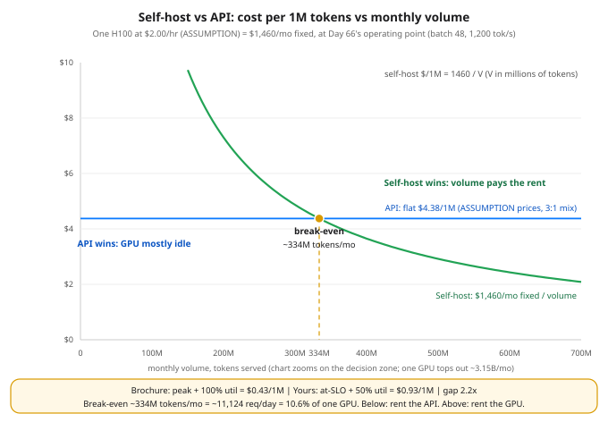

# Day 72 — Cost Math: $/1M Tokens & GPU-Hour Thinking

**Tonight you'll be able to:** price any serving setup in dollars per million tokens starting from a GPU hourly rate and your Day 66 operating point, apply the utilization haircut, and compute the monthly volume at which self-hosting starts beating an API — with every price in the math labeled an assumption to re-check, because prices move and the method doesn't.

## The one idea

Phase E built you a serving stack (Days 64–66) and picked its operating point. Tonight that machine gets a price tag, and it takes exactly one formula:

**$/1M tokens = GPU $/hr ÷ tokens/hr at YOUR operating point ÷ your utilization**

**You rent time, not tokens.** A GPU bills by the hour whether it serves three requests or three billion tokens. Day 66 chose the operating point: batch 48, TPOT inside the 40 ms SLO, **1,200 tokens/sec decode** = 4.32M tokens/hr. At a stated **ASSUMPTION** price of $2.00/GPU-hr for an H100 (cloud prices move monthly — re-check before you ever use this number for real), the formula gives $2.00 ÷ 4.32M = **$0.46 per 1M tokens**. Day 51's unit is the same rent in a different costume: $48 per GPU-day, $1,460 per GPU-month, and one GPU-month of capacity is 3.15 *billion* tokens. Fixed. All of it owed before token #1.

**The utilization haircut.** That $0.46 assumes the GPU serves back-to-back, 24/7, at the operating point. Real traffic is diurnal, spiky, and you hold headroom so the SLO survives a burst — so divide by utilization. At 75% the same GPU costs $0.62/1M; at a realistic planning number of 50%, $0.93; at 25%, $1.85 — four times the nameplate. Utilization is the denominator nobody puts on the slide, and it is a bigger lever than the GPU's sticker price: switching from on-demand to a committed rate (ASSUMPTION: $1.20/hr) saves 40%, but dropping from 75% to 25% utilization *costs* 200%.

**The input/output mix.** APIs don't sell "tokens"; they sell two directions at two prices, because output (decode) is the serial, one-token-at-a-time work from Days 48 and 66 while input (prefill) processes in parallel. ASSUMPTION prices for tonight: $2.50/1M in, $10.00/1M out. You cannot compare that to $0.46 until you blend it at *your* workload's mix — tonight's stated workload is 3 input : 1 output, so the blended API price is (3×2.50 + 1×10.00)/4 = **$4.375/1M**. Change the mix, change the answer: a summarizer drowning in input blends far cheaper than a code generator spewing output. (Simplification, stated: the self-host math charges per *served* token regardless of direction, because Day 66's decode rate at the operating point is the binding constraint and prefill rides along in the same steps.)

**Self-host vs API is a break-even volume, nothing more.** The GPU is pure fixed cost: $1,460/mo for the first card. The API is pure variable cost: $4.375 per million, forever, no idle charge. Set them equal: 1,460 ÷ 4.375 ≈ **334M tokens/month**. Below that volume the API's margin is cheaper than your idle GPU — at 100M tokens/mo the API bill is $438 against a $1,460 card running at 3.2% utilization. Above it the fixed GPU wins and keeps winning — until the step: past 3.15B tokens/mo you rent a second GPU and the fixed cost doubles, which is why the 5B scenario in the code runs on 2 cards at 79% utilization. The surprise hiding in the arithmetic: break-even is only **10.6% of one GPU's capacity** — ~11,124 requests/day at 1,000 tokens each. Self-hosting doesn't need much volume to win on price. What it needs is volume that *actually shows up, steadily*.

**The classic mistake: quoting peak-throughput cost instead of at-SLO cost.** Day 66's model says batch 256 pushes 1,306 tok/s — at a TPOT of 196 ms, nearly five times your SLO. Nobody's users accept that latency, but the benchmark doesn't care, and neither does the brochure: peak rate plus an assumed 100% utilization prices this GPU at **$0.43/1M**. Your honest number — at-SLO throughput at 50% utilization — is **$0.93/1M**. The brochure understates real cost 2.2×. New rule, worth keeping for every vendor claim you ever read: a $/1M quote with no operating point and no utilization attached is marketing, not math.

**Honest caveats, one breath.** Every price tonight is a labeled assumption — GPU rates and API prices both move, so the deliverable is the method, not the digits. The API's price also buys things this math doesn't charge for: a frontier model you may not be able to run yourself, zero ops, and elasticity when traffic spikes 10×. Self-hosting quietly bills your engineering time, which appears nowhere in $1,460. The formula answers the volume question. It does not answer the quality question, and it was never meant to.

## Analogy

You already know this shape from trading: it's the **market-maker's decision**. Paying an API per token is paying taker fees — zero fixed cost, pure per-trade variable, completely rational at low volume. Self-hosting is building the desk: the seat, the servers, and the connection bill arrive every month whether you trade once or a million times, and past a volume threshold the fixed cost amortizes until each fill costs almost nothing. Nobody asks "which is cheaper?" in the abstract — they ask "at *my* volume, which is cheaper?" Same in systems clothes: it's a reserved instance versus per-request Lambda pricing, the oldest fixed-vs-variable argument in cloud. The GPU is just the newest thing you can rent by the hour and leave idle by accident.

## See it



The whole self-host vs API decision on one chart. The API is a flat line — $4.38/1M blended at the assumed prices and a 3:1 input:output mix, the same at any volume. The GPU is a fixed $1,460/mo (assumption price) spread over volume, so its per-token cost falls hyperbolically: ruinous when the card idles, cheap when it is fed. The lines cross at ~334M tokens/mo — ~11,124 requests/day, just 10.6% of one GPU's capacity. The footer strip carries the warning: brochure math (peak throughput, 100% utilization) prices this GPU at $0.43/1M; your math (at-SLO throughput, 50% utilization) says $0.93/1M.

## Code it (~30 min)

One file, **standard library only** — no torch tonight, this is arithmetic with consequences. Every price is a named ASSUMPTION constant at the top of the file; the four parts walk the formula, the haircut, the break-even (with a three-volume scenario table), and the brochure trap. Run it as-is first. Then change the four price constants to today's real prices and run it again — that second run is the actual skill.

```python
"""Day 72 - Cost Math: $/1M Tokens & GPU-Hour Thinking.

Phase E closer. Days 64-66 built the serving machine and
Day 66 picked its operating point; tonight the machine gets
a price tag. ONE formula runs the whole lesson:

    $/1M tokens = (GPU $/hr) / (tokens/hr at YOUR operating
    point), with the result divided by your utilization.

Everything else is a consequence: the utilization haircut
(you rent the GPU 24/7, traffic does not arrive 24/7), the
input/output mix (APIs bill the two directions separately,
so blend them at YOUR ratio), and the break-even volume
where a fixed GPU-month starts beating a per-token API bill.

  Part 1  The formula at Day 66's operating point (batch
          48, TPOT inside 40 ms, 1,200 tok/s decode): what
          one served token costs on one rented H100 - and
          the monthly capacity that fixed rent buys.
  Part 2  The utilization haircut: the same GPU at 25 /
          50 / 75 / 100% utilization. Halve the utilization,
          double the cost per token. This is where most
          self-host estimates quietly die.
  Part 3  Self-host vs API as a break-even volume. The API
          (stated assumption prices, blended at a 3:1
          input:output mix) is pure variable cost; the GPU
          is pure fixed cost. Below ~334M tokens/mo the
          API's margin is cheaper than your idle GPU; above
          it the fixed GPU wins - until capacity forces a
          second GPU and the cost steps up.
  Part 4  The classic mistake: quoting peak-throughput
          cost (batch 256, no latency SLO, Day 66) instead
          of at-SLO cost, at an assumed 100% utilization.
          Brochure $0.43/1M vs your $0.93/1M - the brochure
          understates real cost 2.2x.

EVERY price below is a labeled ASSUMPTION in the constants,
not a quote: GPU and API prices move monthly. The method is
the lesson - re-check the four price constants against
today's price pages and re-run before using any number.

Runs on the ~/ai-lab venv: standard library only (free),
no torch needed, no CUDA, no paid APIs, no downloads.
Every input is stated, so every number is exact.

Expected output:

  Part 1 - the one formula: $/1M = GPU $/hr / tokens per hour
    operating point (Day 66): batch 48, 1,200 tok/s -> 4.32M tokens/hr
    H100 on-demand $2.00/hr (ASSUMPTION): $2.00 / 4.32M = $0.4630/1M
    H100 committed $1.20/hr (ASSUMPTION): $1.20 / 4.32M = $0.2778/1M
    you rent time, not tokens: $48.00 per GPU-day (Day 51), $1,460/mo at 730 hr - paid whether it serves or idles
    one GPU-month of capacity at the operating point: 3,153.6M tokens
  Part 2 - the utilization haircut: cost per token divides by utilization
          util   on-dem $/1M   commit $/1M
           25%   $    1.8519   $    1.1111
           50%   $    0.9259   $    0.5556
           75%   $    0.6173   $    0.3704
          100%   $    0.4630   $    0.2778
    at 50% utilization you pay double the nameplate rate: the GPU bills 24/7, traffic does not arrive 24/7
  Part 3 - the break-even: fixed GPU vs per-token API
    API (ASSUMPTION): $2.50/1M input, $10.00/1M output; your mix 3:1 -> blended $4.3750/1M
    break-even volume = $1,460/mo / $4.3750/1M = 333.7M tokens/mo
    that is 10.6% of one GPU's monthly capacity - and ~11,124 requests/day at 1,000 tokens each
        volume    API bill/mo   self-host/mo   winner
       100.0M   $     437.50   $   1,460.00   API (GPU would idle at 3.2% util)
     1,000.0M   $   4,375.00   $   1,460.00   self-host (31.7% util, 1 GPU)
     5,000.0M   $  21,875.00   $   2,920.00   self-host (79.3% util, 2 GPUs)
  Part 4 - the classic mistake: peak cost vs at-SLO cost
    brochure: batch 256 ignores the SLO - 1,306 tok/s (Day 66) -> $0.4253/1M
    at-SLO:   batch 48 inside TPOT 40 ms - 1,200 tok/s -> $0.4630/1M
    then the brochure also assumes 100% utilization; at a realistic 50%: $0.9259/1M
    brochure $0.4253 vs your $0.9259: real cost is 2.18x the brochure (call it 2.2x)
    verdict: a $/1M quote with no operating point and no utilization attached is marketing, not math
"""
import math

# ---------------- ASSUMPTIONS - re-check before use ----------------
# Prices move monthly. These are illustrative stated values,
# NOT quotes; the method survives any of them changing.
GPU_HR_ONDEMAND = 2.00     # ASSUMPTION: 1x H100, $/GPU-hr on-demand
GPU_HR_COMMITTED = 1.20    # ASSUMPTION: 1x H100, $/GPU-hr committed/spot
API_IN_PER_1M = 2.50       # ASSUMPTION: API input price, $/1M tokens
API_OUT_PER_1M = 10.00     # ASSUMPTION: API output price, $/1M tokens

# ---------------- From earlier lessons (not prices) ----------------
TOK_S_AT_SLO = 1200.0      # Day 66 operating point: batch 48 decode
TOK_S_PEAK = 256 * 1000.0 / 196.0   # Day 66 model, batch 256: step
                           # 196 ms, TPOT way over the 40 ms SLO
HOURS_PER_MONTH = 730      # average month
DAYS_PER_MONTH = 30
MIX_IN, MIX_OUT = 3, 1     # workload mix: 3 input : 1 output tokens
AVG_TOKENS_PER_REQUEST = 1000       # 750 in + 250 out, at the mix

TOK_PER_HOUR = TOK_S_AT_SLO * 3600          # 4,320,000 tokens/hr
M_TOK_PER_HOUR = TOK_PER_HOUR / 1e6         # 4.32M tokens/hr
GPU_MONTH = GPU_HR_ONDEMAND * HOURS_PER_MONTH          # $1,460 fixed
CAPACITY_M_PER_MONTH = M_TOK_PER_HOUR * HOURS_PER_MONTH  # 3,153.6M


def cost_per_1m(gpu_hr, utilization=1.0):
    """$/1M tokens = GPU $/hr / (tokens/hr x utilization)."""
    return gpu_hr / (M_TOK_PER_HOUR * utilization)


# ---------- Part 1: the one formula ----------
print("Part 1 - the one formula: $/1M = GPU $/hr / tokens per hour")
print(f"  operating point (Day 66): batch 48, {TOK_S_AT_SLO:,.0f} tok/s"
      f" -> {M_TOK_PER_HOUR:.2f}M tokens/hr")
print(f"  H100 on-demand ${GPU_HR_ONDEMAND:.2f}/hr (ASSUMPTION): "
      f"${GPU_HR_ONDEMAND:.2f} / {M_TOK_PER_HOUR:.2f}M"
      f" = ${cost_per_1m(GPU_HR_ONDEMAND):.4f}/1M")
print(f"  H100 committed ${GPU_HR_COMMITTED:.2f}/hr (ASSUMPTION): "
      f"${GPU_HR_COMMITTED:.2f} / {M_TOK_PER_HOUR:.2f}M"
      f" = ${cost_per_1m(GPU_HR_COMMITTED):.4f}/1M")
print(f"  you rent time, not tokens: ${GPU_HR_ONDEMAND * 24:.2f} per"
      f" GPU-day (Day 51), ${GPU_MONTH:,.0f}/mo at"
      f" {HOURS_PER_MONTH} hr - paid whether it serves or idles")
print(f"  one GPU-month of capacity at the operating point:"
      f" {CAPACITY_M_PER_MONTH:,.1f}M tokens")

# ---------- Part 2: the utilization haircut ----------
print("Part 2 - the utilization haircut: cost per token"
      " divides by utilization")
print(f"  {'util':>10}   {'on-dem $/1M':>11}   {'commit $/1M':>11}")
for util in (0.25, 0.50, 0.75, 1.00):
    print(f"  {util:>10.0%}   "
          f"${cost_per_1m(GPU_HR_ONDEMAND, util):>10.4f}   "
          f"${cost_per_1m(GPU_HR_COMMITTED, util):>10.4f}")
print("  at 50% utilization you pay double the nameplate rate:"
      " the GPU bills 24/7, traffic does not arrive 24/7")

# ---------- Part 3: the break-even ----------
print("Part 3 - the break-even: fixed GPU vs per-token API")
blended_api = (MIX_IN * API_IN_PER_1M
               + MIX_OUT * API_OUT_PER_1M) / (MIX_IN + MIX_OUT)
print(f"  API (ASSUMPTION): ${API_IN_PER_1M:.2f}/1M input,"
      f" ${API_OUT_PER_1M:.2f}/1M output; your mix"
      f" {MIX_IN}:{MIX_OUT} -> blended ${blended_api:.4f}/1M")
break_even_m = GPU_MONTH / blended_api          # millions of tokens
req_per_day = break_even_m * 1e6 / DAYS_PER_MONTH \
    / AVG_TOKENS_PER_REQUEST
print(f"  break-even volume = ${GPU_MONTH:,.0f}/mo"
      f" / ${blended_api:.4f}/1M = {break_even_m:,.1f}M tokens/mo")
print(f"  that is {break_even_m / CAPACITY_M_PER_MONTH:.1%} of one"
      f" GPU's monthly capacity - and ~{req_per_day:,.0f} requests/day"
      f" at {AVG_TOKENS_PER_REQUEST:,} tokens each")
print(f"  {'volume':>10}   {'API bill/mo':>12}   {'self-host/mo':>12}"
      f"   winner")
for vol_m in (100.0, 1000.0, 5000.0):
    api_bill = vol_m * blended_api
    gpus = math.ceil(vol_m / CAPACITY_M_PER_MONTH)
    host_bill = gpus * GPU_MONTH
    util = vol_m / (gpus * CAPACITY_M_PER_MONTH)
    if api_bill < host_bill:
        winner = f"API (GPU would idle at {util:.1%} util)"
    else:
        winner = f"self-host ({util:.1%} util, {gpus} GPU"
        winner += "s)" if gpus > 1 else ")"
    print(f"  {vol_m:>8,.1f}M   ${api_bill:>11,.2f}"
          f"   ${host_bill:>11,.2f}   {winner}")

# ---------- Part 4: the classic mistake ----------
print("Part 4 - the classic mistake: peak cost vs at-SLO cost")
peak_per_1m = GPU_HR_ONDEMAND / (TOK_S_PEAK * 3600 / 1e6)
real_per_1m = cost_per_1m(GPU_HR_ONDEMAND, 0.50)
print(f"  brochure: batch 256 ignores the SLO - {TOK_S_PEAK:,.0f}"
      f" tok/s (Day 66) -> ${peak_per_1m:.4f}/1M")
print(f"  at-SLO:   batch 48 inside TPOT 40 ms - {TOK_S_AT_SLO:,.0f}"
      f" tok/s -> ${cost_per_1m(GPU_HR_ONDEMAND):.4f}/1M")
print("  then the brochure also assumes 100% utilization; at a"
      f" realistic 50%: ${real_per_1m:.4f}/1M")
print(f"  brochure ${peak_per_1m:.4f} vs your ${real_per_1m:.4f}:"
      f" real cost is {real_per_1m / peak_per_1m:.2f}x the brochure"
      " (call it 2.2x)")
print("  verdict: a $/1M quote with no operating point and no"
      " utilization attached is marketing, not math")
```

**Expected output:**

```
Part 1 - the one formula: $/1M = GPU $/hr / tokens per hour
  operating point (Day 66): batch 48, 1,200 tok/s -> 4.32M tokens/hr
  H100 on-demand $2.00/hr (ASSUMPTION): $2.00 / 4.32M = $0.4630/1M
  H100 committed $1.20/hr (ASSUMPTION): $1.20 / 4.32M = $0.2778/1M
  you rent time, not tokens: $48.00 per GPU-day (Day 51), $1,460/mo at 730 hr - paid whether it serves or idles
  one GPU-month of capacity at the operating point: 3,153.6M tokens
Part 2 - the utilization haircut: cost per token divides by utilization
        util   on-dem $/1M   commit $/1M
         25%   $    1.8519   $    1.1111
         50%   $    0.9259   $    0.5556
         75%   $    0.6173   $    0.3704
        100%   $    0.4630   $    0.2778
  at 50% utilization you pay double the nameplate rate: the GPU bills 24/7, traffic does not arrive 24/7
Part 3 - the break-even: fixed GPU vs per-token API
  API (ASSUMPTION): $2.50/1M input, $10.00/1M output; your mix 3:1 -> blended $4.3750/1M
  break-even volume = $1,460/mo / $4.3750/1M = 333.7M tokens/mo
  that is 10.6% of one GPU's monthly capacity - and ~11,124 requests/day at 1,000 tokens each
      volume    API bill/mo   self-host/mo   winner
     100.0M   $     437.50   $   1,460.00   API (GPU would idle at 3.2% util)
   1,000.0M   $   4,375.00   $   1,460.00   self-host (31.7% util, 1 GPU)
   5,000.0M   $  21,875.00   $   2,920.00   self-host (79.3% util, 2 GPUs)
Part 4 - the classic mistake: peak cost vs at-SLO cost
  brochure: batch 256 ignores the SLO - 1,306 tok/s (Day 66) -> $0.4253/1M
  at-SLO:   batch 48 inside TPOT 40 ms - 1,200 tok/s -> $0.4630/1M
  then the brochure also assumes 100% utilization; at a realistic 50%: $0.9259/1M
  brochure $0.4253 vs your $0.9259: real cost is 2.18x the brochure (call it 2.2x)
  verdict: a $/1M quote with no operating point and no utilization attached is marketing, not math
```

## Today's win

Done when your run prints `$0.4630`/1M at the operating point, the haircut row `50% → $0.9259`, break-even `333.7M tokens/mo` (~11,124 requests/day, 10.6% of one GPU), and the brochure gap `2.18x`. The keeper test: someone hands you any $/1M claim and you immediately ask two questions — *at what operating point, and at what utilization?* If they can't answer both, you're reading marketing. One more rep before you close the laptop: re-run the file with one price changed and predict the new break-even before you look.

## Short on time? 20-minute version

Read "The one idea", then study the chart until you can sketch both lines and their crossing from memory. Run only Parts 1 and 3, and say the break-even sentence out loud: *below ~334M tokens a month, the API's margin is cheaper than my idle GPU; above it, the fixed GPU wins.* Parts 2 and 4 are the victory lap — but come back for them, because they're where real-world estimates go to die.

## Tomorrow's teaser

Tomorrow Phase F opens — ML systems, where your infra career plugs straight into AI. Same H100, opposite problem: tonight it was too expensive to leave idle; tomorrow you'll see why training can't even fit on it in the first place.

Streak: 72 day(s) · Never miss twice.
