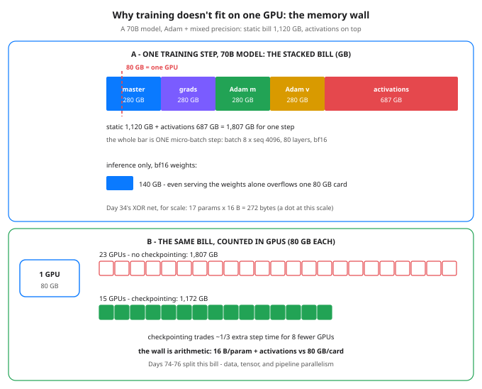

# Day 73 — The Memory Wall: Why Training Doesn't Fit on One GPU

**Tonight you'll be able to:** do the full memory arithmetic for one training step — bytes per parameter for SGD vs Adam, the static bill for 7B–405B models, and activation memory with and without gradient checkpointing — and state exactly how many 80 GB GPUs a 70B model needs just to stand still.

## The one idea

Phase F is your home turf: ML systems, where your infra career plugs directly into AI. And it opens with a question that is not about models at all — it is capacity planning. Every net through Day 72 fit on one device; Day 34’s biggest had 113 parameters. Production models have 7 billion to 405 billion. Whether one can train on one GPU is not a matter of engineering cleverness. It is arithmetic, and tonight you do the arithmetic.


The one idea: the weights are the smallest line item in the training bill. Serving a model stores the weights once — in bf16 (2 bytes per parameter, Day 65’s quantization math), a 70B model is 140 GB, which already overflows an 80 GB card. Training stores four things per parameter. In the standard mixed-precision recipe (compute in bf16, keep full-precision state — the honest accounting, with variants noted): an fp32 master copy of the weights (4 bytes — the copy that actually takes the update), fp32 gradients (4 bytes — autograd produces exactly one gradient per parameter, Day 4), and Adam’s two state arrays, m and v (4 + 4 bytes — the running averages from Day 18, kept per parameter, always). Total: 16 bytes per parameter. A stack that also keeps a bf16 compute copy pays 18. Plain SGD pays 8 (weights + grads, no state); SGD with momentum pays 12. Multiply by 70 billion: 1,120 GB of static memory before a single token is processed — 14 GPUs’ worth, just to stand still. Day 34’s XOR net under the same recipe: 272 bytes.


Then come activations — everything the forward pass computes that the backward pass will need again. Autograd’s tape (Day 4) is not free: every layer’s intermediates are saved until backward consumes them. Activations scale with a completely different set of knobs than the static bill: batch × sequence × layers × d_model — workload size, not model size. For a stated 70B-class config (80 layers, dmodel 8192, a per-device micro-batch of 8 sequences × 4096 tokens, bf16, and a stated simplification of ~16 saved hidden-sized tensors per layer), that is 687 GB for one micro-batch step (Part 3). This is why batch size is secretly a memory dial (Day 30): double the batch, double the activations, static bill untouched.


One lever exists inside a single step: gradient checkpointing. Save only each layer’s boundary activation, throw the rest away, and recompute one layer’s forward on the fly during backward. The 687 GB becomes ~51.5 GB; the price is roughly one extra forward pass, ~⅓ more step time. It is a memory-for-compute trade, nothing more — saving weights to survive machine failures is a different job with the same name, and it gets Day 78. Even with checkpointing, the 70B step totals 1,172 GB: 15 GPUs. There is no configuration in which one card wins. The bill has to be split across machines — which is exactly what the next three days are for.


Assumptions on the table (so you can redo this for any stack): GB = 109 bytes, as GPU boxes are sold; static recipe = 4 (fp32 master) + 4 (fp32 grads) + 4 (Adam m) + 4 (Adam v) = 16 B/param; activation estimate = layers × tokens × dmodel × 16 saved tensors × 2 bytes, a simplification — a real MLP block’s intermediate is 4× wider than dmodel, so real activation bills run higher; treat tonight’s number as a floor, not a ceiling.

## Analogy

Size a storage node the way you’d size Conveyor, and you already know this failure mode: nobody sizes RAM from the dataset size. The payload on disk is the weights. But every key also carries bookkeeping — here, 16 bytes of state for every 2 bytes of bf16 payload, an 8× metadata amplification any storage engineer would flag in review. And activations are in-flight request state: they scale with concurrency (batch × sequence), not with how much data you own — exactly like sizing a server by simultaneous connections, not by total stored objects. A node that holds the dataset but not the working set doesn’t degrade; it OOMs and dies. GPUs are no different.

## See it



Top: one 70B training step as a stacked bar &mdash; four 280 GB static blocks (master weights, gradients, Adam m, Adam v) plus 687 GB of activations, with the red dash marking where a single 80 GB GPU&rsquo;s capacity ends: inside the first block. Bottom: the same 1,807 GB counted in hardware &mdash; 23 GPUs without gradient checkpointing, 15 with it. The weights alone (140 GB, inference) overflow one card too.

## Code it (~30 min)

No torch tonight — counting bytes needs no GPU, so this is pure standard library and runs in milliseconds in ~/ai-lab. Part 1 prices one parameter under three optimizers, component by component. Part 2 multiplies up: the static bill for 7B / 13B / 70B / 405B, inference’s weights-only bill beside it, and the stand-still GPU count. Part 3 adds activations for the stated 70B-class config and prices gradient checkpointing in both currencies — GB saved, GPUs saved.

```python
"""Day 73 - The Memory Wall: Why Training Doesn't Fit on One GPU.

Phase F opens. Everything so far trained on ONE device -
Day 34's biggest net had 113 parameters. Tonight's question
is pure arithmetic, and it explains why the next three days
(parallelism, Days 74-76) exist at all:

    Training memory is NOT the weights. It is weights +
    gradients + optimizer state + activations - and for
    Adam in mixed precision the static bill alone is about
    16 bytes per parameter, before a single activation.

THE RECIPE (state your assumptions - every framework mixes
slightly different dtypes, this is the standard accounting):
  Adam, mixed precision, per parameter:
    fp32 master weights .... 4 bytes  (the copy that updates)
    fp32 gradients ......... 4 bytes  (one grad per param)
    Adam m (1st moment) .... 4 bytes  (Day 18: Adam keeps two)
    Adam v (2nd moment) .... 4 bytes
    TOTAL .................. 16 bytes per parameter
  Some stacks also keep a bf16 compute copy of the weights
  (+2 bytes -> 18). SGD pays 8, SGD+momentum pays 12 - Part 1.
  GB below means 10^9 bytes, the way GPU boxes are sold.

  Part 1  Bytes per parameter: SGD vs SGD+momentum vs Adam,
          component by component. Day 34's 17-parameter XOR
          net costs 272 bytes under Adam. A 70B model costs
          16 bytes x 70 billion. Same recipe, bigger number.
  Part 2  The static bill (weights + grads + optimizer, NO
          activations yet) for 7B / 13B / 70B / 405B models,
          with the inference-only bill (bf16 weights alone,
          2 bytes/param) next to it, and the only column that
          matters: how many 80GB GPUs you need JUST TO STAND
          STILL - before one token is processed.
  Part 3  Activations: the memory autograd saves for the
          backward pass (Day 4's tape, at scale). Stated
          config: 80 layers, d_model 8192, batch 8 sequences
          x 4096 tokens, bf16, and a stated simplification -
          ~16 saved hidden-sized tensors per layer. Gradient
          checkpointing (store only layer boundaries, redo
          one layer's forward in the backward pass) cuts it
          ~14x for ~1/3 extra step time. Checkpointing as a
          fault-tolerance strategy is Day 78 - different job.

Runs anywhere: pure standard library, no torch, no GPU,
no downloads, no APIs. The whole lesson is counting bytes,
so it runs on the MacBook ~/ai-lab venv in milliseconds.

Expected output:

  Part 1 - bytes per parameter: the optimizer is the landlord
    SGD (fp32):              weights 4 + grads 4                  =  8 B/param
    SGD + momentum:          weights 4 + grads 4 + momentum 4     = 12 B/param
    Adam, mixed precision:   master 4 + grads 4 + m 4 + v 4       = 16 B/param
    variant:                 stacks keeping a bf16 compute copy add 2        = 18 B/param
    Day 34's XOR net, 17 params, under Adam: 272 bytes total
  Part 2 - static bill: weights + grads + optimizer (Adam, 16 B/param)
    model  params   static (no acts)  bf16 weights only  80GB GPUs to stand still
       7B      7B           112.0 GB            14.0 GB                         2
      13B     13B           208.0 GB            26.0 GB                         3
      70B     70B          1120.0 GB           140.0 GB                        14
     405B    405B          6480.0 GB           810.0 GB                        81
    a 70B model's STATIC bill is 1.12 TB - and not one token has moved yet
  Part 3 - activations: the tape autograd saves for backward
    config: 80 layers, d_model 8192, batch 8 x seq 4096 = 32768 tokens, bf16
    stated assumption: ~16 saved hidden-sized tensors per layer
    saved per token per layer: 262144 bytes (0.25 MB)
    activations, no checkpointing:     687.19 GB
    gradient checkpointing: boundaries 42.95 GB + one layer recomputed 8.59 GB
    70B step total, no checkpointing: 1120.0 static + 687.19 acts = 1807.19 GB -> 23 GPUs
    70B step total, checkpointing: 1120.0 static + 51.54 acts = 1171.54 GB -> 15 GPUs
    verdict: the wall is arithmetic, not engineering - 16 B/param + activations
    vs 80 GB/card is WHY Days 74-76 (splitting the bill) exist
"""
import math

GB = 1e9                      # gigabytes as sold: 10^9 bytes
GPU_GB = 80                   # one H100/A100-class card

# ---------- Part 1: bytes per parameter ----------
print("Part 1 - bytes per parameter: the optimizer is the landlord")
recipes = [
    ("SGD (fp32):", "weights 4 + grads 4", 4 + 4),
    ("SGD + momentum:", "weights 4 + grads 4 + momentum 4", 4 + 4 + 4),
    ("Adam, mixed precision:", "master 4 + grads 4 + m 4 + v 4",
     4 + 4 + 4 + 4),
]
for name, parts, total in recipes:
    print(f"  {name:<24} {parts:<36} = {total:>2} B/param")
print(f"  {'variant:':<24} stacks keeping a bf16 compute copy "
      f"add 2        = 18 B/param")
print(f"  Day 34's XOR net, 17 params, under Adam: {17 * 16} bytes total")
ADAM_BPP = recipes[-1][2]     # 16 - the recipe Parts 2-3 use

# ---------- Part 2: the static bill ----------
print("Part 2 - static bill: weights + grads + optimizer "
      "(Adam, 16 B/param)")
print(f"  {'model':>5} {'params':>7} {'static (no acts)':>18} "
      f"{'bf16 weights only':>18} {'80GB GPUs to stand still':>25}")
for label, params_b in (("7B", 7), ("13B", 13), ("70B", 70),
                        ("405B", 405)):
    params = params_b * GB
    static_gb = params * ADAM_BPP / GB
    weights_gb = params * 2 / GB          # inference: bf16 weights
    gpus = math.ceil(static_gb / GPU_GB)
    print(f"  {label:>5} {params_b:>6}B {static_gb:>15.1f} GB "
          f"{weights_gb:>15.1f} GB {gpus:>25}")
print("  a 70B model's STATIC bill is 1.12 TB - and not one token "
      "has moved yet")

# ---------- Part 3: activations ----------
print("Part 3 - activations: the tape autograd saves for backward")
LAYERS, D_MODEL = 80, 8192                # a 70B-class transformer
BATCH, SEQ = 8, 4096                      # per-device micro-batch
TOKENS = BATCH * SEQ
SAVED_PER_LAYER = 16      # stated simplification: ~16 saved tensors
BYTES = 2                                 # bf16 activations
per_token_layer = SAVED_PER_LAYER * D_MODEL * BYTES
acts_gb = per_token_layer * LAYERS * TOKENS / GB
bounds_gb = TOKENS * D_MODEL * BYTES * LAYERS / GB   # boundaries only
recompute_gb = per_token_layer * TOKENS / GB         # one layer redone
static70 = 70 * ADAM_BPP                          # 1120.0 GB, Part 2
print(f"  config: {LAYERS} layers, d_model {D_MODEL}, batch {BATCH} "
      f"x seq {SEQ} = {TOKENS} tokens, bf16")
print(f"  stated assumption: ~{SAVED_PER_LAYER} saved hidden-sized "
      "tensors per layer")
print(f"  saved per token per layer: {per_token_layer} bytes (0.25 MB)")
print(f"  activations, no checkpointing:     {acts_gb:.2f} GB")
print(f"  gradient checkpointing: boundaries {bounds_gb:.2f} GB + one "
      f"layer recomputed {recompute_gb:.2f} GB")
ckpt_acts = bounds_gb + recompute_gb
for label, total in (("no checkpointing", static70 + acts_gb),
                     ("checkpointing", static70 + ckpt_acts)):
    acts = total - static70
    print(f"  70B step total, {label}: {static70:.1f} static + "
          f"{acts:.2f} acts = {total:.2f} GB -> "
          f"{math.ceil(total / GPU_GB)} GPUs")
print("  verdict: the wall is arithmetic, not engineering - "
      "16 B/param + activations")
print("  vs 80 GB/card is WHY Days 74-76 (splitting the bill) exist")
```

**Expected output:**

```
Part 1 - bytes per parameter: the optimizer is the landlord
  SGD (fp32):              weights 4 + grads 4                  =  8 B/param
  SGD + momentum:          weights 4 + grads 4 + momentum 4     = 12 B/param
  Adam, mixed precision:   master 4 + grads 4 + m 4 + v 4       = 16 B/param
  variant:                 stacks keeping a bf16 compute copy add 2        = 18 B/param
  Day 34's XOR net, 17 params, under Adam: 272 bytes total
Part 2 - static bill: weights + grads + optimizer (Adam, 16 B/param)
  model  params   static (no acts)  bf16 weights only  80GB GPUs to stand still
     7B      7B           112.0 GB            14.0 GB                         2
    13B     13B           208.0 GB            26.0 GB                         3
    70B     70B          1120.0 GB           140.0 GB                        14
   405B    405B          6480.0 GB           810.0 GB                        81
  a 70B model's STATIC bill is 1.12 TB - and not one token has moved yet
Part 3 - activations: the tape autograd saves for backward
  config: 80 layers, d_model 8192, batch 8 x seq 4096 = 32768 tokens, bf16
  stated assumption: ~16 saved hidden-sized tensors per layer
  saved per token per layer: 262144 bytes (0.25 MB)
  activations, no checkpointing:     687.19 GB
  gradient checkpointing: boundaries 42.95 GB + one layer recomputed 8.59 GB
  70B step total, no checkpointing: 1120.0 static + 687.19 acts = 1807.19 GB -> 23 GPUs
  70B step total, checkpointing: 1120.0 static + 51.54 acts = 1171.54 GB -> 15 GPUs
  verdict: the wall is arithmetic, not engineering - 16 B/param + activations
  vs 80 GB/card is WHY Days 74-76 (splitting the bill) exist
```

## Today's win

Done when your run prints Part 2’s table — 70B static 1120.0 GB, 14 GPUs to stand still, 405B at 81 — and Part 3’s two totals: 1807.19 GB -> 23 GPUs without checkpointing, 1171.54 GB -> 15 GPUs with it. Keeper test, no notes: someone names a model size and an optimizer, and you produce the static bill and the GPU floor in your head — parameters × bytes-per-param ÷ 80 GB — and you can name the four things the 16 bytes buy.

## Short on time? 20-minute version

Read “The one idea”, study the stacked bar until the red dash makes you wince, then run only Part 2. If you can say where the 16 comes from (4 + 4 + 4 + 4) and why activations scale with batch while the static bill scales with parameters, you have the day — Part 3 is the receipt.

## Tomorrow's teaser

Tomorrow: the first way to split the bill — every GPU holds a full copy of the model, and what gets divided instead is the data. Why that is the easy 80% of scaling, and where it stops working.

Streak: 73 day(s) · Never miss twice.
