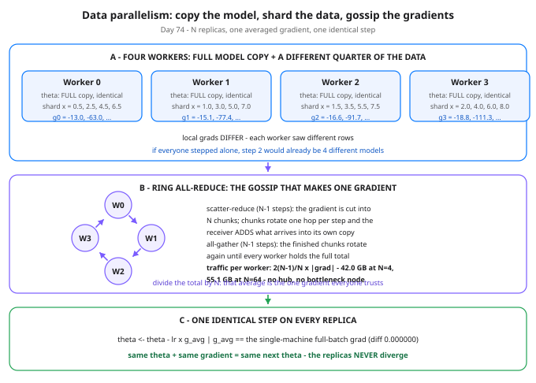

# Day 74 — Data Parallelism: The Straightforward Scale-Out

**Tonight you'll be able to:** explain how N identical copies of one model train on N different shards of data as if they were a single machine — replicate theta, shard the rows, all-reduce the gradients, step as one — and price the sync for any model size and any N.

## The one idea

Yesterday's wall was memory: a real training state doesn't fit on one GPU. Tonight's move is the simple one, and it comes first because it's the one you'll reach for most: **don't split the model — copy it.** Every worker (one GPU, one process — in framework-speak, one *rank*) holds the complete, identical theta. What gets divided is the *data*: the dataset is sharded into N disjoint pieces, one per worker — the same sharding instinct you'd apply to any table that outgrows one node.


Each worker then runs the ordinary Day 7 loop on its own shard: forward, loss, backward — producing a **local gradient**. Local gradients differ, because the shards differ. And here is the trap the whole design exists to avoid: if each worker stepped on its own gradient, the copies would drift apart immediately — by step 2 you no longer have one model training faster, you have N different models training separately. Replicas that diverge are worthless: which one do you ship?


So nobody steps alone. Once per step, the workers run an **all-reduce**: a collective operation that sums a vector across all workers and hands the *total* back to *every* worker. Divide by N and every replica holds the same averaged gradient; apply it to the same theta and every replica lands on the same next theta. Same state + same input → same next state, forever. And it is not an approximation: when the shards are equal-sized, the average of the shard gradients is *exactly* the gradient one machine would compute on the whole batch — Part 3 proves it to 0.000000. Data parallelism is big-batch training; the distribution is an implementation detail.


The sync is also the entire cost, so price it honestly. The naive design — everyone sends gradients to one hub, the hub averages and broadcasts back — funnels N gradient-sized messages through one node's link: for a 7B model in fp32 (one gradient = 28 GB), a hub at N=64 must receive and resend 3,584 GB per step. The **ring all-reduce** removes the hub: cut the gradient into N chunks, line the workers in a ring, and rotate. Phase 1, *scatter-reduce*: chunks hop neighbour to neighbour, each receiver adding what arrives into its own copy, until each worker holds one fully-summed chunk. Phase 2, *all-gather*: the finished chunks rotate again until everyone has all of them. Total traffic per worker: **2(N−1)/N × gradient size** — one visual bite: 42.0 GB at N=4, 55.1 GB at N=64, 55.9 GB at N=1024. It asymptotes at two gradient sizes and never grows past it — and the dataset size appears nowhere in the formula: the bill is set by the model, so *larger shards make the sync relatively cheaper*, because each sync buys more compute.


Two honest footnotes, one line each. The step is a **barrier**: the fastest worker waits for the slowest, so one straggler sets the step time and one dead worker stalls the whole run (surviving that is a later day's topic). And data parallelism has a hard precondition: the model, plus its Day 73 training state, must *fit* on one worker — when it doesn't, copying stops working, and that's tomorrow. In practice you rarely write the ring yourself: PyTorch's `DistributedDataParallel` and the NCCL library run exactly this protocol under the hood, overlapping the gossip with `backward()` so much of the sync hides behind compute.

## Analogy

You already know this protocol — it's **state-machine replication** wearing a GPU costume. Raft replicas stay identical because they apply the same log entries in the same order; here the "log entry" is the averaged gradient, and instead of a leader broadcasting it, the replicas *gossip* it into existence with all-reduce: all-reduce = gossip that ends with everyone holding the same aggregate and applying the same state transition. The shard side is just as familiar: each worker's local gradient is a *partial aggregate* over its shard, like a distributed SUM with combiners pushed down to the leaves.

Trading version, one line: four analysts each mark a quarter of the book — the desk's risk number exists only after the partials are summed and handed back to everyone, and anyone trading on their own partial is trading on a fiction.

## See it



Top: four identical theta copies, four different data shards, four different local gradients — divergence waiting to happen. Middle: the ring all-reduce — chunks rotate twice (scatter-reduce, then all-gather) and every worker ends holding the same summed gradient, at a per-worker cost capped near two gradient sizes at any N. Bottom: one averaged gradient and one identical step, so the replicas can never diverge.

## Code it (~30 min)

One process plays all four workers — no torch, no cluster, pure Python stdlib — so the ring is code you read, not a library call you trust. The model is Day 7's regression with a 4-wide feature vector (phi = [1, x, x²/8, x³/64]), making the gradient a 4-vector: one chunk per worker. **Part 1** is the single-machine reference step. **Part 2** shards the 16 points four ways and computes four different local gradients from the same theta0. **Part 3** runs the ring on those gradients — every send printed — then averages, steps, and diffs against Part 1. **Part 4** prices the sync at 7B parameters. The data is built by a formula in dyadic fractions, so the equality proofs are exact: watch for `0.000000`, not ≈0.

```python
"""Day 74 - Data Parallelism: The Straightforward Scale-Out.

Day 73's problem was one GPU that cannot hold training. Tonight's
first scale-out move: do NOT split the model. Copy the whole
model onto N workers and split the DATA instead.

  Part 1  The reference: Day 7's linear-regression gradient on
          the full dataset, one machine, one step.
  Part 2  Four simulated workers in one process. Each gets a
          quarter of the data (equal shards) and computes its
          own local gradient from the SAME starting theta.
          No worker steps yet - stepping alone would give
          four different models.
  Part 3  The ring all-reduce, watched step by step: the
          gradient is a 4-vector, so each worker owns one
          chunk. Scatter-reduce rotates chunks and adds
          partial sums; all-gather rotates the finished
          chunks until every worker holds the total. Average
          it, step with it, and prove the result is EXACTLY
          the single-machine step from Part 1.
  Part 4  The comm math for a 7B-parameter model in fp32:
          ring traffic per worker, and why it barely grows
          from N=4 to N=1024 - while the hub design blows up.

Pure Python stdlib, deterministic data built by a formula, no
RNG, no downloads, no paid APIs. Runs anywhere, including
the ~/ai-lab venv on a MacBook. One process plays all four
workers so you can watch the algorithm instead of a library
call hiding it.

Expected output:

  Part 1 - one machine, full batch (Day 7's gradient)
    theta0 = 0.500000, 0.250000, 0.000000, 0.000000
    full-batch grad = -15.875000, -85.828125, -65.891602, -54.102722
    after one step (lr 0.05) = 1.293750, 4.541406, 3.294580, 2.705136
  Part 2 - four workers, one data shard each, same theta0
    worker 0: shard x = 0.5, 2.5, 4.5, 6.5  local grad = -13.000000, -63.000000, -43.343750, -31.617188
    worker 1: shard x = 1.0, 3.0, 5.0, 7.0  local grad = -15.125000, -77.375000, -56.890625, -44.615234
    worker 2: shard x = 1.5, 3.5, 5.5, 7.5  local grad = -16.625000, -91.687500, -71.144531, -58.881592
    worker 3: shard x = 2.0, 4.0, 6.0, 8.0  local grad = -18.750000, -111.250000, -92.187500, -81.296875
    average of local grads = -15.875000, -85.828125, -65.891602, -54.102722
    diff vs full-batch grad = 0.000000
  Part 3 - ring all-reduce on the local gradients
    scatter-reduce 1/3: sends W0:c0  W1:c1  W2:c2  W3:c3 (receiver adds)
    scatter-reduce 2/3: sends W0:c3  W1:c0  W2:c1  W3:c2 (receiver adds)
    scatter-reduce 3/3: sends W0:c2  W1:c3  W2:c0  W3:c1 (receiver adds)
    after scatter-reduce, finished chunks live at: chunk 0 on W3, chunk 1 on W0, chunk 2 on W1, chunk 3 on W2
    all-gather 1/3: sends W0:c1  W1:c2  W2:c3  W3:c0 (receiver overwrites)
    all-gather 2/3: sends W0:c0  W1:c1  W2:c2  W3:c3 (receiver overwrites)
    all-gather 3/3: sends W0:c3  W1:c0  W2:c1  W3:c2 (receiver overwrites)
    every worker now holds the total sum:
      W0 = -63.500000, -343.312500, -263.566406, -216.410889
    all four workers identical: True
    averaged grad (sum / 4) = -15.875000, -85.828125, -65.891602, -54.102722
    diff vs full-batch grad = 0.000000
    after one step = 1.293750, 4.541406, 3.294580, 2.705136
    diff vs single-machine step = 0.000000
    verdict: same theta0 + same averaged grad = same step, on every replica - the replicas never diverge
  Part 4 - what the sync costs at 7B parameters (fp32)
    one gradient = 7,000,000,000 params x 4 bytes = 28.0 GB
    ring traffic per worker = 2(N-1)/N x grad size, 2(N-1) steps:
      N=4     ring: 42.0 GB/worker/step, 6 steps
      N=64    ring: 55.1 GB/worker/step, 126 steps
      N=1024  ring: 55.9 GB/worker/step, 2046 steps
    hub (parameter server) at N=64: one node must receive and resend 3,584 GB/step through a single link
    at 50 GB/s effective, the N=64 ring sync takes 1.10 s per step - and note
    the shard size never appears: sync cost depends on the
    MODEL size only, so bigger shards (more compute per
    step) make the sync relatively cheaper, not dearer
    one-line failure note: the step is a barrier - the
    slowest worker sets the step time, and one dead
    worker stalls the whole run (Day 78: checkpointing)
"""


def features(x):
    """A 4-wide feature vector so the gradient is a 4-vector.

    phi = [1, x, x^2/8, x^3/64]. Day 7's gradient formula is
    unchanged: dL/dtheta_j = mean(2 * err * phi_j). One feature
    would give a 1-vector and the ring would have nothing to
    chunk; four features give one chunk per worker.
    """
    return [1.0, x, x * x / 8.0, x * x * x / 64.0]


def predict(theta, phi):
    return sum(t * p for t, p in zip(theta, phi))


def gradient(theta, points):
    """Full-batch MSE gradient over a list of (x, y) points."""
    n = len(points)
    sums = [0.0, 0.0, 0.0, 0.0]
    for x, y in points:
        err = predict(theta, features(x)) - y
        for j, p in enumerate(features(x)):
            sums[j] += 2.0 * err * p
    return [s / n for s in sums]


def fmt(vec):
    return ", ".join(f"{v:.6f}" for v in vec)


# Deterministic data, built by a formula. x runs 0.5..8.0, the
# true line is y = 1 + 2x, and the noise is a small sawtooth.
# Every number is a dyadic fraction, so the arithmetic below
# is exact - the equality proofs in Part 3 print 0.0, not ~0.
POINTS = []
for i in range(1, 17):
    x = 0.5 * i
    noise = ((i * 7) % 5 - 2) * 0.25
    POINTS.append((x, 1.0 + 2.0 * x + noise))

THETA0 = [0.5, 0.25, 0.0, 0.0]
LR = 0.05
N_WORKERS = 4

# ---------- Part 1: the single-machine reference ----------
print("Part 1 - one machine, full batch (Day 7's gradient)")
full_grad = gradient(THETA0, POINTS)
theta_ref = [t - LR * g for t, g in zip(THETA0, full_grad)]
print(f"  theta0 = {fmt(THETA0)}")
print(f"  full-batch grad = {fmt(full_grad)}")
print(f"  after one step (lr 0.05) = {fmt(theta_ref)}")

# ---------- Part 2: four workers, four equal data shards ----------
print("Part 2 - four workers, one data shard each, same theta0")
shards = [POINTS[i::N_WORKERS] for i in range(N_WORKERS)]
# NB: POINTS[i::4] gives 4-point shards; equal sizes are what
# make "average of shard gradients" equal "gradient of all data".
local_grads = []
for r, shard in enumerate(shards):
    g = gradient(THETA0, shard)
    local_grads.append(g)
    print(f"  worker {r}: shard x = "
          f"{', '.join(f'{x:.1f}' for x, _ in shard)}  "
          f"local grad = {fmt(g)}")
naive_avg = [sum(g[j] for g in local_grads) / N_WORKERS
             for j in range(4)]
print(f"  average of local grads = {fmt(naive_avg)}")
print(f"  diff vs full-batch grad = "
      f"{max(abs(a - b) for a, b in zip(naive_avg, full_grad)):.6f}")

# ---------- Part 3: the ring all-reduce, step by step ----------
print("Part 3 - ring all-reduce on the local gradients")


def ring_allreduce(vectors):
    """Sum N vectors with the ring algorithm. Each vector has
    N elements, so worker r owns chunk r (one element here).
    Scatter-reduce: chunks rotate one hop per step and the
    receiver adds the incoming chunk into its copy. After
    N-1 steps each worker holds exactly one finished chunk.
    All-gather: finished chunks rotate until every worker
    holds all of them. Returns the summed vectors plus a
    human-readable trace of every step."""
    n = len(vectors)
    work = [list(v) for v in vectors]
    trace = []
    # Scatter-reduce.
    for step in range(n - 1):
        sends = []
        for r in range(n):
            send_chunk = (r - step) % n
            recv_chunk = (r - step - 1) % n
            sends.append((r, send_chunk, recv_chunk))
        # Apply the step: worker r receives chunk recv_chunk
        # from worker (r-1) and adds it into its own copy.
        new = [list(v) for v in work]
        for r, send_chunk, recv_chunk in sends:
            src = (r - 1) % n
            new[r][recv_chunk] += work[src][recv_chunk]
        work = new
        desc = "  ".join(f"W{r}:c{c}" for r, c, _ in sends)
        trace.append(f"  scatter-reduce {step + 1}/{n - 1}: "
                     f"sends {desc} (receiver adds)")
    # Who owns which finished chunk now? Check against the
    # naive total instead of trusting the textbook diagram.
    total = [sum(v[j] for v in vectors) for j in range(n)]
    owners = []
    for j in range(n):
        owner = next(r for r in range(n) if work[r][j] == total[j]
                     and all(work[r][k] != total[k] or k == j
                             for k in range(n)))
        owners.append(owner)
    trace.append("  after scatter-reduce, finished chunks live at: "
                 + ", ".join(f"chunk {j} on W{owners[j]}"
                             for j in range(n)))
    # All-gather.
    for step in range(n - 1):
        sends = []
        for r in range(n):
            send_chunk = (r - step + 1) % n
            recv_chunk = (r - step) % n
            sends.append((r, send_chunk, recv_chunk))
        new = [list(v) for v in work]
        for r, send_chunk, recv_chunk in sends:
            src = (r - 1) % n
            new[r][recv_chunk] = work[src][recv_chunk]
        work = new
        desc = "  ".join(f"W{r}:c{c}" for r, c, _ in sends)
        trace.append(f"  all-gather {step + 1}/{n - 1}: "
                     f"sends {desc} (receiver overwrites)")
    return work, trace, total


summed, trace, naive_total = ring_allreduce(local_grads)
for line in trace:
    print(line)
print(f"  every worker now holds the total sum:")
print(f"    W0 = {fmt(summed[0])}")
identical = all(v == summed[0] for v in summed)
print(f"  all four workers identical: {identical}")
ring_avg = [v / N_WORKERS for v in summed[0]]
theta_ring = [t - LR * g for t, g in zip(THETA0, ring_avg)]
print(f"  averaged grad (sum / 4) = {fmt(ring_avg)}")
print(f"  diff vs full-batch grad = "
      f"{max(abs(a - b) for a, b in zip(ring_avg, full_grad)):.6f}")
print(f"  after one step = {fmt(theta_ring)}")
print(f"  diff vs single-machine step = "
      f"{max(abs(a - b) for a, b in zip(theta_ring, theta_ref)):.6f}")
print("  verdict: same theta0 + same averaged grad = same step, "
      "on every replica - the replicas never diverge")

# ---------- Part 4: comm math for a 7B model, fp32 ----------
print("Part 4 - what the sync costs at 7B parameters (fp32)")
params = 7_000_000_000
grad_gb = params * 4 / 1e9
print(f"  one gradient = {params:,} params x 4 bytes = {grad_gb:.1f} GB")
print("  ring traffic per worker = 2(N-1)/N x grad size, "
      "2(N-1) steps:")
for n in (4, 64, 1024):
    traffic = 2 * (n - 1) / n * grad_gb
    print(f"    N={n:<5} ring: {traffic:.1f} GB/worker/step, "
          f"{2 * (n - 1)} steps")
hub_gb = 64 * grad_gb * 2
print(f"  hub (parameter server) at N=64: one node must receive "
      f"and resend {hub_gb:,.0f} GB/step through a single link")
print(f"  at 50 GB/s effective, the N=64 ring sync takes "
      f"{2 * 63 / 64 * grad_gb / 50:.2f} s per step - and note")
print("  the shard size never appears: sync cost depends on the")
print("  MODEL size only, so bigger shards (more compute per")
print("  step) make the sync relatively cheaper, not dearer")
print("  one-line failure note: the step is a barrier - the")
print("  slowest worker sets the step time, and one dead")
print("  worker stalls the whole run (Day 78: checkpointing)")
```

**Expected output:**

```
Part 1 - one machine, full batch (Day 7's gradient)
  theta0 = 0.500000, 0.250000, 0.000000, 0.000000
  full-batch grad = -15.875000, -85.828125, -65.891602, -54.102722
  after one step (lr 0.05) = 1.293750, 4.541406, 3.294580, 2.705136
Part 2 - four workers, one data shard each, same theta0
  worker 0: shard x = 0.5, 2.5, 4.5, 6.5  local grad = -13.000000, -63.000000, -43.343750, -31.617188
  worker 1: shard x = 1.0, 3.0, 5.0, 7.0  local grad = -15.125000, -77.375000, -56.890625, -44.615234
  worker 2: shard x = 1.5, 3.5, 5.5, 7.5  local grad = -16.625000, -91.687500, -71.144531, -58.881592
  worker 3: shard x = 2.0, 4.0, 6.0, 8.0  local grad = -18.750000, -111.250000, -92.187500, -81.296875
  average of local grads = -15.875000, -85.828125, -65.891602, -54.102722
  diff vs full-batch grad = 0.000000
Part 3 - ring all-reduce on the local gradients
  scatter-reduce 1/3: sends W0:c0  W1:c1  W2:c2  W3:c3 (receiver adds)
  scatter-reduce 2/3: sends W0:c3  W1:c0  W2:c1  W3:c2 (receiver adds)
  scatter-reduce 3/3: sends W0:c2  W1:c3  W2:c0  W3:c1 (receiver adds)
  after scatter-reduce, finished chunks live at: chunk 0 on W3, chunk 1 on W0, chunk 2 on W1, chunk 3 on W2
  all-gather 1/3: sends W0:c1  W1:c2  W2:c3  W3:c0 (receiver overwrites)
  all-gather 2/3: sends W0:c0  W1:c1  W2:c2  W3:c3 (receiver overwrites)
  all-gather 3/3: sends W0:c3  W1:c0  W2:c1  W3:c2 (receiver overwrites)
  every worker now holds the total sum:
    W0 = -63.500000, -343.312500, -263.566406, -216.410889
  all four workers identical: True
  averaged grad (sum / 4) = -15.875000, -85.828125, -65.891602, -54.102722
  diff vs full-batch grad = 0.000000
  after one step = 1.293750, 4.541406, 3.294580, 2.705136
  diff vs single-machine step = 0.000000
  verdict: same theta0 + same averaged grad = same step, on every replica - the replicas never diverge
Part 4 - what the sync costs at 7B parameters (fp32)
  one gradient = 7,000,000,000 params x 4 bytes = 28.0 GB
  ring traffic per worker = 2(N-1)/N x grad size, 2(N-1) steps:
    N=4     ring: 42.0 GB/worker/step, 6 steps
    N=64    ring: 55.1 GB/worker/step, 126 steps
    N=1024  ring: 55.9 GB/worker/step, 2046 steps
  hub (parameter server) at N=64: one node must receive and resend 3,584 GB/step through a single link
  at 50 GB/s effective, the N=64 ring sync takes 1.10 s per step - and note
  the shard size never appears: sync cost depends on the
  MODEL size only, so bigger shards (more compute per
  step) make the sync relatively cheaper, not dearer
  one-line failure note: the step is a barrier - the
  slowest worker sets the step time, and one dead
  worker stalls the whole run (Day 78: checkpointing)
```

## Today's win

Done when your Part 3 prints `all four workers identical: True` and both diffs read `0.000000` — four simulated workers stepped to exactly the single-machine theta. The keeper test, no notes allowed: someone says "7B model, fp32, 64 GPUs, data parallel" and you answer "each GPU moves about 55 GB per step in the sync, and doubling the dataset changes that number by zero." Name the precondition too — the model must fit on one worker — and you own the concept.

## Short on time? 20-minute version

Read "The one idea", then study the ring panel until you can sketch scatter-reduce vs all-gather from memory. Run the code and look only at Part 3's trace, its two `0.000000` lines, and Part 4's three-row table. The rest is confirmation.

## Tomorrow's teaser

Tomorrow: data parallelism dies the moment the model itself doesn't fit on one worker. So we split the model — and the moment you do, the workers stop being copies of each other and start being stages of one machine.

Streak: 74 day(s) · Never miss twice.
